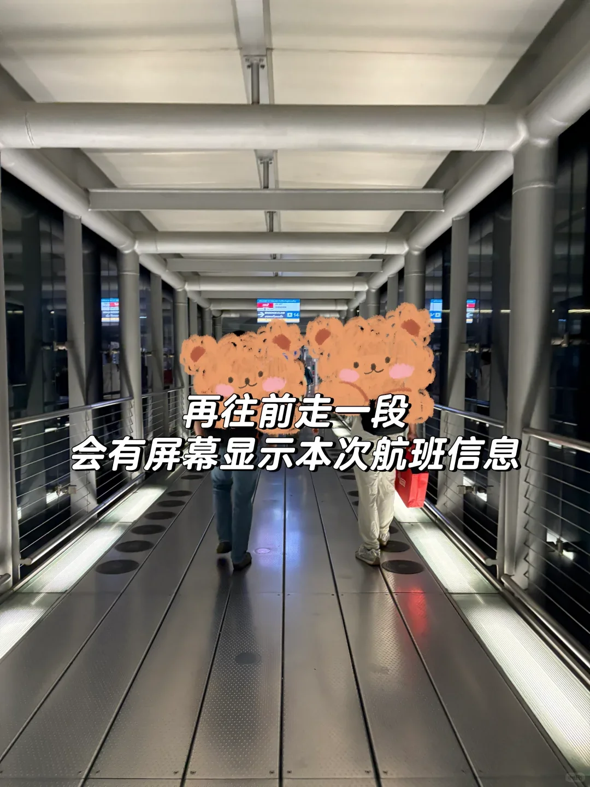
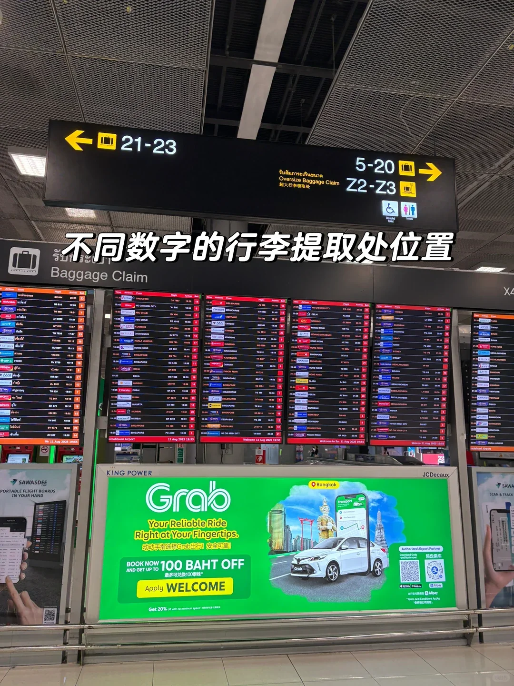

Als je voor het eerst op Suvarnabhumi landt, is de zorg dat je niet weet welke kant je op moet lopen. Deze gids splitst de hele route voor internationale aankomst op in één foto per stap, zodat je die gewoon kunt volgen — handig voor een oudere reiziger die alleen vliegt, of voor de familie die buiten wacht.

## De route in één regel

**Uit het vliegtuig → slurf of bus → volg de borden "Arrivals" → immigratie → bagageband → Exit → openbare hal**

> De bewegwijzering op Suvarnabhumi is uitstekend, en **de belangrijkste borden zijn naast Thais en Engels ook in het Chinees**, dus je zult onderweg niet verdwalen.

## Stap voor stap

### 1. Volg de menigte van het vliegtuig

Je verlaat het vliegtuig meestal via een slurf, en er is maar één route — volg gewoon iedereen.

### 2. Blijf lopen en let op het vluchtscherm

Even verderop hangt een scherm met je vlucht.

Het toont **je vluchtnummer, de stad waar je vandaan komt en je bagageband** (nummer 14 op de foto hieronder). Noteer je nummer.

### 3. Zoek het zwarte bord "Arrivals"

Zodra je uit de slurf bent, kom je bij de borden. Zoek het **zwarte vak met "Arrivals" (旅客到达)** — dat staat meestal bovenaan het bord — en ga die kant op (ongeveer 190 meter).

Onderweg kom je langs roltrappen en lopende banden; blijf gewoon "Arrivals" volgen.

### 4. Dien de TDAC-aankomstkaart in voor de immigratie

Thailand gebruikt nu de **digitale aankomstkaart TDAC (Thailand Digital Arrival Card)**, die online **moet worden ingevuld voordat je bij de immigratie bent**, op [tdac.immigration.go.th](https://tdac.immigration.go.th).

Er staat een groot informatiebord langs de looproute. Als de reiziger geen Engels leest, kan een jonger familielid het vooraf op een telefoon invullen en een screenshot van de QR-code bewaren.

### 5. Sla bij de splitsing linksaf naar de douane

Dit grote bord markeert de splitsing: "Arrivals" naar links, en Connecting Flights en de Transfers Desk naar rechts. Passagiers die de stad in gaan, **slaan hier linksaf** en lopen door naar het douanegebied.

### 6. Immigratie: neem de rij voor buitenlandse paspoorten

Sluit je in het douanegebied aan bij de rij **Foreign Passport**. **Binnen is fotograferen niet toegestaan** — berg je telefoon op.

Houd deze klaar:

- **Je terugvliegticket** (of een doorreisroute)
- **Je hotelboeking**
- **Contant geld:** de Thaise immigratie kan je middelen steekproefsgewijs controleren — ongeveer 10.000 baht per persoon, 20.000 baht per gezin

Als je papieren in orde zijn, wordt je meestal niets meer gevraagd. Als je het Engels niet volgt, laat dan de vertaling op je telefoon aan de beambte zien.

### 7. Haal je bagage op

Voorbij de douane ligt de bagagehal. Kijk omhoog naar de borden en zoek je bagagebandnummer.

Heb je bagage ingecheckt, wacht dan bij de band met jouw nummer; **heb je geen ruimbagage, loop dan rechtdoor naar de uitgang**.

### 8. Zoek je exitletter en stap de openbare hal in

De uitgangen hebben letters (A, B, C enzovoort) en ze komen allemaal uit op dezelfde openbare looproute.

Buiten is de openbare hal, waar de pilaar of het bord boven je hoofd aangeeft **bij welk poortnummer je staat** (poort 5 hieronder). Het is de makkelijkste plek om familie of vrienden te ontmoeten — of om meteen door te lopen naar een taxi of de Airport Rail Link.

## Als je iemand ophaalt

- Vraag de aankomende reiziger **het bagagebandnummer en de exitletter te noteren** — met die twee gegevens kun je hem of haar vinden.
- De aankomstverdieping van Suvarnabhumi heeft meerdere uitgangssecties, dus **"poort 5" afspreken werkt beter dan "de uitgang" afspreken**.
- Van landing tot het betreden van de openbare hal duurt normaal **45–75 minuten**, inclusief immigratie en bagage. Reken wat extra tijd als je iemand gaat ophalen.
