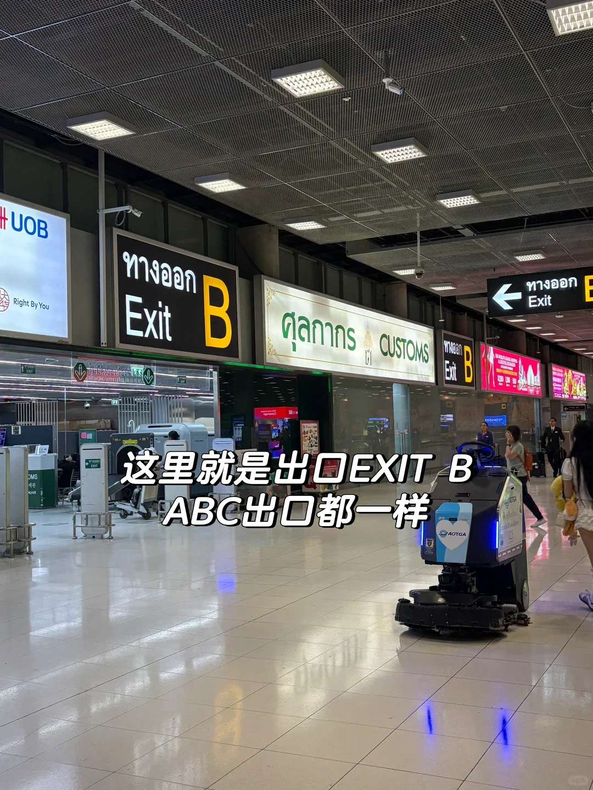

Wysiadając po raz pierwszy na Suvarnabhumi, człowiek martwi się, że nie wie, w którą stronę iść. Ten przewodnik dzieli całą trasę przylotów międzynarodowych na jedno zdjęcie na krok, żeby po prostu za nim iść — przydatny dla starszego podróżnego lecącego samemu albo dla rodziny czekającej na zewnątrz.

## Trasa w jednej linii

**Z samolotu → rękaw lub autobus → za znakami „Arrivals” → kontrola paszportowa → odbiór bagażu → wyjście → strefa ogólnodostępna**

> Oznakowanie na Suvarnabhumi jest znakomite, a **główne znaki mają chiński obok tajskiego i angielskiego**, więc nie powinieneś się zgubić po drodze.

## Krok po kroku

### 1. Idź za tłumem wysiadającym z samolotu

Zwykle wychodzi się przez rękaw, a droga jest tylko jedna — po prostu idź za wszystkimi.

### 2. Idź dalej i wypatruj ekranu lotu

Nieco dalej jest ekran pokazujący twój lot.

Pokazuje **numer twojego lotu, miasto, z którego przyleciałeś, i twoją taśmę bagażową** (numer 14 na zdjęciu poniżej). Zapisz swój numer.

### 3. Szukaj czarnego znaku „Arrivals”

Gdy wyjdziesz z rękawa, dojdziesz do znaków. Szukaj **czarnego panelu z napisem „Arrivals” (旅客到达)** — zwykle jest na górze tablicy — i ruszaj w tym kierunku (około 190 metrów).

Po drodze mijasz schody ruchome i chodniki ruchome; po prostu trzymaj się znaków „Arrivals”.

### 4. Złóż kartę przylotu TDAC przed kontrolą paszportową

Tajlandia korzysta teraz z **cyfrowej karty przylotu TDAC (Thailand Digital Arrival Card)**, którą trzeba wypełnić online **przed dotarciem do kontroli paszportowej**, na stronie [tdac.immigration.go.th](https://tdac.immigration.go.th).

Na korytarzu stoi duża tablica informacyjna. Jeśli podróżny nie czyta po angielsku, młodszy krewny może wypełnić ją wcześniej na telefonie i zapisać zrzut ekranu kodu QR.

### 5. Na rozgałęzieniu skręć w lewo do odprawy celnej

Ten duży znak oznacza rozgałęzienie: „Arrivals” w lewo, a loty łączone i stanowisko transferów w prawo. Pasażerowie jadący do miasta **skręcają tutaj w lewo** i przechodzą do strefy celnej.

### 6. Kontrola paszportowa: wybierz pas dla zagranicznych paszportów

W strefie celnej ustaw się w kolejce **Foreign Passport**. **W środku nie wolno robić zdjęć** — schowaj telefon.

Miej przygotowane:

- **Bilet powrotny** (lub dalszy plan podróży)
- **Rezerwację hotelu**
- **Gotówkę:** tajlandzka kontrola może sprawdzić środki — około 10 000 bahtów na osobę, 20 000 bahtów na rodzinę

Jeśli dokumenty są w porządku, zwykle nie pytają o nic więcej. Jeśli nie nadążasz za angielskim, pokaż funkcjonariuszowi tłumaczenie na telefonie.

### 7. Odbierz bagaż

Za odprawą celną jest hala odbioru bagażu. Spójrz na znaki i znajdź numer swojej taśmy.

Jeśli oddawałeś bagaż, czekaj przy taśmie z twoim numerem; **jeśli nie masz bagażu rejestrowanego, idź prosto w stronę wyjścia**.

### 8. Znajdź literę wyjścia i wejdź do strefy ogólnodostępnej

Wyjścia są oznaczone literami (A, B, C i tak dalej), a każde prowadzi na ten sam ogólnodostępny korytarz.

Na zewnątrz jest strefa ogólnodostępna, gdzie filar lub znak nad głową mówi, **przy której bramce jesteś** (bramka 5 poniżej). To najłatwiejsze miejsce na spotkanie z rodziną lub znajomymi — albo na przejście prosto do taksówki lub kolejki Airport Rail Link.

## Jeśli kogoś odbierasz

- Poproś przylatującego, by **zanotował numer taśmy i literę wyjścia** — z tymi dwiema informacjami go znajdziesz.
- Poziom przylotów na Suvarnabhumi ma kilka stref wyjścia, więc **umówienie się na „bramkę 5” jest lepsze niż umawianie się „przy wyjściu”**.
- Od lądowania do wejścia do strefy ogólnodostępnej mija zwykle **45–75 minut**, łącznie z kontrolą paszportową i bagażem. Daj sobie trochę zapasu, gdy wybierasz się po kogoś.
