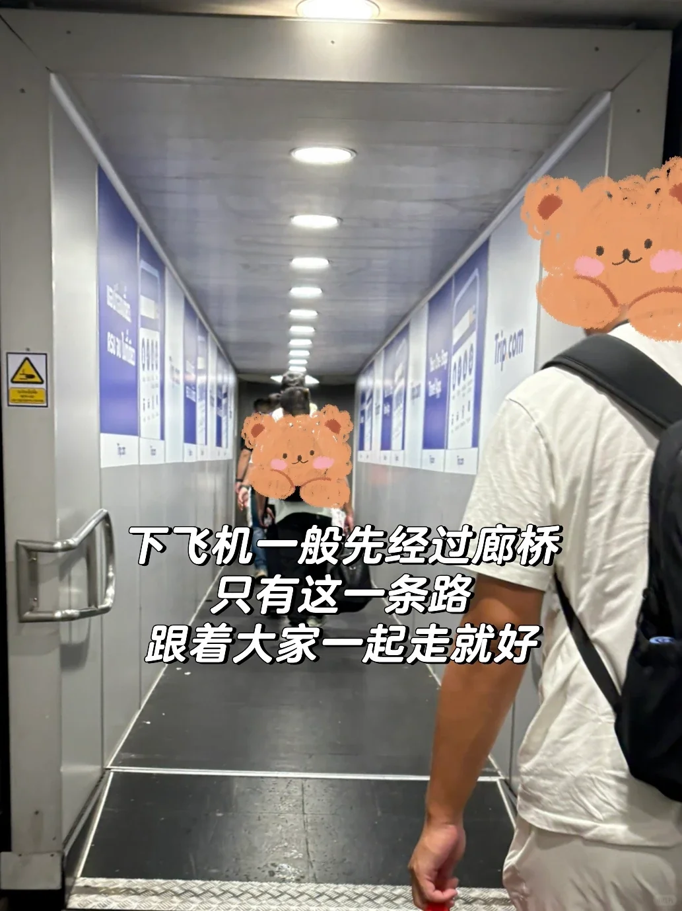
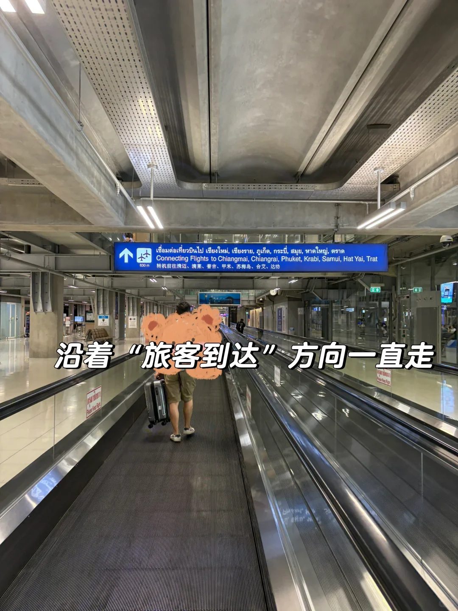

Pousando em Suvarnabhumi pela primeira vez, a preocupação é não saber para que lado andar. Este guia divide todo o trajeto de desembarque internacional em uma foto por passo, para você simplesmente segui-lo — útil para um viajante mais velho voando sozinho ou para a família que espera lá fora.

## A rota em uma linha

**Sair do avião → ponte de embarque ou ônibus → seguir as placas de “Arrivals” → imigração → retirada de bagagem → saída → área pública**

> A sinalização de Suvarnabhumi é excelente, e **as principais placas trazem chinês, além de tailandês e inglês**, então você não deve se perder no caminho.

## Passo a passo

### 1. Siga a multidão ao sair do avião

Normalmente você sai por uma ponte de embarque, e há apenas um caminho — basta seguir todo mundo.

### 2. Continue andando e observe a tela do voo

Um pouco mais adiante há uma tela mostrando o seu voo.

Ela mostra **o número do seu voo, a cidade de onde você veio e a sua esteira de bagagem** (número 14 na foto abaixo). Anote o seu número.

### 3. Procure a placa preta de “Arrivals”

Assim que você sair da ponte de embarque, chega às placas. Procure o **painel preto escrito “Arrivals” (旅客到达)** — ele geralmente fica no topo do quadro — e siga naquela direção (cerca de 190 metros).

Você passa por escadas rolantes e esteiras de caminhada no caminho; é só continuar seguindo “Arrivals”.

### 4. Envie o cartão de chegada TDAC antes da imigração

A Tailândia agora usa o **cartão de chegada digital, TDAC (Thailand Digital Arrival Card)**, que deve ser preenchido on-line **antes de você chegar à imigração**, em [tdac.immigration.go.th](https://tdac.immigration.go.th).

Há um grande quadro de avisos na passarela. Se o viajante não lê inglês, um parente mais jovem pode preenchê-lo no celular com antecedência e salvar uma captura de tela do código QR.

### 5. Vire à esquerda na bifurcação, para a alfândega

Esta grande placa marca a bifurcação: “Arrivals” à esquerda, e Voos de Conexão e o Balcão de Trânsito à direita. Os passageiros que vão para a cidade **viram à esquerda aqui** e seguem para a área da alfândega.

### 6. Imigração: pegue a fila de passaporte estrangeiro

Na área da alfândega, entre na fila de **Foreign Passport**. **Não é permitido fotografar lá dentro** — guarde o celular.

Tenha estes documentos à mão:

- **Sua passagem de volta** (ou um itinerário de continuação)
- **Sua reserva de hotel**
- **Dinheiro:** a imigração tailandesa pode fazer uma verificação de fundos — cerca de 10.000 baht por pessoa, 20.000 baht por família

Se a sua papelada estiver em ordem, geralmente não perguntam mais nada. Se você não acompanha o inglês, mostre a tradução do celular ao agente.

### 7. Retire sua bagagem

Depois da alfândega fica o salão de retirada de bagagem. Olhe para as placas e encontre o número da sua esteira.

Se você despachou uma mala, espere na esteira com o seu número; **se não tem bagagem despachada, siga direto para a saída**.

### 8. Encontre a letra da sua saída e entre na área pública

As saídas são identificadas por letras (A, B, C e assim por diante), e qualquer uma delas leva à mesma passarela pública.

Lá fora é a área pública, onde o pilar ou a placa suspensa informa **em qual número de portão você está** (portão 5 abaixo). É o lugar mais fácil para encontrar a família ou os amigos — ou para seguir direto para um táxi ou para o Airport Rail Link.

## Se você vai encontrar alguém

- Peça ao viajante que chega para **anotar o número da esteira e a letra da saída** — com esses dois detalhes você consegue localizá-lo.
- O nível de desembarque de Suvarnabhumi tem várias seções de saída, então **combinar “portão 5” é melhor do que combinar “a saída”**.
- Do pouso até entrar na área pública normalmente leva **45–75 minutos**, incluindo imigração e bagagem. Deixe uma pequena folga quando sair para buscar alguém.
