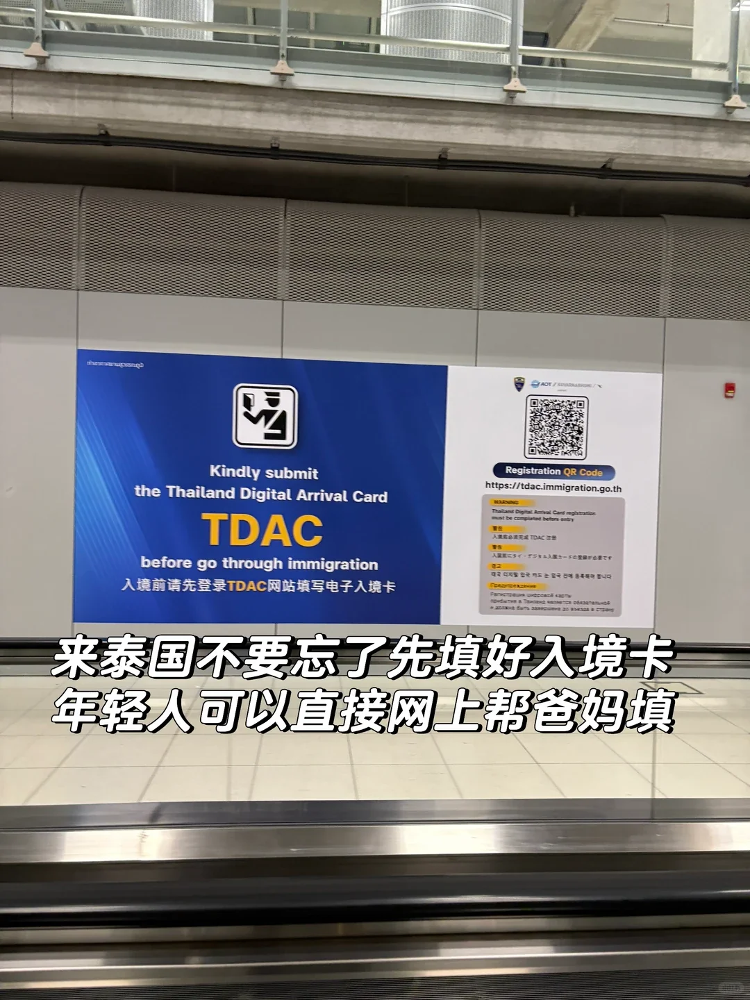

Aterizând la Suvarnabhumi pentru prima dată, grija este să nu știi încotro să mergi. Acest ghid împarte întregul traseu al sosirilor internaționale într-o imagine pe pas, așa că poți pur și simplu să îl urmezi — util pentru un călător în vârstă care zboară singur sau pentru familia care așteaptă afară.

## Traseul într-o singură linie

**Coborârea din avion → pasarelă telescopică sau autobuz → urmează semnele „Arrivals” → control pașapoarte → banda de bagaje → Exit → zona publică**

> Semnalistica de la Suvarnabhumi este excelentă, iar **semnele principale au și chineză, pe lângă thai și engleză**, așa că nu ar trebui să te rătăcești pe drum.

## Pas cu pas

### 1. Urmează mulțimea la coborârea din avion

De obicei cobori prin pasarelă telescopică și există o singură rută — urmează-i pur și simplu pe toți ceilalți.

### 2. Continuă și fii atent la ecranul zborurilor

Puțin mai departe este un ecran care arată zborul tău.

Acesta arată **numărul zborului tău, orașul din care ai venit și banda de bagaje** (numărul 14 în fotografia de mai jos). Notează-ți numărul.

### 3. Caută semnul negru „Arrivals”

După ce ieși din pasarela telescopică ajungi la semne. Caută **panoul negru cu inscripția „Arrivals” (旅客到达)** — de obicei stă în partea de sus a panoului — și pornește în acea direcție (aproximativ 190 de metri).

Pe drum treci pe lângă scări rulante și benzi transportoare; continuă să urmezi „Arrivals”.

### 4. Trimite cardul de sosire TDAC înainte de controlul pașapoartelor

Thailanda folosește acum **cardul digital de sosire, TDAC (Thailand Digital Arrival Card)**, care trebuie completat online **înainte de a ajunge la controlul pașapoartelor**, la [tdac.immigration.go.th](https://tdac.immigration.go.th).

Pe pasarelă există un panou mare de anunțuri. Dacă călătorul nu citește engleză, o rudă mai tânără îl poate completa de pe telefon în avans și poate salva o captură de ecran cu codul QR.

### 5. Coteste la stânga la intersecție, spre vamă

Acest semn mare marchează intersecția: „Arrivals” la stânga, iar Connecting Flights și Transfers Desk la dreapta. Pasagerii care merg în oraș **cotesc la stânga aici** și trec în zona vamală.

### 6. Controlul pașapoartelor: ia culoarul pentru pașapoarte străine

În zona vamală, alătură-te cozii **Foreign Passport**. **Fotografierea nu este permisă înăuntru** — pune telefonul deoparte.

Ai pregătite:

- **Biletul de întoarcere** (sau un itinerariu de continuare)
- **Rezervarea hotelului**
- **Numerar:** imigrarea thailandeză poate verifica fondurile — în jur de 10.000 de baht de persoană, 20.000 de baht de familie

Dacă actele sunt în ordine, de obicei nu ți se mai cere nimic. Dacă nu urmărești engleza, arată-i ofițerului traducerea de pe telefon.

### 7. Ia-ți bagajele

Dincolo de vamă este sala de revendicare a bagajelor. Privește în sus la semne și găsește-ți numărul benzii.

Dacă ai predat un bagaj la cală, așteaptă la banda cu numărul tău; **dacă nu ai bagaj de cală, mergi drept înainte spre ieșire**.

### 8. Găsește-ți litera ieșirii și pășește în zona publică

Ieșirile sunt marcate cu litere (A, B, C și așa mai departe) și oricare duce afară, în aceeași pasarelă publică.

Afară este zona publică, unde stâlpul sau semnul de deasupra îți spune **la ce număr de poartă ești** (poarta 5 mai jos). Este cel mai ușor loc unde să întâlnești familia sau prietenii — sau să continui direct spre un taxi ori Airport Rail Link.

## Dacă aștepți pe cineva

- Roagă călătorul care sosește să **noteze numărul benzii de bagaje și litera ieșirii** — cu aceste două detalii îl poți localiza.
- Nivelul de sosiri al Suvarnabhumi are mai multe secțiuni de ieșire, așa că **„poarta 5” este o înțelegere mai bună decât „ieșirea”**.
- De la aterizare până la intrarea în zona publică trec de obicei **45–75 de minute**, inclusiv controlul pașapoartelor și bagajele. Lasă puțină rezervă când pornești să iei pe cineva.
