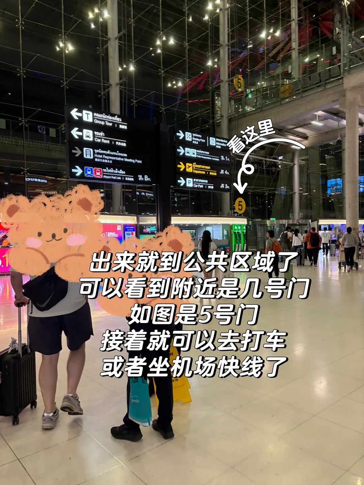

Приземляясь в Суварнабхуми впервые, больше всего волнуешься, не понимая, куда идти. Этот гид разбивает весь маршрут международного прилёта на один шаг — одна картинка, чтобы вы просто шли по нему; полезно и пожилому путешественнику, летящему одному, и семье, которая ждёт снаружи.

## Маршрут одной строкой

**С самолёта → телетрап или автобус → по указателям «Arrivals» → паспортный контроль → выдача багажа → Exit → общественная зона**

> Указатели в Суварнабхуми отличные, и **на главных есть китайский, а также тайский и английский**, так что по пути вы не заблудитесь.

## Пошагово

### 1. Идите за толпой с самолёта

Обычно вы выходите через телетрап, и маршрут только один — просто идите за всеми.

### 2. Идите дальше и следите за экраном рейса

Чуть дальше есть экран с вашим рейсом.

На нём показаны **номер вашего рейса, город вылета и ваша багажная лента** (номер 14 на фото ниже). Запишите номер.

### 3. Ищите чёрный указатель «Arrivals»

Выйдя из телетрапа, вы доходите до указателей. Ищите **чёрную панель с надписью «Arrivals» (旅客到达)** — обычно она в верхней части табло — и идите в том направлении (около 190 метров).

По пути вы проходите эскалаторы и траволаторы; просто продолжайте идти по «Arrivals».

### 4. Подайте карту прибытия TDAC до паспортного контроля

Таиланд теперь использует **цифровую карту прибытия TDAC (Thailand Digital Arrival Card)**, которую нужно заполнить онлайн **до паспортного контроля** на [tdac.immigration.go.th](https://tdac.immigration.go.th).

На переходе стоит большой информационный стенд. Если путешественник не читает по-английски, младший родственник может заранее заполнить форму на телефоне и сохранить скриншот QR-кода.

### 5. На развилке поверните налево, к таможне

Этот большой указатель отмечает развилку: «Arrivals» налево, Connecting Flights и Transfers Desk направо. Пассажиры, направляющиеся в город, **поворачивают здесь налево** и проходят в таможенную зону.

### 6. Паспортный контроль: идите в коридоре для иностранных паспортов

В таможенной зоне вставайте в очередь **Foreign Passport**. **Внутри фотографировать нельзя** — уберите телефон.

Держите наготове:

- **Обратный билет** (или маршрут дальнейшего следования)
- **Бронь отеля**
- **Наличные**: тайская иммиграционная служба может выборочно проверить средства — около 10 000 батов на человека, 20 000 батов на семью

Если документы в порядке, обычно больше ничего не спрашивают. Если не понимаете по-английски, покажите сотруднику перевод на телефоне.

### 7. Получите багаж

За таможней находится зал выдачи багажа. Посмотрите на указатели и найдите номер своей ленты.

Если вы сдавали багаж, ждите у ленты со своим номером; **если сданного багажа нет, идите прямо к выходу**.

### 8. Найдите букву выхода и выйдите в общественную зону

Выходы обозначены буквами (A, B, C и так далее), и любой из них ведёт на общий общественный переход.

Снаружи общественная зона, где колонна или указатель над головой сообщает, **у какого номера выхода вы находитесь** (выход 5 на фото ниже). Это самое удобное место, чтобы встретиться с семьёй или друзьями — или сразу пройти к такси или Airport Rail Link.

## Если вы встречаете кого-то

- Попросите прилетающего **записать номер багажной ленты и букву выхода** — по этим двум данным вы его найдёте.
- На уровне прилёта Суварнабхуми несколько выходных секций, поэтому **договориться о «выходе 5» надёжнее, чем о «выходе»**.
- От посадки до выхода в общественную зону обычно проходит **45–75 минут** с учётом паспортного контроля и багажа. Закладывайте небольшой запас, когда едете кого-то встречать.
