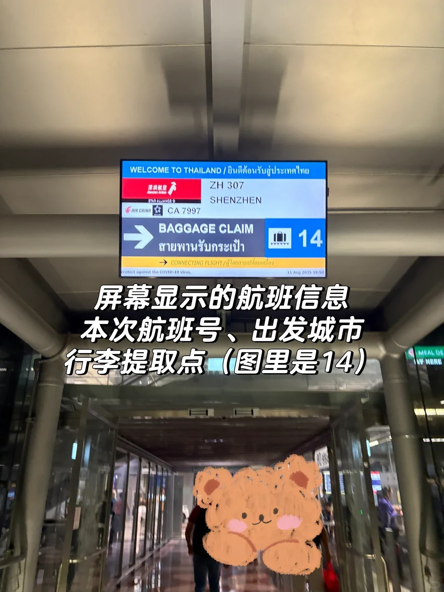

Unapotua Suvarnabhumi kwa mara ya kwanza, wasiwasi ni kutojua njia ya kwenda. Mwongozo huu unagawanya njia yote ya kuwasili kimataifa kuwa picha moja kwa kila hatua, ili uweze kuifuata tu — unafaa kwa msafiri mzee anayesafiri peke yake, au kwa familia inayosubiri nje.

## Njia kwa sentensi moja

**Kutoka kwenye ndege → daraja la ndege au basi → fuata ishara za "Arrivals" → ukaguzi wa pasipoti → kuchukua mizigo → Kutoka → eneo la umma**

> Ishara za Suvarnabhumi ni bora, na **ishara kuu zina Kichina pamoja na Kithai na Kiingereza**, hivyo hupaswi kupotea njiani.

## Hatua kwa hatua

### 1. Fuata umati ukitoka kwenye ndege

Kwa kawaida unatoka kwa daraja la ndege, na kuna njia moja tu — fuata tu wengine wote.

### 2. Endelea kutembea na angalia skrini ya ndege

Mbele kidogo kuna skrini inayoonyesha ndege yako.

Inaonyesha **namba ya ndege yako, mji ulikotoka, na mzunguko wako wa mizigo** (namba 14 kwenye picha hapa chini). Andika namba yako.

### 3. Tafuta ishara nyeusi ya "Arrivals"

Ukitoka kwenye daraja la ndege unafika kwenye ishara. Tafuta **ubao mweusi ulioandikwa "Arrivals" (旅客到达)** — kwa kawaida uko juu ya ubao — na uanze kwenda upande huo (takriban mita 190).

Utapita eskaleta na njia zinazosogeza watu njiani; endelea tu kufuata "Arrivals".

### 4. Wasilisha kadi ya kuwasili ya TDAC kabla ya ukaguzi wa pasipoti

Thailand sasa inatumia **kadi ya kidijitali ya kuwasili, TDAC (Thailand Digital Arrival Card)**, ambayo lazima ijazwe mtandaoni **kabla ya kufika kwenye ukaguzi wa pasipoti**, kwenye [tdac.immigration.go.th](https://tdac.immigration.go.th).

Kuna ubao mkubwa wa matangazo kwenye njia. Ikiwa msafiri hawezi kusoma Kiingereza, ndugu mdogo anaweza kuijaza kwenye simu mapema na kuhifadhi picha ya skrini ya msimbo wa QR.

### 5. Geuka kushoto kwenye makutano kuingia forodha

Ishara hii kubwa inaonyesha makutano: "Arrivals" kushoto, na Ndege za Kuunganisha na Dawati la Uhamisho kulia. Abiria wanaoelekea mjini **wanageuka kushoto hapa** na kupitia hadi eneo la forodha.

### 6. Ukaguzi wa pasipoti: tumia njia ya pasipoti za kigeni

Katika eneo la forodha, jiunge na foleni ya **Foreign Passport**. **Kupiga picha hakuruhusiwi ndani** — weka simu yako mbali.

Kuwa tayari na hivi:

- **Tiketi yako ya kurudi** (au ratiba ya kuendelea)
- **Uhifadhi wako wa hoteli**
- **Fedha taslimu:** uhamiaji wa Thailand wanaweza kukagua fedha kwa ghafla — takriban baht 10,000 kwa mtu, baht 20,000 kwa familia

Kama nyaraka zako ziko sawa kwa kawaida hautaulizwa zaidi. Ikiwa huelewi Kiingereza, mwonyeshe afisa tafsiri iliyo kwenye simu yako.

### 7. Chukua mizigo yako

Baada ya forodha ni jengo la kuchukua mizigo. Angalia juu kwenye ishara na utafute namba ya mzunguko wako.

Kama ulisajili mzigo, subiri kwenye mzunguko wenye namba yako; **kama huna mzigo uliosajiliwa, endelea moja kwa moja kuelekea njia ya kutoka**.

### 8. Tafuta herufi ya njia yako ya kutoka na uingie eneo la umma

Njia za kutoka zina herufi (A, B, C na kadhalika) na yoyote inaongoza kwenye njia hiyo hiyo ya umma.

Nje ni eneo la umma, ambapo nguzo au ishara ya juu inakuambia **lango gani ulilopo** (lango 5 hapa chini). Ni mahali rahisi zaidi kukutana na familia au marafiki — au kuendelea moja kwa moja hadi teksi au Airport Rail Link.

## Ikiwa unamsubiri mtu

- Mwombe msafiri anayewasili **aandike namba ya mzunguko na herufi ya njia ya kutoka** — kwa maelezo hayo mawili unaweza kumpata.
- Ghorofa ya kuwasili ya Suvarnabhumi ina sehemu kadhaa za kutoka, hivyo **kukubaliana kuhusu "lango 5" ni bora kuliko kukubaliana kuhusu "njia ya kutoka"**.
- Kutoka kutua hadi kuingia eneo la umma kwa kawaida huchukua **dakika 45–75**, ikiwemo ukaguzi wa pasipoti na mizigo. Tenga muda wa ziada kidogo unapoanza safari ya kumchukua mtu.
