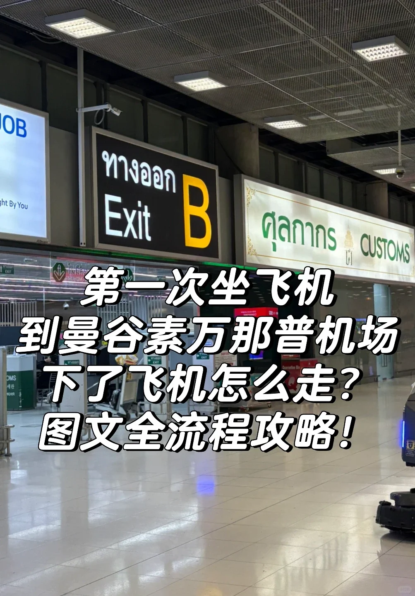

第一次到曼谷素萬那普機場，最怕的就是下了飛機不知道往哪走。這篇按「一步一張圖」把國際到達全程拆開寫，看完照著走就行——給第一次出國的長輩、或者要接機的家人，都很合適。

## 一句話路線

**下飛機 → 廊橋／擺渡車 → 跟「旅客到達」指示牌走 → 過海關 → 行李提取 → Exit 出口 → 公共區域**

> 素萬那普機場的標識非常齊全，**主要指示牌都有中文**，沿途不用擔心看不懂。

## 詳細步驟

### 1. 下飛機後跟著人群走

通常是通過廊橋下機，只有一條路，跟著大家走就好。

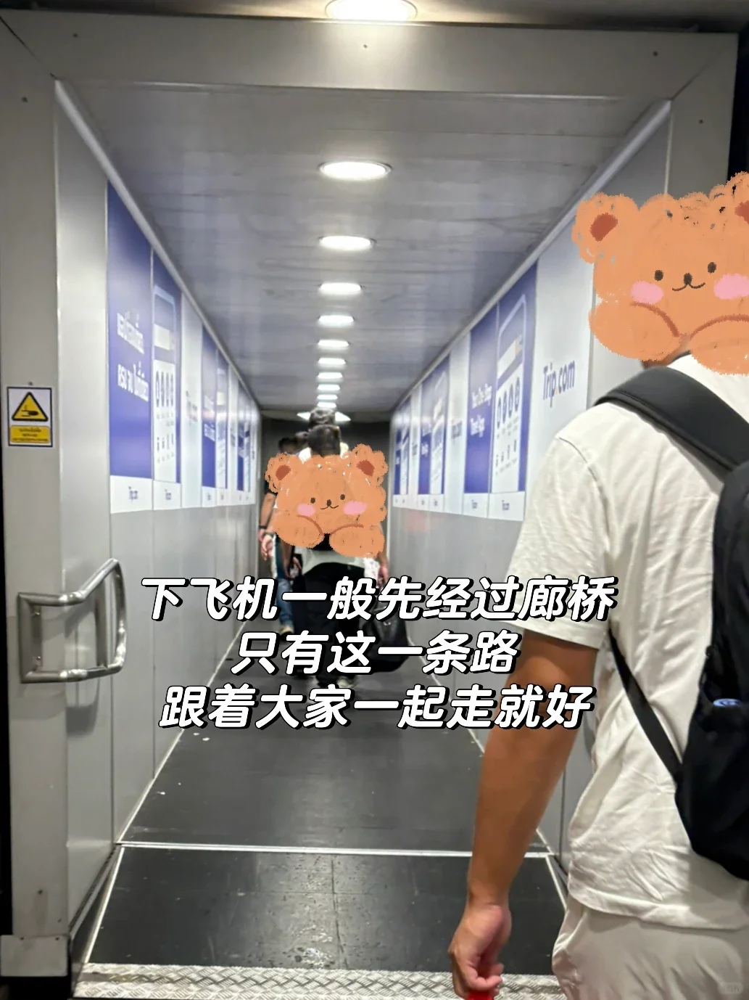

### 2. 繼續走，留意航班資訊屏

再往前一段，會有螢幕顯示本次航班的資訊。

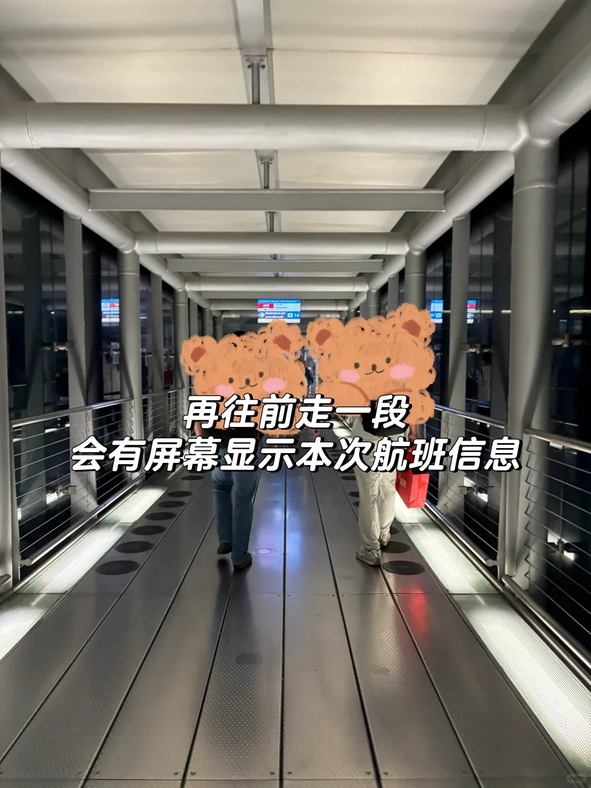

螢幕上會顯示**航班號、出發城市，以及行李提取轉盤號**（下圖是 14 號），記好自己的號碼。

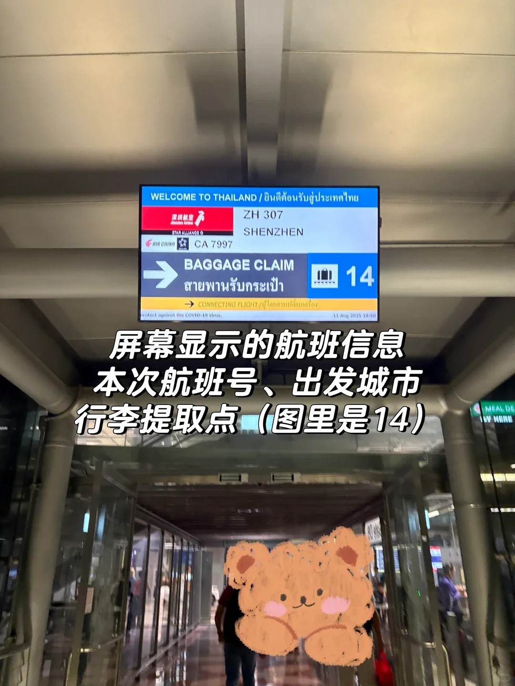

### 3. 認準「旅客到達」的黑色指示牌

走出廊橋後會看到指示牌。注意**黑色底、寫著「旅客到達」（Arrivals）**的那一塊，一般在指示牌最上方，跟著它的方向走（距離約 190 米）。

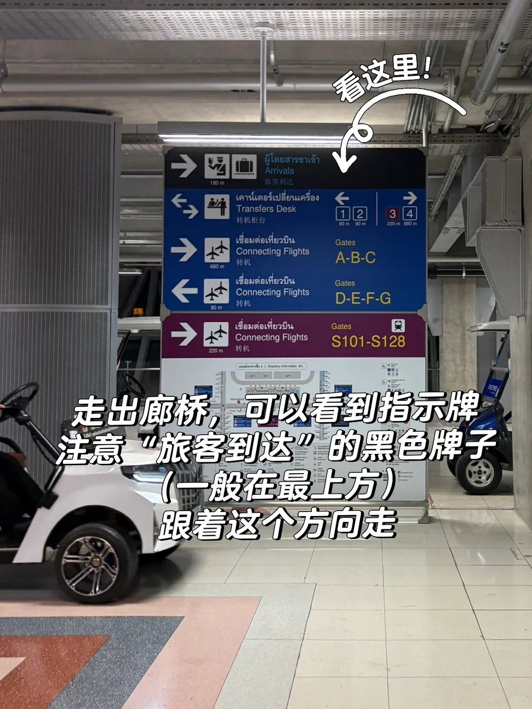

沿途會經過扶梯和自動步道，一直跟著「旅客到達」走就好。

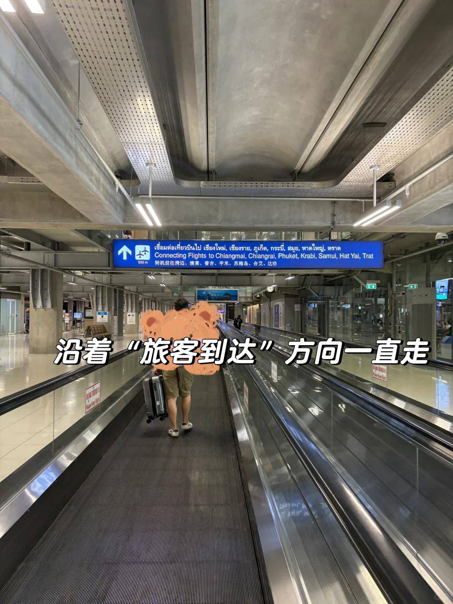

### 4. 入境前先填好 TDAC 電子入境卡

泰國現在用的是**電子入境卡 TDAC（Thailand Digital Arrival Card）**，需要在**入境檢查之前**線上填好，網址是 [tdac.immigration.go.th](https://tdac.immigration.go.th)。

機場在通道上就立著很大的提示牌。不會英文的長輩，建議由年輕人在手機上代為填寫，填完存好二維碼截圖。

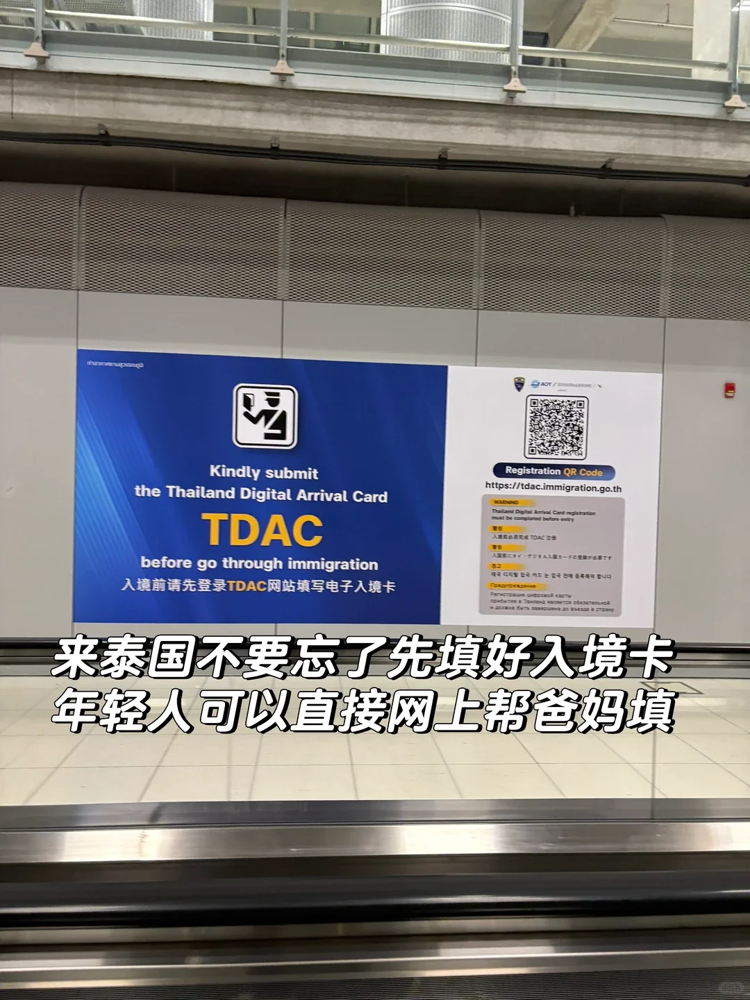

### 5. 到路口左轉，進入海關區

看到這塊大型指示牌就是路口了：左邊是「旅客到達」，右邊是轉機（Connecting Flights）與轉機櫃臺（Transfers Desk）。去市區的旅客**在這裡左轉**，進入海關區。

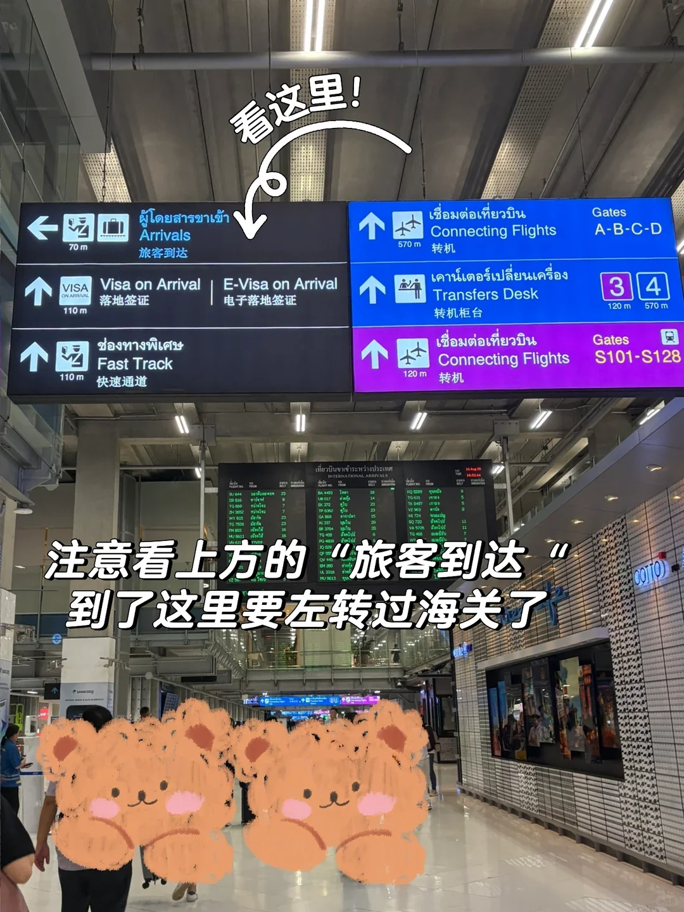

### 6. 過海關：走「外國護照」通道

進入海關區後走 **Foreign Passport（外國護照）** 通道排隊。這一區域**禁止拍照**，請收好手機。

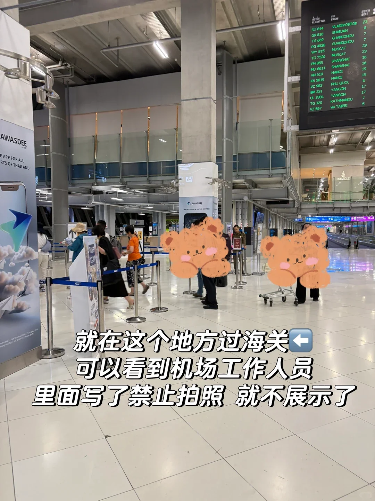

建議提前準備好：

- **返程機票**（或離境行程單）
- **酒店預訂單**
- **現金**：泰國移民局對旅客有現金抽查要求，個人約 1 萬泰銖、家庭約 2 萬泰銖

材料齊全一般不會被多問。聽不懂英文可以用手機翻譯給工作人員看。

### 7. 提取行李

過完海關就是行李提取區。抬頭看指示牌，按轉盤號去找自己的行李。

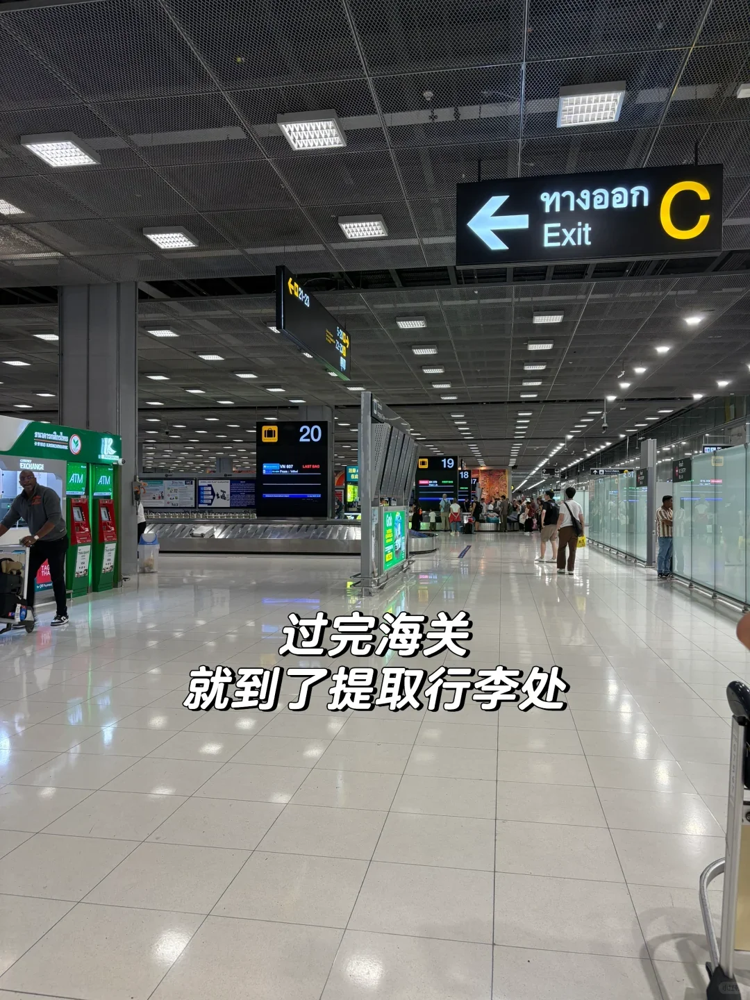

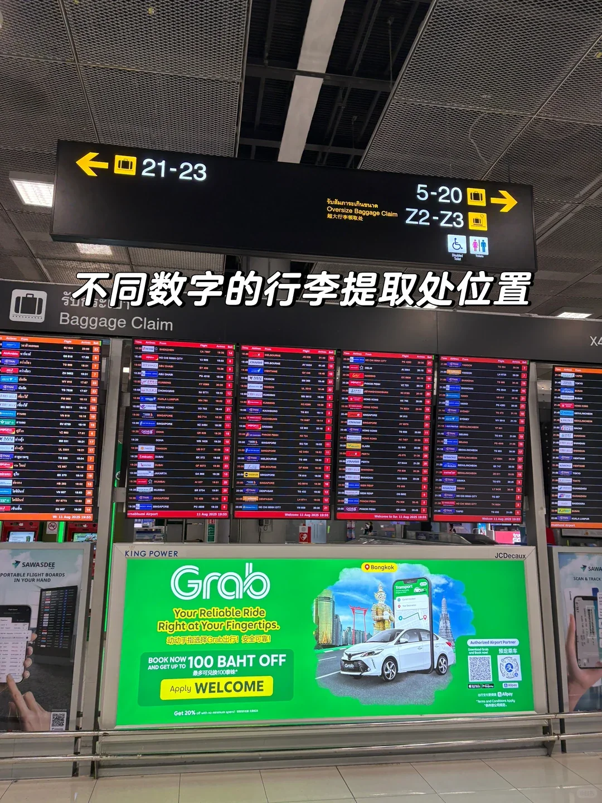

有託運行李的到對應號碼的轉盤等候；**沒有託運行李的可以直接往出口走**。

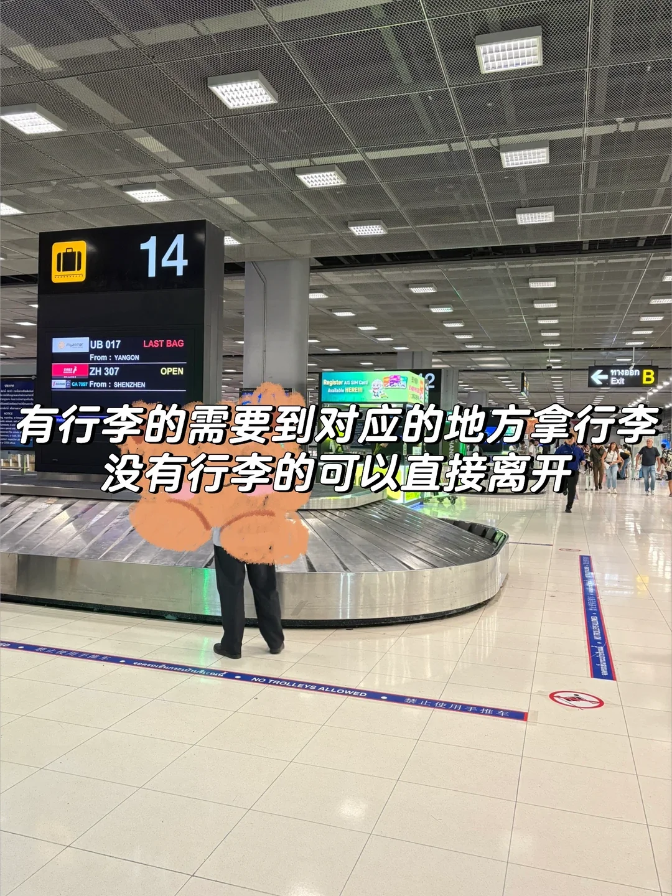

### 8. 找到 Exit 出口，進入公共區域

出口按字母編號（A、B、C…），走哪個都可以，出去都是同一條公共通道。

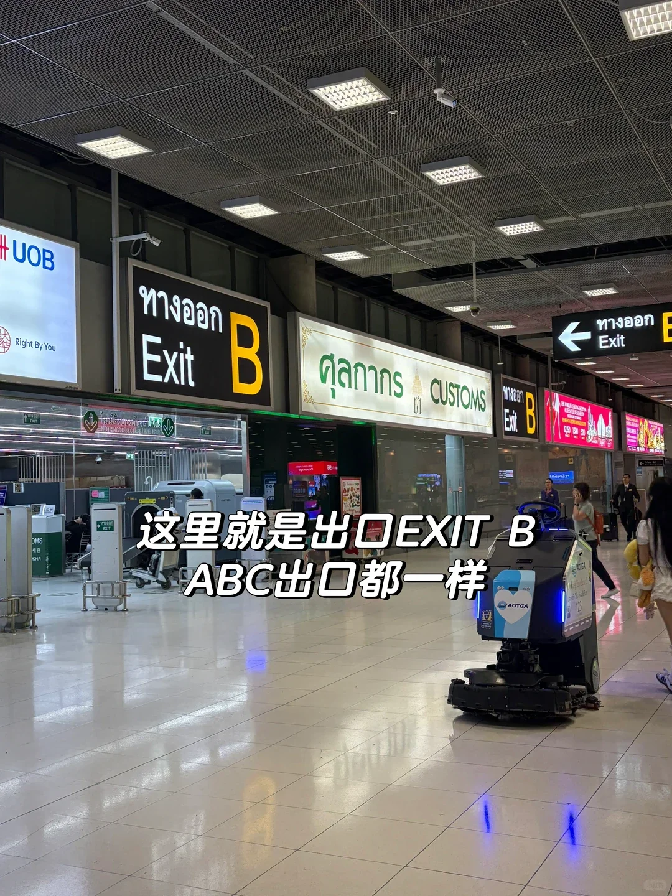

出門就是公共區域，抬頭或看柱子可以確認這是**幾號門**（下圖為 5 號門）。和家人朋友約在這裡碰面最方便；也可以直接去叫車或坐機場快線。

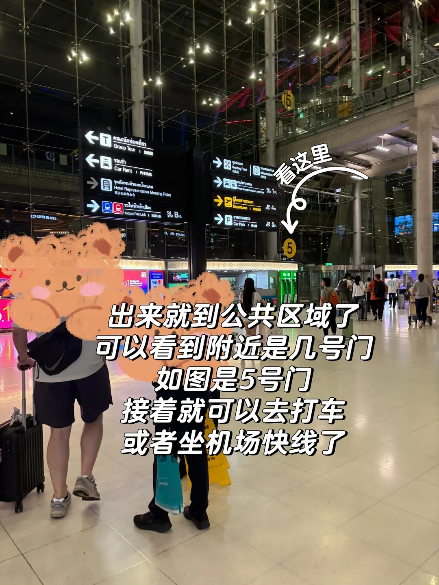

## 給接機家人的小提示

- 讓被接的人**記住自己的行李轉盤號和出口字母**，報給你就能對上位置。
- 素萬那普的到達層出口分 A–G 若干段，**約在「幾號門」**比約在「出口」準確得多。
- 從落地到走出公共區域，正常情況約需 **45–75 分鐘**（含入境排隊與等行李），安排接機時間可以稍寬鬆一些。
