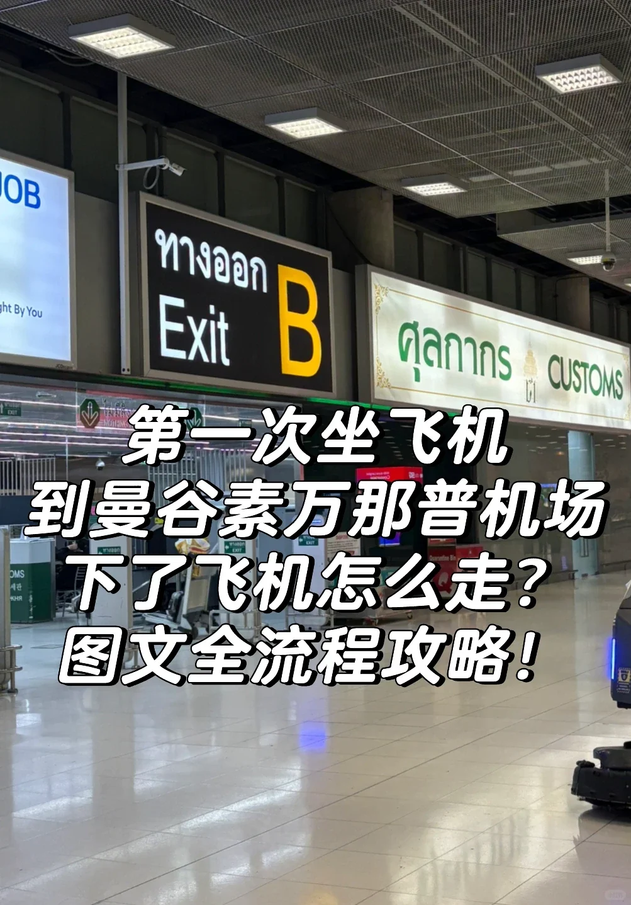
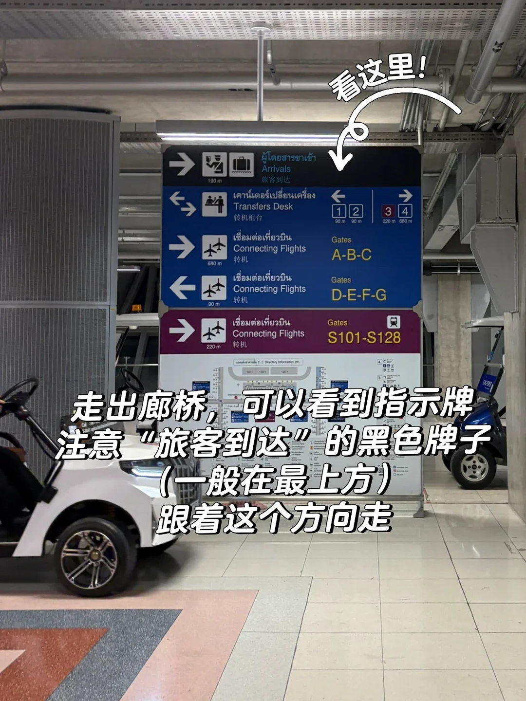
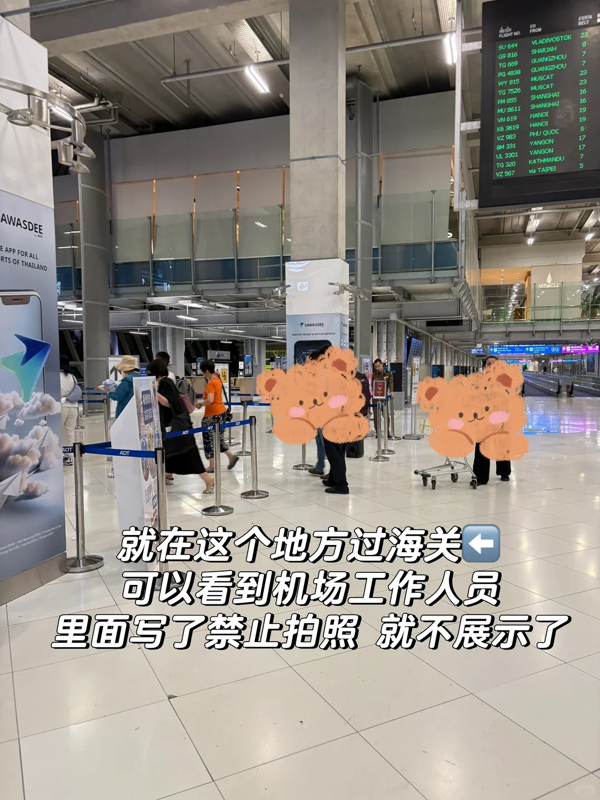

Lần đầu hạ cánh ở Suvarnabhumi, nỗi lo không phải là biết đi hướng nào. Bài hướng dẫn này chia toàn bộ lộ trình nhập cảnh quốc tế thành mỗi bước một bức ảnh, để bạn chỉ cần đi theo — hữu ích cho người lớn tuổi đi một mình, hoặc cho gia đình chờ bên ngoài.

## Lộ trình trong một dòng

**Xuống máy bay → cầu ống dẫn khách hoặc xe buýt → đi theo biển “Arrivals” → kiểm soát nhập cảnh → nhận hành lý → Exit → khu vực công cộng**

> Biển chỉ dẫn ở Suvarnabhumi rất tốt, và **các biển chính có cả tiếng Trung, tiếng Thái lẫn tiếng Anh**, nên bạn khó bị lạc trên đường.

## Từng bước

### 1. Đi theo đám đông xuống máy bay

Bạn thường rời máy bay qua cầu ống dẫn khách, và chỉ có một lối — cứ đi theo mọi người.

### 2. Tiếp tục đi và để ý màn hình chuyến bay

Xa hơn một chút có màn hình hiển thị chuyến bay của bạn.

Nó hiển thị **số hiệu chuyến bay, thành phố bạn đến và băng chuyền hành lý** (số 14 trong ảnh dưới). Hãy ghi lại số đó.

### 3. Tìm biển “Arrivals” màu đen

Khi ra khỏi cầu ống dẫn khách, bạn sẽ gặp các biển chỉ dẫn. Tìm **bảng màu đen ghi “Arrivals” (旅客到达)** — thường nằm ở trên cùng của bảng — và đi theo hướng đó (khoảng 190 mét).

Trên đường bạn đi qua thang cuốn và băng chuyền đi bộ; cứ tiếp tục đi theo “Arrivals”.

### 4. Nộp thẻ nhập cảnh TDAC trước khi qua kiểm soát

Thái Lan hiện dùng **thẻ nhập cảnh điện tử TDAC (Thailand Digital Arrival Card)**, phải hoàn thành trực tuyến **trước khi đến quầy kiểm soát nhập cảnh**, tại [tdac.immigration.go.th](https://tdac.immigration.go.th).

Có một bảng thông báo lớn trên lối đi. Nếu người đi không đọc được tiếng Anh, người thân trẻ hơn có thể điền trước trên điện thoại và lưu ảnh chụp mã QR.

### 5. Rẽ trái ở ngã ba vào khu hải quan

Biển lớn này đánh dấu ngã ba: “Arrivals” bên trái, còn Connecting Flights và Transfers Desk bên phải. Hành khách vào thành phố **rẽ trái ở đây** và đi qua khu hải quan.

### 6. Kiểm soát nhập cảnh: đi làn hộ chiếu nước ngoài

Trong khu hải quan, hãy xếp hàng **Foreign Passport**. **Không được chụp ảnh bên trong** — hãy cất điện thoại đi.

Chuẩn bị sẵn:

- **Vé về** (hoặc lịch trình chặng tiếp theo)
- **Đặt phòng khách sạn**
- **Tiền mặt:** kiểm soát nhập cảnh Thái Lan có thể kiểm tra ngẫu nhiên tài chính — khoảng 10.000 baht mỗi người, 20.000 baht mỗi gia đình

Nếu giấy tờ đầy đủ, bạn thường không bị hỏi thêm. Nếu không hiểu tiếng Anh, hãy cho nhân viên xem bản dịch trên điện thoại.

### 7. Nhận hành lý

Qua hải quan là sảnh nhận hành lý. Hãy nhìn lên biển và tìm số băng chuyền của bạn.

Nếu bạn có ký gửi hành lý, hãy chờ ở băng chuyền có số của bạn; **nếu không có hành lý ký gửi, hãy đi thẳng về phía lối ra**.

### 8. Tìm chữ cái lối ra và bước vào khu vực công cộng

Các lối ra được đặt chữ cái (A, B, C, v.v.) và lối nào cũng dẫn ra cùng một lối đi bộ công cộng.

Bên ngoài là khu vực công cộng, nơi cột hoặc biển treo cho biết **bạn đang ở cổng số mấy** (cổng 5 trong ảnh dưới). Đây là nơi dễ nhất để gặp gia đình, bạn bè — hoặc đi thẳng đến taxi hay Airport Rail Link.

## Nếu bạn đi đón người

- Hãy nhờ người đến **ghi lại số băng chuyền và chữ cái lối ra** — với hai thông tin đó bạn có thể tìm thấy họ.
- Tầng đến của Suvarnabhumi có nhiều khu lối ra, nên **thống nhất “cổng 5” tốt hơn là “cửa ra”**.
- Từ lúc hạ cánh đến khi bước vào khu vực công cộng thường mất **45–75 phút**, gồm kiểm soát nhập cảnh và hành lý. Hãy dành thêm chút thời gian khi đi đón người.
