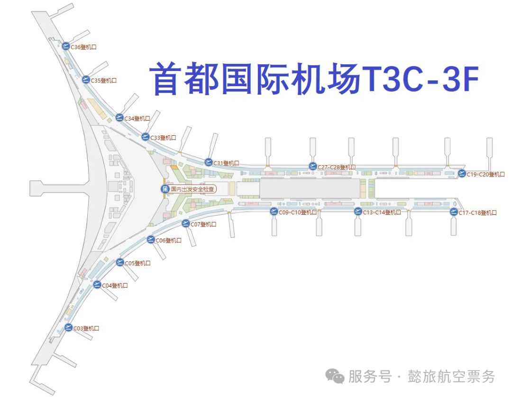

❤️❤️❤️ বেইজিং ক্যাপিটাল আন্তর্জাতিক বিমানবন্দর ২৫.৬৯ বর্গকিলোমিটার জুড়ে। চীনের ব্যস্ততম বিমানবন্দরগুলোর একটি, এতে তিনটি রানওয়ে, ৩১৪টি বিমান স্ট্যান্ড এবং বিস্তৃত পণ্য ও লজিস্টিকস সেবা আছে।

## টার্মিনালগুলো

👉👉👉 ক্যাপিটালে তিনটি টার্মিনাল (টি১, টি২ ও টি৩), যদিও **টি১ এখন বন্ধ** ❌।

- ✅ **টি১** (❌ বন্ধ): অভ্যন্তরীণ, তিন তলা।
- ✅ **টি২**: অভ্যন্তরীণ ও আন্তর্জাতিক, চার তলা।
- ✅ **টি৩**, তিনটি অঞ্চলে বিভক্ত:
  - 🟡 **টি৩সি**: পাঁচ তলা, বেশিরভাগ অভ্যন্তরীণ — চিত্র ৭ থেকে ১১ দেখুন।
  - 🟡 **টি৩ডি**: চার তলা, বেশিরভাগ আন্তর্জাতিক — চিত্র ১২ থেকে ১৫ দেখুন।
  - 🟡 **টি৩ই**: তিন তলা, বেশিরভাগ আন্তর্জাতিক — চিত্র ১৬ থেকে ১৮ দেখুন।

## তলার নকশা

👉👉👉 বিস্তারিত তলার নকশা নিচে:

- টি২ বি১ ➡️ চিত্র ২
- টি২ ১এফ ➡️ চিত্র ৩
- টি২ ২এফ ➡️ চিত্র ৪
- টি২ ৩এফ ➡️ চিত্র ৫
- টি৩সি বি১ ➡️ চিত্র ৬
- টি৩সি ১এফ ➡️ চিত্র ৭
- টি৩সি ২এফ ➡️ চিত্র ৮
- টি৩সি ৩এফ ➡️ চিত্র ৯
- টি৩সি ৪এফ ➡️ চিত্র ১০
- টি৩ডি বি১ ➡️ চিত্র ১১
- টি৩ডি ১এফ ➡️ চিত্র ১২
- টি৩ডি ২এফ ➡️ চিত্র ১৩
- টি৩ডি ৩এফ ➡️ চিত্র ১৪
- টি৩ই ১এফ ➡️ চিত্র ১৫
- টি৩ই ২এফ ➡️ চিত্র ১৬
- টি৩ই ৩এফ ➡️ চিত্র ১৭

### টি২

### টি৩সি

### টি৩ডি

### টি৩ই

## সম্পর্কিত লিংক

- **এই সাইটে**: [বেইজিং ক্যাপিটাল আন্তর্জাতিক বিমানবন্দর (PEK)](/airport/PEK), [চীন (CN)](/country/CN)
- **উইকিপিডিয়া**: [বেইজিং ক্যাপিটাল আন্তর্জাতিক বিমানবন্দর](https://en.wikipedia.org/wiki/Beijing_Capital_International_Airport)
- **বাইদু বাইকে**: [বেইজিং ক্যাপিটাল আন্তর্জাতিক বিমানবন্দর](https://baike.baidu.com/item/%E5%8C%97%E4%BA%AC%E9%A6%96%E9%83%BD%E5%9B%BD%E9%99%85%E6%9C%BA%E5%9C%BA)
