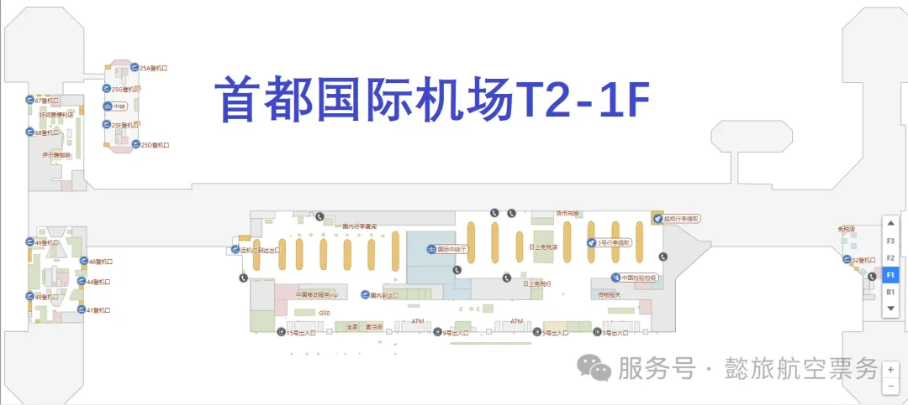

❤️❤️❤️ El Aeropuerto Internacional de Pekín Capital ocupa 25,69 km². Es uno de los aeropuertos más concurridos de China y cuenta con tres pistas, 314 puestos de estacionamiento de aeronaves y una amplia gama de servicios de carga y logística.

## Las terminales

👉👉👉 Capital tiene tres terminales (T1, T2 y T3), aunque **la T1 está actualmente fuera de servicio** ❌.

- ✅ **T1** (❌ cerrada): nacional, tres plantas.
- ✅ **T2**: nacional e internacional, cuatro plantas.
- ✅ **T3**, dividida en tres zonas:
  - 🟡 **T3C**: cinco plantas, principalmente nacional: véanse las figuras 7 a 11.
  - 🟡 **T3D**: cuatro plantas, principalmente internacional: véanse las figuras 12 a 15.
  - 🟡 **T3E**: tres plantas, principalmente internacional: véanse las figuras 16 a 18.

## Diagramas de plantas

👉👉👉 A continuación, los diagramas detallados planta por planta:

- T2 B1 ➡️ Figura 2
- T2 1F ➡️ Figura 3
- T2 2F ➡️ Figura 4
- T2 3F ➡️ Figura 5
- T3C B1 ➡️ Figura 6
- T3C 1F ➡️ Figura 7
- T3C 2F ➡️ Figura 8
- T3C 3F ➡️ Figura 9
- T3C 4F ➡️ Figura 10
- T3D B1 ➡️ Figura 11
- T3D 1F ➡️ Figura 12
- T3D 2F ➡️ Figura 13
- T3D 3F ➡️ Figura 14
- T3E 1F ➡️ Figura 15
- T3E 2F ➡️ Figura 16
- T3E 3F ➡️ Figura 17

### T2

### T3C

### T3D

### T3E

## Enlaces relacionados

- **En este sitio**: [Aeropuerto Internacional de Pekín Capital (PEK)](/airport/PEK), [China (CN)](/country/CN)
- **Wikipedia**: [Aeropuerto Internacional de Pekín Capital](https://en.wikipedia.org/wiki/Beijing_Capital_International_Airport)
- **Baidu Baike**: [Aeropuerto Internacional de Pekín Capital](https://baike.baidu.com/item/%E5%8C%97%E4%BA%AC%E9%A6%96%E9%83%BD%E5%9B%BD%E9%99%85%E6%9C%BA%E5%9C%BA)
