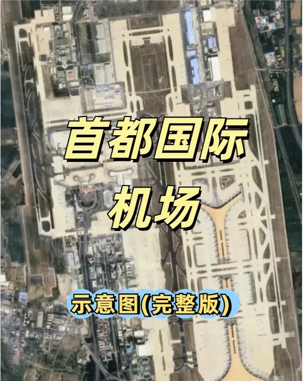

❤️❤️❤️ L'aéroport international de Pékin-Capitale couvre 25,69 km². L'un des aéroports les plus fréquentés de Chine, il compte trois pistes, 314 postes de stationnement d'aéronefs et une large gamme de services de fret et de logistique.

## Les terminaux

👉👉👉 Capital compte trois terminaux (T1, T2 et T3), mais **le T1 est actuellement hors service** ❌.

- ✅ **T1** (❌ fermé) : vols intérieurs, trois étages.
- ✅ **T2** : vols intérieurs et internationaux, quatre étages.
- ✅ **T3**, divisé en trois zones :
  - 🟡 **T3C** : cinq étages, majoritairement intérieurs — voir figures 7 à 11.
  - 🟡 **T3D** : quatre étages, majoritairement internationaux — voir figures 12 à 15.
  - 🟡 **T3E** : trois étages, majoritairement internationaux — voir figures 16 à 18.

## Plans des étages

👉👉👉 Les plans détaillés des étages suivent :

- T2, sous-sol 1 ➡️ figure 2
- T2, 1er étage ➡️ figure 3
- T2, 2e étage ➡️ figure 4
- T2, 3e étage ➡️ figure 5
- T3C, sous-sol 1 ➡️ figure 6
- T3C, 1er étage ➡️ figure 7
- T3C, 2e étage ➡️ figure 8
- T3C, 3e étage ➡️ figure 9
- T3C, 4e étage ➡️ figure 10
- T3D, sous-sol 1 ➡️ figure 11
- T3D, 1er étage ➡️ figure 12
- T3D, 2e étage ➡️ figure 13
- T3D, 3e étage ➡️ figure 14
- T3E, 1er étage ➡️ figure 15
- T3E, 2e étage ➡️ figure 16
- T3E, 3e étage ➡️ figure 17

### T2

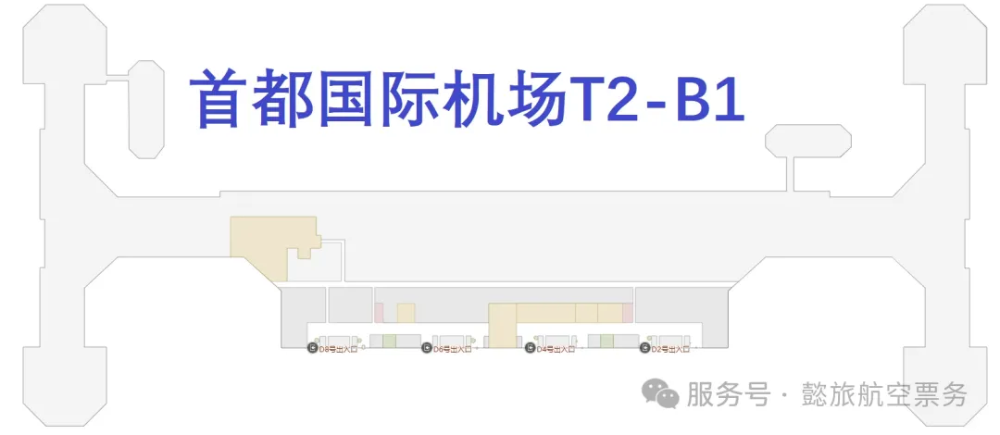

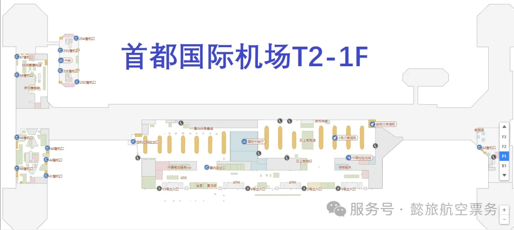

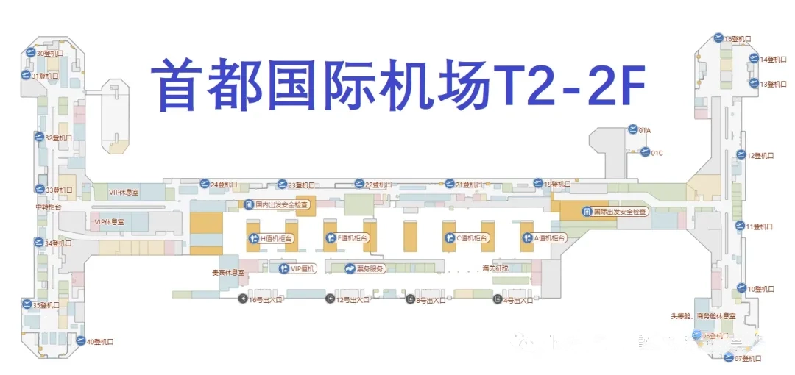

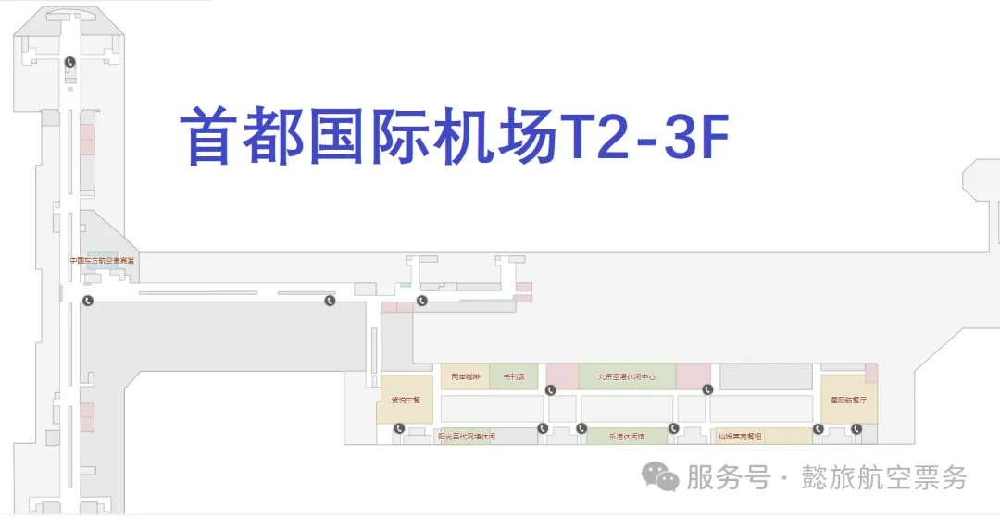

### T3C

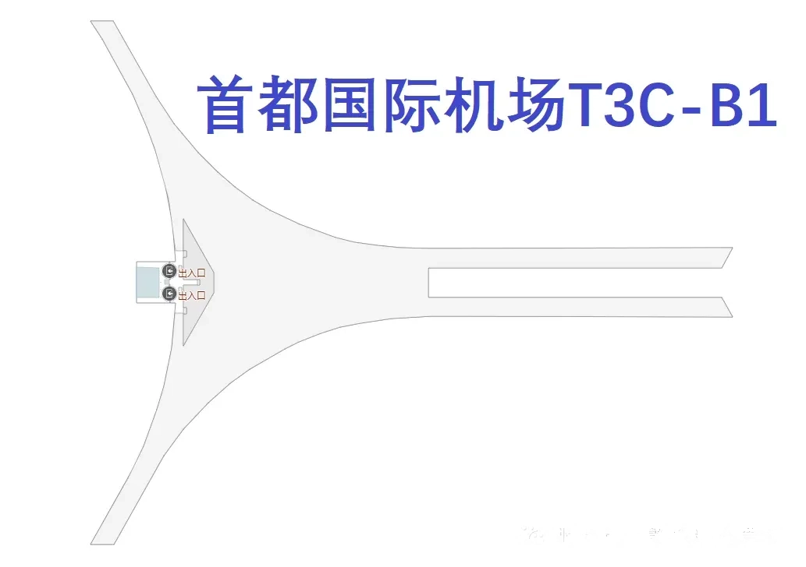

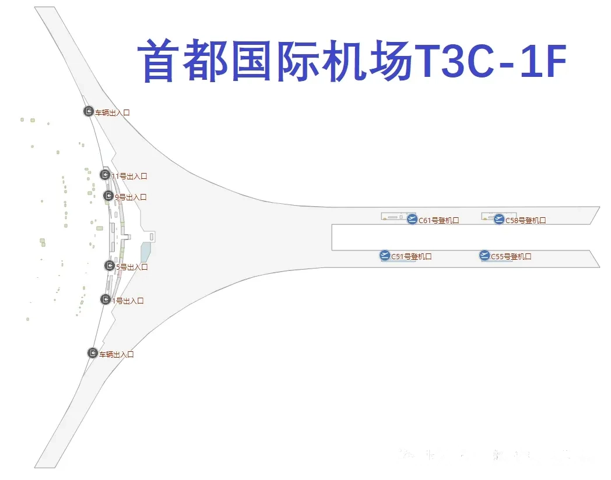

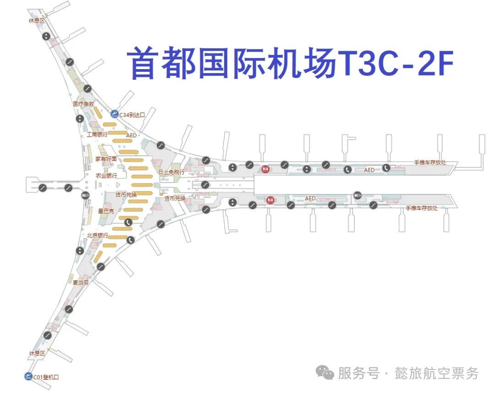

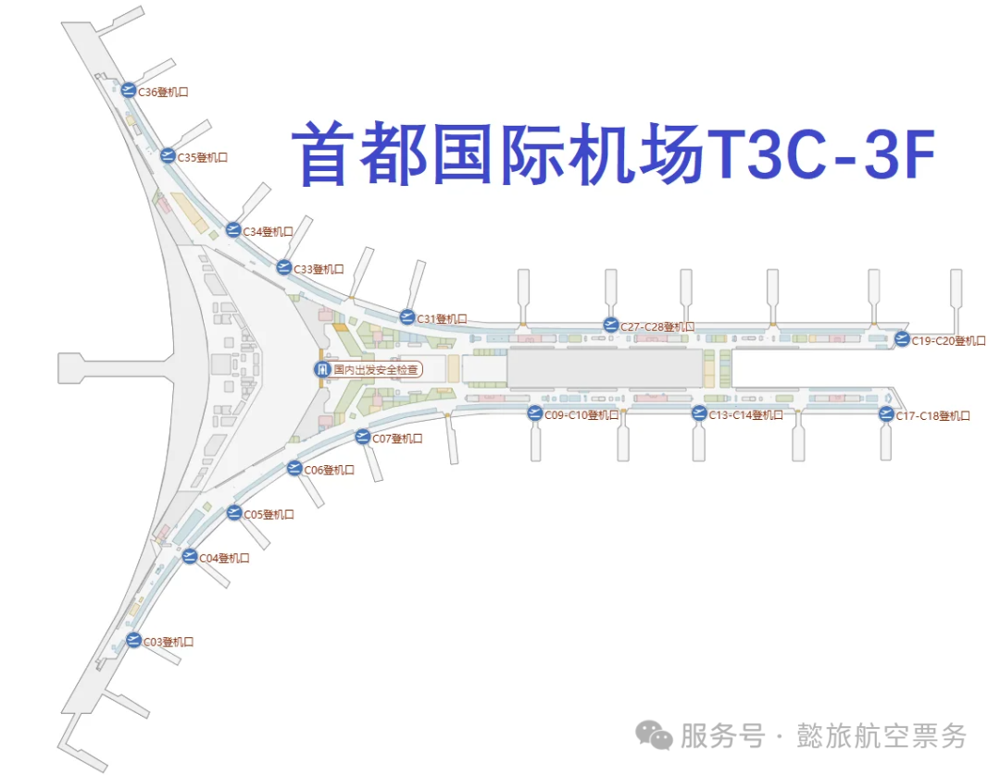

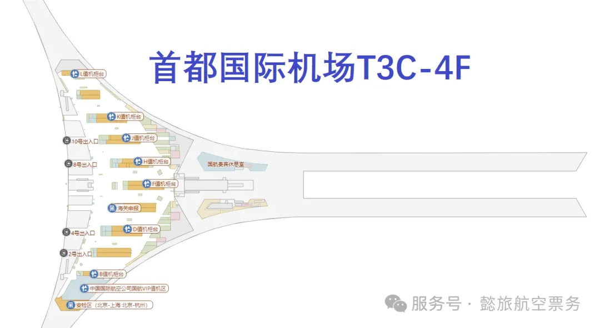

### T3D

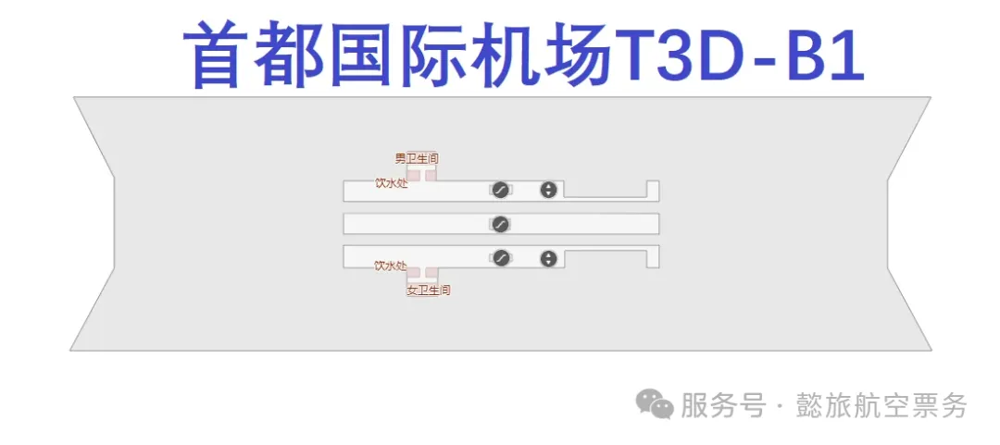

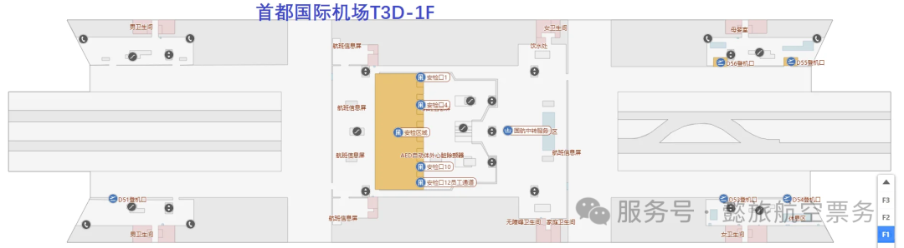

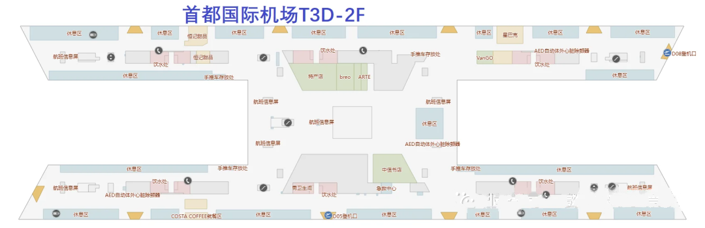

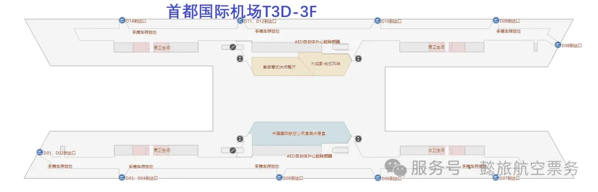

### T3E

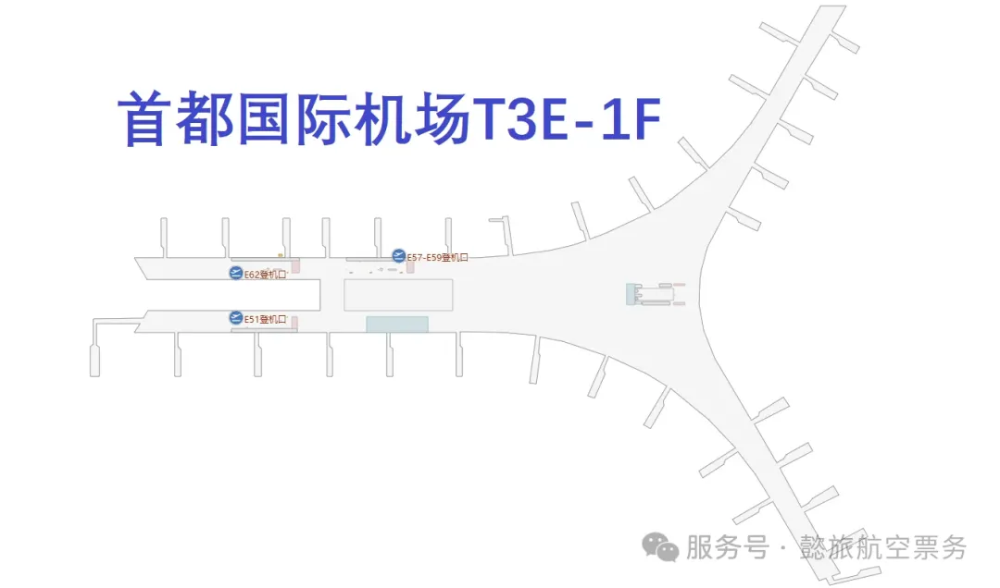

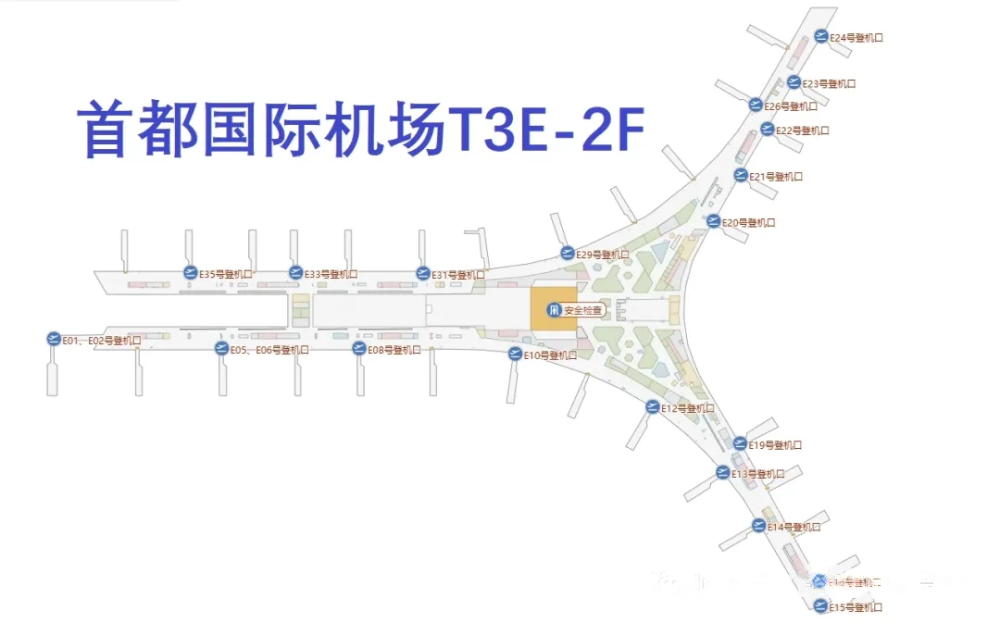

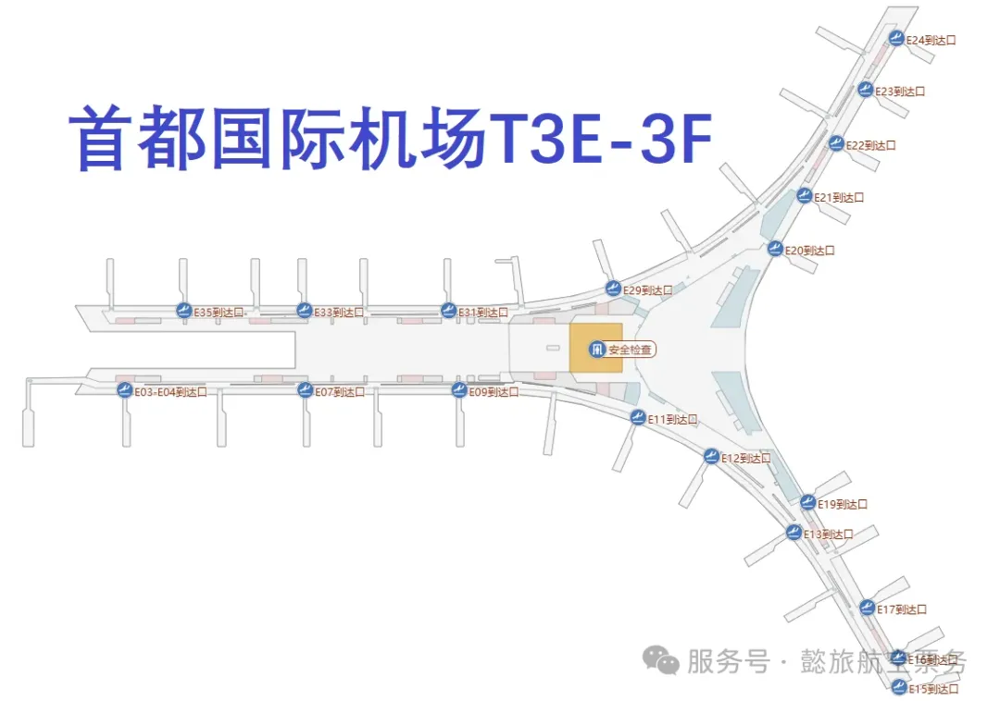

## Liens utiles

- **Sur ce site** : [Aéroport international de Pékin-Capitale (PEK)](/airport/PEK), [Chine (CN)](/country/CN)
- **Wikipédia** : [Beijing Capital International Airport](https://en.wikipedia.org/wiki/Beijing_Capital_International_Airport)
- **Baidu Baike** : [Beijing Capital International Airport](https://baike.baidu.com/item/%E5%8C%97%E4%BA%AC%E9%A6%96%E9%83%BD%E5%9B%BD%E9%99%85%E6%9C%BA%E5%9C%BA)
