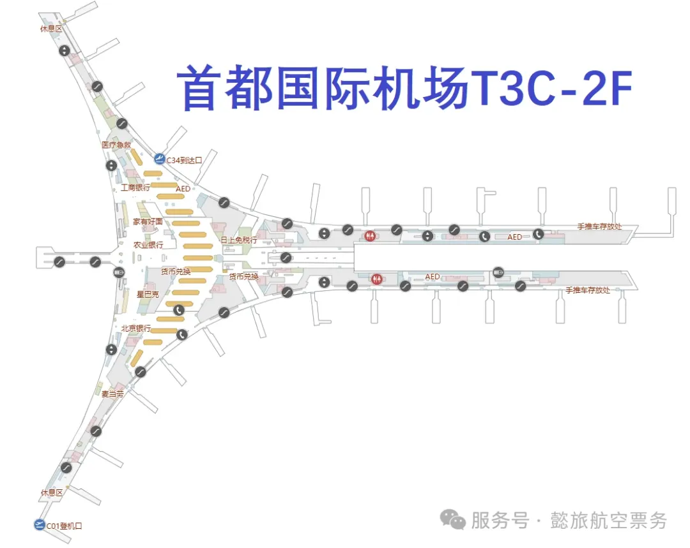

❤️❤️❤️ बीजिंग कैपिटल अंतरराष्ट्रीय हवाई अड्डा 25.69 किमी² में फैला है। चीन के सबसे व्यस्त एयरपोर्टों में से एक, इसमें तीन रनवे, 314 विमान स्टैंड और कार्गो व लॉजिस्टिक्स की विस्तृत सेवाएँ हैं।

## टर्मिनल

👉👉👉 कैपिटल में तीन टर्मिनल हैं (T1, T2 और T3), हालाँकि **T1 इस समय सेवा से बाहर है** ❌।

- ✅ **T1** (❌ बंद): घरेलू, तीन मंज़िलें।
- ✅ **T2**: घरेलू और अंतरराष्ट्रीय, चार मंज़िलें।
- ✅ **T3**, तीन ज़ोन में बँटा:
  - 🟡 **T3C**: पाँच मंज़िलें, ज़्यादातर घरेलू — चित्र 7 से 11 देखें।
  - 🟡 **T3D**: चार मंज़िलें, ज़्यादातर अंतरराष्ट्रीय — चित्र 12 से 15 देखें।
  - 🟡 **T3E**: तीन मंज़िलें, ज़्यादातर अंतरराष्ट्रीय — चित्र 16 से 18 देखें।

## मंज़िल चित्र

👉👉👉 आगे विस्तृत मंज़िल चित्र हैं:

- T2 B1 ➡️ चित्र 2
- T2 1F ➡️ चित्र 3
- T2 2F ➡️ चित्र 4
- T2 3F ➡️ चित्र 5
- T3C B1 ➡️ चित्र 6
- T3C 1F ➡️ चित्र 7
- T3C 2F ➡️ चित्र 8
- T3C 3F ➡️ चित्र 9
- T3C 4F ➡️ चित्र 10
- T3D B1 ➡️ चित्र 11
- T3D 1F ➡️ चित्र 12
- T3D 2F ➡️ चित्र 13
- T3D 3F ➡️ चित्र 14
- T3E 1F ➡️ चित्र 15
- T3E 2F ➡️ चित्र 16
- T3E 3F ➡️ चित्र 17

### T2

### T3C

### T3D

### T3E

## संबंधित लिंक

- **इस साइट पर**: [बीजिंग कैपिटल अंतरराष्ट्रीय हवाई अड्डा (PEK)](/airport/PEK), [चीन (CN)](/country/CN)
- **विकिपीडिया**: [बीजिंग कैपिटल अंतरराष्ट्रीय हवाई अड्डा](https://en.wikipedia.org/wiki/Beijing_Capital_International_Airport)
- **बाइदू बाइके**: [बीजिंग कैपिटल अंतरराष्ट्रीय हवाई अड्डा](https://baike.baidu.com/item/%E5%8C%97%E4%BA%AC%E9%A6%96%E9%83%BD%E5%9B%BD%E9%99%85%E6%9C%BA%E5%9C%BA)
