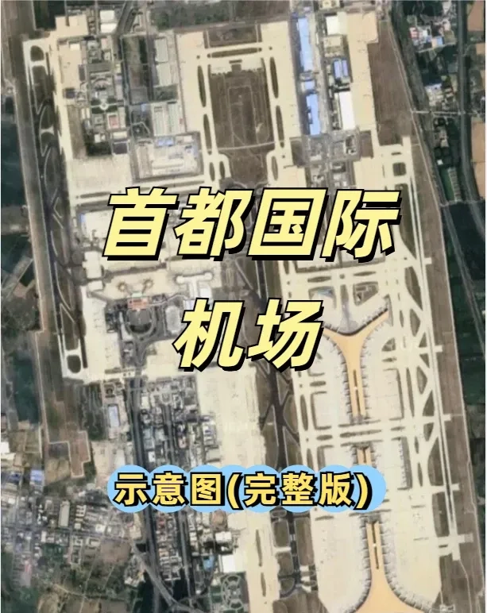
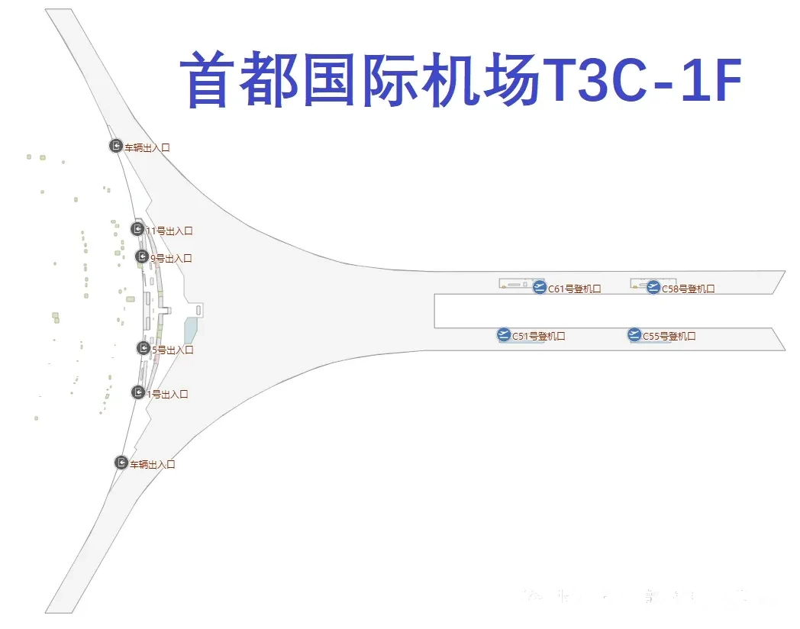
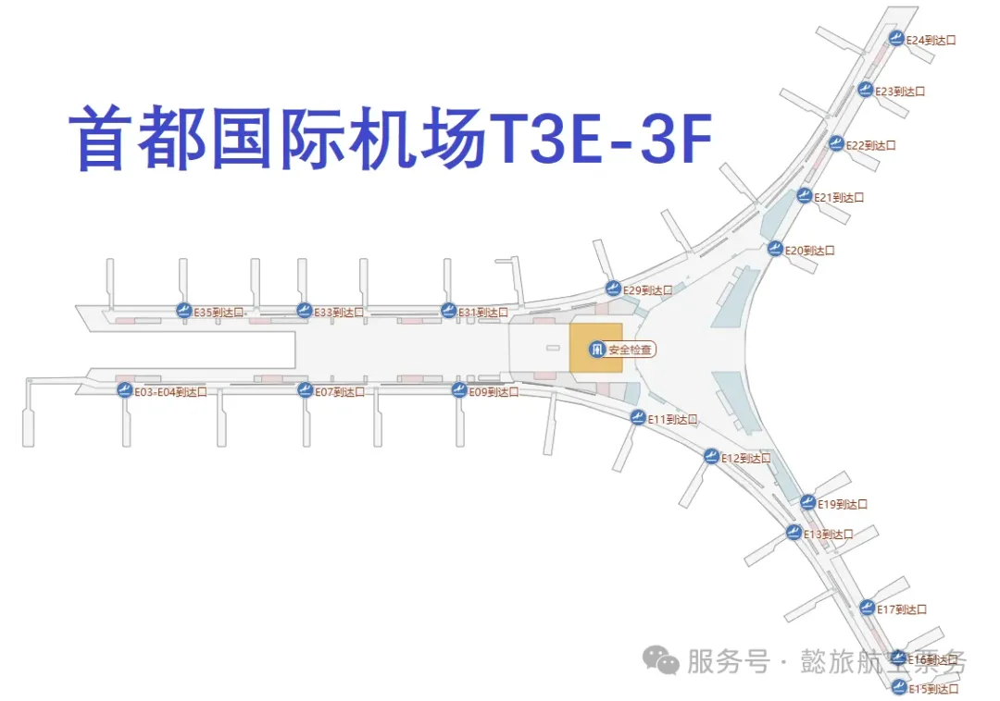

❤️❤️❤️ 北京首都国際空港は25.69 km²の敷地を誇ります。中国で最も忙しい空港の1つで、3本の滑走路、314の駐機スポット、幅広い貨物・物流サービスを備えています。

## ターミナル

👉👉👉 首都空港には3つのターミナル（T1、T2、T3）がありますが、**T1は現在供用停止中**です ❌。

- ✅ **T1**（❌ 閉鎖中）：国内線、3フロア。
- ✅ **T2**：国内線・国際線、4フロア。
- ✅ **T3**：3つのゾーンに分かれます。
  - 🟡 **T3C**：5フロア、主に国内線 — 図7〜11を参照。
  - 🟡 **T3D**：4フロア、主に国際線 — 図12〜15を参照。
  - 🟡 **T3E**：3フロア、主に国際線 — 図16〜18を参照。

## フロア図

👉👉👉 以下、詳細なフロア図です。

- T2 B1 ➡️ 図2
- T2 1F ➡️ 図3
- T2 2F ➡️ 図4
- T2 3F ➡️ 図5
- T3C B1 ➡️ 図6
- T3C 1F ➡️ 図7
- T3C 2F ➡️ 図8
- T3C 3F ➡️ 図9
- T3C 4F ➡️ 図10
- T3D B1 ➡️ 図11
- T3D 1F ➡️ 図12
- T3D 2F ➡️ 図13
- T3D 3F ➡️ 図14
- T3E 1F ➡️ 図15
- T3E 2F ➡️ 図16
- T3E 3F ➡️ 図17

### T2

### T3C

### T3D

### T3E

## 関連リンク

- **このサイト内**：[北京首都国際空港 (PEK)](/airport/PEK)、[中国 (CN)](/country/CN)
- **Wikipedia**：[北京首都国際空港](https://en.wikipedia.org/wiki/Beijing_Capital_International_Airport)
- **百度百科**：[北京首都国際空港](https://baike.baidu.com/item/%E5%8C%97%E4%BA%AC%E9%A6%96%E9%83%BD%E5%9B%BD%E9%99%85%E6%9C%BA%E5%9C%BA)
