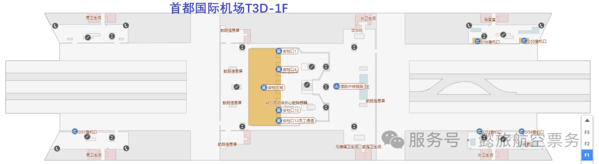

❤️❤️❤️ Beijing Capital International Airport beslaat 25,69 km². Het is een van de drukste luchthavens van China, met drie startbanen, 314 standplaatsen voor vliegtuigen en een breed scala aan vracht- en logistieke diensten.

## De terminals

👉👉👉 Capital heeft drie terminals (T1, T2 en T3), maar **T1 is momenteel buiten gebruik** ❌.

- ✅ **T1** (❌ gesloten): binnenlands, drie verdiepingen.
- ✅ **T2**: binnenlands en internationaal, vier verdiepingen.
- ✅ **T3**, verdeeld in drie zones:
  - 🟡 **T3C**: vijf verdiepingen, grotendeels binnenlands — zie figuren 7 tot en met 11.
  - 🟡 **T3D**: vier verdiepingen, grotendeels internationaal — zie figuren 12 tot en met 15.
  - 🟡 **T3E**: drie verdiepingen, grotendeels internationaal — zie figuren 16 tot en met 18.

## Verdiepingsdiagrammen

👉👉👉 Hier volgen gedetailleerde verdiepingsdiagrammen:

- T2 B1 ➡️ figuur 2
- T2 1F ➡️ figuur 3
- T2 2F ➡️ figuur 4
- T2 3F ➡️ figuur 5
- T3C B1 ➡️ figuur 6
- T3C 1F ➡️ figuur 7
- T3C 2F ➡️ figuur 8
- T3C 3F ➡️ figuur 9
- T3C 4F ➡️ figuur 10
- T3D B1 ➡️ figuur 11
- T3D 1F ➡️ figuur 12
- T3D 2F ➡️ figuur 13
- T3D 3F ➡️ figuur 14
- T3E 1F ➡️ figuur 15
- T3E 2F ➡️ figuur 16
- T3E 3F ➡️ figuur 17

### T2

### T3C

### T3D

### T3E

## Gerelateerde links

- **Op deze site**: [Beijing Capital International Airport (PEK)](/airport/PEK), [China (CN)](/country/CN)
- **Wikipedia**: [Beijing Capital International Airport](https://en.wikipedia.org/wiki/Beijing_Capital_International_Airport)
- **Baidu Baike**: [Beijing Capital International Airport](https://baike.baidu.com/item/%E5%8C%97%E4%BA%AC%E9%A6%96%E9%83%BD%E5%9B%BD%E9%99%85%E6%9C%BA%E5%9C%BA)
