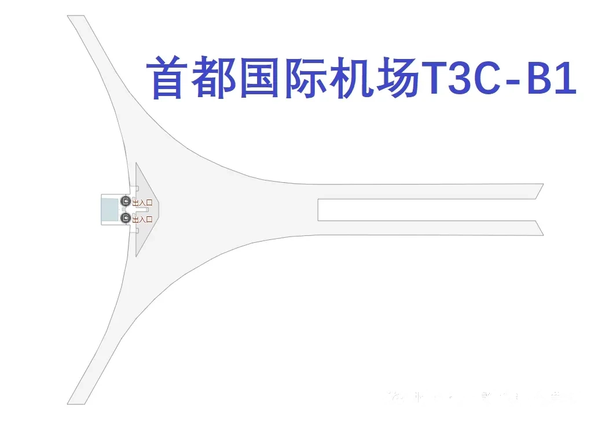

❤️❤️❤️ Pekińskie lotnisko Capital zajmuje 25,69 km². Jedno z najruchliwszych lotnisk w Chinach ma trzy pasy startowe, 314 stanowisk postojowych dla samolotów oraz szeroki zakres usług cargo i logistycznych.

## Terminale

👉👉👉 Capital ma trzy terminale (T1, T2 i T3), choć **T1 jest obecnie wyłączony z eksploatacji** ❌.

- ✅ **T1** (❌ zamknięty): krajowy, trzy piętra.
- ✅ **T2**: krajowy i międzynarodowy, cztery piętra.
- ✅ **T3**, podzielony na trzy strefy:
  - 🟡 **T3C**: pięć pięter, głównie krajowy — patrz rysunki 7–11.
  - 🟡 **T3D**: cztery piętra, głównie międzynarodowy — patrz rysunki 12–15.
  - 🟡 **T3E**: trzy piętra, głównie międzynarodowy — patrz rysunki 16–18.

## Schematy pięter

👉👉👉 Szczegółowe schematy pięter poniżej:

- T2, piwnica 1 ➡️ rysunek 2
- T2, piętro 1 ➡️ rysunek 3
- T2, piętro 2 ➡️ rysunek 4
- T2, piętro 3 ➡️ rysunek 5
- T3C, piwnica 1 ➡️ rysunek 6
- T3C, piętro 1 ➡️ rysunek 7
- T3C, piętro 2 ➡️ rysunek 8
- T3C, piętro 3 ➡️ rysunek 9
- T3C, piętro 4 ➡️ rysunek 10
- T3D, piwnica 1 ➡️ rysunek 11
- T3D, piętro 1 ➡️ rysunek 12
- T3D, piętro 2 ➡️ rysunek 13
- T3D, piętro 3 ➡️ rysunek 14
- T3E, piętro 1 ➡️ rysunek 15
- T3E, piętro 2 ➡️ rysunek 16
- T3E, piętro 3 ➡️ rysunek 17

### T2

### T3C

### T3D

### T3E

## Powiązane linki

- **Na tej stronie**: [Pekińskie lotnisko Capital (PEK)](/airport/PEK), [Chiny (CN)](/country/CN)
- **Wikipedia**: [Port lotniczy Pekin Capital](https://en.wikipedia.org/wiki/Beijing_Capital_International_Airport)
- **Baidu Baike**: [Port lotniczy Pekin Capital](https://baike.baidu.com/item/%E5%8C%97%E4%BA%AC%E9%A6%96%E9%83%BD%E5%9B%BD%E9%99%85%E6%9C%BA%E5%9C%BA)
