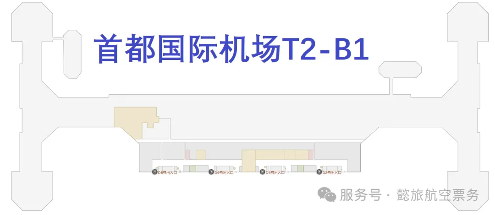
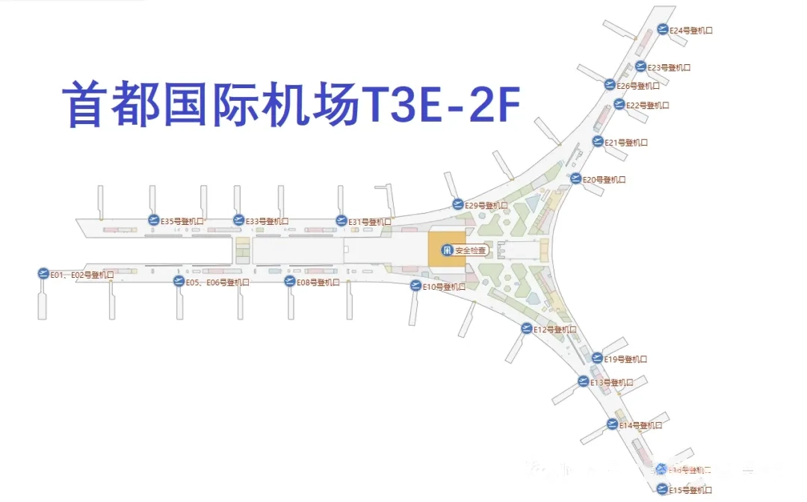

❤️❤️❤️ Международный аэропорт Пекин-Шоуду занимает 25,69 км². Один из самых загруженных аэропортов Китая, он располагает тремя взлётно-посадочными полосами, 314 стоянками воздушных судов и широким набором грузовых и логистических услуг.

## Терминалы

👉👉👉 У Шоуду три терминала (T1, T2 и T3), хотя **T1 в настоящее время не работает** ❌.

- ✅ **T1** (❌ закрыт): внутренние рейсы, три этажа.
- ✅ **T2**: внутренние и международные рейсы, четыре этажа.
- ✅ **T3**, разделён на три зоны:
  - 🟡 **T3C**: пять этажей, в основном внутренние рейсы — см. рисунки 7–11.
  - 🟡 **T3D**: четыре этажа, в основном международные рейсы — см. рисунки 12–15.
  - 🟡 **T3E**: три этажа, в основном международные рейсы — см. рисунки 16–18.

## Поэтажные схемы

👉👉👉 Ниже подробные поэтажные схемы:

- T2 B1 ➡️ рисунок 2
- T2 1F ➡️ рисунок 3
- T2 2F ➡️ рисунок 4
- T2 3F ➡️ рисунок 5
- T3C B1 ➡️ рисунок 6
- T3C 1F ➡️ рисунок 7
- T3C 2F ➡️ рисунок 8
- T3C 3F ➡️ рисунок 9
- T3C 4F ➡️ рисунок 10
- T3D B1 ➡️ рисунок 11
- T3D 1F ➡️ рисунок 12
- T3D 2F ➡️ рисунок 13
- T3D 3F ➡️ рисунок 14
- T3E 1F ➡️ рисунок 15
- T3E 2F ➡️ рисунок 16
- T3E 3F ➡️ рисунок 17

### T2

### T3C

### T3D

### T3E

## Полезные ссылки

- **На этом сайте**: [Международный аэропорт Пекин-Шоуду (PEK)](/airport/PEK), [Китай (CN)](/country/CN)
- **Википедия**: [Beijing Capital International Airport](https://en.wikipedia.org/wiki/Beijing_Capital_International_Airport)
- **Baidu Baike**: [Международный аэропорт Пекин-Шоуду](https://baike.baidu.com/item/%E5%8C%97%E4%BA%AC%E9%A6%96%E9%83%BD%E5%9B%BD%E9%99%85%E6%9C%BA%E5%9C%BA)
