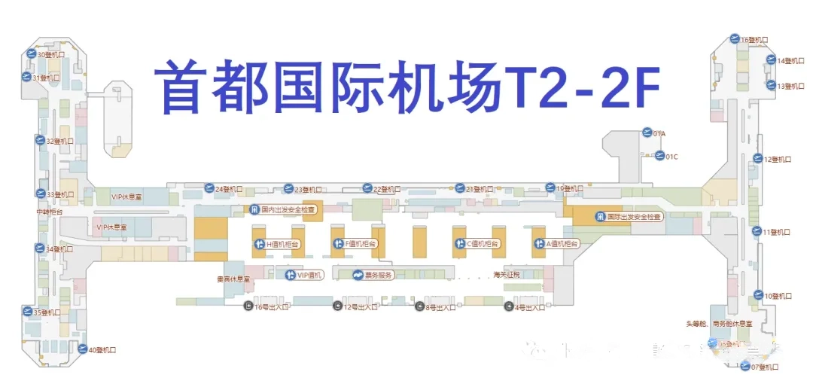

❤️❤️❤️ Beijing Capital International Airport täcker 25,69 km². Det är en av Kinas mest trafikerade flygplatser och har tre rullbanor, 314 uppställningsplatser och ett brett utbud av frakt- och logistiktjänster.

## Terminalerna

👉👉👉 Capital har tre terminaler (T1, T2 och T3), men **T1 är för närvarande stängd** ❌.

- ✅ **T1** (❌ stängd): inrikes, tre våningar.
- ✅ **T2**: inrikes och utrikes, fyra våningar.
- ✅ **T3**, uppdelad i tre zoner:
  - 🟡 **T3C**: fem våningar, mest inrikes – se figur 7 till 11.
  - 🟡 **T3D**: fyra våningar, mest utrikes – se figur 12 till 15.
  - 🟡 **T3E**: tre våningar, mest utrikes – se figur 16 till 18.

## Våningsdiagram

👉👉👉 Detaljerade våningsdiagram följer:

- T2 B1 ➡️ Figur 2
- T2 1F ➡️ Figur 3
- T2 2F ➡️ Figur 4
- T2 3F ➡️ Figur 5
- T3C B1 ➡️ Figur 6
- T3C 1F ➡️ Figur 7
- T3C 2F ➡️ Figur 8
- T3C 3F ➡️ Figur 9
- T3C 4F ➡️ Figur 10
- T3D B1 ➡️ Figur 11
- T3D 1F ➡️ Figur 12
- T3D 2F ➡️ Figur 13
- T3D 3F ➡️ Figur 14
- T3E 1F ➡️ Figur 15
- T3E 2F ➡️ Figur 16
- T3E 3F ➡️ Figur 17

### T2

### T3C

### T3D

### T3E

## Relaterade länkar

- **På den här sajten**: [Beijing Capital International Airport (PEK)](/airport/PEK), [Kina (CN)](/country/CN)
- **Wikipedia**: [Beijing Capital International Airport](https://en.wikipedia.org/wiki/Beijing_Capital_International_Airport)
- **Baidu Baike**: [Beijing Capital International Airport](https://baike.baidu.com/item/%E5%8C%97%E4%BA%AC%E9%A6%96%E9%83%BD%E5%9B%BD%E9%99%85%E6%9C%BA%E5%9C%BA)
