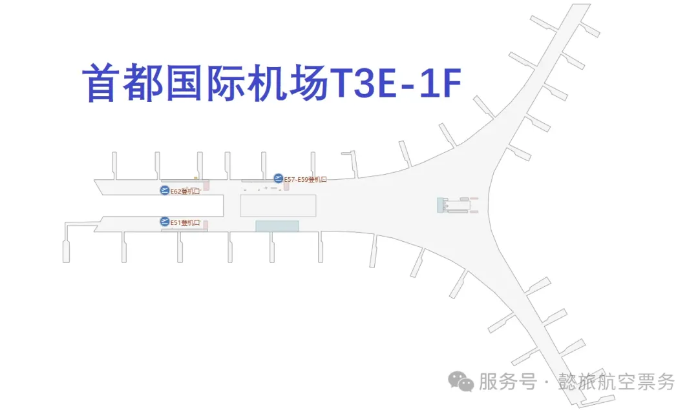

❤️❤️❤️ Uwanja wa Ndege wa Kimataifa wa Beijing Capital unachukua eneo la kilomita za mraba 25.69. Ukiwa mmoja wa viwanja vya ndege vyenye shughuli nyingi zaidi China, una njia tatu za ndege, stendi 314 za ndege na aina mbalimbali za huduma za mizigo na usafirishaji.

## Majengo ya abiria

👉👉👉 Capital ina majengo matatu ya abiria (T1, T2 na T3), ingawa **T1 kwa sasa haitumiki** ❌.

- ✅ **T1** (❌ imefungwa): ya ndani, ghorofa tatu.
- ✅ **T2**: ya ndani na kimataifa, ghorofa nne.
- ✅ **T3**, imegawanywa katika maeneo matatu:
  - 🟡 **T3C**: ghorofa tano, nyingi za ndani — tazama Kielelezo 7 hadi 11.
  - 🟡 **T3D**: ghorofa nne, nyingi za kimataifa — tazama Kielelezo 12 hadi 15.
  - 🟡 **T3E**: ghorofa tatu, nyingi za kimataifa — tazama Kielelezo 16 hadi 18.

## Michoro ya ghorofa

👉👉👉 Michoro ya kina ya ghorofa inafuata:

- T2 B1 ➡️ Kielelezo 2
- T2 1F ➡️ Kielelezo 3
- T2 2F ➡️ Kielelezo 4
- T2 3F ➡️ Kielelezo 5
- T3C B1 ➡️ Kielelezo 6
- T3C 1F ➡️ Kielelezo 7
- T3C 2F ➡️ Kielelezo 8
- T3C 3F ➡️ Kielelezo 9
- T3C 4F ➡️ Kielelezo 10
- T3D B1 ➡️ Kielelezo 11
- T3D 1F ➡️ Kielelezo 12
- T3D 2F ➡️ Kielelezo 13
- T3D 3F ➡️ Kielelezo 14
- T3E 1F ➡️ Kielelezo 15
- T3E 2F ➡️ Kielelezo 16
- T3E 3F ➡️ Kielelezo 17

### T2

### T3C

### T3D

### T3E

## Viungo vinavyohusiana

- **Kwenye tovuti hii**: [Uwanja wa Ndege wa Kimataifa wa Beijing Capital (PEK)](/airport/PEK), [China (CN)](/country/CN)
- **Wikipedia**: [Beijing Capital International Airport](https://en.wikipedia.org/wiki/Beijing_Capital_International_Airport)
- **Baidu Baike**: [Beijing Capital International Airport](https://baike.baidu.com/item/%E5%8C%97%E4%BA%AC%E9%A6%96%E9%83%BD%E5%9B%BD%E9%99%85%E6%9C%BA%E5%9C%BA)
