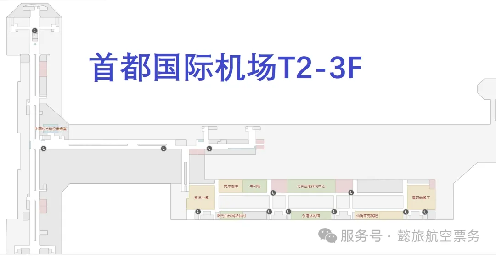
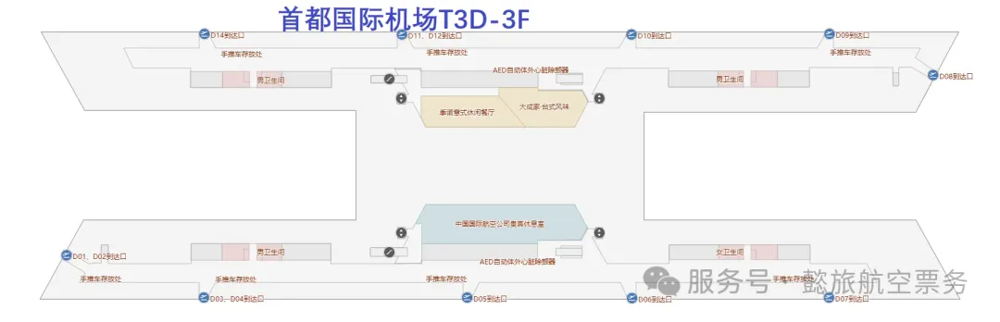

❤️❤️❤️ Pekin Başkent Uluslararası Havalimanı 25,69 km² alan kaplıyor. Çin'in en yoğun havalimanlarından biri; üç pisti, 314 uçak park pozisyonu ve geniş bir kargo ile lojistik hizmet yelpazesi var.

## Terminaller

👉👉👉 Başkent'in üç terminali var (T1, T2 ve T3), ancak **T1 şu anda hizmet dışı** ❌.

- ✅ **T1** (❌ kapalı): iç hatlar, üç kat.
- ✅ **T2**: iç ve dış hatlar, dört kat.
- ✅ **T3**, üç bölgeye ayrılmış:
  - 🟡 **T3C**: beş kat, çoğunlukla iç hatlar — bkz. Şekil 7–11.
  - 🟡 **T3D**: dört kat, çoğunlukla dış hatlar — bkz. Şekil 12–15.
  - 🟡 **T3E**: üç kat, çoğunlukla dış hatlar — bkz. Şekil 16–18.

## Kat şemaları

👉👉👉 Ayrıntılı kat şemaları aşağıda:

- T2 B1 ➡️ Şekil 2
- T2 1F ➡️ Şekil 3
- T2 2F ➡️ Şekil 4
- T2 3F ➡️ Şekil 5
- T3C B1 ➡️ Şekil 6
- T3C 1F ➡️ Şekil 7
- T3C 2F ➡️ Şekil 8
- T3C 3F ➡️ Şekil 9
- T3C 4F ➡️ Şekil 10
- T3D B1 ➡️ Şekil 11
- T3D 1F ➡️ Şekil 12
- T3D 2F ➡️ Şekil 13
- T3D 3F ➡️ Şekil 14
- T3E 1F ➡️ Şekil 15
- T3E 2F ➡️ Şekil 16
- T3E 3F ➡️ Şekil 17

### T2

### T3C

### T3D

### T3E

## İlgili bağlantılar

- **Bu sitede**: [Pekin Başkent Uluslararası Havalimanı (PEK)](/airport/PEK), [Çin (CN)](/country/CN)
- **Wikipedia**: [Pekin Başkent Uluslararası Havalimanı](https://en.wikipedia.org/wiki/Beijing_Capital_International_Airport)
- **Baidu Baike**: [Pekin Başkent Uluslararası Havalimanı](https://baike.baidu.com/item/%E5%8C%97%E4%BA%AC%E9%A6%96%E9%83%BD%E5%9B%BD%E9%99%85%E6%9C%BA%E5%9C%BA)
