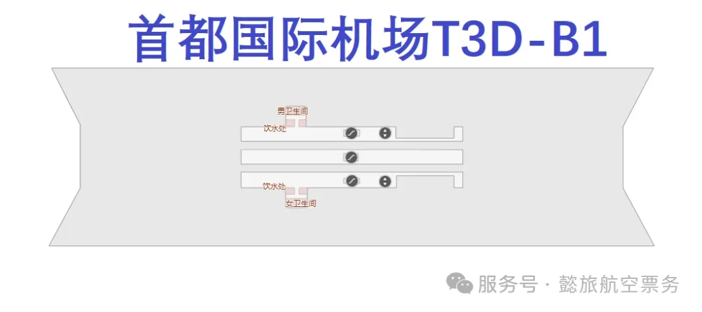
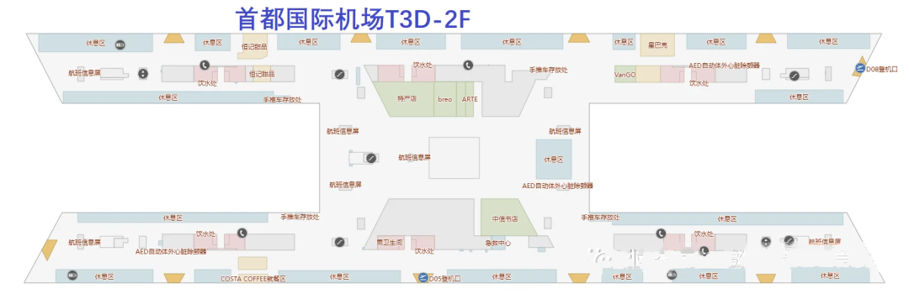

❤️❤️❤️ Пекінський міжнародний аеропорт Шоуду займає 25,69 км². Один із найзавантаженіших аеропортів Китаю, він має три злітно-посадкові смуги, 314 стояночних місць для літаків і широкий спектр вантажних та логістичних послуг.

## Термінали

👉👉👉 У Шоуду три термінали (T1, T2 і T3), хоча **T1 наразі не працює** ❌.

- ✅ **T1** (❌ закрито): внутрішні рейси, три поверхи.
- ✅ **T2**: внутрішні та міжнародні рейси, чотири поверхи.
- ✅ **T3**, поділений на три зони:
  - 🟡 **T3C**: п'ять поверхів, переважно внутрішні рейси — див. рисунки 7–11.
  - 🟡 **T3D**: чотири поверхи, переважно міжнародні рейси — див. рисунки 12–15.
  - 🟡 **T3E**: три поверхи, переважно міжнародні рейси — див. рисунки 16–18.

## Поверхові схеми

👉👉👉 Далі — докладні поверхові схеми:

- T2, підвал 1 ➡️ рисунок 2
- T2, 1 поверх ➡️ рисунок 3
- T2, 2 поверх ➡️ рисунок 4
- T2, 3 поверх ➡️ рисунок 5
- T3C, підвал 1 ➡️ рисунок 6
- T3C, 1 поверх ➡️ рисунок 7
- T3C, 2 поверх ➡️ рисунок 8
- T3C, 3 поверх ➡️ рисунок 9
- T3C, 4 поверх ➡️ рисунок 10
- T3D, підвал 1 ➡️ рисунок 11
- T3D, 1 поверх ➡️ рисунок 12
- T3D, 2 поверх ➡️ рисунок 13
- T3D, 3 поверх ➡️ рисунок 14
- T3E, 1 поверх ➡️ рисунок 15
- T3E, 2 поверх ➡️ рисунок 16
- T3E, 3 поверх ➡️ рисунок 17

### T2

### T3C

### T3D

### T3E

## Пов'язані посилання

- **На цьому сайті**: [Пекінський міжнародний аеропорт Шоуду (PEK)](/airport/PEK), [Китай (CN)](/country/CN)
- **Вікіпедія**: [Пекінський міжнародний аеропорт Шоуду](https://en.wikipedia.org/wiki/Beijing_Capital_International_Airport)
- **Baidu Baike**: [Пекінський міжнародний аеропорт Шоуду](https://baike.baidu.com/item/%E5%8C%97%E4%BA%AC%E9%A6%96%E9%83%BD%E5%9B%BD%E9%99%85%E6%9C%BA%E5%9C%BA)
