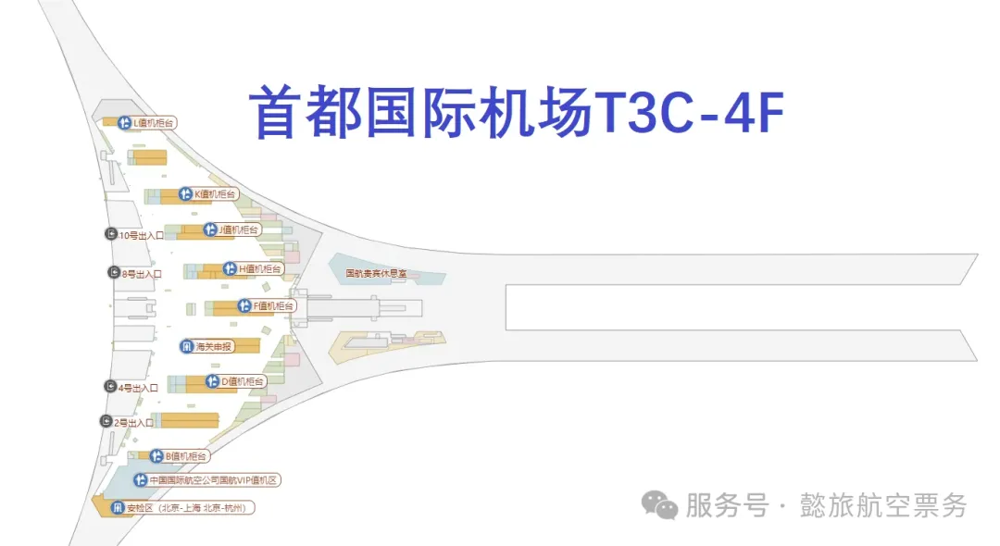

❤️❤️❤️ Sân bay Quốc tế Thủ đô Bắc Kinh rộng 25,69 km². Là một trong những sân bay bận rộn nhất Trung Quốc, sân bay có ba đường băng, 314 vị trí đỗ máy bay và nhiều dịch vụ vận tải, hậu cần.

## Các nhà ga

👉👉👉 Thủ đô có ba nhà ga (T1, T2 và T3), nhưng **T1 hiện đang ngừng hoạt động** ❌.

- ✅ **T1** (❌ đóng cửa): nội địa, ba tầng.
- ✅ **T2**: nội địa và quốc tế, bốn tầng.
- ✅ **T3**, chia thành ba khu:
  - 🟡 **T3C**: năm tầng, chủ yếu nội địa — xem Hình 7 đến 11.
  - 🟡 **T3D**: bốn tầng, chủ yếu quốc tế — xem Hình 12 đến 15.
  - 🟡 **T3E**: ba tầng, chủ yếu quốc tế — xem Hình 16 đến 18.

## Sơ đồ tầng

👉👉👉 Sơ đồ chi tiết từng tầng như sau:

- T2 B1 ➡️ Hình 2
- T2 1F ➡️ Hình 3
- T2 2F ➡️ Hình 4
- T2 3F ➡️ Hình 5
- T3C B1 ➡️ Hình 6
- T3C 1F ➡️ Hình 7
- T3C 2F ➡️ Hình 8
- T3C 3F ➡️ Hình 9
- T3C 4F ➡️ Hình 10
- T3D B1 ➡️ Hình 11
- T3D 1F ➡️ Hình 12
- T3D 2F ➡️ Hình 13
- T3D 3F ➡️ Hình 14
- T3E 1F ➡️ Hình 15
- T3E 2F ➡️ Hình 16
- T3E 3F ➡️ Hình 17

### T2

### T3C

### T3D

### T3E

## Liên kết liên quan

- **Trên trang này**: [Sân bay Quốc tế Thủ đô Bắc Kinh (PEK)](/airport/PEK), [Trung Quốc (CN)](/country/CN)
- **Wikipedia**: [Beijing Capital International Airport](https://en.wikipedia.org/wiki/Beijing_Capital_International_Airport)
- **Baidu Baike**: [Beijing Capital International Airport](https://baike.baidu.com/item/%E5%8C%97%E4%BA%AC%E9%A6%96%E9%83%BD%E5%9B%BD%E9%99%85%E6%9C%BA%E5%9C%BA)
