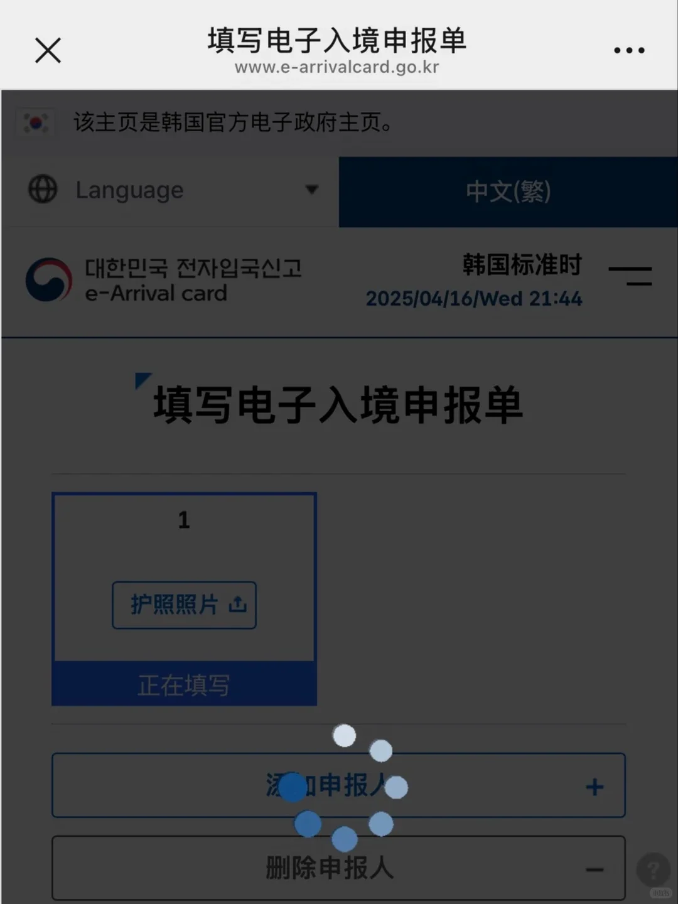

গিমহে আন্তর্জাতিক বিমানবন্দর ছোট এবং আগমনের প্রক্রিয়া সংক্ষিপ্ত: বিমান থেকে নামা, বিদেশি যাত্রীদের লেন, ফিঙ্গারপ্রিন্ট, ব্যাগ, কাস্টমস — ভালো দিনে আধা ঘণ্টায় টার্মিনালের বাইরে। মানুষের সময় নষ্ট হয় সাধারণত লাইনে নয় — ইলেকট্রনিক অ্যারাইভাল কার্ডের কারণে, যা তারা বিমান অবতরণের আগে শেষ করেনি।

কোরিয়া এখন একটি ই-অ্যারাইভাল কার্ড চালায়, যা ফোনে আগেই পূরণ করা যায় এবং বিমানে দেওয়া কাগজের কার্ডের বদলে ব্যবহার করা যায়। এই গাইড পাঁচ ধাপে প্রক্রিয়াটি অনুসরণ করে — ফর্ম, সাক্ষাৎকার, ব্যাগেজ, কাস্টমস ও বহির্গমন — এবং যেসব ক্ষেত্রে সমস্যা হয় সেগুলোতে মন দেয়: ঠিকানা, পাসপোর্টের ছবি ও ফোন নম্বর। ওয়েবসাইট ও নিয়ম বদলায়, তাই ভ্রমণের আগে অফিসিয়াল পেজটি দেখে নিন।

## 1. অবতরণের তিন দিন আগে: ই-অ্যারাইভাল কার্ড জমা দিন

অফিসিয়াল পোর্টাল www.e-arrivalcard.go.kr, এবং এটি বিনামূল্যে; কোনো এজেন্টকে টাকা দিতে হবে না। ফর্মটি আগমনের তিন দিন আগে খোলে — 22 অক্টোবর অবতরণ করলে 19 অক্টোবর থেকে জমা দিতে পারবেন — এবং একবার হয়ে গেলে পিডিএফ বা স্ক্রিনশট সংরক্ষণ করুন অফিসারকে দেখানোর জন্য।

ফর্মটি পাঁচ ধাপে চলে: শর্তাবলিতে সম্মতি দিন ও একটি ইমেল ঠিকানা দিন, পাসপোর্টের তথ্য দিন, ভ্রমণের তথ্য যোগ করুন (তারিখ, ফ্লাইট নম্বর, কোরিয়ায় ঠিকানা), সবকিছু যাচাই করে জমা দিন। জমা দিলে একটি ইস্যু নম্বর পাওয়া যায়, যা দিয়ে আপনার ইমেল দিয়ে আবার লগইন করে ফর্মটি দেখা বা সম্পাদনা করা যায়, তাই বদলানো ফ্লাইট বা ভুল টাইপ করা ঠিকানাও ঠিক করা যায়।

ই-অ্যারাইভাল কার্ড ভিসা নয় এবং ভিসার বিকল্পও নয়। চীনা পাসপোর্টধারীদের এখনও বৈধ কোরিয়ান ভিসা বা রেসিডেন্স পারমিট দরকার; কার্ডটি কেবল কাগজের আগমন স্লিপের বিকল্প। কাগজের কার্ড বৈধ এবং ফ্লাইট অ্যাটেনডেন্টরা এখনও তা দেন, আর আগমন হলে ডেস্ক আছে যদি আপনি বরং সেখানে বসে একটি পূরণ করতে চান — তবে তা আরেকটি লাইনে দাঁড়ানোই।

## 2. যে চারটি ক্ষেত্রে মানুষ আটকে যায়

প্রথমটি ঠিকানা। আপনার কোরিয়ায় ঠিকানা দরকার, আদর্শভাবে কোরিয়ান ও ইংরেজি দুই ভাষাতেই, সাথে পাঁচ অঙ্কের পোস্টাল কোড। হোটেলের কনফার্মেশনে সাধারণত দুটোই থাকে; পোস্টাল কোড না থাকলে ফর্মটি ঠিকানা বা পোস্টকোড দিয়ে খুঁজে মিলে যাওয়া কোরিয়ান ঠিকানা দিতে পারে, যা থেকে একটি বেছে নিতে হয়।

দ্বিতীয়টি পাসপোর্টের ছবি। যেখানে আপনার ছবি আছে সেই পৃষ্ঠাটি আপলোড করুন, এবং নিচের প্রান্তে থাকা মেশিন-রিডেবল স্ট্রিপটি অন্তর্ভুক্ত করুন — তা কেটে ফেললে আপলোড ব্যর্থ হয়। চকচকে ভাব ও ঝাপসাও প্রত্যাখ্যাত হয়, তাই স্ক্রিনশট না নিয়ে সমান আলোতে আবার ছবি তুলুন।

তৃতীয়টি ফোন নম্বর। চীনা মোবাইল নম্বর কাজ করে যদি সামনে 86 বসানো হয়; ভুল ফরম্যাট বা খুব কম অঙ্ক থাকলে পেজটি ফর্মেই আটকে থাকে। চতুর্থটি অসম্পূর্ণ তথ্য: একটি অনুপস্থিত ইউনিট নম্বর, ভুল টাইপ করা ফ্লাইট বা উল্টো তারিখ — সবই পেজটিকে ফর্মে ফিরিয়ে পাঠায়, যা ভাঙা ওয়েবসাইটের মতো দেখায় কিন্তু সাধারণত একটি ক্ষেত্রই ভ্যালিডেশনে ব্যর্থ হয়।

জমা দেওয়ার সাথে সাথে উইন্ডো বন্ধ করবেন না। পিডিএফ সংরক্ষণ করুন এবং ইস্যু নম্বর দেখানো একটি স্ক্রিনশট নিন, এবং দুটোই আপনার ফটো লাইব্রেরি বা একটি অফলাইন ফোল্ডারে রাখুন। বিমানবন্দরের ওয়াইফাই নির্ভরযোগ্য নয়, এবং যে এক মুহূর্তে ফাইলটি দরকার ঠিক সেই মুহূর্তেই তা লোড হবে না।

## 3. ইমিগ্রেশন: বিদেশি যাত্রীদের লেন ব্যবহার করুন

বিমান থেকে নেমে "국제선 도착 / International Arrivals" সাইন অনুসরণ করুন। ইমিগ্রেশন হলে কোরিয়ান পাসপোর্টগুলো দেশীয় কাউন্টারে যায় এবং বিদেশি দর্শনার্থীরা "Foreigner / 外国人" লেখা লেনে যায়, সাধারণত পীত বা নীল সাইন থাকে যা চোখ এড়ানো কঠিন।

কাউন্টারে আপনার পাসপোর্ট এবং ই-অ্যারাইভাল স্ক্রিনশট বা কাগজের কার্ড দেখান। অফিসার আপনার ভিসা, ফ্লাইট ও ঠিকানা যাচাই করেন, তারপর দুটি তর্জনীর ফিঙ্গারপ্রিন্ট ও মুখের ছবি নেন। এই ধাপ বাধ্যতামূলক: অস্বীকার করলে প্রবেশে অস্বীকৃতি জানানো হয়। এরপর আপনি ব্যাগেজের দিকে যান।

অপেক্ষার সময় নির্ভর করে আর কী অবতরণ করছে তার ওপর। ভোর ও গভীর রাতের ফ্লাইট সাধারণত কয়েক মিনিটে ক্লিয়ার হয়; দিনের মাঝামাঝি, একসাথে কয়েকটি আগমন জমলে 30 থেকে 40 মিনিট স্বাভাবিক। হাঁটুন, জেট ব্রিজে বা টয়লেটে দেরি করবেন না — যত আগে হলে পৌঁছাবেন, তত আগে পার হবেন।

## 4. ব্যাগেজ ও কাস্টমস

ইমিগ্রেশনের পর ব্যাগেজ ক্যারোসেল, স্ক্রিনে দেখানো হয় কোন বেল্ট আপনার ফ্লাইটের জন্য। গিমহেতে বেল্ট বেশি নয়, তাই সহযাত্রীদের অনুসরণ করলেই সাধারণত কাজ হয়; ক্যারোসেলের পাশে ট্রলি বিনামূল্যে, এবং অতিরিক্ত বড় ব্যাগের জন্য আলাদা সংগ্রহস্থল আছে।

তারপর কাস্টমস, যা "ঘোষণার সামগ্রী আছে" ও "ঘোষণার কিছু নেই"-তে ভাগ হয়। ঘোষণার কিছু না থাকলে সবুজ চ্যানেলে ব্যাগ স্ক্যানারে দিন। ডিউটি-ফ্রি সীমার বেশি কিছু, US$10,000-এর বেশি নগদ, বা খাবার, মাংস, বীজ বা অন্য নিষিদ্ধ সামগ্রী আনলে ঘোষণা চ্যানেল ব্যবহার করুন এবং সৎভাবে ফর্ম পূরণ করুন।

মনে রাখার মতো ডিউটি-ফ্রি সীমা: 1 লিটার মদ, 200 সিগারেট, 60 মিলি পারফিউম, এবং অন্যান্য সামগ্রী মোট US$800 পর্যন্ত। বেশিরভাগ মাংসজাত পণ্য, ফল, সবজি ও বীজ নিষিদ্ধ, এবং যা আনবেন তা অবশ্যই ঘোষণা করতে হবে — না করলে জরিমানা সত্যিই হয়। হলে থাকা কাস্টমস নোটিশই চূড়ান্ত কথা।

## 5. টার্মিনালের বাইরে: লাইট রেল, বাস বা ট্যাক্সি

আগমন হলে, বাইরে যাওয়ার আগে দিক ঠিক করে নিন। এয়ারপোর্ট স্টেশন দেশীয় টার্মিনালের দিকে: আন্তর্জাতিক আগমন থেকে বেরিয়ে দেশীয় গেট 1-এ হেঁটে যান, জেব্রা ক্রসিং পার হন, প্রবেশপথ ওখানেই, হেঁটে পাঁচ থেকে দশ মিনিট। বাসের টিকিট অফিস গেট 4-এর পাশে, এবং ট্যাক্সি স্ট্যান্ড ক্রসিংয়ের ওপারে।

বাস ও ট্যাক্সি দুটোই দেশীয় টার্মিনালের দিক থেকে ছাড়ে, এবং আন্তর্জাতিক আগমনের বাইরে সাইন "대중교통 / Bus·Taxi·Light Rail" দেখায়, তাই পথ অনুসরণ করা সহজ। লাইট রেল তিন স্টেশনে ও প্রায় ছয় মিনিটে সাসাং পৌঁছায়, যেখান থেকে লাইন 2 সিওমিয়ন, গোয়াংগালি ও হাইউন্দে পর্যন্ত চলতে থাকে; ধাপে ধাপে রুট, ভাড়া ও ট্রান্সফার [লাইট রেল গাইড](/blog/busan-gimhae-airport-light-rail-guide)-এ আছে।

অনেক লাগেজ, বা শিশু বা বয়স্ক যাত্রী থাকলে ট্যাক্সি সহজতর: সিওমিয়ন পর্যন্ত প্রায় 25 থেকে 30 মিনিট ও 20,000 থেকে 25,000 ওয়ন, বা হাইউন্দে পর্যন্ত 45 থেকে 55 মিনিট ও 35,000 থেকে 45,000 ওয়ন। শেষ ট্রেনের পর অবতরণ করলে ট্যাক্সিই একমাত্র উপায়।

## সম্পর্কিত লিংক

- **এই সাইটে**: [দক্ষিণ কোরিয়া (KR)](/country/KR), [গিমহে বিমানবন্দর লাইট রেল গাইড](/blog/busan-gimhae-airport-light-rail-guide)
- **উইকিপিডিয়া**: [Gimhae International Airport](https://en.wikipedia.org/wiki/Gimhae_International_Airport)
- **বাইদু বাইকে**: [Gimhae International Airport](https://baike.baidu.com/item/%E9%87%91%E6%B5%B7%E5%9B%BD%E9%99%85%E6%9C%BA%E5%9C%BA)

সূত্র: একটি উইচ্যাট ভ্রমণ গাইড, অক্টোবর 2026-এ সম্পাদিত। ই-অ্যারাইভাল নিয়ম, ইমিগ্রেশন পরীক্ষা ও কাস্টমস সীমা কোরিয়ার বিচার মন্ত্রণালয়, কোরিয়া কাস্টমস সার্ভিস এবং গিমহে বিমানবন্দরের চলমান নোটিশ অনুসরণ করে।
