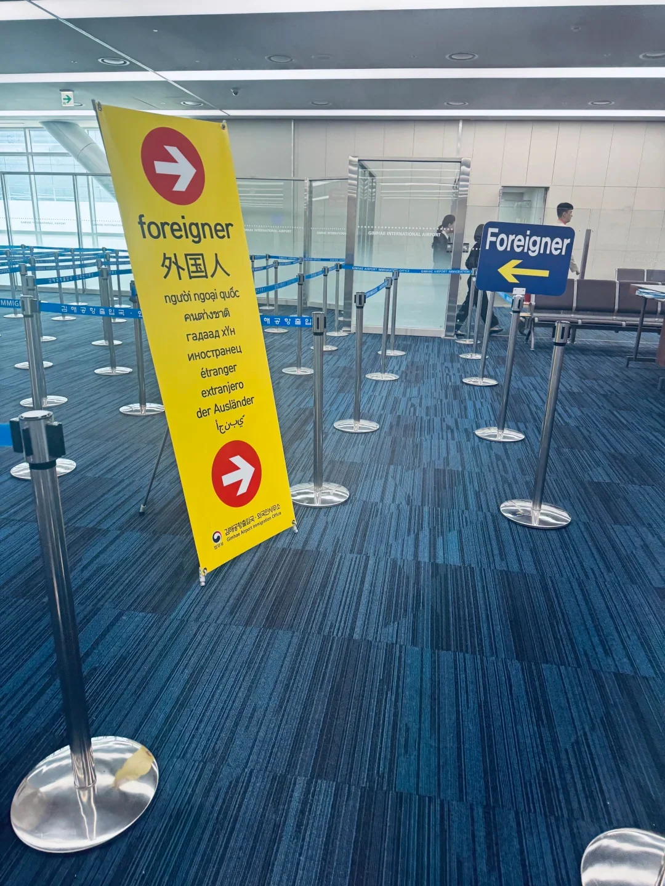
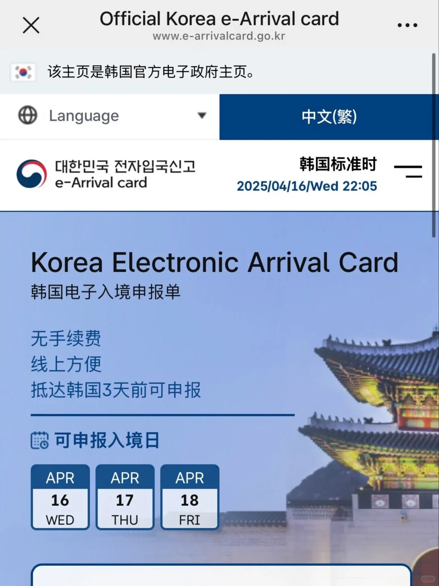
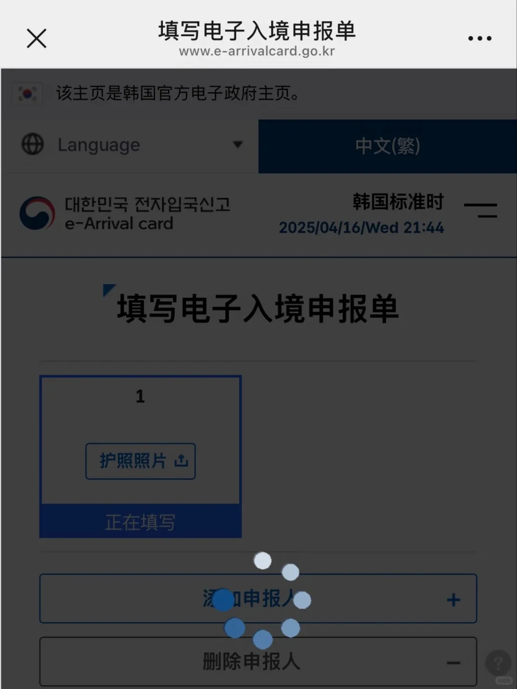
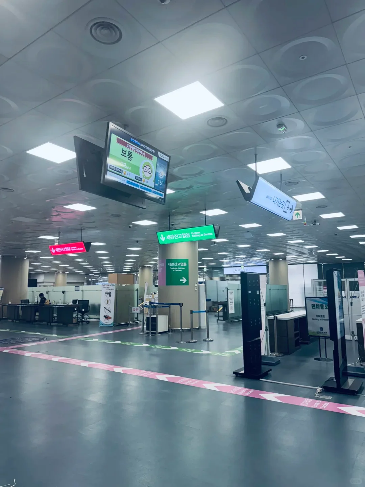
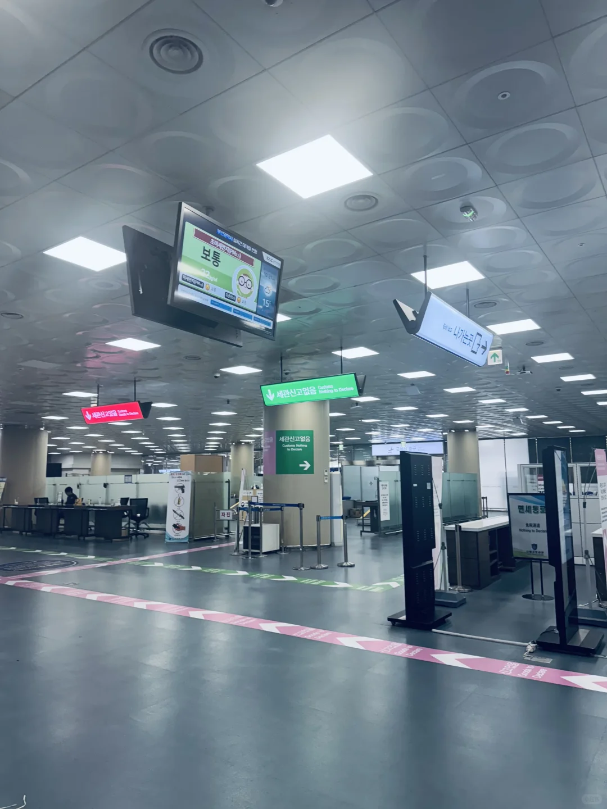

Der Gimhae International Airport ist klein, und die Ankunft geht schnell: aus dem Flugzeug, durch die Ausländerspur, Fingerabdrücke, Gepäck, Zoll, und an einem guten Tag in einer halben Stunde aus dem Terminal. Was Menschen Zeit kostet, ist selten die Schlange – es ist die elektronische Ankunftskarte, die sie vor der Landung nicht fertig ausgefüllt haben.

Korea betreibt jetzt eine e-Arrival Card, die sich vorab auf dem Telefon ausfüllen und anstelle der im Flugzeug verteilten Papierkarte verwenden lässt. Dieser Leitfaden folgt dem Ablauf in fünf Schritten – Formular, Einreisegespräch, Gepäck, Zoll und Ausgang – und konzentriert sich auf die Felder, die Probleme bereiten: Adresse, Passfoto und Telefonnummer. Die Website und die Regeln ändern sich, prüfen Sie daher vor der Reise die offizielle Seite.

## 1. Drei Tage vor der Landung: die e-Arrival Card ausfüllen

Das offizielle Portal ist www.e-arrivalcard.go.kr, und es ist kostenlos; Sie müssen keinen Vermittler bezahlen. Das Formular öffnet drei Tage vor der Ankunft – bei einer Landung am 22. Oktober können Sie ab dem 19. Oktober einreichen –, und wenn es erledigt ist, speichern Sie das PDF oder einen Screenshot, um ihn dem Beamten zu zeigen.

Das Formular führt durch fünf Schritte: den Bedingungen zustimmen und eine E-Mail-Adresse angeben, die Passdaten eingeben, die Reisedaten ergänzen (Daten, Flugnummer, Adresse in Korea), alles prüfen und absenden. Nach dem Absenden erhalten Sie eine Vorgangsnummer, mit der Sie sich per E-Mail wieder anmelden können, um das Formular zu prüfen oder zu ändern; ein geänderter Flug oder eine falsch eingegebene Adresse lassen sich also noch korrigieren.

Die e-Arrival Card ist kein Visum und ersetzt keines. Chinesische Passinhaber benötigen weiterhin ein gültiges koreanisches Visum oder eine Aufenthaltsgenehmigung; die Karte ersetzt nur den Papier-Ankunftsschein. Papierkarten bleiben gültig und werden von den Flugbegleitern weiterhin verteilt, und in der Ankunftshalle stehen Schalter, wenn Sie lieber vor Ort ausfüllen möchten – das bedeutet nur, sich in eine weitere Schlange einzureihen.

## 2. Die vier Felder, bei denen Menschen hängen bleiben

Das erste ist die Adresse. Sie benötigen Ihre Adresse in Korea, idealerweise auf Koreanisch und Englisch, plus die fünfstellige Postleitzahl. Hotelbestätigungen enthalten meist beides; fehlt die Postleitzahl, kann das Formular nach Adresse oder Postleitzahl suchen und die passende koreanische Adresse anbieten, aus der Sie eine auswählen.

Das zweite ist das Passfoto. Laden Sie die Seite mit Ihrem Foto hoch und schließen Sie den maschinenlesbaren Streifen am unteren Rand ein – schneiden Sie ihn ab, schlägt der Upload fehl. Blendung und Unschärfe werden ebenfalls abgelehnt, machen Sie das Foto daher bei gleichmäßigem Licht neu, statt einen Screenshot zu verwenden.

Das dritte ist die Telefonnummer. Eine chinesische Mobilfunknummer funktioniert, wenn Sie 86 davor setzen; ein falsches Format oder zu wenige Ziffern lassen die Seite im Formular hängen. Das vierte sind unvollständige Angaben: eine fehlende Wohnungsnummer, ein falsch eingegebener Flug oder vertauschte Daten schicken die Seite zurück zum Formular, was wie eine defekte Website aussieht, in Wirklichkeit aber meist daran liegt, dass ein Feld die Validierung nicht besteht.

Schließen Sie das Fenster nicht sofort nach dem Absenden. Speichern Sie das PDF und machen Sie einen Screenshot mit der Vorgangsnummer, und bewahren Sie beides in Ihrer Fotogalerie oder einem Offline-Ordner auf. Das Flughafen-WLAN ist nicht zuverlässig, und genau in dem Moment, in dem Sie die Datei brauchen, wird sie nicht laden.

## 3. Einreise: die Ausländerspur nutzen

Folgen Sie nach dem Aussteigen den Schildern „국제선 도착 / International Arrivals“. In der Einreisehalle gehen koreanische Pässe zu den Inlandsschaltern und ausländische Besucher zur Spur mit der Aufschrift „Foreigner / 外国人“, in der Regel mit einem gelben oder blauen Schild, das kaum zu übersehen ist.

Am Schalter zeigen Sie Ihren Pass und entweder den Screenshot der e-Arrival Card oder die Papierkarte. Der Beamte prüft Visum, Flug und Adresse, nimmt dann Fingerabdrücke beider Zeigefinger und ein Gesichtsbild auf. Dieser Schritt ist obligatorisch: Wer ihn verweigert, dem wird die Einreise verweigert. Danach geht es zum Gepäck.

Die Wartezeit hängt davon ab, was sonst noch landet. Frühmorgendliche und spätabendliche Flüge werden oft in wenigen Minuten abgefertigt; mitten am Tag, wenn mehrere Ankünfte zusammenkommen, sind 30 bis 40 Minuten normal. Gehen Sie zügig, statt auf der Fluggastbrücke oder in den Toiletten zu verweilen – je früher Sie in der Halle sind, desto früher sind Sie durch.

## 4. Gepäck und Zoll

Nach der Einreise kommt das Gepäckband, mit Bildschirmen, die zeigen, welches Band Ihren Flug bedient. Gimhae hat nicht viele Bänder, daher funktioniert es meist, den Mitreisenden zu folgen; Gepäckwagen stehen kostenlos neben dem Band, und für Übergrößen gibt es eine eigene Abholstelle.

Dann der Zoll, der sich in „Waren zu verzollen“ und „Nichts zu verzollen“ teilt. Wenn Sie nichts zu verzollen haben, geben Sie Ihr Gepäck im grünen Kanal durch den Scanner. Wenn Sie über der Freimenge liegen, mehr als 10.000 US$ Bargeld mitführen oder Lebensmittel, Fleisch, Samen oder andere beschränkte Waren einführen, nutzen Sie den Deklarationskanal und füllen Sie das Formular wahrheitsgemäß aus.

Die Freimengen, die Sie im Blick behalten sollten: 1 Liter Alkohol, 200 Zigaretten, 60 ml Parfüm und andere Waren bis zu einem Gesamtwert von 800 US$. Die meisten Fleischprodukte, Obst, Gemüse und Samen sind verboten, und alles, was Sie mitbringen, muss deklariert werden – die Strafe für die Nichtdeklaration ist real. Der Zollaushang in der Halle ist maßgeblich.

## 5. Aus dem Terminal: Stadtbahn, Bus oder Taxi

Orientieren Sie sich in der Ankunftshalle, bevor Sie nach draußen gehen. Die Station Airport liegt auf der Seite des Inlandsterminals: Verlassen Sie die internationale Ankunft, gehen Sie zu Gate 1 des Inlandsterminals, überqueren Sie den Zebrastreifen, und der Eingang ist dort, fünf bis zehn Minuten zu Fuß. Der Busschalter liegt neben Gate 4, und der Taxistand ist auf der anderen Seite des Übergangs.

Busse und Taxis fahren beide von der Seite des Inlandsterminals ab, und die Schilder draußen vor der internationalen Ankunft weisen auf „대중교통 / Bus·Taxi·Light Rail“ hin, sodass der Weg leicht zu finden ist. Die Stadtbahn erreicht Sasang in drei Stationen und etwa sechs Minuten, wo die Linie 2 nach Seomyeon, Gwangalli und Haeundae weiterfährt; die Schritt-für-Schritt-Route, Fahrpreise und der Umstieg sind im [Stadtbahn-Leitfaden](/blog/busan-gimhae-airport-light-rail-guide) beschrieben.

Mit viel Gepäck oder mit Kindern oder älteren Reisenden ist ein Taxi einfacher: etwa 25 bis 30 Minuten und 20.000 bis 25.000 Won nach Seomyeon oder 45 bis 55 Minuten und 35.000 bis 45.000 Won nach Haeundae. Wer nach der letzten Bahn landet, hat nur noch das Taxi.

## Weiterführende Links

- **Auf dieser Website**: [Südkorea (KR)](/country/KR), [Stadtbahn-Leitfaden Flughafen Gimhae](/blog/busan-gimhae-airport-light-rail-guide)
- **Wikipedia**: [Gimhae International Airport](https://en.wikipedia.org/wiki/Gimhae_International_Airport)
- **Baidu Baike**: [Gimhae International Airport](https://baike.baidu.com/item/%E9%87%91%E6%B5%B7%E5%9B%BD%E9%99%85%E6%9C%BA%E5%9C%BA)

Quelle: ein WeChat-Reiseführer, bearbeitet im Oktober 2026. e-Arrival-Bestimmungen, Einreisekontrollen und Zollgrenzen folgen dem koreanischen Justizministerium, dem Korea Customs Service und aktuellen Hinweisen am Flughafen Gimhae.
