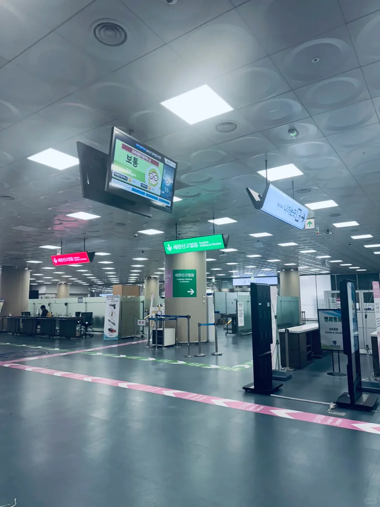

El Aeropuerto Internacional de Gimhae es pequeño y el proceso de llegada es corto: bajar del avión, pasar por el carril de extranjeros, huellas, maletas, aduanas y salir de la terminal en media hora si todo va bien. Lo que hace perder tiempo rara vez es la cola: es la tarjeta de llegada electrónica que no se terminó antes de aterrizar.

Corea usa ahora una tarjeta de llegada electrónica que puede completarse en el teléfono con antelación y utilizarse en lugar de la tarjeta de papel que se reparte en el avión. Esta guía sigue el proceso en cinco pasos —el formulario, la entrevista, el equipaje, las aduanas y la salida— y se centra en los campos que causan problemas: dirección, foto del pasaporte y número de teléfono. La web y las normas cambian, así que consulta la página oficial antes de viajar.

## 1. Tres días antes de aterrizar: presenta la tarjeta de llegada electrónica

El portal oficial es www.e-arrivalcard.go.kr y es gratuito; no hace falta pagar a un agente. El formulario se abre tres días antes de la llegada —si aterrizas el 22 de octubre, puedes enviarlo desde el 19 de octubre— y, una vez hecho, guarda el PDF o una captura para mostrársela al agente.

El formulario recorre cinco pasos: aceptar las condiciones y dar un correo electrónico, introducir los datos del pasaporte, añadir los detalles del viaje (fechas, número de vuelo, dirección en Corea), comprobarlo todo y enviarlo. Al enviarlo se genera un número de expediente, que permite volver a entrar con tu correo para consultar o editar el formulario, así que un vuelo cambiado o una dirección mal escrita todavía pueden corregirse.

La tarjeta de llegada electrónica no es un visado ni lo sustituye. Los titulares de pasaporte chino siguen necesitando un visado o permiso de residencia coreano válido; la tarjeta solo sustituye el papel de llegada. Las tarjetas de papel siguen siendo válidas y los auxiliares de vuelo todavía las reparten, y hay mostradores en la sala de llegadas si prefieres rellenar una allí: solo significa hacer otra cola.

## 2. Los cuatro campos que hacen tropezar

El primero es la dirección. Necesitas tu dirección en Corea, preferiblemente en coreano y en inglés, además del código postal de cinco dígitos. Las confirmaciones de hotel suelen llevar ambos; si falta el código postal, el formulario puede buscar por dirección o código postal y ofrecer la dirección coreana correspondiente, de la que eliges una.

El segundo es la foto del pasaporte. Sube la página con tu fotografía e incluye la banda legible por máquina del borde inferior: si la recortas, la subida falla. Los reflejos y el desenfoque también se rechazan, así que vuelve a hacer la foto con luz uniforme en lugar de usar una captura de pantalla.

El tercero es el número de teléfono. Un móvil chino funciona si le pones 86 delante; el formato incorrecto o muy pocos dígitos dejan la página atascada en el formulario. El cuarto es la información incompleta: un número de piso que falta, un vuelo mal escrito o unas fechas invertidas devuelven la página al formulario, lo que parece una web rota pero normalmente es un campo que no pasa la validación.

No cierres la ventana en cuanto envíes. Guarda el PDF y haz una captura que muestre el número de expediente, y ten ambos en la galería o en una carpeta sin conexión. El wifi del aeropuerto no es fiable, y el momento en que necesitas el archivo es justo el momento en que no cargará.

## 3. Inmigración: usa el carril de extranjeros

Sigue los carteles “국제선 도착 / International Arrivals” al bajar del avión. En la sala de inmigración, los pasaportes coreanos van a los mostradores nacionales y los visitantes extranjeros al carril marcado “Foreigner / 外国人”, normalmente con un cartel amarillo o azul difícil de pasar por alto.

En el mostrador, muestra el pasaporte y la captura de la tarjeta electrónica o la tarjeta de papel. El agente comprueba el visado, el vuelo y la dirección, y luego toma las huellas de los dos dedos índices y una imagen facial. Este paso es obligatorio: negarse significa que te denieguen la entrada. Después pasas al equipaje.

La espera depende de lo que esté aterrizando. Los vuelos de primera hora y de última noche suelen despacharse en pocos minutos; a mediodía, con varias llegadas acumuladas, lo normal son 30 a 40 minutos. Camina en lugar de entretenerte en la pasarela o en los aseos: cuanto antes llegues a la sala, antes pasarás.

## 4. Equipaje y aduanas

Después de inmigración viene la cinta de equipaje, con pantallas que indican qué cinta sirve a tu vuelo. Gimhae no tiene muchas cintas, así que seguir a los demás pasajeros suele funcionar; los carritos son gratuitos junto a la cinta y las maletas de gran tamaño tienen su propio punto de recogida.

Luego las aduanas, que se dividen en “mercancías que declarar” y “nada que declarar”. Si no tienes nada que declarar, pasa las maletas por el escáner del canal verde. Si superas la franquicia duty-free, llevas más de US$10.000 en efectivo o introduces comida, carne, semillas u otros artículos restringidos, usa el canal de declaración y rellena el formulario con sinceridad.

Las franquicias duty-free que conviene recordar: 1 litro de alcohol, 200 cigarrillos, 60 ml de perfume y otros bienes hasta US$800 en total. La mayoría de los productos cárnicos, frutas, verduras y semillas están prohibidos, y todo lo que traigas debe declararse: la sanción por no hacerlo es real. El aviso de aduanas de la sala es la última palabra.

## 5. Fuera de la terminal: tren ligero, autobús o taxi

En la sala de llegadas, orienta antes de salir. La estación Airport está del lado de la terminal nacional: sal de llegadas internacionales, camina hasta la puerta 1 nacional, cruza el paso de cebra y allí está la entrada, a cinco o diez minutos a pie. La taquilla de autobuses está junto a la puerta 4, y la parada de taxis al otro lado del cruce.

Los autobuses y los taxis salen ambos del lado de la terminal nacional, y los carteles fuera de llegadas internacionales indican “대중교통 / Bus·Taxi·Light Rail”, así que el camino es fácil de seguir. El tren ligero llega a Sasang en tres paradas y unos seis minutos, donde la línea 2 continúa hacia Seomyeon, Gwangalli y Haeundae; la ruta paso a paso, las tarifas y el transbordo se explican en la [guía del tren ligero](/blog/busan-gimhae-airport-light-rail-guide).

Con mucho equipaje, o con niños o viajeros mayores, un taxi es más sencillo: unos 25 a 30 minutos y 20.000 a 25.000 wones hasta Seomyeon, o 45 a 55 minutos y 35.000 a 45.000 wones hasta Haeundae. Si aterrizas después del último tren, el taxi es la única opción que queda.

## Enlaces relacionados

- **En este sitio**: [Corea del Sur (KR)](/country/KR), [Guía del tren ligero del aeropuerto de Gimhae](/blog/busan-gimhae-airport-light-rail-guide)
- **Wikipedia**: [Aeropuerto Internacional de Gimhae](https://en.wikipedia.org/wiki/Gimhae_International_Airport)
- **Baidu Baike**: [Aeropuerto Internacional de Gimhae](https://baike.baidu.com/item/%E9%87%91%E6%B5%B7%E5%9B%BD%E9%99%85%E6%9C%BA%E5%9C%BA)

Fuente: una guía de viaje de WeChat, editada en octubre de 2026. Las normas de la tarjeta de llegada electrónica, los controles de inmigración y los límites de aduanas siguen al Ministerio de Justicia de Corea, al Servicio de Aduanas de Corea y a los avisos actuales del aeropuerto de Gimhae.
