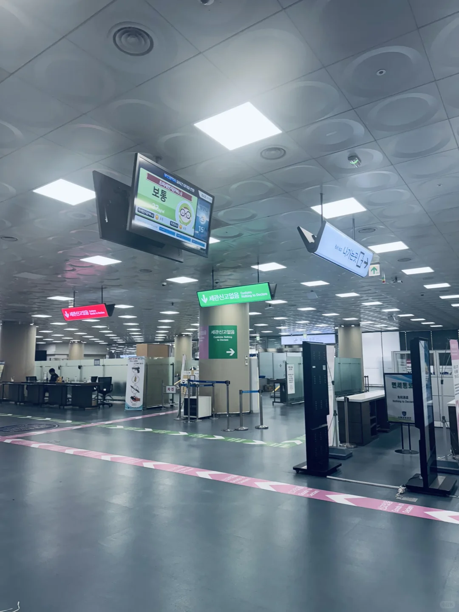

Gimhae internationella flygplats är liten och ankomstprocessen är kort: av planet, genom utlänningskön, fingeravtryck, väskor, tull, och ut ur terminalen på en halvtimme en bra dag. Det som kostar folk tid är sällan kön — det är det elektroniska ankomstkortet de inte hann fylla i före landningen.

Korea har nu ett e-Arrival Card som kan fyllas i på telefonen i förväg och användas i stället för papperskortet som delas ut på planet. Den här guiden följer processen i fem steg — formuläret, immigrationskontrollen, bagaget, tullen och utpasseringen — och koncentrerar sig på fälten som ställer till problem: adress, passfoto och telefonnummer. Webbplatsen och reglerna ändras, så kontrollera den officiella sidan innan du reser.

## 1. Tre dagar före landning: fyll i e-Arrival Card

Den officiella portalen är www.e-arrivalcard.go.kr, och den är gratis; det finns ingen anledning att betala en agent. Formuläret öppnar tre dagar före ankomst — landar du den 22 oktober kan du skicka in från den 19 oktober — och när det är klart sparar du PDF:en eller en skärmbild att visa för tjänstemannen.

Formuläret har fem steg: godkänn villkoren och ange en e-postadress, fyll i dina passuppgifter, lägg till dina reseuppgifter (datum, flygnummer, adress i Korea), kontrollera allt och skicka in. När du skickar in får du ett ärendenummer, som låter dig logga in igen med din e-post för att kontrollera eller ändra formuläret, så ett ändrat flyg eller en felstavad adress kan fortfarande rättas.

e-Arrival Card är inte ett visum och ersätter inte ett. Kinesiska passinnehavare behöver fortfarande ett giltigt koreanskt visum eller uppehållstillstånd; kortet ersätter bara papperslappen vid ankomst. Papperskorten är fortfarande giltiga och kabinpersonalen delar fortfarande ut dem, och det finns diskar i ankomsthallen om du hellre vill fylla i ett på plats — det innebär bara att du ställer dig i ännu en kö.

## 2. De fyra fälten som ställer till det

Det första är adressen. Du behöver din adress i Korea, helst på både koreanska och engelska, plus det femsiffriga postnumret. Hotellbekräftelser brukar innehålla båda; saknas postnumret kan formuläret söka på adress eller postnummer och föreslå den matchande koreanska adressen, som du sedan väljer.

Det andra är passfotot. Ladda upp sidan med ditt foto och ta med den maskinläsbara remsan längs nedre kanten — beskär du bort den misslyckas uppladdningen. Reflexer och suddighet avvisas också, så ta bilden igen i jämnt ljus i stället för att använda en skärmbild.

Det tredje är telefonnumret. Ett kinesiskt mobilnummer fungerar om du sätter 86 framför; fel format eller för få siffror låter sidan fastna i formuläret. Det fjärde är ofullständiga uppgifter: ett saknat lägenhetsnummer, ett felstavat flyg eller omvända datum skickar tillbaka sidan till formuläret, vilket ser ut som en trasig webbplats men oftast är ett fält som inte klarar valideringen.

Stäng inte fönstret så fort du har skickat in. Spara PDF:en och ta en skärmbild som visar ärendenumret, och förvara båda i fotobiblioteket eller en offline-mapp. Flygplatsens wifi är inte pålitligt, och i det ögonblick du behöver filen är det ögonblick den inte laddar.

## 3. Immigrationskontrollen: använd utlänningskön

Följ skyltarna ”국제선 도착 / International Arrivals” från planet. I immigrationshallen går koreanska pass till de inrikes diskarna och utländska besökare till kön märkt ”Foreigner / 外国人”, oftast med en gul eller blå skylt som är svår att missa.

Vid disken visar du ditt pass och antingen e-Arrival-skärmbilden eller papperskortet. Tjänstemannen kontrollerar ditt visum, flyg och adress och tar sedan fingeravtryck från båda pekfingrarna och en ansiktsbild. Detta steg är obligatoriskt: att vägra innebär att nekas inresa. Därefter går du vidare till bagaget.

Väntetiden beror på vad som landar samtidigt. Tidiga morgon- och sena kvällsflyg går ofta igenom på några minuter; mitt på dagen, med flera ankomster på rad, är 30 till 40 minuter normalt. Gå i stället för att dröja på gångbron eller på toaletten — ju tidigare du når hallen, desto tidigare är du igenom.

## 4. Bagage och tull

Efter immigrationen kommer bagagebandet, med skärmar som visar vilket band som hör till ditt flyg. Gimhae har inte många band, så att följa medresenärerna fungerar oftast; vagnar är gratis vid bandet, och överstort bagage har sin egen upphämtningsplats.

Sedan tullen, som delas upp i ”varor att deklarera” och ”inget att deklarera”. Har du inget att deklarera sätter du väskorna genom scannern i den gröna kanalen. Om du överskrider taxfreegränsen, har mer än 10 000 US-dollar i kontanter eller tar in mat, kött, frön eller andra begränsade varor, använd deklarationskanalen och fyll i formuläret ärligt.

Taxfreegränserna att hålla koll på: 1 liter alkohol, 200 cigaretter, 60 ml parfym och andra varor till ett totalt värde av 800 US-dollar. De flesta köttprodukter, frukt, grönsaker och frön är förbjudna, och allt du tar med måste deklareras — straffet för att inte göra det är på riktigt. Tullmeddelandet i hallen är det som gäller.

## 5. Ut ur terminalen: lättbana, buss eller taxi

I ankomsthallen, orientera dig innan du går ut. Airport Station ligger på inrikesterminalens sida: lämna internationella ankomster, gå till inrikes gate 1, korsa övergångsstället och där är ingången, fem till tio minuter till fots. Biljettkontoret för buss ligger bredvid gate 4, och taxihållplatsen ligger på andra sidan övergångsstället.

Bussar och taxibilar avgår båda från inrikesterminalens sida, och skyltarna utanför internationella ankomster pekar mot ”대중교통 / Bus·Taxi·Light Rail”, så vägen är lätt att följa. Lättbanan når Sasang på tre hållplatser och cirka sex minuter, där linje 2 fortsätter till Seomyeon, Gwangalli och Haeundae; den steg-för-steg-väg, biljetter och bytet beskrivs i [guiden för lättbanan](/blog/busan-gimhae-airport-light-rail-guide).

Med mycket bagage, eller med barn eller äldre resenärer, är taxi enklare: cirka 25 till 30 minuter och 20 000 till 25 000 won till Seomyeon, eller 45 till 55 minuter och 35 000 till 45 000 won till Haeundae. Landar du efter sista tåget är taxin det enda alternativet kvar.

## Relaterade länkar

- **På den här webbplatsen**: [Sydkorea (KR)](/country/KR), [Guide till Gimhae flygplats lättbana](/blog/busan-gimhae-airport-light-rail-guide)
- **Wikipedia**: [Gimhae International Airport](https://en.wikipedia.org/wiki/Gimhae_International_Airport)
- **Baidu Baike**: [Gimhae International Airport](https://baike.baidu.com/item/%E9%87%91%E6%B5%B7%E5%9B%BD%E9%99%85%E6%9C%BA%E5%9C%BA)

Källa: en reseguide från WeChat, redigerad i oktober 2026. Regler för e-Arrival, immigrationskontroller och tullgränser följer Koreas justitieministerium, Korea Customs Service och aktuella meddelanden på Gimhae flygplats.
