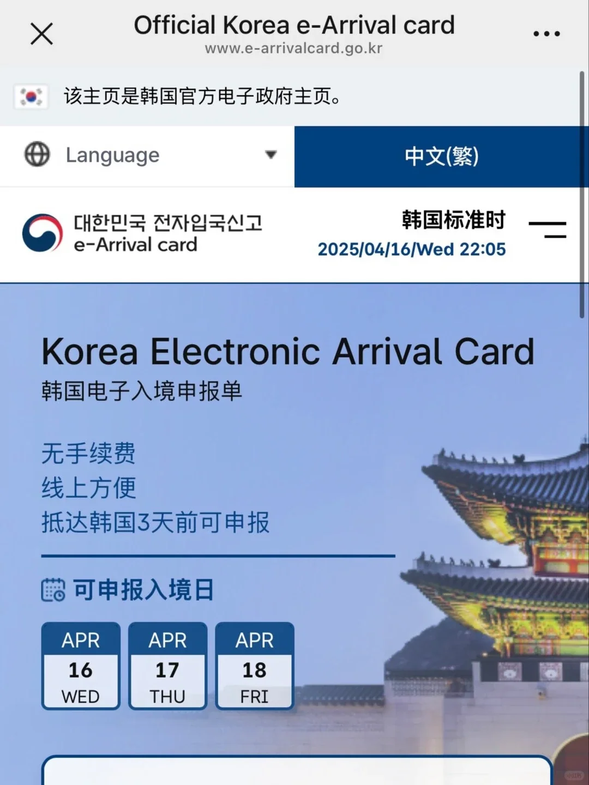

Gimhae Uluslararası Havalimanı küçük ve varış süreci kısa: uçaktan in, yabancı hattından geç, parmak izleri, bagajlar, gümrük ve iyi bir günde yarım saat içinde terminalden çık. İnsanlara zaman kaybettiren nadiren kuyruk — inişten önce tamamlamadıkları elektronik geliş kartı.

Kore artık önceden telefondan doldurulabilen ve uçakta dağıtılan kâğıt kartın yerine kullanılabilen bir e-Geliş Kartı işletiyor. Bu rehber süreci beş adımda izliyor — form, görüşme, bagaj, gümrük ve çıkış — ve sorun çıkaran alanlara odaklanıyor: adres, pasaport fotoğrafı ve telefon numarası. Web sitesi ve kurallar değişiyor, seyahatten önce resmî sayfayı kontrol edin.

## 1. İnişten üç gün önce: e-Geliş Kartını doldurun

Resmî portal www.e-arrivalcard.go.kr ve ücretsiz; bir acenteye ödeme yapmanıza gerek yok. Form varıştan üç gün önce açılıyor — 22 Ekim'de iniyorsanız 19 Ekim'den itibaren gönderebilirsiniz — ve tamamlandığında görevliye göstermek için PDF'i veya ekran görüntüsünü kaydedin.

Form beş adımdan geçiyor: koşulları kabul edip e-posta adresi verin, pasaport bilgilerinizi girin, seyahat bilgilerinizi (tarihler, uçuş numarası, Kore'deki adres) ekleyin, her şeyi kontrol edin ve gönderin. Göndermek bir işlem numarası üretiyor; bu numarayla e-postanızla yeniden giriş yapıp formu kontrol edebilir veya düzenleyebilirsiniz, böylece değişen bir uçuş ya da yanlış yazılmış bir adres hâlâ düzeltilebilir.

e-Geliş Kartı vize değil ve vizenin yerini almıyor. Çin pasaportu sahipleri hâlâ geçerli bir Kore vizesi veya oturma iznine ihtiyaç duyuyor; kart yalnızca kâğıt giriş fişinin yerini alıyor. Kâğıt kartlar geçerli ve kabin memurları hâlâ dağıtıyor; varış salonunda da doldurmak isterseniz gişeler var — sadece başka bir kuyruğa girmek anlamına geliyor.

## 2. İnsanları zorlayan dört alan

Birincisi adres. Kore'deki adresiniz gerekiyor, ideal olarak hem Korece hem İngilizce, ayrıca beş haneli posta kodu. Otel onay belgelerinde genellikle ikisi de bulunur; posta kodu yoksa form adres veya posta koduyla arama yapıp eşleşen Korece adresi önerebiliyor, oradan birini seçiyorsunuz.

İkincisi pasaport fotoğrafı. Fotoğrafınızın bulunduğu sayfayı yükleyin ve alt kenardaki makine tarafından okunabilir şeridi dahil edin — kırparsanız yükleme başarısız olur. Parlama ve bulanıklık da reddediliyor, ekran görüntüsü kullanmak yerine eşit ışıkta fotoğrafı yeniden çekin.

Üçüncüsü telefon numarası. Çin cep telefonu başına 86 koyarsanız çalışır; yanlış biçim veya çok az hane sayfasını formda takılı bırakır. Dördüncüsü eksik bilgi: eksik daire numarası, yanlış yazılmış uçuş veya ters tarihler sayfayı forma geri gönderir; bu bozuk bir web sitesi gibi görünür ama genellikle bir alan doğrulamadan geçmiyordur.

Gönderir göndermez pencereyi kapatmayın. PDF'i kaydedin ve işlem numarasını gösteren bir ekran görüntüsü alın; ikisini de fotoğraf kitaplığınızda veya çevrimdışı bir klasörde tutun. Havalimanı Wi-Fi'si güvenilir değil ve dosyaya ihtiyaç duyduğunuz o an, yüklenmeyeceği an olacak.

## 3. Pasaport kontrolü: yabancı hattını kullanın

Uçaktan indikten sonra “국제선 도착 / International Arrivals” tabelalarını izleyin. Pasaport salonunda Kore pasaportları iç hat gişelerine, yabancı ziyaretçiler ise genellikle gözden kaçmayan sarı veya mavi tabelayla işaretlenmiş “Foreigner / 外国人” hattına gidiyor.

Gişede pasaportunuzu, ayrıca e-Geliş ekran görüntüsünü ya da kâğıt kartı gösterin. Görevli vizenizi, uçuşunuzu ve adresinizi kontrol eder, ardından iki işaret parmağınızdan parmak izi ve yüz görüntüsü alır. Bu adım zorunlu: reddetmek girişin reddedilmesi anlamına gelir. Sonra bagaja geçersiniz.

Bekleme, inen diğer uçuşlara bağlı. Sabah erken ve gece geç uçuşlar genellikle birkaç dakikada temizleniyor; gün ortasında, birkaç varış üst üste geldiğinde 30–40 dakika normal. Körükte veya tuvalette oyalanmak yerine yürüyün — salona ne kadar erken varırsanız o kadar erken geçersiniz.

## 4. Bagaj ve gümrük

Pasaport kontrolünden sonra bagaj bandı geliyor; ekranlar uçuşunuza hangi bandın hizmet verdiğini gösteriyor. Gimhae'de çok fazla bant yok, bu yüzden diğer yolcuları takip etmek genellikle işe yarıyor; bantların yanında arabalar ücretsiz ve büyük bagajların kendi teslim noktası var.

Sonra gümrük geliyor; “beyan edilecek eşya” ve “beyan edilecek bir şey yok” olarak ayrılıyor. Beyan edecek bir şeyiniz yoksa bagajlarınızı yeşil kanaldaki tarayıcıdan geçirin. Gümrüksüz muafiyeti aşıyorsanız, 10.000 ABD dolarından fazla nakit taşıyorsanız veya yiyecek, et, tohum ya da diğer kısıtlı eşyalar getiriyorsanız beyan kanalını kullanın ve formu dürüstçe doldurun.

Akılda tutulacak gümrüksüz muafiyetler: 1 litre alkol, 200 sigara, 60 ml parfüm ve toplamda 800 ABD dolarına kadar diğer eşyalar. Çoğu et ürünü, meyve, sebze ve tohum yasaklı ve getirdiğiniz her şey beyan edilmeli — beyan etmemenin cezası gerçek. Salondaki gümrük duyurusu son sözdür.

## 5. Terminalden çıkış: hafif raylı sistem, otobüs veya taksi

Varış salonunda dışarı çıkmadan önce yönünüzü belirleyin. Airport Station iç hatlar terminali tarafında: dış hat varışlarından çıkın, iç hatlar kapı 1'e yürüyün, yaya geçidini geçin ve giriş orada, yürüyerek beş ila on dakika. Otobüs bilet gişesi kapı 4'ün yanında, taksi durağı geçidin karşısında.

Otobüsler ve taksiler de iç hatlar terminali tarafından kalkıyor ve dış hat varışlarının dışındaki tabelalar “대중교통 / Bus·Taxi·Light Rail” yönünü gösteriyor, bu yüzden yolu takip etmek kolay. Hafif raylı sistem üç durakta ve yaklaşık altı dakikada Sasang'a ulaşıyor; oradan 2. Hat Seomyeon, Gwangalli ve Haeundae'ye devam ediyor; adım adım güzergâh, ücretler ve aktarma [hafif raylı sistem rehberinde](/blog/busan-gimhae-airport-light-rail-guide).

Çok bagajla veya çocuklar ya da yaşlı yolcularla taksi daha basit: Seomyeon'a yaklaşık 25–30 dakika ve 20.000–25.000 won, Haeundae'ye 45–55 dakika ve 35.000–45.000 won. Son trenden sonra inerseniz tek seçenek taksi.

## İlgili bağlantılar

- **Bu sitede**: [Güney Kore (KR)](/country/KR), [Gimhae Havalimanı hafif raylı sistem rehberi](/blog/busan-gimhae-airport-light-rail-guide)
- **Wikipedia**: [Gimhae Uluslararası Havalimanı](https://en.wikipedia.org/wiki/Gimhae_International_Airport)
- **Baidu Baike**: [Gimhae Uluslararası Havalimanı](https://baike.baidu.com/item/%E9%87%91%E6%B5%B7%E5%9B%BD%E9%99%85%E6%9C%BA%E5%9C%BA)

Kaynak: bir WeChat seyahat rehberi, Ekim 2026'da düzenlendi. e-Geliş kuralları, pasaport kontrolleri ve gümrük limitleri Kore Adalet Bakanlığı, Kore Gümrük Servisi ve Gimhae Havalimanı'ndaki güncel duyuruları izler.
