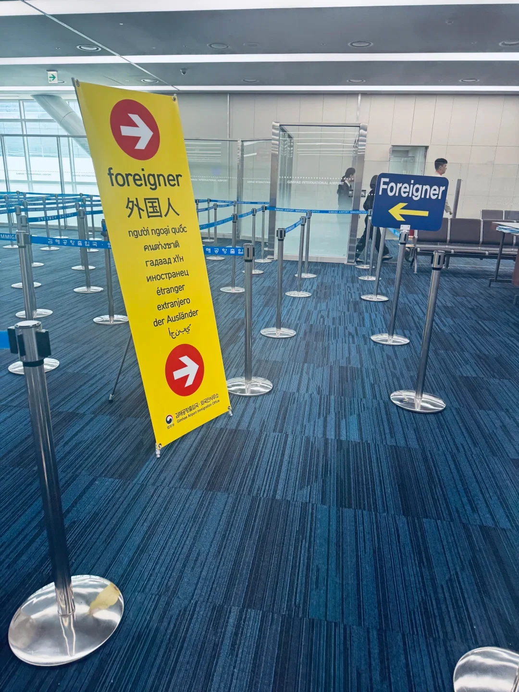

Sân bay Quốc tế Gimhae nhỏ và quy trình nhập cảnh ngắn: xuống máy bay, qua làn người nước ngoài, lấy vân tay, nhận hành lý, qua hải quan, và ra khỏi nhà ga trong nửa giờ nếu thuận lợi. Thứ khiến người ta mất thời gian hiếm khi là hàng chờ — mà là thẻ nhập cảnh điện tử họ chưa hoàn thành trước khi hạ cánh.

Hàn Quốc hiện dùng thẻ nhập cảnh điện tử có thể hoàn thành trên điện thoại trước và dùng thay cho thẻ giấy phát trên máy bay. Hướng dẫn này đi theo quy trình năm bước — biểu mẫu, phỏng vấn, hành lý, hải quan và lối ra — tập trung vào những trường gây rắc rối: địa chỉ, ảnh hộ chiếu và số điện thoại. Trang web và quy định có thể thay đổi, nên hãy kiểm tra trang chính thức trước khi đi.

## 1. Ba ngày trước khi hạ cánh: khai thẻ nhập cảnh điện tử

Cổng chính thức là www.e-arrivalcard.go.kr và miễn phí; không cần trả tiền cho đại lý. Biểu mẫu mở ba ngày trước khi đến — hạ cánh ngày 22 tháng 10 thì có thể nộp từ ngày 19 tháng 10 — và sau khi hoàn tất, hãy lưu PDF hoặc ảnh chụp để trình nhân viên.

Biểu mẫu gồm năm bước: đồng ý điều khoản và nhập email, nhập thông tin hộ chiếu, thêm thông tin chuyến đi (ngày, số hiệu chuyến bay, địa chỉ tại Hàn Quốc), kiểm tra lại và nộp. Nộp xong sẽ có số cấp, cho phép bạn đăng nhập lại bằng email để kiểm tra hoặc sửa biểu mẫu, nên chuyến bay thay đổi hay địa chỉ gõ nhầm vẫn có thể sửa.

Thẻ nhập cảnh điện tử không phải thị thực và không thay thế thị thực. Người có hộ chiếu Trung Quốc vẫn cần thị thực Hàn Quốc còn hiệu lực hoặc giấy phép cư trú; thẻ chỉ thay thế phiếu nhập cảnh giấy. Thẻ giấy vẫn có hiệu lực và tiếp viên vẫn phát, và trong sảnh đến có quầy nếu bạn muốn điền tại chỗ — chỉ là phải xếp thêm một hàng.

## 2. Bốn trường khiến người ta vấp

Đầu tiên là địa chỉ. Bạn cần địa chỉ tại Hàn Quốc, tốt nhất bằng cả tiếng Hàn và tiếng Anh, kèm mã bưu chính năm chữ số. Xác nhận khách sạn thường có cả hai; nếu thiếu mã bưu chính, biểu mẫu có thể tìm theo địa chỉ hoặc mã bưu chính và gợi ý địa chỉ Hàn Quốc khớp, từ đó bạn chọn một.

Thứ hai là ảnh hộ chiếu. Tải lên trang có ảnh của bạn, và bao gồm dải ký tự đọc bằng máy ở mép dưới — cắt mất là tải lên thất bại. Ảnh lóa và mờ cũng bị từ chối, nên hãy chụp lại trong ánh sáng đều thay vì dùng ảnh chụp màn hình.

Thứ ba là số điện thoại. Số di động Trung Quốc dùng được nếu bạn thêm 86 ở đầu; sai định dạng hoặc quá ít chữ số sẽ khiến trang bị kẹt ở biểu mẫu. Thứ tư là thông tin chưa đầy đủ: thiếu số căn hộ, gõ nhầm chuyến bay hoặc đảo ngày đều đưa trang trở lại biểu mẫu, trông như trang web hỏng nhưng thường chỉ là một trường không qua kiểm tra.

Đừng đóng cửa sổ ngay sau khi nộp. Hãy lưu PDF và chụp ảnh màn hình có số cấp, giữ cả hai trong thư viện ảnh hoặc thư mục ngoại tuyến. Wi-Fi sân bay không ổn định, và đúng lúc bạn cần tệp nhất là lúc nó không tải được.

## 3. Kiểm soát nhập cảnh: đi làn người nước ngoài

Đi theo biển “국제선 도착 / International Arrivals” khi xuống máy bay. Trong sảnh kiểm soát nhập cảnh, hộ chiếu Hàn Quốc đi quầy nội địa và khách nước ngoài đi làn ghi “Foreigner / 外国人”, thường có biển vàng hoặc xanh dương khó bỏ sót.

Tại quầy, xuất trình hộ chiếu và ảnh chụp thẻ nhập cảnh điện tử hoặc thẻ giấy. Nhân viên kiểm tra thị thực, chuyến bay và địa chỉ, sau đó lấy vân tay cả hai ngón trỏ và chụp ảnh khuôn mặt. Bước này là bắt buộc: từ chối nghĩa là bị từ chối nhập cảnh. Sau đó bạn đi nhận hành lý.

Thời gian chờ phụ thuộc vào các chuyến khác. Chuyến sáng sớm và đêm muộn thường qua trong vài phút; giữa ngày, khi nhiều chuyến đến cùng lúc, 30 đến 40 phút là bình thường. Hãy đi bộ thay vì nán lại ở cầu ống dẫn khách hay nhà vệ sinh — đến sảnh càng sớm, bạn càng qua nhanh.

## 4. Hành lý và hải quan

Sau kiểm soát nhập cảnh là băng chuyền hành lý, với màn hình cho biết băng nào phục vụ chuyến của bạn. Gimhae không có nhiều băng, nên đi theo các hành khách cùng chuyến thường là đủ; xe đẩy miễn phí bên cạnh băng chuyền, và hành lý quá khổ có điểm nhận riêng.

Tiếp theo là hải quan, chia thành “hàng hóa phải khai báo” và “không có gì để khai báo”. Nếu không có gì để khai, hãy cho hành lý qua máy quét ở làn xanh. Nếu bạn vượt hạn mức miễn thuế, mang hơn 10.000 USD tiền mặt, hoặc mang thực phẩm, thịt, hạt giống hay các mặt hàng bị hạn chế khác, hãy đi làn khai báo và điền biểu mẫu trung thực.

Các hạn mức miễn thuế cần nhớ: 1 lít rượu, 200 điếu thuốc, 60 ml nước hoa, và hàng hóa khác tổng cộng tối đa 800 USD. Hầu hết sản phẩm thịt, trái cây, rau củ và hạt giống đều bị cấm, và bất cứ thứ gì mang vào đều phải khai báo — mức phạt nếu không khai là có thật. Thông báo hải quan trong sảnh là căn cứ cuối cùng.

## 5. Ra khỏi nhà ga: tàu điện nhẹ, xe buýt hay taxi

Trong sảnh đến, hãy định hướng trước khi ra ngoài. Ga Airport nằm phía nhà ga nội địa: rời khu đến quốc tế, đi bộ đến cổng nội địa 1, qua vạch sang đường là cổng vào, mất năm đến mười phút đi bộ. Quầy bán vé xe buýt ở cạnh cổng 4, và bến taxi ở bên kia vạch sang đường.

Xe buýt và taxi đều khởi hành từ phía nhà ga nội địa, và biển ngoài khu đến quốc tế chỉ “대중교통 / Bus·Taxi·Light Rail”, nên đường đi dễ theo. Tàu điện nhẹ đến Sasang sau ba ga và khoảng sáu phút, nơi tuyến 2 tiếp tục đến Seomyeon, Gwangalli và Haeundae; lộ trình từng bước, giá vé và cách chuyển tuyến được trình bày trong [hướng dẫn tàu điện nhẹ](/blog/busan-gimhae-airport-light-rail-guide).

Với nhiều hành lý, hoặc đi cùng trẻ em hay người lớn tuổi, taxi đơn giản hơn: khoảng 25 đến 30 phút và 20.000 đến 25.000 won đến Seomyeon, hoặc 45 đến 55 phút và 35.000 đến 45.000 won đến Haeundae. Hạ cánh sau chuyến tàu cuối thì taxi là lựa chọn duy nhất còn lại.

## Liên kết liên quan

- **Trên trang này**: [Hàn Quốc (KR)](/country/KR), [Hướng dẫn tàu điện nhẹ Sân bay Gimhae](/blog/busan-gimhae-airport-light-rail-guide)
- **Wikipedia**: [Gimhae International Airport](https://en.wikipedia.org/wiki/Gimhae_International_Airport)
- **Baidu Baike**: [Gimhae International Airport](https://baike.baidu.com/item/%E9%87%91%E6%B5%B7%E5%9B%BD%E9%99%85%E6%9C%BA%E5%9C%BA)

Nguồn: một hướng dẫn du lịch WeChat, biên tập tháng 10 năm 2026. Quy định thẻ nhập cảnh điện tử, kiểm tra nhập cảnh và hạn mức hải quan theo Bộ Tư pháp Hàn Quốc, Cơ quan Hải quan Hàn Quốc và các thông báo hiện hành tại Sân bay Gimhae.
