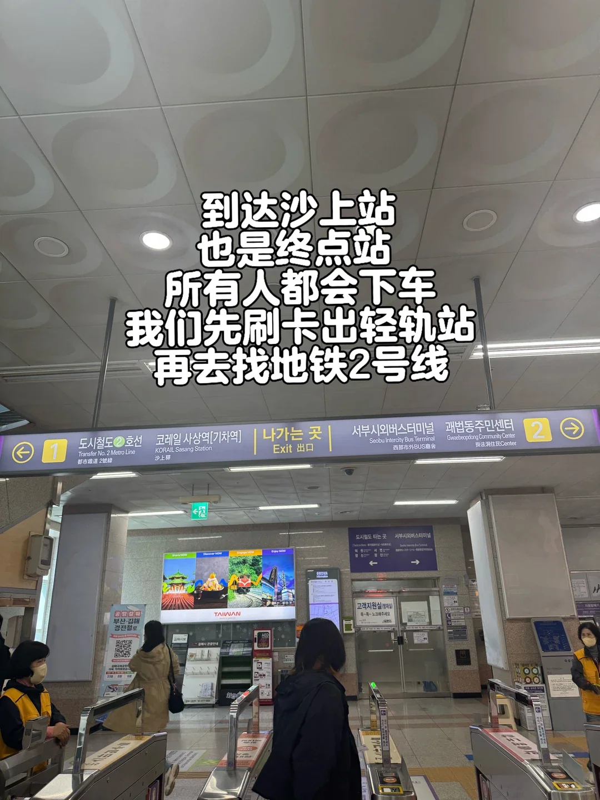

Nejspolehlivější cesta z mezinárodního letiště Gimhae do Pusanu je lehké metro Pusan–Gimhae, obvykle zkracované na BGL. Jezdí z letištní stanice do Sasangu za tři zastávky, kde navazuje zelená linka metra 2; Seomyeon, Gwangalli i Haeundae leží na této lince.

Chyby se soustředí na třech místech: vchod do stanice není uvnitř mezinárodního terminálu, jízdné závisí na zóně a přestup v Sasangu znamená dost dlouhé chození. Tento průvodce to bere v pěti krocích — přílet, jízdenky, jízda, přestup a město — přičemž jízdné a časy jsou jen orientační.

## 1. Po příletu: jděte na stranu domácího terminálu

Dva terminály Gimhae stojí vedle sebe a letištní stanice je mimo oba, přes silnici od vchodu do domácího terminálu. Při odchodu z mezinárodního příletu následujte značku „대중교통 / Bus·Taxi·Light Rail" ven z budovy.

Venku jděte podél průčelí terminálu k domácímu terminálu, přejděte na přechodu u domácí brány 1 a vchod do stanice je naproti. Počítejte s pěti až deseti minutami od dveří mezinárodního příletu. Fialové cedule s nápisem „경전철 타는 곳 / Tracks to Busan Gimhae Light Rail Transit" ukazují vchod 100 metrů před vámi.

Stanice má výtahy a eskalátory, takže se těžká zavazadla vyhnou schodům. Před turniketem zkontrolujte směr: chcete nástupiště na Sasang a do centrálního Pusanu, ne to směrem na Gimhae.

## 2. Jízdenky a dobití: jedna karta T-money

Jízdné se účtuje podle zón. Letištní stanice – Sasang je zóna 1: asi 1 600 wonů s dopravní kartou, 1 700 za jednotlivou jízdenku. Zóna 2 stojí 1 800 a 1 900 wonů. Jsou to sazby ze září 2025; v den cesty si zkontrolujte jízdní tabuli ve stanici.

Nejjednodušší možnost je karta T-money koupená a dobitá ve večerce v terminálu — prodávají ji CU i GS25, k ceně se připočítá poplatek za kartu. Stejná karta platí na lehké metro, metro, autobusy i taxíky. Dobíjecí automaty v hale se přepnou do čínštiny a provedou vás kroky.

Bez karty mají i automaty na jízdenky čínské rozhraní: vyberte cíl, zaplaťte v hotovosti a vezměte si jednotlivou jízdenku, kterou při odchodu vhoďte do sběrného otvoru. Jednotlivá jízdenka stojí o 100 wonů víc, takže karta je rychlejší volba.

## 3. Jízda: tři zastávky, šest minut

Směrem na Sasang vlak zastavuje na třech stanicích — Seobusan Yutongjigu, Goebeop Renecite a Sasang — a trvá to asi šest minut. Vlaky jsou bez řidiče, takže předním oknem vidíte přímo na trať.

Hlášení jsou v korejštině a angličtině a většina názvů stanic a značek má i čínštinu, takže korejštinu nepotřebujete. Vlaky jezdí zhruba každých pět až osm minut. Kufry mějte vedle sedadla nebo u dveří, ne v uličce.

První vlak směrem na Sasang odjíždí z letištní stanice asi v 05:30 a poslední asi v 00:10; v opačném směru, na Gimhae, je první kolem 05:06 a poslední kolem 23:48. Berte to jako orientační časy — svátky a stavební práce je mění — a pokud přistanete těsně před půlnocí, ověřte si poslední vlak dne, než na něj spoléháte.

## 4. Přestup v Sasangu: následujte zelenou linku 2

Sasang je konečná, takže všichni vystupují. Přiložte kartu u turniketu BGL a pak hledejte značky „도시철도 2호선 / Transfer to Metro Line 2", místo abyste šli nahoru na ulici.

Přestup vede dvě úrovně dolů, dlouhou podzemní chodbou a ještě jednou dolů na nástupiště linky 2: celkem pět až osm minut, s velkým kufrem déle, i když značky jsou jasné po celou cestu. Vlaky směrem na Seomyeon, Gwangalli a Haeundae jezdí ve směru „장산 (Jangsan)"; před nástupem zkontrolujte cíl na obrazovce na nástupišti.

S kartou T-money je přestup zdarma do 30 minut a až se dvěma přestupy, účtuje se jednou podle nejvyšší jednotlivé sazby. Dodatečný příplatek za přestup Pusan–Gimhae–Yangsan byl v září 2025 zrušen, takže cesta z letiště do Seomyeonu obvykle vyjde asi na 1 600 wonů.

## 5. Časy do Seomyeonu a Haeundae

Z letištní stanice, včetně chůze v Sasangu, počítejte zhruba s následujícím. Ve špičce, kdy jsou vlaky plné a čekání delší, přidejte asi deset minut.

| Cíl | Trasa | Čas | Jízdné (dopravní karta) |
| --- | --- | --- | --- |
| Sasang | lehké metro, 3 zastávky | asi 6 min | 1 600 wonů |
| Seomyeon | lehké metro + linka 2 | 25–30 min | asi 1 600 wonů |
| Gwangalli | lehké metro + linka 2 | 40–45 min | 1 600–1 800 wonů |
| Haeundae | lehké metro + linka 2 | 55–65 min | 1 600–1 800 wonů |
| Nampo-dong | lehké metro + linka 2 + linka 1 | 40–50 min | asi 1 800 wonů |
| Seomyeon taxíkem | z letiště | 25–30 min | asi 20 000–25 000 wonů |

Pro Seomyeon a Nampo-dong je lehké metro plus metro jasná volba. Haeundae trvá asi hodinu, takže s velkým množstvím zavazadel porovnejte taxík: 25 až 30 minut a 20 000 až 25 000 wonů do Seomyeonu, nebo 45 až 55 minut a 35 000 až 45 000 wonů do Haeundae.

Na závěr dvě poznámky. Letištní stanice je mimo terminál, takže cestou zpět počítejte s deseti minutami navíc na cestu na nástupiště. Chodba v Sasangu je dlouhá: se dvěma velkými kufry jeďte výtahem, protože u schodů a eskalátorů se v době špičky tvoří fronty.

## Související odkazy

- **Na tomto webu**: [Jižní Korea (KR)](/country/KR)
- **Wikipedia**: [Gimhae International Airport](https://en.wikipedia.org/wiki/Gimhae_International_Airport), [Busan–Gimhae Light Rail Transit](https://en.wikipedia.org/wiki/Busan%E2%80%93Gimhae_Light_Rail_Transit)
- **Baidu Baike**: [Gimhae International Airport](https://baike.baidu.com/item/%E9%87%91%E6%B5%B7%E5%9B%BD%E9%99%85%E6%9C%BA%E5%9C%BA)

Zdroj: cestovní průvodce z WeChatu, upraveno v říjnu 2026. Jízdné, první a poslední vlaky a pravidla přestupů vycházejí z vyhlášek lehkého metra Pusan–Gimhae a Busan Transportation Corporation.
