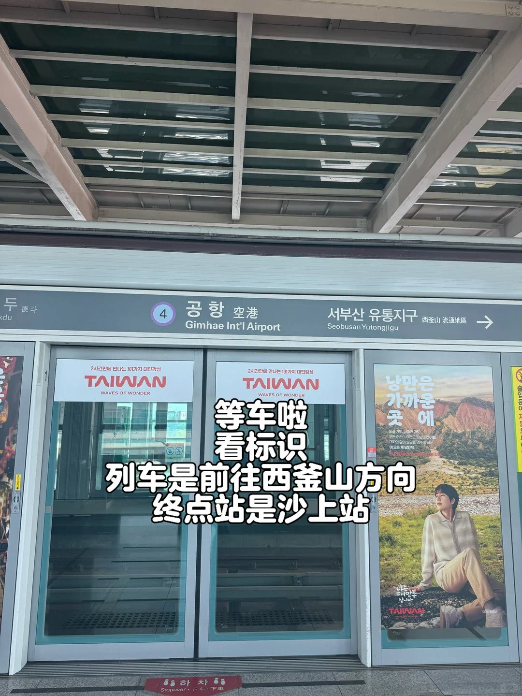
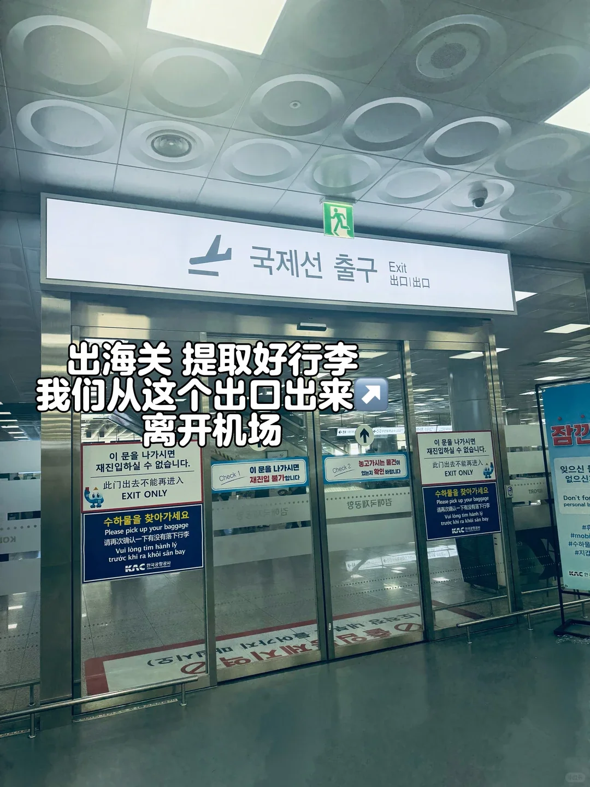
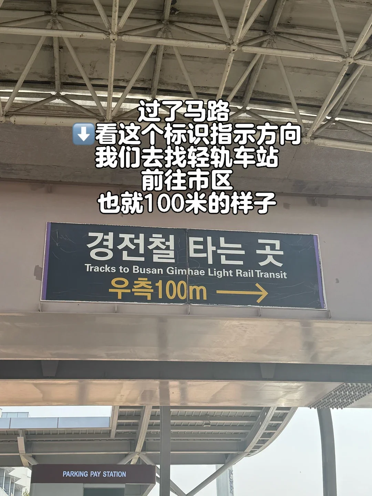
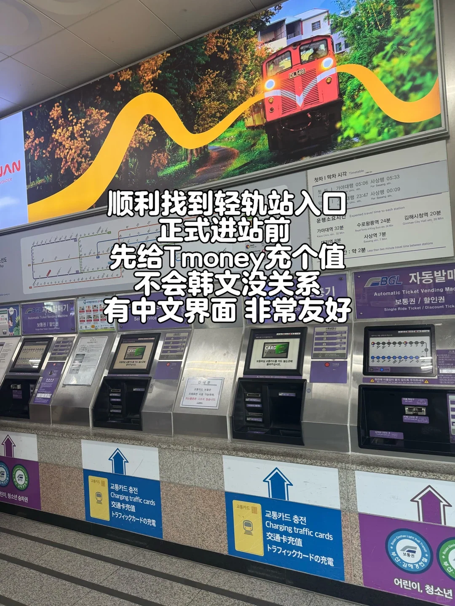
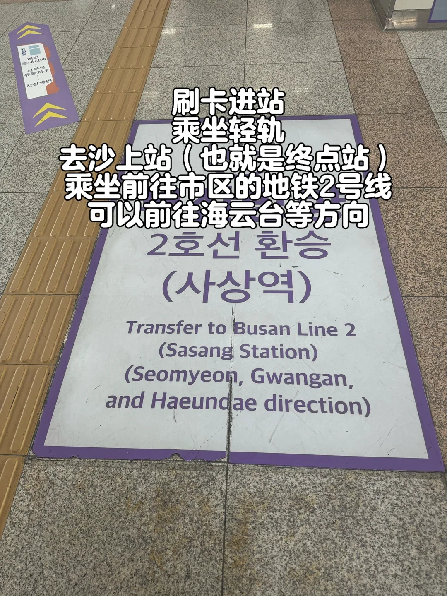
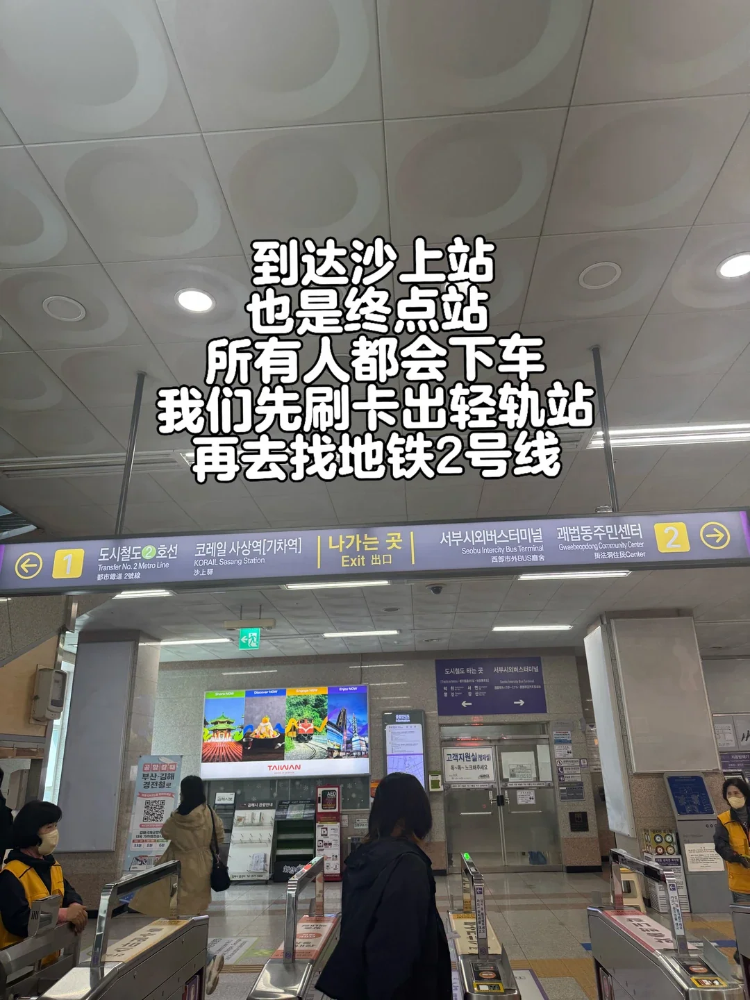

Le moyen le plus fiable de rejoindre Busan depuis l'aéroport international de Gimhae est le Busan–Gimhae Light Rail Transit, souvent abrégé BGL. Il relie Airport Station à Sasang en trois stations, où la ligne 2 verte du métro prend le relais ; Seomyeon, Gwangalli et Haeundae se trouvent toutes sur cette ligne.

Les erreurs se concentrent à trois endroits : l'entrée de la station ne se trouve pas dans le terminal international, le tarif dépend de la zone, et le changement à Sasang implique pas mal de marche. Ce guide procède en cinq étapes — l'arrivée, les billets, le trajet, le changement et la ville — avec des tarifs et des temps indicatifs.

## 1. Après l'arrivée : marchez vers le terminal domestique

Les deux terminaux de Gimhae sont côte à côte, et Airport Station se trouve à l'extérieur des deux, de l'autre côté de la route face à l'entrée du terminal domestique. À la sortie de l'arrivée internationale, suivez le panneau « 대중교통 / Bus·Taxi·Light Rail » pour quitter le bâtiment.

Dehors, longez la façade des terminaux jusqu'au terminal domestique, traversez au passage piéton près de la porte 1 du terminal domestique, et l'entrée de la station est en face. Comptez cinq à dix minutes depuis la porte de l'arrivée internationale. Des panneaux violets portant « 경전철 타는 곳 / Tracks to Busan Gimhae Light Rail Transit » situent l'entrée à 100 mètres.

La station dispose d'ascenseurs et d'escalators, les bagages lourds évitent donc les escaliers. Vérifiez la direction avant le portique : c'est le quai vers Sasang et le centre de Busan qu'il vous faut, pas celui vers Gimhae.

## 2. Billets et recharges : une seule carte T-money

Le tarif est calculé par zone. D'Airport Station à Sasang, on est en zone 1 : environ 1 600 wons avec une carte de transport, 1 700 pour un ticket simple. La zone 2 coûte 1 800 et 1 900 wons. Ce sont les tarifs de septembre 2025 ; vérifiez la grille tarifaire de la station le jour même.

L'option la plus simple est une carte T-money achetée et rechargée dans une supérette du terminal : CU et GS25 en vendent, avec les frais de carte en supplément. La même carte couvre le métro léger, le métro, les bus et les taxis. Les bornes de recharge du hall passent en chinois et vous guident pas à pas.

Sans carte, les distributeurs de billets ont aussi une interface en chinois : choisissez la destination, payez en espèces et prenez un ticket simple, puis déposez-le dans la borne à la sortie. Un ticket simple coûte 100 wons de plus, la carte est donc le choix le plus rapide.

## 3. Le trajet : trois stations, six minutes

Vers Sasang, la rame dessert trois stations — Seobusan Yutongjigu, Goebeop Renecite et Sasang — et met environ six minutes. Les rames sont sans conducteur, la vitre avant donne donc directement sur la voie.

Les annonces sont en coréen et en anglais, et la plupart des noms de stations et des panneaux comportent aussi du chinois, aucun coréen n'est donc nécessaire. Les rames circulent environ toutes les cinq à huit minutes. Gardez vos valises près de votre siège ou près de la porte plutôt que dans l'allée.

Le premier train vers Sasang part d'Airport Station vers 05:30 et le dernier vers 00:10 ; dans l'autre sens, vers Gimhae, le premier est vers 05:06 et le dernier vers 23:48. Considérez ces horaires comme indicatifs — jours fériés et travaux les modifient — et si vous atterrissez près de minuit, vérifiez le dernier train du jour avant de compter dessus.

## 4. Changer à Sasang : suivez la ligne 2 verte

Sasang est le terminus, tout le monde descend donc. Validez votre sortie au portique du BGL, puis cherchez les panneaux « 도시철도 2호선 / Transfer to Metro Line 2 » plutôt que de monter vers la rue.

Le changement descend de deux niveaux, longe un long couloir souterrain et descend encore jusqu'au quai de la ligne 2 : cinq à huit minutes au total, davantage avec une grande valise, mais les panneaux sont clairs tout du long. Les trains vers Seomyeon, Gwangalli et Haeundae vont en direction de « 장산 (Jangsan) » ; vérifiez la destination sur l'écran du quai avant de monter.

Avec T-money, la correspondance est gratuite dans les 30 minutes et jusqu'à deux changements, facturés une seule fois au tarif simple le plus élevé. Le supplément de correspondance Busan–Gimhae–Yangsan a été supprimé en septembre 2025, l'aéroport à Seomyeon revient donc normalement à environ 1 600 wons.

## 5. Temps de trajet vers Seomyeon et Haeundae

Depuis Airport Station, marche à Sasang comprise, comptez à peu près ce qui suit. Aux heures de pointe, quand les rames sont bondées et l'attente plus longue, ajoutez une dizaine de minutes.

| Destination | Itinéraire | Temps | Tarif (carte de transport) |
| --- | --- | --- | --- |
| Sasang | métro léger, 3 stations | environ 6 min | 1 600 wons |
| Seomyeon | métro léger + ligne 2 | 25–30 min | environ 1 600 wons |
| Gwangalli | métro léger + ligne 2 | 40–45 min | 1 600–1 800 wons |
| Haeundae | métro léger + ligne 2 | 55–65 min | 1 600–1 800 wons |
| Nampo-dong | métro léger + ligne 2 + ligne 1 | 40–50 min | environ 1 800 wons |
| Seomyeon en taxi | depuis l'aéroport | 25–30 min | environ 20 000–25 000 wons |

Pour Seomyeon et Nampo-dong, le métro léger plus le métro est le choix évident. Haeundae prend environ une heure, alors avec beaucoup de bagages, comparez avec un taxi : 25 à 30 minutes et 20 000 à 25 000 wons jusqu'à Seomyeon, ou 45 à 55 minutes et 35 000 à 45 000 wons jusqu'à Haeundae.

Deux derniers points. Airport Station est hors du terminal, prévoyez donc dix minutes de plus pour atteindre le quai au retour. Le couloir de Sasang est long : avec deux grandes valises, prenez l'ascenseur, car escaliers et escalators font la queue aux heures de pointe.

## Liens utiles

- **Sur ce site** : [Corée du Sud (KR)](/country/KR)
- **Wikipédia** : [Gimhae International Airport](https://en.wikipedia.org/wiki/Gimhae_International_Airport), [Busan–Gimhae Light Rail Transit](https://en.wikipedia.org/wiki/Busan%E2%80%93Gimhae_Light_Rail_Transit)
- **Baidu Baike** : [Gimhae International Airport](https://baike.baidu.com/item/%E9%87%91%E6%B5%B7%E5%9B%BD%E9%99%85%E6%9C%BA%E5%9C%BA)

Source : un guide de voyage WeChat, édité en octobre 2026. Les tarifs, les premiers et derniers trains et les règles de correspondance suivent les avis du Busan–Gimhae Light Rail Transit et de la Busan Transportation Corporation.
