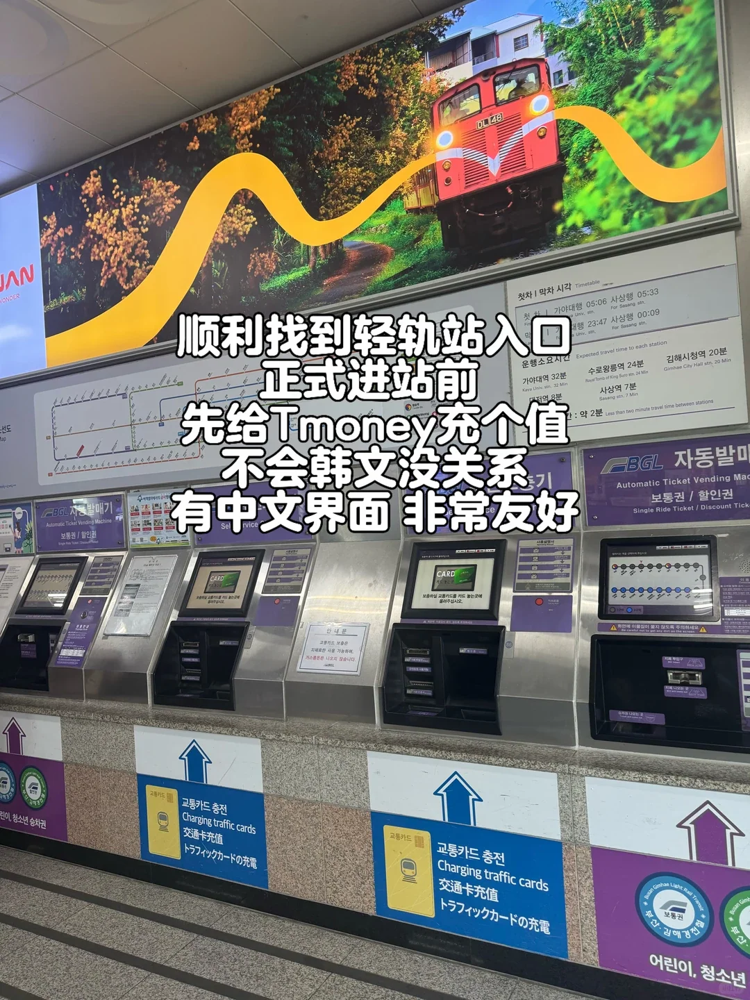

गिम्हाए अंतरराष्ट्रीय एयरपोर्ट से बुसान पहुँचने का सबसे भरोसेमंद तरीका बुसान-गिम्हाए लाइट रेल ट्रांज़िट है, जिसे आमतौर पर छोटा करके BGL कहा जाता है। यह एयरपोर्ट स्टेशन से तीन स्टॉप में सासांग तक जाती है, जहाँ से हरी मेट्रो लाइन 2 संभाल लेती है; सोम्योन, ग्वांगाली और हेउंदे सब उसी लाइन पर हैं।

ग़लतियाँ तीन जगहों पर होती हैं: स्टेशन का प्रवेश द्वार अंतरराष्ट्रीय टर्मिनल के अंदर नहीं है, किराया ज़ोन पर निर्भर करता है, और सासांग में बदलाव के दौरान काफ़ी चलना पड़ता है। यह गाइड पाँच चरणों में बताती है — आगमन, टिकट, सफ़र, बदलाव और शहर — जहाँ किराए और समय केवल संदर्भ के लिए हैं।

## 1. आगमन के बाद: घरेलू टर्मिनल की तरफ़ चलें

गिम्हाए के दोनों टर्मिनल साथ-साथ हैं, और एयरपोर्ट स्टेशन दोनों के बाहर, घरेलू टर्मिनल के प्रवेश द्वार के सामने सड़क के पार है। अंतरराष्ट्रीय आगमन से निकलकर "대중교통 / Bus·Taxi·Light Rail" संकेत के साथ इमारत से बाहर आएँ।

बाहर टर्मिनल के अगले हिस्से के साथ-साथ घरेलू टर्मिनल तक चलें, घरेलू गेट 1 के पास ज़ेबरा क्रॉसिंग से सड़क पार करें, और स्टेशन का प्रवेश द्वार सामने है। अंतरराष्ट्रीय आगमन के दरवाज़े से पाँच से दस मिनट का समय रखें। बैंगनी रंग के संकेत, जिन पर "경전철 타는 곳 / Tracks to Busan Gimhae Light Rail Transit" लिखा है, प्रवेश द्वार को 100 मीटर आगे बताते हैं।

स्टेशन में लिफ़्ट और एस्केलेटर हैं, इसलिए भारी बैग सीढ़ियों से बच जाते हैं। गेट से पहले दिशा जाँचें: आपको सासांग और मध्य बुसान वाला प्लेटफ़ॉर्म चाहिए, गिम्हाए की ओर जाने वाला नहीं।

## 2. टिकट और रीचार्ज: एक T-money कार्ड

किराया ज़ोन के हिसाब से लिया जाता है। एयरपोर्ट स्टेशन से सासांग ज़ोन 1 है: ट्रांसपोर्ट कार्ड पर लगभग 1,600 वॉन, सिंगल टिकट पर 1,700। ज़ोन 2 का किराया 1,800 और 1,900 वॉन है। ये सितंबर 2025 की दरें हैं; उस दिन स्टेशन की किराया तालिका देख लें।

सबसे आसान विकल्प टर्मिनल की कन्वीनियंस स्टोर से खरीदा और रीचार्ज किया हुआ T-money कार्ड है — CU और GS25 दोनों बेचते हैं, कार्ड का शुल्क अलग से। वही कार्ड लाइट रेल, मेट्रो, बसों और टैक्सियों में चलता है। कॉन्कोर्स की रीचार्ज मशीनें चीनी भाषा में बदल जाती हैं और चरण-दर-चरण मार्गदर्शन करती हैं।

कार्ड न हो तो टिकट मशीनों में भी चीनी इंटरफ़ेस है: गंतव्य चुनें, नकद दें और सिंगल टिकट लें, फिर बाहर निकलते समय उसे कलेक्टर में डाल दें। सिंगल टिकट 100 वॉन ज़्यादा का पड़ता है, इसलिए कार्ड तेज़ विकल्प है।

## 3. सफ़र: तीन स्टॉप, छह मिनट

सासांग की ओर ट्रेन तीन स्टेशनों पर रुकती है — सोबुसान युतोंगजिगु, गोएबॉप रेनेसिट और सासांग — और लगभग छह मिनट लेती है। ट्रेनें बिना ड्राइवर की हैं, इसलिए सामने की खिड़की से सीधे पटरी दिखती है।

घोषणाएँ कोरियाई और अंग्रेज़ी में होती हैं, और ज़्यादातर स्टेशन नामों तथा संकेतों पर चीनी भी लिखी होती है, इसलिए कोरियाई की ज़रूरत नहीं। ट्रेनें लगभग हर पाँच से आठ मिनट में चलती हैं। सूटकेस को गलियारे में रखने की जगह अपनी सीट के पास या दरवाज़े के पास रखें।

सासांग की ओर पहली ट्रेन एयरपोर्ट स्टेशन से लगभग 05:30 पर और आख़िरी लगभग 00:10 पर निकलती है; दूसरी दिशा में, गिम्हाए की ओर, पहली लगभग 05:06 और आख़िरी लगभग 23:48 है। इन्हें संदर्भ समय मानें — छुट्टियाँ और रेलवे मरम्मत के काम इन्हें बदल देते हैं — और अगर आधी रात के आसपास उतर रहे हैं तो भरोसा करने से पहले उस दिन की आख़िरी ट्रेन जाँच लें।

## 4. सासांग में बदलाव: हरी लाइन 2 के पीछे चलें

सासांग लाइन का अंत है, इसलिए सब उतर जाते हैं। BGL गेट पर टैप आउट करें, फिर सड़क पर ऊपर जाने की जगह "도시철도 2호선 / Transfer to Metro Line 2" संकेत खोजें।

बदलाव दो स्तर नीचे जाता है, एक लंबे भूमिगत गलियारे से होकर और एक बार और नीचे लाइन 2 के प्लेटफ़ॉर्म तक: कुल मिलाकर पाँच से आठ मिनट, बड़े सूटकेस के साथ ज़्यादा, हालाँकि संकेत पूरे रास्ते साफ़ हैं। सोम्योन, ग्वांगाली और हेउंदे की ओर ट्रेनें "장산 (Jangsan)" दिशा में चलती हैं; चढ़ने से पहले प्लेटफ़ॉर्म स्क्रीन पर गंतव्य जाँचें।

T-money के साथ 30 मिनट के भीतर और दो ट्रांसफ़र तक बदलाव मुफ़्त है, और किराया एक बार सबसे ऊँची सिंगल दर पर लिया जाता है। बुसान-गिम्हाए-यांगसान का अतिरिक्त ट्रांसफ़र अधिभार सितंबर 2025 में हटा दिया गया, इसलिए एयरपोर्ट से सोम्योन तक आमतौर पर लगभग 1,600 वॉन ही बनता है।

## 5. सोम्योन और हेउंदे तक का समय

एयरपोर्ट स्टेशन से, सासांग में चलने का समय मिलाकर, लगभग इतना समय मानें। व्यस्त घंटों में, जब ट्रेनें भरी हों और इंतज़ार लंबा हो, क़रीब दस मिनट और जोड़ लें।

| गंतव्य | मार्ग | समय | किराया (ट्रांसपोर्ट कार्ड) |
| --- | --- | --- | --- |
| सासांग | लाइट रेल, 3 स्टॉप | लगभग 6 मिनट | 1,600 वॉन |
| सोम्योन | लाइट रेल + लाइन 2 | 25–30 मिनट | लगभग 1,600 वॉन |
| ग्वांगाली | लाइट रेल + लाइन 2 | 40–45 मिनट | 1,600–1,800 वॉन |
| हेउंदे | लाइट रेल + लाइन 2 | 55–65 मिनट | 1,600–1,800 वॉन |
| नाम्पो-दोंग | लाइट रेल + लाइन 2 + लाइन 1 | 40–50 मिनट | लगभग 1,800 वॉन |
| सोम्योन, टैक्सी से | एयरपोर्ट से | 25–30 मिनट | लगभग 20,000–25,000 वॉन |

सोम्योन और नाम्पो-दोंग के लिए लाइट रेल के साथ मेट्रो साफ़ तौर पर बेहतर विकल्प है। हेउंदे में लगभग एक घंटा लगता है, इसलिए ज़्यादा सामान हो तो टैक्सी से तुलना करें: सोम्योन तक 25 से 30 मिनट और 20,000 से 25,000 वॉन, या हेउंदे तक 45 से 55 मिनट और 35,000 से 45,000 वॉन।

आख़िर में दो बातें। एयरपोर्ट स्टेशन टर्मिनल के बाहर है, इसलिए वापसी में प्लेटफ़ॉर्म तक पहुँचने के लिए दस मिनट अतिरिक्त रखें। सासांग का गलियारा लंबा है: दो बड़े सूटकेस हों तो लिफ़्ट लें, क्योंकि व्यस्त समय में सीढ़ियों और एस्केलेटर पर कतार लगती है।

## संबंधित लिंक

- **इस साइट पर**: [दक्षिण कोरिया (KR)](/country/KR)
- **विकिपीडिया**: [गिम्हाए अंतरराष्ट्रीय एयरपोर्ट](https://en.wikipedia.org/wiki/Gimhae_International_Airport), [बुसान-गिम्हाए लाइट रेल ट्रांज़िट](https://en.wikipedia.org/wiki/Busan%E2%80%93Gimhae_Light_Rail_Transit)
- **बाइदू बाइके**: [गिम्हाए अंतरराष्ट्रीय एयरपोर्ट](https://baike.baidu.com/item/%E9%87%91%E6%B5%B7%E5%9B%BD%E9%99%85%E6%9C%BA%E5%9C%BA)

स्रोत: एक WeChat यात्रा गाइड, अक्टूबर 2026 में संपादित। किराए, पहली और आख़िरी ट्रेनें तथा ट्रांसफ़र नियम बुसान-गिम्हाए लाइट रेल ट्रांज़िट और बुसान ट्रांसपोर्टेशन कॉर्पोरेशन की सूचनाओं पर आधारित हैं।
