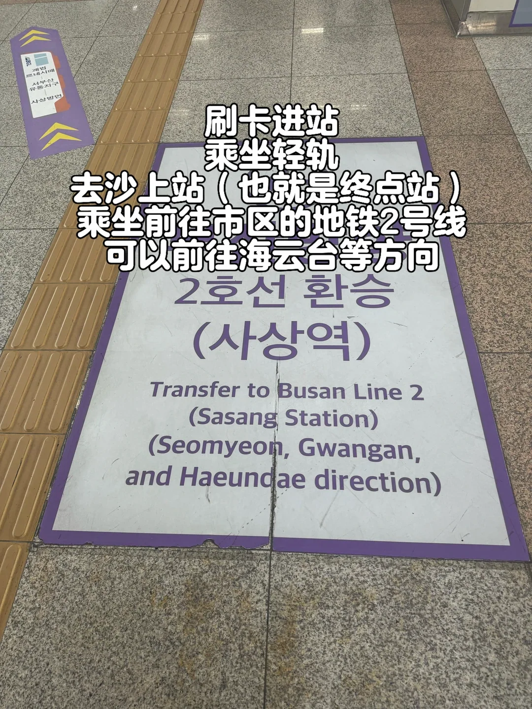

Cara paling andal dari Bandara Internasional Gimhae ke Busan adalah Busan–Gimhae Light Rail Transit, biasanya disingkat BGL. Kereta ini berjalan dari Stasiun Bandara ke Sasang dalam tiga perhentian, tempat metro Line 2 hijau mengambil alih; Seomyeon, Gwangalli, dan Haeundae semuanya berada di jalur itu.

Kesalahan umum terpusat di tiga tempat: pintu masuk stasiun tidak berada di dalam terminal internasional, tarifnya bergantung pada zona, dan pergantian di Sasang melibatkan cukup banyak berjalan kaki. Panduan ini membawanya dalam lima langkah — kedatangan, tiket, perjalanan, pergantian, dan kota — dengan tarif dan waktu hanya sebagai acuan.

## 1. Setelah kedatangan: berjalan ke sisi terminal domestik

Dua terminal Gimhae berdiri berdampingan, dan Stasiun Bandara berada di luar keduanya, di seberang jalan dari pintu masuk terminal domestik. Meninggalkan kedatangan internasional, ikuti papan “대중교통 / Bus·Taxi·Light Rail” keluar dari gedung.

Di luar, berjalan di sepanjang fasad terminal ke terminal domestik, seberangi penyeberangan zebra dekat gerbang domestik 1, dan pintu masuk stasiun ada di seberang. Sisakan lima hingga sepuluh menit dari pintu kedatangan internasional. Papan ungu bertuliskan “경전철 타는 곳 / Tracks to Busan Gimhae Light Rail Transit” menunjukkan bahwa pintu masuk berada 100 meter di depan.

Stasiun memiliki lift dan eskalator, sehingga bagasi berat terhindar dari tangga. Periksa arah sebelum gerbang: Anda menginginkan peron untuk Sasang dan pusat kota Busan, bukan peron menuju Gimhae.

## 2. Tiket dan isi ulang: satu kartu T-money

Tarifnya ditagih berdasarkan zona. Stasiun Bandara ke Sasang adalah zona 1: sekitar 1.600 won dengan kartu transportasi, 1.700 untuk tiket sekali jalan. Zona 2 berharga 1.800 dan 1.900 won. Ini tarif September 2025; periksa tabel tarif stasiun pada hari keberangkatan.

Pilihan paling sederhana adalah kartu T-money yang dibeli dan diisi ulang di toko serba ada di terminal — CU dan GS25 sama-sama menjualnya, dengan biaya kartu ditambahkan. Kartu yang sama mencakup kereta ringan, metro, bus, dan taksi. Mesin isi ulang di concourse beralih ke bahasa Tionghoa dan memandu Anda melalui langkah-langkahnya.

Tanpa kartu, mesin tiket juga memiliki antarmuka bahasa Tionghoa: pilih tujuan, bayar tunai dan ambil tiket sekali jalan, lalu masukkan ke pengumpul saat keluar. Tiket sekali jalan berharga 100 won lebih mahal, jadi kartu adalah langkah yang lebih cepat.

## 3. Perjalanan: tiga perhentian, enam menit

Menuju Sasang, kereta berhenti di tiga stasiun — Seobusan Yutongjigu, Goebeop Renecite, dan Sasang — dan memakan waktu sekitar enam menit. Keretanya tanpa masinis, jadi jendela depan menghadap langsung ke rel.

Pengumuman dalam bahasa Korea dan Inggris, dan sebagian besar nama stasiun dan papan juga memuat bahasa Tionghoa, jadi tidak perlu bahasa Korea. Kereta berjalan kira-kira setiap lima hingga delapan menit. Letakkan koper di samping kursi atau dekat pintu, bukan di lorong.

Kereta pertama menuju Sasang meninggalkan Stasiun Bandara sekitar 05.30 dan yang terakhir sekitar 00.10; ke arah sebaliknya, menuju Gimhae, yang pertama sekitar 05.06 dan yang terakhir sekitar 23.48. Anggap itu sebagai waktu acuan — hari libur dan pekerjaan teknik mengubahnya — dan jika Anda mendarat mendekati tengah malam, periksa kereta terakhir hari itu sebelum mengandalkannya.

## 4. Berganti di Sasang: ikuti Line 2 hijau

Sasang adalah ujung jalur, jadi semua orang turun. Tap keluar di gerbang BGL, lalu cari papan “도시철도 2호선 / Transfer to Metro Line 2” daripada menuju ke jalan.

Pergantian turun dua lantai, melalui koridor bawah tanah yang panjang dan turun sekali lagi ke peron Line 2: total lima hingga delapan menit, lebih lama dengan koper besar, meskipun papannya jelas sepanjang jalan. Kereta menuju Seomyeon, Gwangalli, dan Haeundae berjalan ke arah “장산 (Jangsan)”; periksa tujuan di layar peron sebelum naik.

Dengan T-money, pergantian gratis dalam 30 menit dan hingga dua transit, ditagih sekali dengan tarif tunggal tertinggi. Biaya tambahan transit Busan–Gimhae–Yangsan dihapus pada September 2025, jadi dari bandara ke Seomyeon biasanya sekitar 1.600 won.

## 5. Waktu ke Seomyeon dan Haeundae

Dari Stasiun Bandara, termasuk berjalan kaki di Sasang, perkirakan kira-kira sebagai berikut. Pada jam sibuk, ketika kereta penuh dan waktu tunggu lebih lama, tambahkan sekitar sepuluh menit.

| Tujuan | Rute | Waktu | Tarif (kartu transportasi) |
| --- | --- | --- | --- |
| Sasang | Kereta ringan, 3 perhentian | sekitar 6 menit | 1.600 won |
| Seomyeon | Kereta ringan + Line 2 | 25–30 menit | sekitar 1.600 won |
| Gwangalli | Kereta ringan + Line 2 | 40–45 menit | 1.600–1.800 won |
| Haeundae | Kereta ringan + Line 2 | 55–65 menit | 1.600–1.800 won |
| Nampo-dong | Kereta ringan + Line 2 + Line 1 | 40–50 menit | sekitar 1.800 won |
| Seomyeon dengan taksi | Dari bandara | 25–30 menit | sekitar 20.000–25.000 won |

Untuk Seomyeon dan Nampo-dong, kereta ringan plus metro adalah pilihan yang jelas. Haeundae memakan waktu sekitar satu jam, jadi dengan banyak bagasi bandingkan dengan taksi: 25 hingga 30 menit dan 20.000 hingga 25.000 won ke Seomyeon, atau 45 hingga 55 menit dan 35.000 hingga 45.000 won ke Haeundae.

Dua poin terakhir. Stasiun Bandara berada di luar terminal, jadi dalam perjalanan kembali sisakan sepuluh menit tambahan untuk mencapai peron. Koridor Sasang panjang: dengan dua koper besar, gunakan lift, karena tangga dan eskalator mengantre pada jam sibuk.

## Tautan terkait

- **Di situs ini**: [Korea Selatan (KR)](/country/KR)
- **Wikipedia**: [Bandara Internasional Gimhae](https://en.wikipedia.org/wiki/Gimhae_International_Airport), [Busan–Gimhae Light Rail Transit](https://en.wikipedia.org/wiki/Busan%E2%80%93Gimhae_Light_Rail_Transit)
- **Baidu Baike**: [Bandara Internasional Gimhae](https://baike.baidu.com/item/%E9%87%91%E6%B5%B7%E5%9B%BD%E9%99%85%E6%9C%BA%E5%9C%BA)

Sumber: panduan perjalanan WeChat, diedit Oktober 2026. Tarif, kereta pertama dan terakhir, serta aturan transit mengikuti pemberitahuan Busan–Gimhae Light Rail Transit dan Busan Transportation Corporation.
