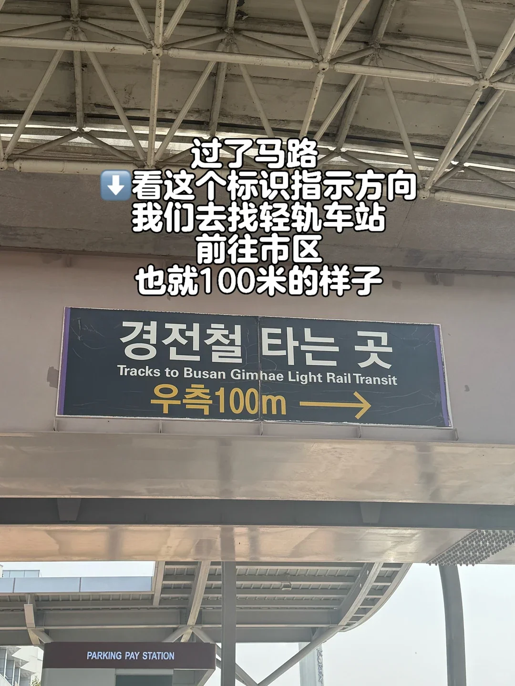

De betrouwbaarste manier om van Gimhae International Airport naar Busan te komen, is de Busan–Gimhae Light Rail Transit, meestal afgekort tot BGL. Die rijdt van Airport Station naar Sasang in drie haltes, waar de groene metrolijn 2 het overneemt; Seomyeon, Gwangalli en Haeundae liggen allemaal aan die lijn.

De fouten clusteren op drie plekken: de ingang van het station zit niet in de internationale terminal, het tarief hangt af van de zone, en de overstap in Sasang betekent een flink stuk lopen. Deze gids neemt het in vijf stappen — aankomst, kaartjes, de rit, de overstap en de stad — met tarieven en tijden alleen als richtlijn.

## 1. Na de aankomst: loop naar de kant van de binnenlandse terminal

De twee terminals van Gimhae staan naast elkaar, en Airport Station ligt buiten beide, aan de overkant van de weg bij de ingang van de binnenlandse terminal. Verlaat je de internationale aankomst, volg dan het bord "대중교통 / Bus·Taxi·Light Rail" naar buiten.

Buiten loop je langs de voorgevel van de terminal naar de binnenlandse terminal, steek je over bij het zebrapad vlak bij binnenlandse gate 1, en de ingang van het station ligt ertegenover. Reken vijf tot tien minuten vanaf de deur van de internationale aankomst. Paarse borden met "경전철 타는 곳 / Tracks to Busan Gimhae Light Rail Transit" wijzen de ingang 100 meter verderop aan.

Het station heeft liften en roltrappen, dus zware tassen vermijden de trap. Controleer de richting voor de poortjes: je wilt het perron naar Sasang en centraal Busan, niet dat richting Gimhae.

## 2. Kaartjes en opwaarderen: één T-money-kaart

Het tarief wordt per zone gerekend. Airport Station naar Sasang is zone 1: ongeveer 1.600 won met een vervoerskaart, 1.700 voor een enkel kaartje. Zone 2 kost 1.800 en 1.900 won. Dit zijn de tarieven van september 2025; controleer op de dag zelf de tarieventabel op het station.

De eenvoudigste optie is een T-money-kaart, gekocht en opgewaardeerd bij een buurtwinkel in de terminal — CU en GS25 verkopen ze allebei, met de kaartkosten er bovenop. Dezelfde kaart geldt voor de lightrail, de metro, bussen en taxi's. Oplaadautomaten in de hal schakelen over naar het Chinees en leiden je door de stappen.

Zonder kaart hebben de kaartautomaten ook een Chinese interface: kies de bestemming, betaal contant en neem een enkel kaartje, en gooi dat bij het uitgaan in de inleverautomaat. Een enkel kaartje kost 100 won meer, dus de kaart is de snellere zet.

## 3. De rit: drie haltes, zes minuten

Richting Sasang stopt de trein op drie stations — Seobusan Yutongjigu, Goebeop Renecite en Sasang — en doet er ongeveer zes minuten over. De treinen rijden zonder bestuurder, dus door de voorruit kijk je recht de baan af.

Omroepen zijn in het Koreaans en Engels, en de meeste stationsnamen en borden hebben ook Chinees, dus Koreaans is niet nodig. Treinen rijden ongeveer elke vijf tot acht minuten. Houd koffers naast je stoel of bij de deur in plaats van in het gangpad.

De eerste trein richting Sasang vertrekt van Airport Station rond 05.30 en de laatste rond 00.10; in de andere richting, naar Gimhae, is de eerste rond 05.06 en de laatste rond 23.48. Beschouw die tijden als richtlijn — feestdagen en werkzaamheden veranderen ze — en land je rond middernacht, controleer dan de laatste trein van die dag voordat je erop rekent.

## 4. Overstappen in Sasang: volg de groene lijn 2

Sasang is het eindpunt van de lijn, dus iedereen stapt uit. Tik uit bij de BGL-poortjes en zoek dan de borden "도시철도 2호선 / Transfer to Metro Line 2" in plaats van naar de straat te gaan.

De overstap gaat twee niveaus naar beneden, door een lange ondergrondse gang en nog eens naar beneden naar het perron van lijn 2: in totaal vijf tot acht minuten, langer met een grote koffer, al zijn de borden de hele weg duidelijk. Treinen naar Seomyeon, Gwangalli en Haeundae rijden in de richting "장산 (Jangsan)"; controleer de bestemming op het scherm op het perron voordat je instapt.

Met T-money is de overstap gratis binnen 30 minuten en tot twee overstappen, één keer afgerekend tegen het hoogste enkeltarief. De extra toeslag voor de overstap Busan–Gimhae–Yangsan is in september 2025 afgeschaft, dus van het vliegveld naar Seomyeon kost normaal ongeveer 1.600 won.

## 5. Tijden naar Seomyeon en Haeundae

Vanaf Airport Station, inclusief het lopen in Sasang, kun je ongeveer het volgende verwachten. In de spits, wanneer treinen vol zitten en de wachttijden langer zijn, komt er ongeveer tien minuten bij.

| Bestemming | Route | Tijd | Tarief (vervoerskaart) |
| --- | --- | --- | --- |
| Sasang | Lightrail, 3 haltes | ca. 6 min | 1.600 won |
| Seomyeon | Lightrail + lijn 2 | 25–30 min | ca. 1.600 won |
| Gwangalli | Lightrail + lijn 2 | 40–45 min | 1.600–1.800 won |
| Haeundae | Lightrail + lijn 2 | 55–65 min | 1.600–1.800 won |
| Nampo-dong | Lightrail + lijn 2 + lijn 1 | 40–50 min | ca. 1.800 won |
| Seomyeon met de taxi | Vanaf het vliegveld | 25–30 min | ca. 20.000–25.000 won |

Voor Seomyeon en Nampo-dong is de lightrail plus metro de duidelijke keuze. Haeundae duurt ongeveer een uur, dus met veel bagage kun je een taxi overwegen: 25 tot 30 minuten en 20.000 tot 25.000 won naar Seomyeon, of 45 tot 55 minuten en 35.000 tot 45.000 won naar Haeundae.

Twee laatste punten. Airport Station ligt buiten de terminal, dus reken op de terugweg tien extra minuten om het perron te bereiken. De gang in Sasang is lang: met twee grote koffers neem je de lift, want trappen en roltrappen hebben in de spits rijen.

## Gerelateerde links

- **Op deze site**: [Zuid-Korea (KR)](/country/KR)
- **Wikipedia**: [Gimhae International Airport](https://en.wikipedia.org/wiki/Gimhae_International_Airport), [Busan–Gimhae Light Rail Transit](https://en.wikipedia.org/wiki/Busan%E2%80%93Gimhae_Light_Rail_Transit)
- **Baidu Baike**: [Gimhae International Airport](https://baike.baidu.com/item/%E9%87%91%E6%B5%B7%E5%9B%BD%E9%99%85%E6%9C%BA%E5%9C%BA)

Bron: een reisgids van WeChat, bewerkt in oktober 2026. Tarieven, eerste en laatste treinen en overstapregels volgen de mededelingen van Busan–Gimhae Light Rail Transit en Busan Transportation Corporation.
