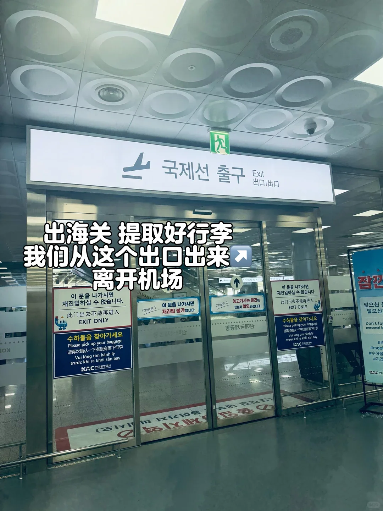

Njia ya kuaminika zaidi kutoka Uwanja wa Ndege wa Kimataifa wa Gimhae kuingia Busan ni Treni Nyepesi ya Busan–Gimhae, inayojulikana kwa kifupi kama BGL. Huanza kutoka Airport Station hadi Sasang kwa vituo vitatu, ambako Line 2 ya metro ya kijani inachukua nafasi; Seomyeon, Gwangalli na Haeundae zote ziko kwenye mstari huo.

Makosa hujikita katika maeneo matatu: kiingilio cha kituo hakiko ndani ya jengo la abiria la kimataifa, nauli hutegemea eneo, na badiliko la Sasang linahusisha kutembea kwa kiasi kikubwa. Mwongozo huu unachukua hatua tano — kuwasili, tikiti, safari, badiliko na mji — huku nauli na nyakati zikiwa ni marejeleo tu.

## 1. Baada ya kuwasili: tembea hadi upande wa jengo la abiria la ndani

Majengo mawili ya abiria ya Gimhae yanasimama bega kwa bega, na Airport Station iko nje ya yote mawili, ng'ambo ya barabara kutoka kiingilio cha jengo la abiria la ndani. Ukitoka kuwasili kwa kimataifa, fuata alama ya "대중교통 / Bus·Taxi·Light Rail" ili kutoka kwenye jengo.

Nje, tembea kando ya mbele ya jengo la abiria hadi jengo la abiria la ndani, vuka kwenye kivuko cha pundamilia karibu na lango 1 la ndani, na kiingilio cha kituo kiko mbele. Toa dakika tano hadi kumi kutoka mlango wa kuwasili kwa kimataifa. Alama za zambarau zinazosomeka "경전철 타는 곳 / Tracks to Busan Gimhae Light Rail Transit" zinaweka kiingilio mita 100 mbele.

Kituo kina lifti na eskaleta, kwa hiyo mizigo mizito inaepuka ngazi. Angalia mwelekeo kabla ya lango: unataka jukwaa la Sasang na katikati ya Busan, si lile la kuelekea Gimhae.

## 2. Tikiti na kuongeza salio: kadi moja ya T-money

Nauli hutozwa kwa eneo. Airport Station hadi Sasang ni eneo la 1: takriban won 1,600 kwa kadi ya usafiri, 1,700 kwa tikiti moja. Eneo la 2 linagharimu won 1,800 na 1,900. Hizi ni viwango vya Septemba 2025; angalia jedwali la nauli la kituo siku hiyo.

Chaguo rahisi ni kadi ya T-money inayonunuliwa na kuongezwa salio katika duka la bidhaa za haraka ndani ya jengo la abiria — CU na GS25 zote huiuza, na ada ya kadi juu ya bei. Kadi hiyo hiyo inashughulikia treni nyepesi, metro, mabasi na teksi. Mashine za kuchaji upya katika ukumbi hubadilika hadi Kichina na kukupitisha hatua kwa hatua.

Bila kadi, mashine za tikiti pia zina kiolesura cha Kichina: chagua unakokwenda, lipa taslimu na chukua tikiti moja, kisha uitupie kwenye chombo cha kukusanya unapotoka. Tikiti moja hugharimu won 100 zaidi, kwa hiyo kadi ndiyo hatua ya haraka zaidi.

## 3. Safari: vituo vitatu, dakika sita

Kuelekea Sasang treni hupita vituo vitatu — Seobusan Yutongjigu, Goebeop Renecite na Sasang — na huchukua takriban dakika sita. Treni hazina dereva, kwa hiyo dirisha la mbele linaangalia moja kwa moja kwenye reli.

Matangazo ni kwa Kikorea na Kiingereza, na majina mengi ya vituo na alama pia zina Kichina, kwa hiyo Kikorea hakihitajiki. Treni huenda takriban kila dakika tano hadi nane. Weka masanduku kando ya kiti chako au karibu na mlango badala ya njia ya kupita.

Treni ya kwanza kuelekea Sasang huondoka Airport Station takriban 05:30 na ya mwisho takriban 00:10; upande mwingine, kuelekea Gimhae, ya kwanza ni karibu 05:06 na ya mwisho karibu 23:48. Chukua hizo kama nyakati za marejeleo — sikukuu na kazi za uhandisi huzibadilisha — na ukitia karibu na usiku wa manane, angalia treni ya mwisho ya siku hiyo kabla ya kuitegemea.

## 4. Kubadilisha Sasang: fuata Line 2 ya kijani

Sasang ni mwisho wa njia, kwa hiyo kila mtu hushuka. Gusa kadi ukitoka kwenye lango la BGL, kisha tafuta alama za "도시철도 2호선 / Transfer to Metro Line 2" badala ya kuelekea barabarani.

Badiliko hushuka ngazi mbili, kando ya ukanda mrefu wa chini ya ardhi na kushuka tena hadi jukwaa la Line 2: dakika tano hadi nane kwa jumla, muda mrefu zaidi ukiwa na sanduku kubwa, ingawa alama ziko wazi njia nzima. Treni kuelekea Seomyeon, Gwangalli na Haeundae huenda upande wa "장산 (Jangsan)"; angalia mwisho wa safari kwenye skrini ya jukwaa kabla ya kuingia.

Ukiwa na T-money, badiliko ni bure ndani ya dakika 30 na hadi mabadiliko mawili, hutozwa mara moja kwa nauli ya juu zaidi ya tikiti moja. Ada ya ziada ya badiliko ya Busan–Gimhae–Yangsan ilifutwa Septemba 2025, kwa hiyo kutoka uwanja wa ndege hadi Seomyeon kwa kawaida hufikia takriban won 1,600.

## 5. Nyakati hadi Seomyeon na Haeundae

Kutoka Airport Station, ikiwemo kutembea kule Sasang, tarajia takriban yafuatayo. Wakati wa msongamano, treni zikiwa zimejaa na kusubiri kukiwa kwa muda mrefu, ongeza takriban dakika kumi.

| Marudio | Njia | Muda | Nauli (kadi ya usafiri) |
| --- | --- | --- | --- |
| Sasang | Treni nyepesi, vituo 3 | takriban dakika 6 | won 1,600 |
| Seomyeon | Treni nyepesi + Line 2 | dakika 25–30 | takriban won 1,600 |
| Gwangalli | Treni nyepesi + Line 2 | dakika 40–45 | won 1,600–1,800 |
| Haeundae | Treni nyepesi + Line 2 | dakika 55–65 | won 1,600–1,800 |
| Nampo-dong | Treni nyepesi + Line 2 + Line 1 | dakika 40–50 | takriban won 1,800 |
| Seomyeon kwa teksi | Kutoka uwanja wa ndege | dakika 25–30 | takriban won 20,000–25,000 |

Kwa Seomyeon na Nampo-dong, treni nyepesi pamoja na metro ndicho chaguo dhahiri. Haeundae huchukua takriban saa moja, kwa hiyo ukiwa na mizigo mingi linganisha teksi: dakika 25 hadi 30 na won 20,000 hadi 25,000 hadi Seomyeon, au dakika 45 hadi 55 na won 35,000 hadi 45,000 hadi Haeundae.

Pointi mbili za mwisho. Airport Station iko nje ya jengo la abiria, kwa hiyo unapokwenda zako toa dakika kumi za ziada kufikia jukwaa. Ukanda wa Sasang ni mrefu: ukiwa na masanduku mawili makubwa, tumia lifti, kwa sababu ngazi na eskaleta hupanga foleni nyakati za msongamano.

## Viungo vinavyohusiana

- **Kwenye tovuti hii**: [Korea Kusini (KR)](/country/KR)
- **Wikipedia**: [Uwanja wa Ndege wa Kimataifa wa Gimhae](https://en.wikipedia.org/wiki/Gimhae_International_Airport), [Treni Nyepesi ya Busan–Gimhae](https://en.wikipedia.org/wiki/Busan%E2%80%93Gimhae_Light_Rail_Transit)
- **Baidu Baike**: [Uwanja wa Ndege wa Kimataifa wa Gimhae](https://baike.baidu.com/item/%E9%87%91%E6%B5%B7%E5%9B%BD%E9%99%85%E6%9C%BA%E5%9C%BA)

Chanzo: mwongozo wa safari wa WeChat, uliohaririwa Oktoba 2026. Nauli, treni za kwanza na za mwisho na kanuni za mabadiliko hufuata ilani za Treni Nyepesi ya Busan–Gimhae na Shirika la Usafiri la Busan.
