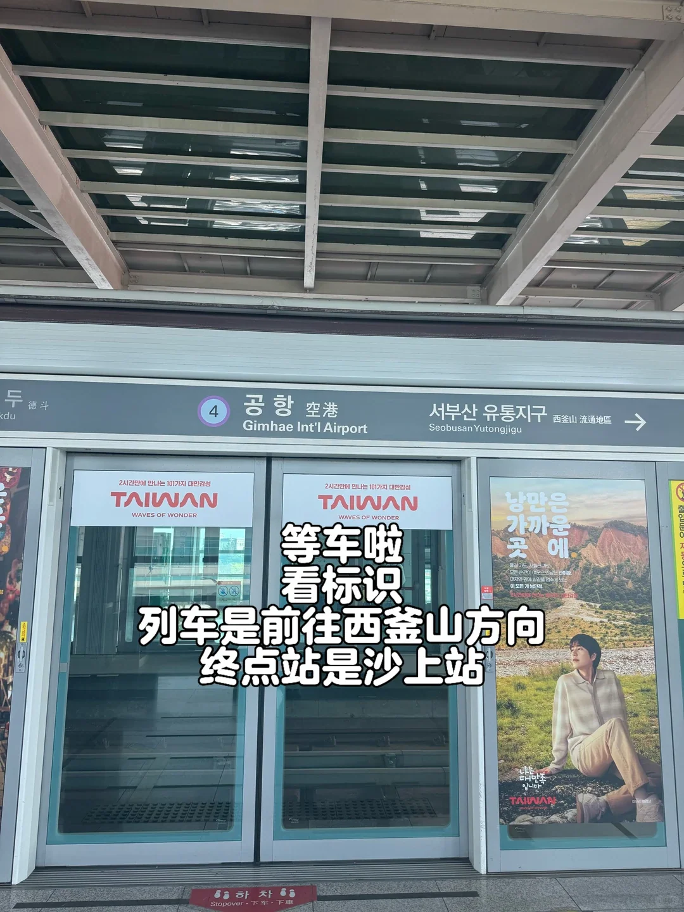

Gimhae Uluslararası Havalimanı'ndan Busan'a en güvenilir yol, genellikle BGL olarak kısaltılan Busan–Gimhae Hafif Raylı Sistemi. Airport Station'dan Sasang'a üç durakta gidiyor, oradan yeşil metro 2. Hattı devralıyor; Seomyeon, Gwangalli ve Haeundae bu hattın üzerinde.

Hatalar üç yerde yoğunlaşıyor: istasyon girişi dış hatlar terminalinin içinde değil, ücret bölgeye bağlı ve Sasang'daki aktarma hatırı sayılır bir yürüyüş içeriyor. Bu rehber beş adımda ele alıyor — varış, biletler, yolculuk, aktarma ve şehir — ücretler ve süreler yalnızca referans.

## 1. Varıştan sonra: iç hatlar terminali tarafına yürüyün

Gimhae'nin iki terminali yan yana ve Airport Station ikisinin de dışında, iç hatlar terminali girişinin yolun karşısında. Dış hat varışlarından çıkarken “대중교통 / Bus·Taxi·Light Rail” tabelasını izleyerek binadan çıkın.

Dışarıda terminal cephesi boyunca iç hatlar terminaline yürüyün, iç hatlar kapı 1'in yanındaki yaya geçidinden karşıya geçin, istasyon girişi karşıda. Dış hat varış kapısından beş ila on dakika ayırın. “경전철 타는 곳 / Tracks to Busan Gimhae Light Rail Transit” yazan mor tabelalar girişin 100 metre ileride olduğunu söylüyor.

İstasyonda asansörler ve yürüyen merdivenler var, ağır bavullar merdivenlerden kaçınabilir. Turnikeden önce yönü kontrol edin: Gimhae yönüne değil, Sasang ve Busan merkezi yönüne giden peronu istiyorsunuz.

## 2. Biletler ve yüklemeler: tek T-money kartı

Ücret bölgeye göre alınıyor. Airport Station'dan Sasang 1. bölge: ulaşım kartıyla yaklaşık 1.600 won, tek bilet 1.700. 2. bölge 1.800 ve 1.900 won. Bunlar Eylül 2025 tarifeleri; gün içinde istasyonun ücret tablosunu kontrol edin.

En basit seçenek, terminaldeki bir marketten alınıp yüklenen T-money kartı — CU ve GS25 ikisi de satıyor, kart ücreti ayrıca ekleniyor. Aynı kart hafif raylı sistem, metro, otobüsler ve taksilerde geçiyor. İstasyon holündeki yükleme makineleri Çinceye geçiyor ve adımları gösteriyor.

Kartınız yoksa bilet makinelerinin Çince arayüzü de var: hedefi seçin, nakit ödeyin ve tek bilet alın, çıkışta toplama kutusuna atın. Tek bilet 100 won daha pahalı, bu yüzden kart daha hızlı hamle.

## 3. Yolculuk: üç durak, altı dakika

Sasang yönünde tren üç istasyonda duruyor — Seobusan Yutongjigu, Goebeop Renecite ve Sasang — ve yaklaşık altı dakika sürüyor. Trenler sürücüsüz, bu yüzden ön cam doğrudan raya bakıyor.

Anonslar Korece ve İngilizce, çoğu istasyon adı ve tabela Çince de taşıyor, yani Korece gerekmiyor. Trenler kabaca beş ila sekiz dakikada bir çalışıyor. Valizleri koridorda değil koltuğunuzun yanında veya kapının yanında tutun.

Sasang yönündeki ilk tren Airport Station'dan yaklaşık 05.30'da, son tren yaklaşık 00.10'da kalkıyor; diğer yönde, Gimhae'ye doğru ilk tren yaklaşık 05.06, son tren yaklaşık 23.48. Bunları referans saat olarak alın — tatiller ve bakım çalışmaları değiştirir — ve gece yarısına yakın iniyorsanız güvenmeden önce o günün son trenini kontrol edin.

## 4. Sasang'da aktarma: yeşil 2. Hattı izleyin

Sasang hattın sonu, bu yüzden herkes iniyor. BGL turnikesinde kartı okutun, sonra sokağa çıkmak yerine “도시철도 2호선 / Transfer to Metro Line 2” tabelalarını arayın.

Aktarma iki kat aşağı, uzun bir yeraltı koridoru boyunca ve bir kez daha 2. Hat peronuna inmekle oluyor: toplamda beş ila sekiz dakika, büyük bir valizle daha uzun, ancak tabelalar baştan sona açık. Seomyeon, Gwangalli ve Haeundae yönündeki trenler “장산 (Jangsan)” yönünde gidiyor; binmeden önce peron ekranındaki hedefi kontrol edin.

T-money ile aktarma 30 dakika içinde ve en fazla iki aktarmaya kadar ücretsiz, en yüksek tek bilet ücreti bir kez alınıyor. Busan–Gimhae–Yangsan ek aktarma ücreti Eylül 2025'te kaldırıldı, bu yüzden havalimanından Seomyeon'a normalde yaklaşık 1.600 won tutuyor.

## 5. Seomyeon ve Haeundae'ye süreler

Airport Station'dan, Sasang'daki yürüyüş dahil, kabaca şunları bekleyin. Yoğun saatlerde, trenler kalabalık ve beklemeler daha uzunken yaklaşık on dakika ekleyin.

| Hedef | Güzergâh | Süre | Ücret (ulaşım kartı) |
| --- | --- | --- | --- |
| Sasang | Hafif raylı, 3 durak | yaklaşık 6 dk | 1.600 won |
| Seomyeon | Hafif raylı + 2. Hat | 25–30 dk | yaklaşık 1.600 won |
| Gwangalli | Hafif raylı + 2. Hat | 40–45 dk | 1.600–1.800 won |
| Haeundae | Hafif raylı + 2. Hat | 55–65 dk | 1.600–1.800 won |
| Nampo-dong | Hafif raylı + 2. Hat + 1. Hat | 40–50 dk | yaklaşık 1.800 won |
| Taksiyle Seomyeon | Havalimanından | 25–30 dk | yaklaşık 20.000–25.000 won |

Seomyeon ve Nampo-dong için hafif raylı sistem artı metro açık seçim. Haeundae yaklaşık bir saat sürüyor, bu yüzden çok bagajla taksiyi karşılaştırın: Seomyeon'a 25–30 dakika ve 20.000–25.000 won, Haeundae'ye 45–55 dakika ve 35.000–45.000 won.

Son iki nokta. Airport Station terminalin dışında, bu yüzden dönüşte perona ulaşmak için on dakika ekstra ayırın. Sasang koridoru uzun: iki büyük valizle asansörü kullanın, çünkü yoğun saatlerde merdivenler ve yürüyen merdivenler kuyruk oluyor.

## İlgili bağlantılar

- **Bu sitede**: [Güney Kore (KR)](/country/KR)
- **Wikipedia**: [Gimhae Uluslararası Havalimanı](https://en.wikipedia.org/wiki/Gimhae_International_Airport), [Busan–Gimhae Hafif Raylı Sistemi](https://en.wikipedia.org/wiki/Busan%E2%80%93Gimhae_Light_Rail_Transit)
- **Baidu Baike**: [Gimhae Uluslararası Havalimanı](https://baike.baidu.com/item/%E9%87%91%E6%B5%B7%E5%9B%BD%E9%99%85%E6%9C%BA%E5%9C%BA)

Kaynak: bir WeChat seyahat rehberi, Ekim 2026'da düzenlendi. Ücretler, ilk ve son trenler ile aktarma kuralları Busan–Gimhae Hafif Raylı Sistemi ve Busan Ulaşım Kurumu duyurularını izler.
