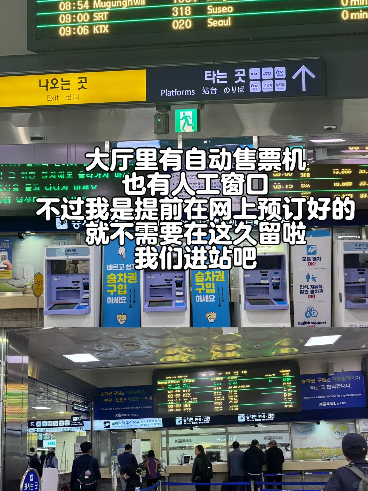

Busan ke Seoul adalah koridor kereta tersibuk di Korea, dan KTX memadatkan kedua kota menjadi sedikit lebih dari dua jam. Naik kereta ini terasa agak seperti terbang dan sama sekali tidak seperti terbang pada saat yang sama: tidak ada keamanan, tidak ada gerbang tiket, tidak ada panggilan boarding yang diulang melalui pengeras suara — hanya papan keberangkatan yang menahan nomor peron sampai lima belas menit sebelum kereta berangkat.

Berikut ini menelusuri perjalanan dalam lima langkah — membeli tiket, masuk stasiun, menemukan peron, menempati kursi, tiba di Stasiun Seoul. Tarif dan waktu di sini bersifat indikatif; periksa situs Korail sendiri dan layar stasiun sebelum berangkat.

## Pemesanan: situs resmi, aplikasi, atau pihak ketiga

Ada dua jalur sah untuk tiket KTX. Yang pertama adalah situs web Korail dan aplikasi Korail Talk, tempat Anda memilih tanggal, keberangkatan, gerbong, dan kursi sendiri dan membayar dengan kartu internasional. Yang kedua adalah platform pihak ketiga seperti Trip.com, yang bekerja dalam bahasa Tionghoa atau Inggris dan mengirim email konfirmasi setelah penerbitan. Tarifnya biasanya identik, dan kelas standar sekitar 59.800 won; periksa Korail untuk tarif pada tanggal Anda.

Tiket umumnya dijual sekitar satu bulan sebelumnya. Pada musim puncak dan akhir pekan, keberangkatan sore yang populer sering habis dua atau tiga hari sebelumnya, menyisakan kereta pagi dan malam. Jika tanggalnya tetap, pesan secepat mungkin — kereta pagi berarti alarm, tetapi juga menempatkan Anda di Seoul saat makan siang.

Anda dapat memilih gerbong dan kursi saat pemesanan. Jendela atau lorong terlihat di layar pemesanan, dan siapa pun yang bepergian dengan anak-anak atau koper besar sebaiknya mengincar kursi dekat pintu.

Setelah pembayaran, platform mengirim email konfirmasi, dan halaman pesanan menampilkan detail yang sama. **Simpan PDF atau tangkapan layar di ponsel Anda, dan simpan salinan di folder offline** — data seluler di dalam stasiun tidak merata. Boarding tidak melalui gerbang, tetapi pemeriksa memang berjalan di kereta, jadi siapkan kertas atau layarnya.

Tanpa pemesanan, tiket dapat dibeli di concourse. Mesin memiliki antarmuka bahasa Inggris dan loket menerima kartu internasional, meskipun kursi yang bersebelahan mungkin sudah habis pada waktu sibuk.

## Masuk: tanpa keamanan, tanpa gerbang

Bagian kereta api Stasiun Busan berbagi gedung dengan Metro Line 1. Naik dari metro, ikuti papan KTX di atas kepala — melalui lorong, naik eskalator — dan Anda tiba di concourse kereta. Logo KTX biru jelas sepanjang jalan dan mengarah ke gerbang tiket, kecuali bahwa tidak ada gerbang tiket.

Tidak ada keamanan, tidak ada pembatas: masuk melalui pintu dan Anda praktis sudah berada di level peron. Itulah perbedaan besar dari bandara. Tidak ada cadangan dua jam, tidak ada tas melalui pemindai, tidak ada antrean untuk cap.

“Tidak diperiksa” bukan berarti “tidak diperlukan”. Manajer kereta melakukan pemeriksaan acak, lebih sering pada perjalanan panjang. Simpan tiket di ponsel atau cetak di tas, dan siapkan nomor gerbong dan kursi.

## Peron: diumumkan 15 menit sebelumnya

Beberapa layar di concourse mencantumkan nomor kereta, waktu keberangkatan, tujuan, dan peron. Kolom peron tetap kosong sampai lima belas menit sebelum keberangkatan. Pendatang baru cenderung panik di sini; tidak perlu. Busan adalah stasiun terminal dan kereta sudah berdiri di peron, jadi menunggu nomornya tidak merugikan.

Saat layar diperbarui, catat peron dan ikuti papan di atas kepala. Peron di Busan terbagi menjadi dua kelompok — 1 hingga 6 di satu sisi, 8 hingga 11 di sisi lain — dan memilih sisi yang salah berarti harus berjalan memutar. Papan biru di atas tangga bertuliskan “서울·수서·대전·동대구 방면” dengan “To Seoul · Suseo · Daejeon · Dongdaegu” di bawahnya, jadi periksa arah sebelum turun.

Tidak setiap peron memiliki eskalator, jadi ambil sisi lift jika membawa koper berat. Di bawah, papan pilar dan layar kecil mengonfirmasi kereta dan peron sekali lagi sebelum boarding.

## Gerbong dan kursi: dipesan, dengan rak di atas

Setiap kursi KTX dipesan. Nomor gerbong dicat di samping pintu — misalnya “gerbong 6” — dan Anda menemukan tempat Anda dari nomor pada tiket. Nomor kursi berada pada pelat kecil di bawah rak bagasi, di atas kursi: C adalah lorong, D adalah jendela, sesuai dengan yang Anda pilih saat memesan.

Rak di atas kursi menampung tas kecil dan koper ukuran sedang. Koper 28 inci tidak akan muat, jadi gunakan ruang di ujung gerbong atau pilih kursi dekat pintu yang ada ruang di kaki Anda. Simpan barang berharga bersama Anda; lorong terisi pada perhentian antara.

Tidak setiap gerbong memiliki toilet. Beberapa bertanda “tanpa toilet” di pintu, dan Anda berjalan ke gerbong berikutnya. Menggunakan toilet di concourse sebelum boarding menghemat masalah nanti.

## Di dalam kereta: empat bahasa, sangat tenang, tidak ada yang dijual

Gerbong hampir sunyi. Orang Korea jarang menerima panggilan di KTX dan menjaga percakapan tetap pelan, jadi yang paling keras biasanya pengumuman stasiun. Untuk panggilan, gunakan ruang penghubung di antara gerbong, yang memiliki pintu kedap suara.

Pengumuman dalam bahasa Korea, Inggris, Tionghoa, dan Jepang, dan layar di langit-langit menunjukkan perhentian berikutnya dan tujuan akhir, sehingga perhentian antara sulit terlewat. Kereta berhenti di Daejeon, Dongdaegu, dan lainnya; perhentiannya singkat, dan turun untuk menghirup udara adalah taruhan.

Tidak ada layanan troli, tidak ada air gratis, tidak ada makanan ringan, dan tidak ada kondektur yang mendorong gerobak. Membeli air dan onigiri di toko serba ada di concourse sebelum boarding adalah rencana paling sederhana.

## Sekitar 2 jam 40 menit ke Stasiun Seoul

Busan ke Seoul memakan waktu sekitar 2 jam 40 menit dari awal hingga akhir. Itu lebih dapat diprediksi daripada terbang ditambah transportasi darat di kedua ujung: Gimhae ke Gimpo adalah satu jam di udara, tetapi check-in, keamanan, dan perjalanan ke kota biasanya mendorong waktu dari pintu ke pintu melewati tiga jam.

Stasiun Seoul adalah hub kereta negara dan bangunan yang sangat besar. Papan membagi pintu keluar berdasarkan tujuan: kereta KTX lanjutan ke kota lain, Metro Line 1 dan 4, dan kereta bandara AREX ke Incheon semuanya bertransit di dalam, tanpa meninggalkan stasiun.

Myeongdong dan Dongdaemun berada di Line 4; City Hall dan Jongno di Line 1. Untuk Bandara Incheon ada AREX Express dari stasiun yang sama, dan dengan banyak bagasi Anda dapat check-in dan menitipkannya di City Airport Terminal terlebih dahulu, lalu masuk ke kota dengan ringan.

Sisakan dua puluh menit tambahan untuk menemukan jalan pada kunjungan pertama. Papannya bagus, tetapi ada banyak level dan banyak pintu keluar, dan menyeret koper naik turun memakan waktu lebih lama dari yang terlihat. Berganti ke metro berarti tap lagi, dan mesin isi ulang di concourse menerima tunai dan kartu.

## Tautan terkait

- **Di situs ini**: [Korea Selatan (KR)](/country/KR)
- **Wikipedia**: [Korea Train Express](https://en.wikipedia.org/wiki/Korea_Train_Express), [Stasiun Busan](https://en.wikipedia.org/wiki/Busan_station), [Stasiun Seoul](https://en.wikipedia.org/wiki/Seoul_Station)
- **Baidu Baike**: [Kereta cepat Korea](https://baike.baidu.com/item/%E9%9F%A9%E5%9B%BD%E9%AB%98%E9%93%81)

Tarif dan waktu mengikuti informasi yang diterbitkan Korail; operator dan layar stasiun adalah acuan pasti. Kredit gambar: panduan perjalanan asli.
