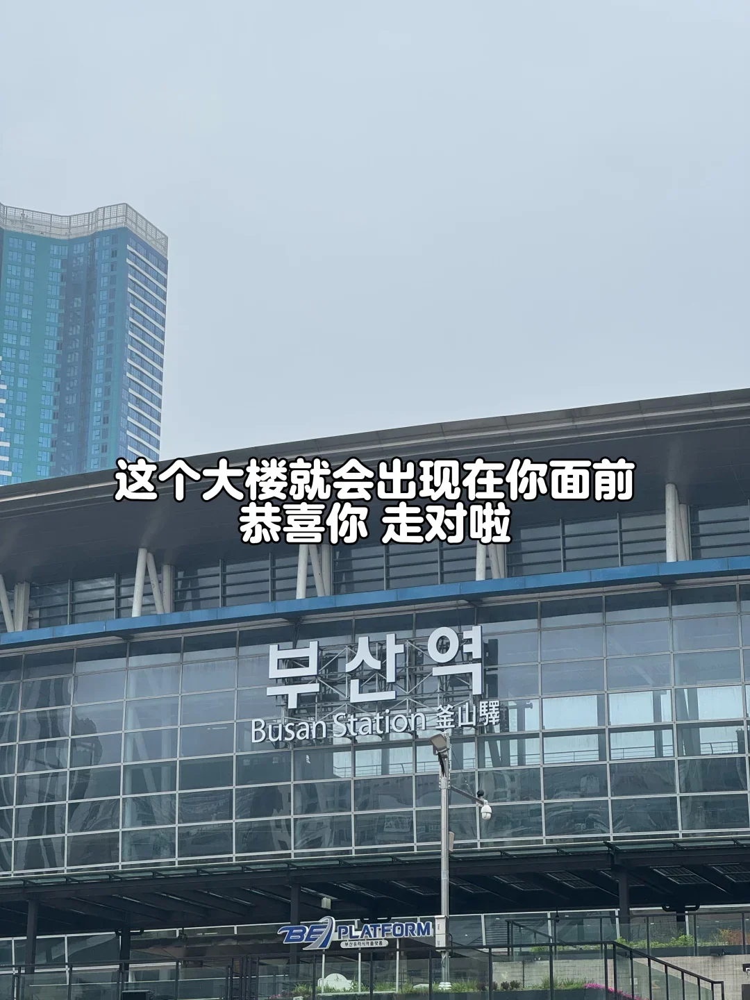
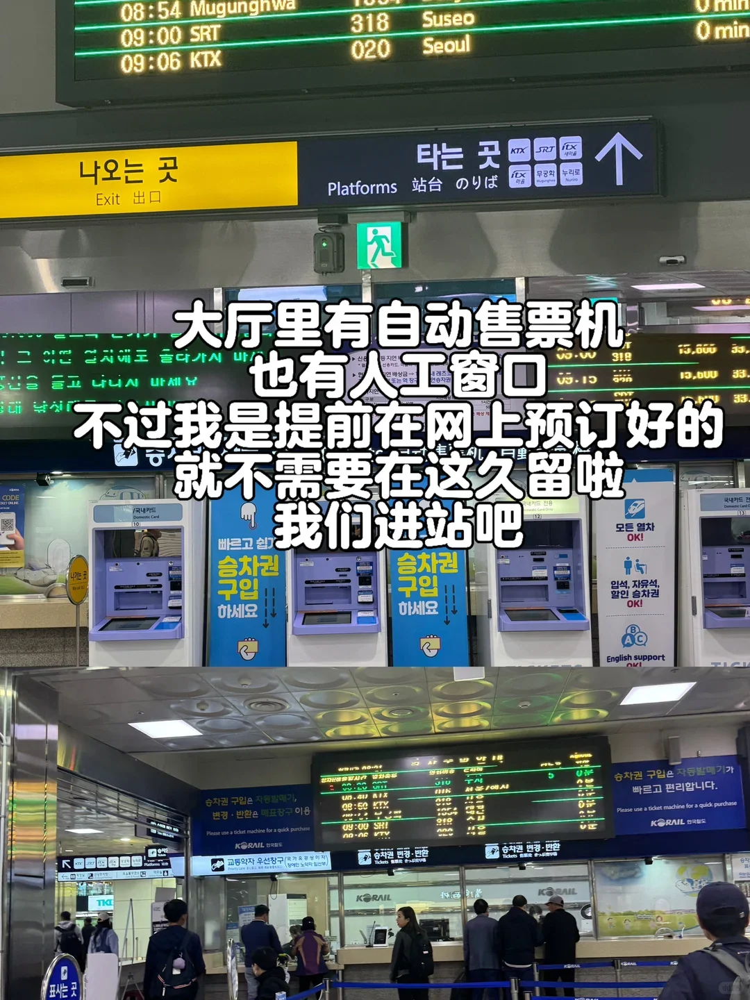
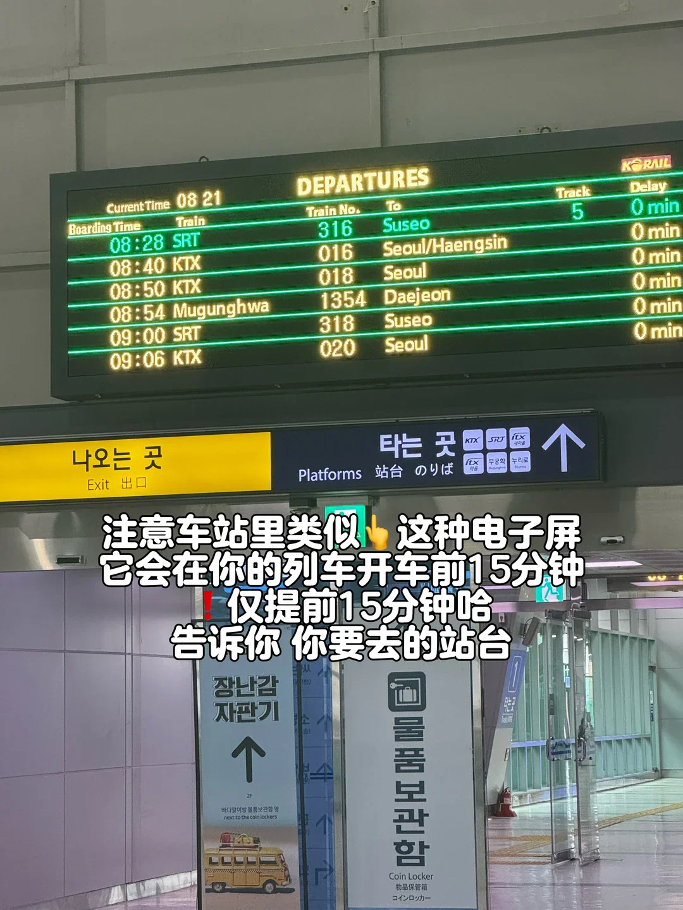
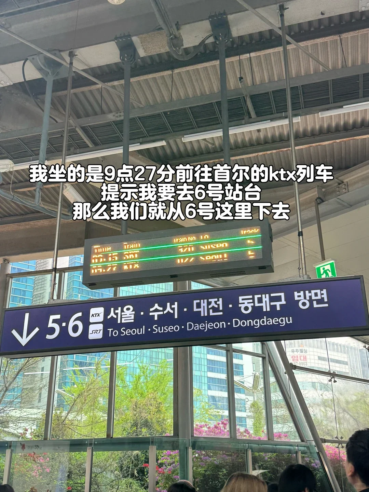
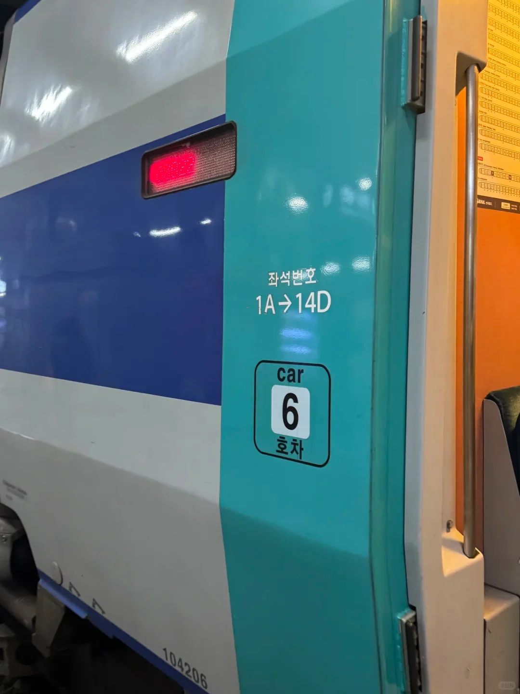
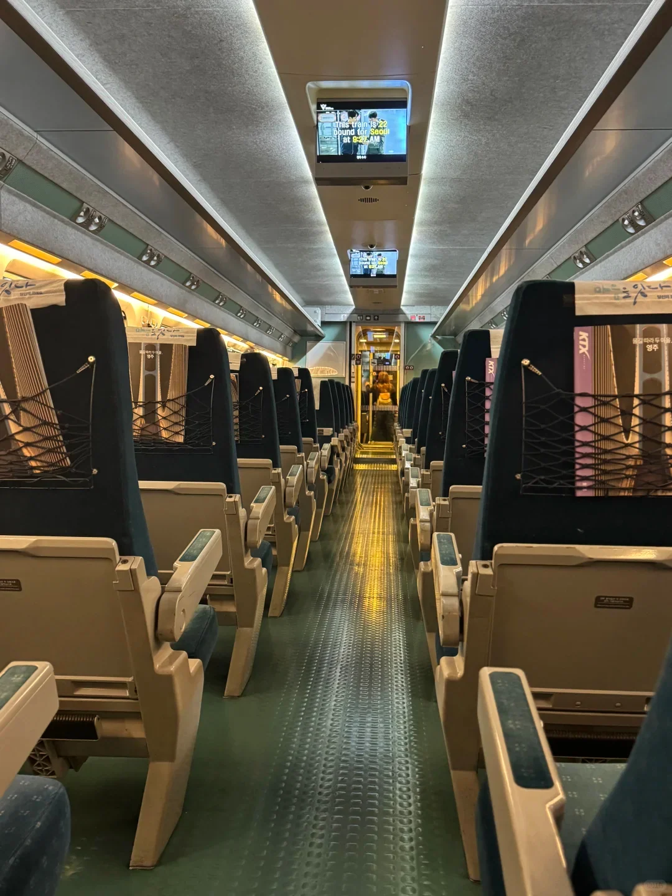

Busan-Seul è il corridoio ferroviario più trafficato della Corea, e il KTX comprime le due città in poco più di due ore. Viaggiarci assomiglia un po' a volare e nello stesso tempo per nulla: niente controlli di sicurezza, niente tornelli, nessun annuncio d'imbarco ripetuto dagli altoparlanti — solo un tabellone delle partenze che tiene il numero del binario fino a quindici minuti prima che il treno parta.

Quello che segue percorre il viaggio in cinque tappe — comprare il biglietto, entrare in stazione, trovare il binario, accomodarsi al posto, arrivare alla stazione di Seul. Tariffe e orari qui sono indicativi; controllate il sito di Korail e i display della stazione prima di partire.

## Prenotazione: il sito ufficiale, l'app o un intermediario

Ci sono due vie legittime per un biglietto KTX. La prima è il sito di Korail e l'app Korail Talk, dove scegliete da soli data, partenza, carrozza e posto e pagate con una carta internazionale. La seconda è una piattaforma di terzi come Trip.com, che funziona in cinese o in inglese e invia un'email di conferma dopo l'emissione. Le tariffe di solito sono identiche, e la classe standard costa circa 59,800 won; controllate Korail per la tariffa della vostra data.

I biglietti in genere vanno in vendita circa un mese prima. In alta stagione e nei fine settimana le partenze pomeridiane più richieste sono spesso esaurite due o tre giorni prima, lasciando i treni di prima mattina e di tarda serata. Se le date sono fisse, prenotate appena potete: un treno presto significa una sveglia, ma vi mette a Seul per pranzo.

Potete scegliere carrozza e posto al momento della prenotazione. Finestrino o corridoio sono visibili nella schermata di prenotazione, e chi viaggia con bambini o valigie grandi dovrebbe puntare a un posto vicino alla porta.

Dopo il pagamento la piattaforma invia un'email di conferma, e la pagina dell'ordine mostra gli stessi dati. **Salvate il PDF o uno screenshot sul telefono e tenetene una copia in una cartella offline** — i dati mobili dentro la stazione sono a chiazze. L'imbarco non è controllato da tornelli, ma i controllori percorrono il treno, quindi tenete pronto il foglio o lo schermo.

Senza prenotazione, i biglietti si comprano nella hall. Le macchine hanno un'interfaccia in inglese e la biglietteria accetta carte internazionali, anche se nelle ore di punta i posti adiacenti possono essere già esauriti.

## Ingresso: niente controlli, niente tornelli

La parte ferroviaria della stazione di Busan condivide l'edificio con la linea 1 della metropolitana. Salendo dalla metro, seguite i cartelli KTX in alto — attraverso un passaggio, su per una scala mobile — e arrivate nella hall ferroviaria. I loghi blu KTX sono chiari per tutto il percorso e portano al varco dei biglietti, peccato che un varco dei biglietti non esista.

Niente controlli di sicurezza, niente barriere: entrate dall'ingresso principale e siete già di fatto al livello dei binari. È la grande differenza rispetto a un aeroporto. Nessun margine di due ore, nessuna valigia nello scanner, nessuna coda per un timbro.

“Non controllato” però non significa “non necessario”. I capotreno fanno controlli a campione, più spesso sui percorsi lunghi. Tenete il biglietto sul telefono o stampato in borsa, e siate pronti a indicare carrozza e posto.

## Il binario: pubblicato 15 minuti prima

Diversi schermi nella hall elencano numero del treno, ora di partenza, destinazione e binario. La colonna del binario resta vuota fino a quindici minuti prima della partenza. Chi è alla prima volta tende a farsi prendere dal panico; non serve. Busan è un capolinea e il treno è già fermo al binario, quindi aspettare il numero non costa nulla.

Quando lo schermo si aggiorna, prendete nota del binario e seguite i cartelli in alto. I binari di Busan sono divisi in due gruppi — da 1 a 6 da un lato, da 8 a 11 dall'altro — e scegliere il lato sbagliato significa tornare indietro. Le tabelle blu sopra le scale recitano “서울·수서·대전·동대구 방면” con “To Seoul · Suseo · Daejeon · Dongdaegu” sotto, quindi controllate la direzione prima di scendere.

Non tutti i binari hanno una scala mobile, quindi con valigie pesanti prendete il lato degli ascensori. In fondo, i cartelli sui pilastri e i piccoli schermi confermano ancora una volta treno e binario prima di salire.

## Carrozza e posto: prenotati, con il portabagagli sopra

Ogni posto KTX è prenotato. Il numero della carrozza è dipinto vicino alla porta — “carrozza 6”, per esempio — e il vostro posto si trova dal numero sul biglietto. I numeri dei sedili sono su piccole targhette sotto il portabagagli, sopra i sedili: C è il corridoio, D il finestrino, in linea con quanto scelto alla prenotazione.

Il portabagagli sopra i sedili accoglie borse piccole e valigie medie. Una valigia da 28 pollici non ci sta, quindi usate lo spazio in fondo alla carrozza o scegliete un posto vicino alla porta dove c'è spazio per i piedi. Tenete con voi gli oggetti di valore; il corridoio si riempie alle fermate intermedie.

Non tutte le carrozze hanno il bagno. Alcune sono segnalate “no toilet” sulla porta, e bisogna andare nella successiva. Usare la hall prima di salire evita problemi più tardi.

## A bordo: quattro lingue, molto silenzio, nulla in vendita

La carrozza è quasi silenziosa. I coreani raramente telefonano sul KTX e tengono basso il volume delle conversazioni, quindi la cosa più rumorosa è di solito l'annuncio della stazione. Per una chiamata usate il vestibolo tra le carrozze, che ha una porta insonorizzata.

Gli annunci sono in coreano, inglese, cinese e giapponese, e gli schermi sul soffitto mostrano la fermata successiva e la destinazione finale, quindi le fermate intermedie difficilmente sfuggono. Il treno ferma a Daejeon, Dongdaegu e altre stazioni; le fermate sono brevi, e scendere a prendere una boccata d'aria è una scommessa.

Non c'è servizio con carrello, né acqua gratuita, né snack, e nessun addetto che spinge un carrello lungo il corridoio. Comprare acqua e una polpetta di riso al minimarket della hall prima di salire è il piano più semplice.

## Circa 2 ore e 40 minuti fino alla stazione di Seul

Da Busan a Seul si impiegano all'incirca 2 ore e 40 minuti porta a porta. È più prevedibile che volare più il trasporto a terra alle due estremità: da Gimhae a Gimpo è un'ora di volo, ma check-in, controlli e la corsa verso il centro di solito spingono il tempo totale oltre le tre ore.

La stazione di Seul è l'hub ferroviario del paese e un edificio molto grande. I cartelli dividono le uscite per scopo: i treni KTX verso altre città, le linee 1 e 4 della metropolitana e la ferrovia aeroportuale AREX per Incheon si interscambiano tutti all'interno, senza uscire dalla stazione.

Myeongdong e Dongdaemun sono sulla linea 4; City Hall e Jongno sulla linea 1. Per l'aeroporto di Incheon c'è l'AREX Express dalla stessa stazione, e con bagagli pesanti potete prima fare il check-in e lasciarli al City Airport Terminal, poi entrare in città leggeri.

Alla prima visita calcolate venti minuti in più per orientarvi. I cartelli sono buoni, ma ci sono molti livelli e molte uscite, e trascinare una valigia su e giù richiede più tempo di quanto sembri. Passare alla metro significa timbrare di nuovo l'ingresso, e le macchine di ricarica nella hall accettano contanti e carte.

## Link utili

- **Su questo sito**: [Corea del Sud (KR)](/country/KR)
- **Wikipedia**: [Korea Train Express](https://en.wikipedia.org/wiki/Korea_Train_Express), [Busan station](https://en.wikipedia.org/wiki/Busan_station), [Seoul Station](https://en.wikipedia.org/wiki/Seoul_Station)
- **Baidu Baike**: [Korea high-speed rail](https://baike.baidu.com/item/%E9%9F%A9%E5%9B%BD%E9%AB%98%E9%93%81)

Tariffe e orari seguono le informazioni pubblicate da Korail; l'operatore e i display della stazione sono la fonte definitiva. Credito immagine: la guida di viaggio originale.
