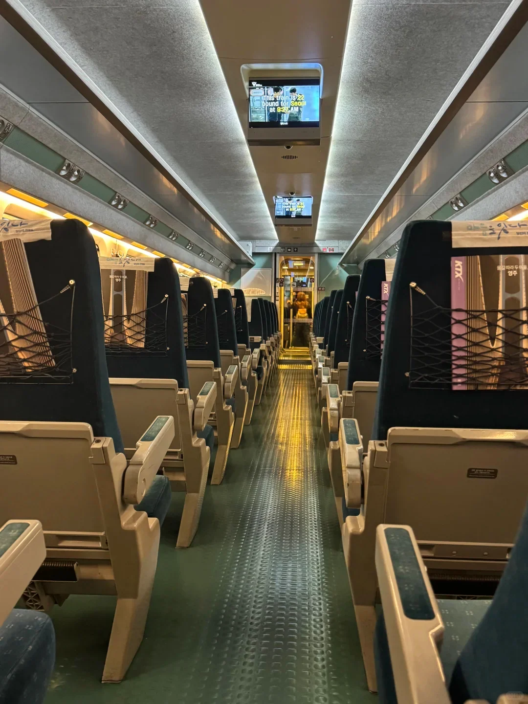

Busan naar Seoul is de drukste spoorcorridor van Korea, en de KTX perst de twee steden in iets meer dan twee uur. Meerijden voelt een beetje als vliegen en tegelijk helemaal niet: geen beveiliging, geen ticketpoortjes, geen omroep die het instappen herhaalt — alleen een vertrekbord dat zijn perronnummer pas een kwartier voor vertrek vrijgeeft.

Hierna volgt de reis in vijf stappen — een kaartje kopen, het station binnenkomen, het perron vinden, je stoel innemen, aankomen op Seoul Station. De tarieven en tijden hier zijn indicatief; controleer de site van Korail en de schermen op het station voordat je reist.

## Boeken: de officiële site, de app of een derde partij

Er zijn twee legitieme routes naar een KTX-kaartje. De eerste is de website van Korail en de app Korail Talk, waar je zelf datum, vertrek, rijtuig en stoel kiest en met een internationale kaart betaalt. De tweede is een platform van derden zoals Trip.com, dat in het Chinees of Engels werkt en na uitgifte een bevestigingsmail stuurt. De tarieven zijn meestal identiek, en tweede klas kost ongeveer 59.800 won; controleer bij Korail het tarief voor jouw datum.

Kaartjes gaan meestal ongeveer een maand vooruit in de verkoop. In het hoogseizoen en in het weekend zijn populaire middagvertrekken vaak twee of drie dagen van tevoren weg, en blijven de vroege ochtend- en late avondtreinen over. Liggen de data vast, boek dan zo snel als je kunt — een vroege trein betekent een wekker, maar zet je ook voor de lunch in Seoul.

Je kunt op het moment van boeken een rijtuig en een stoel kiezen. Raam of gangpad is zichtbaar op het boekingsscherm, en wie met kinderen of grote koffers reist, kan beter een stoel bij de deur nemen.

Na betaling mailt het platform een bevestiging, en de orderpagina toont dezelfde gegevens. **Sla de pdf of een schermafbeelding op je telefoon op, en bewaar een kopie in een offline map** — mobiele data in het station is wisselvallig. Instappen kent geen poortjes, maar conducteurs lopen wel door de trein, dus houd het papier of het scherm klaar.

Zonder reservering kun je in de hal kaartjes kopen. De automaten hebben een Engelse interface en het loket accepteert internationale kaarten, al kunnen naast elkaar gelegen stoelen op drukke momenten al weg zijn.

## Binnenkomen: geen beveiliging, geen poortjes

Het spoorwegdeel van Busan Station deelt een gebouw met metrolijn 1. Kom je van de metro omhoog, volg dan de KTX-borden boven je hoofd — door een gang, een roltrap op — en je komt uit in de spoorweghal. De blauwe KTX-logo's zijn de hele weg duidelijk en leiden naar de ticketcontrole, behalve dat er geen ticketcontrole is.

Geen beveiliging, geen hekken: je loopt door de ingang naar binnen en staat in feite al op perronniveau. Dat is het grote verschil met een vliegveld. Geen buffer van twee uur, geen tas door een scanner, geen rij voor een stempel.

"Niet gecontroleerd" betekent echter niet "niet nodig". Treinmanagers doen steekproeven, vaker op lange trajecten. Houd het kaartje op je telefoon of uitgeprint in je tas, en wees klaar om het rijtuig- en stoelnummer te noemen.

## Het perron: een kwartier vooraf bekendgemaakt

Meerdere schermen in de hal tonen treinnummer, vertrektijd, bestemming en perron. De perronkolom blijft leeg tot een kwartier voor vertrek. Wie voor het eerst reist, raakt hier vaak in paniek; dat is nergens voor nodig. Busan is een kopstation en de trein staat al aan het perron, dus wachten op het nummer kost niets.

Als het scherm verandert, noteer het perron en volg de borden boven je hoofd. De perrons in Busan zijn in twee groepen verdeeld — 1 tot 6 aan de ene kant, 8 tot 11 aan de andere — en de verkeerde kant kiezen betekent om lopen. De blauwe borden boven de trappen lezen "서울·수서·대전·동대구 방면" met daaronder "To Seoul · Suseo · Daejeon · Dongdaegu", dus controleer de richting voordat je naar beneden gaat.

Niet elk perron heeft een roltrap, dus met zware koffers neem je de liftkant. Beneden bevestigen de borden op de pilaren en de kleine schermen de trein en het perron nog eens voor je instapt.

## Rijtuig en stoel: gereserveerd, met het rek erboven

Elke KTX-stoel is gereserveerd. Het rijtuignummer staat bij de deur geschilderd — bijvoorbeeld "car 6" — en je vindt je plek via het nummer op het kaartje. Stoelnummers staan op kleine plaatjes onder het bagagerek, boven de stoelen: C is het gangpad, D het raam, precies zoals je bij het boeken koos.

Het rek boven de stoelen neemt kleine tassen en middelgrote koffers. Een koffer van 28 inch past niet, dus gebruik de ruimte aan het eind van het rijtuig of kies een stoel bij de deur waar ruimte aan je voeten is. Houd waardevolle spullen bij je; het gangpad loopt vol bij tussenstops.

Niet elk rijtuig heeft een toilet. Sommige hebben "geen toilet" op de deur staan, en dan loop je naar het volgende. Voor het instappen de hal gebruiken bespaart later gedoe.

## Aan boord: vier talen, heel stil, niets te koop

Het rijtuig is bijna stil. Koreanen bellen zelden in de KTX en houden het gesprek zacht, dus het luidste is meestal de stationsomroep. Voor een gesprek gebruik je het portaal tussen de rijtuigen, dat een geluiddichte deur heeft.

Omroepen komen in het Koreaans, Engels, Chinees en Japans, en de schermen in het plafond tonen de volgende halte en de eindbestemming, dus tussenstops zijn moeilijk te missen. De trein stopt in Daejeon, Dongdaegu en meer; de stops zijn kort, en even naar buiten stappen voor frisse lucht is een gok.

Er is geen trolleyservice, geen gratis water, geen snacks, en geen conducteur die een kar door het gangpad duwt. Water en een rijstbal kopen bij de buurtwinkel in de hal voor het instappen is het eenvoudigste plan.

## Ongeveer 2 uur 40 minuten naar Seoul Station

Busan naar Seoul duurt van begin tot eind ongeveer 2 uur 40 minuten. Dat is voorspelbaarder dan vliegen plus het grondvervoer aan beide kanten: Gimhae naar Gimpo is een uur in de lucht, maar check-in, beveiliging en de rit naar de stad duwen de deur-tot-deur-tijd meestal voorbij drie uur.

Seoul Station is het spoorwegknooppunt van het land en een zeer groot gebouw. De borden splitsen de uitgangen naar doel: KTX-treinen verder naar andere steden, metrolijnen 1 en 4, en de AREX-luchthavenspoorweg naar Incheon wisselen allemaal binnen over, zonder het station te verlaten.

Myeongdong en Dongdaemun liggen aan lijn 4; City Hall en Jongno aan lijn 1. Voor Incheon Airport is er de AREX Express vanaf hetzelfde station, en met zware tassen kun je eerst inchecken en ze afgeven bij de City Airport Terminal, en daarna licht de stad in.

Reken bij een eerste bezoek twintig extra minuten om je weg te vinden. De borden zijn goed, maar er zijn veel niveaus en veel uitgangen, en een koffer omhoog en omlaag slepen duurt langer dan het lijkt. Overstappen op de metro betekent opnieuw door de poortjes, en de oplaadautomaten in de hal nemen contant geld en kaarten.

## Gerelateerde links

- **Op deze site**: [Zuid-Korea (KR)](/country/KR)
- **Wikipedia**: [Korea Train Express](https://en.wikipedia.org/wiki/Korea_Train_Express), [Busan station](https://en.wikipedia.org/wiki/Busan_station), [Seoul Station](https://en.wikipedia.org/wiki/Seoul_Station)
- **Baidu Baike**: [Korea high-speed rail](https://baike.baidu.com/item/%E9%9F%A9%E5%9B%BD%E9%AB%98%E9%93%81)

Tarieven en tijden volgen de gepubliceerde informatie van Korail; de vervoerder en de schermen op het station zijn bepalend. Beeldcredit: de oorspronkelijke reisgids.
