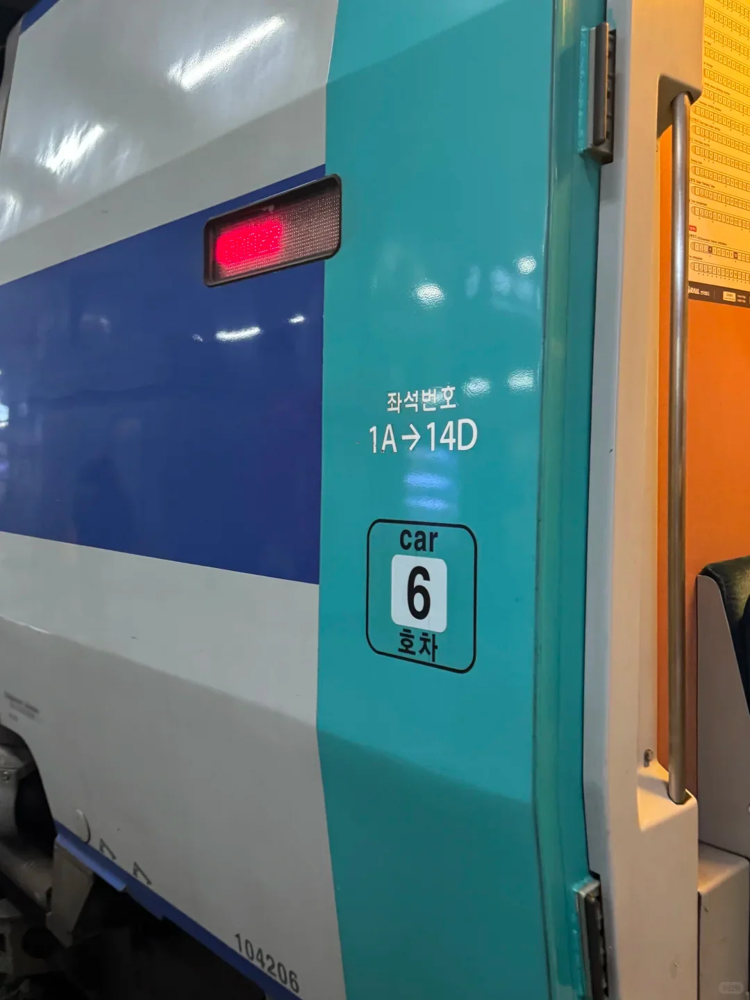

Busan–Seul to najruchliwszy korytarz kolejowy w Korei, a KTX ściska te dwa miasta do niewiele ponad dwóch godzin. Jazda nim trochę przypomina lot, a jednocześnie niczego w locie nie przypomina: żadnej kontroli bezpieczeństwa, żadnych bramek biletowych, żadnego wezwania do wsiadania powtarzanego przez megafon — tylko tablica odjazdów, która trzyma numer peronu w tajemnicy do piętnastu minut przed odjazdem.

Poniżej podróż jest rozpisana w pięciu krokach — kupno biletu, wejście na dworzec, znalezienie peronu, zajęcie miejsca, przyjazd na dworzec Seul. Podane tu opłaty i czasy są orientacyjne; przed podróżą sprawdź stronę Korail i wyświetlacze na dworcu.

## Rezerwacja: oficjalna strona, aplikacja lub pośrednik

Do biletu KTX prowadzą dwie legalne drogi. Pierwsza to strona Korail i aplikacja Korail Talk, gdzie sam wybierasz datę, odjazd, wagon i miejsce i płacisz kartą międzynarodową. Druga to platforma pośrednia, taka jak Trip.com, która działa po chińsku lub angielsku i po wystawieniu biletu wysyła e-mail z potwierdzeniem. Opłaty są zwykle identyczne, a klasa standardowa kosztuje około 59 800 wonów; opłatę na swoją datę sprawdź u Korail.

Bilety trafiają do sprzedaży zwykle około miesiąca wcześniej. W szczycie sezonu i w weekendy popularne popołudniowe odjazdy często znikają dwa lub trzy dni przed, zostawiając pociągi wczesnoporanne i późnowieczorne. Jeśli daty są stałe, rezerwuj jak najszybciej — wczesny pociąg oznacza budzik, ale za to stawia cię w Seulu na obiad.

Przy rezerwacji możesz wybrać wagon i miejsce. Okno czy przejście widać na ekranie rezerwacji, a kto podróżuje z dziećmi lub dużymi walizkami, powinien celować w miejsce przy drzwiach.

Po płatności platforma wysyła e-mail z potwierdzeniem, a strona zamówienia pokazuje te same dane. **Zapisz PDF lub zrzut ekranu na telefonie i trzymaj kopię w folderze offline** — dane mobilne na dworcu są nierówne. Wsiadanie nie odbywa się przez bramki, ale kontrolerzy przechodzą przez pociąg, więc miej bilet pod ręką, na papierze lub na ekranie.

Bez rezerwacji bilety można kupić w hali. Automaty mają angielskie menu, a kasa przyjmuje karty międzynarodowe, choć w godzinach szczytu sąsiednie miejsca mogą być już zajęte.

## Wejście: bez kontroli, bez bramek

Kolejowa część dworca Busan dzieli budynek z linią metra 1. Wychodząc z metra, idź za znakami KTX nad głową — przez przejście, w górę schodami ruchomymi — i trafiasz do hali kolejowej. Niebieskie logotypy KTX są widoczne przez całą drogę i prowadzą do bramki biletowej, z tym że bramki nie ma.

Bez kontroli, bez barierek: wchodzisz przez wejście i praktycznie jesteś już na poziomie peronu. To wielka różnica w stosunku do lotniska. Żadnego dwugodzinnego buforu, żadnej torby przez skaner, żadnej kolejki po pieczątkę.

„Niesprawdzane” nie znaczy jednak „niepotrzebne”. Kierownicy pociągów robią kontrole wyrywkowe, częściej na długich trasach. Trzymaj bilet na telefonie lub wydrukowany w torbie i bądź gotów podać numer wagonu i miejsca.

## Peron: ogłaszany 15 minut przed odjazdem

Kilka ekranów w hali wyświetla numer pociągu, godzinę odjazdu, cel i peron. Kolumna peronu pozostaje pusta do piętnastu minut przed odjazdem. Nowicjusze zwykle wpadają tu w panikę; nie ma powodu. Busan to stacja końcowa, a pociąg już stoi przy peronie, więc czekanie na numer nic nie kosztuje.

Gdy ekran się zaktualizuje, zapamiętaj peron i idź za znakami nad głową. Perony w Busan są podzielone na dwie grupy — 1 do 6 po jednej stronie, 8 do 11 po drugiej — a wybór złej strony oznacza obejście. Niebieskie tablice nad schodami mówią „서울·수서·대전·동대구 방면”, a pod spodem „To Seoul · Suseo · Daejeon · Dongdaegu”, więc sprawdź kierunek przed zejściem.

Nie każdy peron ma schody ruchome, więc z ciężkimi walizkami trzymaj się strony z windą. Na dole znaki na filarach i małe ekrany jeszcze raz potwierdzają pociąg i peron przed wsiadaniem.

## Wagon i miejsce: rezerwowane, z półką nad głową

Każde miejsce w KTX jest rezerwowane. Numer wagonu jest namalowany przy drzwiach — na przykład „wagon 6” — a swoje miejsce znajdziesz po numerze z biletu. Numery miejsc są na małych tabliczkach pod półką bagażową, nad siedzeniami: C to przejście, D to okno, zgodnie z tym, co wybrałeś przy rezerwacji.

Półka nad siedzeniami mieści małe torby i średnie walizki. Walizka 28-calowa się nie zmieści, więc skorzystaj z przestrzeni na końcu wagonu albo wybierz miejsce przy drzwiach, gdzie jest miejsce na podłodze. Trzymaj kosztowności przy sobie; przejście zapełnia się na przystankach pośrednich.

Nie każdy wagon ma toaletę. Niektóre mają na drzwiach oznaczenie „brak toalety” i idziesz do następnego. Skorzystanie z toalety w hali przed wsiadaniem oszczędza kłopotów później.

## W pociągu: cztery języki, bardzo cicho, nic do kupienia

W wagonie jest niemal cicho. Koreańczycy rzadko odbierają telefony w KTX i mówią ściszonym głosem, więc najgłośniejszym dźwiękiem jest zwykle zapowiedź stacji. Na rozmowę telefoniczną użyj przedsionka między wagonami, który ma dźwiękoszczelne drzwi.

Komunikaty są po koreańsku, angielsku, chińsku i japońsku, a ekrany w suficie pokazują następny przystanek i stację końcową, więc pośrednich przystanków trudno nie zauważyć. Pociąg zatrzymuje się w Daejeon, Dongdaegu i innych miastach; postoje są krótkie, a wyjście na świeże powietrze to hazard.

Nie ma wózka z obsługą, darmowej wody, przekąsek ani konduktora z wózkiem. Najprostszy plan to kupić wodę i onigiri w sklepie w hali przed wsiadaniem.

## Około 2 godzin 40 minut do dworca Seul

Busan–Seul zajmuje około 2 godzin 40 minut od początku do końca. To bardziej przewidywalne niż lot plus transport naziemny na obu końcach: Gimhae–Gimpo to godzina w powietrzu, ale odprawa, kontrola bezpieczeństwa i dojazd do miasta zwykle wypychają czas podróży od drzwi do drzwi ponad trzy godziny.

Dworzec Seul to kolejowy węzeł kraju i bardzo duży budynek. Znaki dzielą wyjścia według celu: pociągi KTX do innych miast, linie metra 1 i 4 oraz kolej lotniskowa AREX do Incheon — wszystkie przesiadki są w środku, bez wychodzenia z dworca.

Myeongdong i Dongdaemun są na linii 4; City Hall i Jongno na linii 1. Do lotniska Incheon jest AREX Express z tego samego dworca, a z ciężkimi torbami możesz najpierw odprawić się i zostawić bagaż w City Airport Terminal, a potem pojechać do miasta bez bagażu.

Przy pierwszej wizycie zarezerwuj dodatkowe dwadzieścia minut na rozejrzenie się. Znaki są dobre, ale poziomów i wyjść jest wiele, a ciągnięcie walizki w górę i w dół trwa dłużej, niż wygląda. Przesiadka na metro oznacza ponowne przyłożenie karty, a automaty do doładowań w hali przyjmują gotówkę i karty.

## Powiązane linki

- **Na tej stronie**: [Korea Południowa (KR)](/country/KR)
- **Wikipedia**: [Korea Train Express](https://en.wikipedia.org/wiki/Korea_Train_Express), [Busan station](https://en.wikipedia.org/wiki/Busan_station), [Seoul Station](https://en.wikipedia.org/wiki/Seoul_Station)
- **Baidu Baike**: [Korea high-speed rail](https://baike.baidu.com/item/%E9%9F%A9%E5%9B%BD%E9%AB%98%E9%93%81)

Opłaty i czasy są zgodne z publikowanymi informacjami Korail; operator i wyświetlacze na dworcu są rozstrzygające. Źródło zdjęć: oryginalny przewodnik turystyczny.
