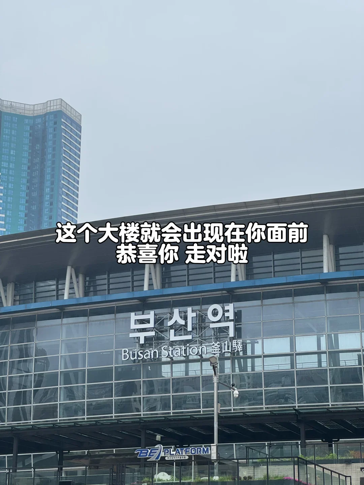

Busan–Seul é o corredor ferroviário mais movimentado da Coreia, e o KTX comprime as duas cidades em pouco mais de duas horas. Andar nele parece um pouco voar e nada parecido ao mesmo tempo: sem segurança, sem catracas, sem chamada de embarque repetida no alto-falante — apenas um painel de partidas que segura o número da plataforma até quinze minutos antes de o trem sair.

O que segue percorre a viagem em cinco etapas — comprar a passagem, entrar na estação, encontrar a plataforma, tomar seu assento e chegar à Estação de Seul. As tarifas e os horários aqui são indicativos; confira o site do Korail e os painéis da estação antes de viajar.

## Reserva: o site oficial, o aplicativo ou um terceiro

Há dois caminhos legítimos para uma passagem de KTX. O primeiro é o site do Korail e o aplicativo Korail Talk, onde você escolhe data, partida, vagão e assento e paga com um cartão internacional. O segundo é uma plataforma de terceiros como a Trip.com, que funciona em chinês ou inglês e envia um e-mail de confirmação após a emissão. As tarifas costumam ser idênticas, e a classe standard custa cerca de 59.800 won; confira no Korail a tarifa da sua data.

Em geral, as passagens são vendidas cerca de um mês antes. Na alta temporada e nos fins de semana, as partidas populares da tarde muitas vezes esgotam dois ou três dias antes, restando os trens de madrugada e de fim de noite. Se as datas forem fixas, reserve o quanto antes — um trem cedo significa despertador, mas também coloca você em Seul na hora do almoço.

Você pode escolher vagão e assento no momento da reserva. Janela ou corredor aparecem na tela de reserva, e quem viaja com crianças ou malas grandes deve mirar em um assento perto da porta.

Após o pagamento, a plataforma envia um e-mail de confirmação, e a página do pedido mostra os mesmos dados. **Salve o PDF ou uma captura de tela no celular, e mantenha uma cópia em uma pasta offline** — o sinal de dados dentro da estação é instável. O embarque não tem catraca, mas os fiscais percorrem o trem, então tenha o papel ou a tela à mão.

Sem reserva, as passagens podem ser compradas no saguão. As máquinas têm interface em inglês e o guichê aceita cartões internacionais, embora assentos adjacentes possam já estar esgotados nos horários movimentados.

## Entrada: sem segurança, sem catracas

A metade ferroviária da Estação de Busan divide o prédio com a Linha 1 do metrô. Subindo do metrô, siga as placas de KTX no teto — por uma passagem, por uma escada rolante — e você chega ao saguão ferroviário. Os logotipos azuis do KTX são claros o tempo todo e levam à catraca de bilhetes, exceto que não há catraca.

Sem segurança, sem barreiras: entre pela porta e você já está efetivamente no nível da plataforma. Essa é a grande diferença em relação a um aeroporto. Sem margem de duas horas, sem mala no scanner, sem fila para um carimbo.

“Não fiscalizado” não significa “não necessário”, porém. Os chefes de trem fazem verificações pontuais, mais frequentemente em viagens longas. Mantenha a passagem no celular ou impressa na bolsa e esteja pronto para informar o vagão e o assento.

## A plataforma: divulgada 15 minutos antes

Várias telas no saguão listam número do trem, horário de partida, destino e plataforma. A coluna da plataforma fica em branco até quinze minutos antes da partida. Quem viaja pela primeira vez tende a entrar em pânico aqui; não é preciso. Busan é terminal, e o trem já está parado na plataforma, então esperar pelo número não custa nada.

Quando a tela atualiza, anote a plataforma e siga as placas no teto. As plataformas em Busan são divididas em dois grupos — 1 a 6 de um lado, 8 a 11 do outro —, e escolher o lado errado significa voltar andando. Os painéis azuis acima das escadas dizem “서울·수서·대전·동대구 방면”, com “To Seoul · Suseo · Daejeon · Dongdaegu” embaixo, então confira o sentido antes de descer.

Nem toda plataforma tem escada rolante, então com malas pesadas fique do lado do elevador. Embaixo, as placas nos pilares e as pequenas telas confirmam o trem e a plataforma mais uma vez antes do embarque.

## Vagão e assento: reservados, com o bagageiro acima

Todo assento do KTX é reservado. O número do vagão está pintado na porta — “vagão 6”, por exemplo —, e você encontra o seu lugar pelo número na passagem. Os números de assento ficam em pequenas placas sob o bagageiro, acima dos assentos: C é o corredor, D a janela, coincidindo com o que você escolheu na reserva.

O bagageiro acima dos assentos acomoda bolsas pequenas e malas médias. Uma mala de 28 polegadas não cabe, então use o espaço na extremidade do vagão ou escolha um assento perto da porta, onde há espaço aos seus pés. Leve os objetos de valor com você; o corredor enche nas paradas intermediárias.

Nem todo vagão tem banheiro. Alguns estão marcados com “sem banheiro” na porta, e você caminha até o próximo. Usar o banheiro do saguão antes de embarcar evita problemas depois.

## A bordo: quatro idiomas, muito silêncio, nada à venda

O vagão é quase silencioso. Os coreanos raramente atendem ligações no KTX e mantêm a conversa baixa, então a coisa mais alta costuma ser o anúncio da estação. Para uma ligação, use o vestíbulo entre os vagões, que tem porta à prova de som.

Os anúncios são em coreano, inglês, chinês e japonês, e as telas no teto mostram a próxima parada e o destino final, então é difícil perder uma parada intermediária. O trem para em Daejeon, Dongdaegu e outras; as paradas são curtas, e descer para tomar ar é uma aposta.

Não há serviço de carrinho, nem água grátis, nem lanches, nem condutor empurrando um carrinho pelo corredor. Comprar água e um bolinho de arroz na loja de conveniência do saguão antes de embarcar é o plano mais simples.

## Cerca de 2 horas e 40 minutos até a Estação de Seul

De Busan a Seul leva cerca de 2 horas e 40 minutos de ponta a ponta. Isso é mais previsível do que voar mais o transporte terrestre nas duas pontas: de Gimhae a Gimpo é uma hora no ar, mas check-in, segurança e o deslocamento até a cidade costumam empurrar o tempo porta a porta para mais de três horas.

A Estação de Seul é o hub ferroviário do país e um prédio muito grande. As placas dividem as saídas por finalidade: trens KTX para outras cidades, Linhas 1 e 4 do metrô e a ferrovia aeroportuária AREX para Incheon, todas com baldeação interna, sem sair da estação.

Myeongdong e Dongdaemun ficam na Linha 4; City Hall e Jongno, na Linha 1. Para o Aeroporto de Incheon há o AREX Express na mesma estação, e com malas pesadas você pode fazer o check-in e despachar a bagagem primeiro no City Airport Terminal, depois ir para a cidade leve.

Reserve vinte minutos extras para se orientar na primeira visita. As placas são boas, mas há muitos níveis e muitas saídas, e arrastar uma mala para cima e para baixo leva mais tempo do que parece. Trocar para o metrô significa encostar o cartão de novo, e as máquinas de recarga no saguão aceitam dinheiro e cartão.

## Links relacionados

- **Neste site**: [Coreia do Sul (KR)](/country/KR)
- **Wikipédia**: [Korea Train Express](https://en.wikipedia.org/wiki/Korea_Train_Express), [Estação de Busan](https://en.wikipedia.org/wiki/Busan_station), [Estação de Seul](https://en.wikipedia.org/wiki/Seoul_Station)
- **Baidu Baike**: [Trem de alta velocidade da Coreia](https://baike.baidu.com/item/%E9%9F%A9%E5%9B%BD%E9%AB%98%E9%93%81)

Tarifas e horários seguem as informações publicadas pelo Korail; o operador e os painéis da estação são definitivos. Crédito das imagens: o guia de viagem original.
