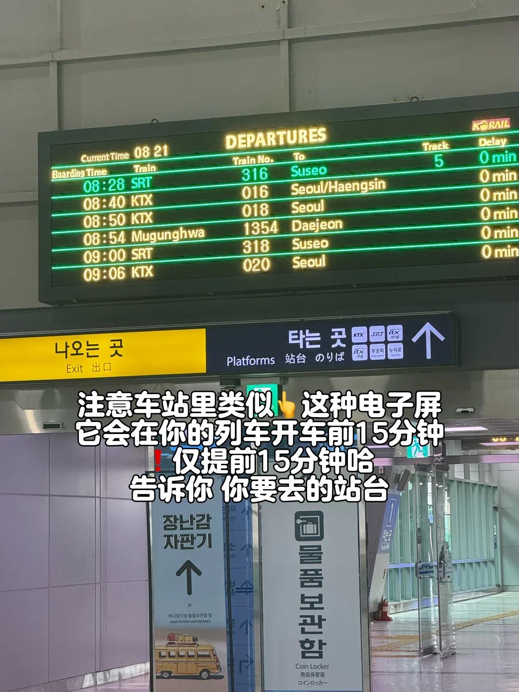

Busan–Seul este cel mai aglomerat coridor feroviar din Coreea, iar KTX comprimă cele două orașe în puțin peste două ore. Călătoria cu el seamănă oarecum cu un zbor, dar în același timp nu seamănă deloc: fără control de securitate, fără porți de bilete, fără anunțuri de îmbarcare repetate prin difuzoare — doar un panou de plecări care își ține numărul peronului până cu cincisprezece minute înainte de plecarea trenului.

Ce urmează parcurge călătoria în cinci pași — cumpărarea biletului, intrarea în stație, găsirea peronului, ocuparea locului, sosirea în stația Seul. Tarifele și orele de aici sunt orientative; verifică site-ul Korail și afișajele din stație înainte de a pleca.

## Rezervarea: site-ul oficial, aplicația sau o platformă terță

Există două rute legitime către un bilet KTX. Prima este site-ul Korail și aplicația Korail Talk, unde alegi singur data, plecarea, vagonul și locul și plătești cu un card internațional. A doua este o platformă terță precum Trip.com, care funcționează în chineză sau engleză și trimite un e-mail de confirmare după emitere. Tarifele sunt de obicei identice, iar clasa standard costă în jur de 59.800 de won; verifică pe Korail tariful pentru data ta.

Biletele se pun în vânzare, în general, cu aproximativ o lună înainte. În sezonul de vârf și în weekend, plecările populare de după-amiază sunt adesea epuizate cu două-trei zile înainte, lăsând trenurile de dimineață devreme și de seară târziu. Dacă datele sunt fixe, rezervă cât mai repede — un tren matinal înseamnă o alarmă, dar te pune și în Seul până la prânz.

Poți alege vagonul și locul în momentul rezervării. La geam sau pe culoar se vede pe ecranul de rezervare, iar cine călătorește cu copii sau cu valize mari ar trebui să vizeze un loc lângă ușă.

După plată, platforma trimite prin e-mail o confirmare, iar pagina comenzii arată aceleași detalii. **Salvează PDF-ul sau o captură de ecran pe telefon și păstrează o copie într-un dosar offline** — datele mobile în stație sunt instabile. Îmbarcarea nu este controlată la poartă, dar inspectorii trec prin tren, așa că ține hârtia sau ecranul la îndemână.

Fără rezervare, biletele pot fi cumpărate în hol. Aparatele au interfață în engleză, iar la ghișeu se acceptă carduri internaționale, deși la orele aglomerate locurile alăturate pot fi deja ocupate.

## Intrarea: fără securitate, fără porți

Partea feroviară a stației Busan împarte clădirea cu metroul linia 1. Când urci din metrou, urmează indicatoarele KTX de deasupra — printr-un pasaj, cu o scară rulantă — și ajungi în holul feroviar. Logo-urile albastre KTX sunt clare pe tot parcursul și te duc spre poarta de bilete, doar că poarta de bilete nu există.

Fără securitate, fără bariere: intri pe ușă și ești practic deja la nivelul peroanelor. Aceasta este marea diferență față de un aeroport. Fără marjă de două ore, fără geantă prin scanner, fără coadă pentru o ștampilă.

„Necontrolat" nu înseamnă însă „inutil". Șefii de tren fac controale prin sondaj, mai des pe rutele lungi. Ține biletul pe telefon sau tipărit în geantă și fii gata să spui numărul vagonului și al locului.

## Peronul: anunțat cu 15 minute înainte

Mai multe ecrane din hol listează numărul trenului, ora de plecare, destinația și peronul. Coloana peronului rămâne goală până cu cincisprezece minute înainte de plecare. Cei aflați la prima călătorie au tendința să panicheze aici; nu e nevoie. Busan este capăt de linie și trenul stă deja la peron, așa că așteptarea numărului nu costă nimic.

Când ecranul se actualizează, notează peronul și urmează indicatoarele de deasupra. Peroanele din Busan sunt împărțite în două grupuri — 1–6 pe o parte, 8–11 pe cealaltă —, iar dacă alegi partea greșită trebuie să ocolești pe la suprafață. Panourile albastre de deasupra scărilor scriu „서울·수서·대전·동대구 방면", cu „To Seoul · Suseo · Daejeon · Dongdaegu" dedesubt, așa că verifică direcția înainte de a coborî.

Nu fiecare peron are scară rulantă, așa că ia partea cu liftul dacă ai valize grele. Jos, indicatoarele de pe stâlpi și ecranele mici confirmă încă o dată trenul și peronul înainte de îmbarcare.

## Vagonul și locul: rezervate, cu raftul deasupra

Fiecare loc KTX este rezervat. Numărul vagonului este scris lângă ușă — „vagonul 6", de exemplu —, iar locul ți-l găsești după numărul de pe bilet. Numerele locurilor stau pe plăcuțe mici sub raftul de bagaje, deasupra scaunelor: C este culoarul, D este geamul, exact cum ai ales la rezervare.

Raftul de deasupra scaunelor ține genți mici și valize de mărime medie. O valiză de 28 de inci nu încape, așa că folosește spațiul de la capătul vagonului sau alege un loc lângă ușă, unde ai loc la picioare. Ține obiectele de valoare la tine; culoarul se umple la stațiile intermediare.

Nu fiecare vagon are toaletă. Unele sunt marcate „fără toaletă" pe ușă, iar trebuie să mergi în vagonul următor. Dacă folosești toaleta din hol înainte de îmbarcare, eviți neplăcerile mai târziu.

## La bord: patru limbi, liniște deplină, nimic de vânzare

Vagonul este aproape silențios. Coreenii rar răspund la telefon în KTX și vorbesc încet, așa că cel mai tare sunet este de obicei anunțul stației. Pentru un telefon, folosește vestibulul dintre vagoane, care are o ușă fonoabsorbantă.

Anunțurile sunt în coreeană, engleză, chineză și japoneză, iar ecranele din tavan arată următoarea stație și destinația finală, așa că stațiile intermediare sunt greu de ratat. Trenul oprește la Daejeon, Dongdaegu și altele; opririle sunt scurte, iar să cobori pentru o gură de aer este un pariu.

Nu există serviciu cu cărucior, apă gratuită, gustări și nici conductor care să împingă un cărucior prin vagon. Cel mai simplu plan este să cumperi apă și un onigiri de la magazinul de proximitate din hol înainte de îmbarcare.

## Aproximativ 2 ore și 40 de minute până la stația Seul

Busan–Seul durează aproximativ 2 ore și 40 de minute de la un capăt la altul. Este mai previzibil decât zborul plus transportul terestru la ambele capete: Gimhae–Gimpo înseamnă o oră în aer, dar check-inul, securitatea și drumul în oraș împing de obicei timpul de la ușă la ușă peste trei ore.

Stația Seul este nodul feroviar al țării și o clădire foarte mare. Indicatoarele împart ieșirile după destinație: trenurile KTX mai departe spre alte orașe, metroul liniile 1 și 4 și trenul de aeroport AREX spre Incheon fac toate legătura în interior, fără să ieși din stație.

Myeongdong și Dongdaemun sunt pe linia 4; City Hall și Jongno pe linia 1. Pentru Aeroportul Incheon există AREX Express din aceeași stație, iar cu bagaje grele poți face check-inul și le poți lăsa mai întâi la City Airport Terminal, apoi intri în oraș fără ele.

Lasă douăzeci de minute în plus ca să te orientezi la prima vizită. Indicatoarele sunt bune, dar sunt multe niveluri și multe ieșiri, iar târâitul unei valize în sus și în jos durează mai mult decât pare. Schimbarea la metrou înseamnă să validezi din nou, iar aparatele de reîncărcare din hol acceptă numerar și carduri.

## Linkuri utile

- **Pe acest site**: [Coreea de Sud (KR)](/country/KR)
- **Wikipedia**: [Korea Train Express](https://en.wikipedia.org/wiki/Korea_Train_Express), [Busan station](https://en.wikipedia.org/wiki/Busan_station), [Seoul Station](https://en.wikipedia.org/wiki/Seoul_Station)
- **Baidu Baike**: [Korea high-speed rail](https://baike.baidu.com/item/%E9%9F%A9%E5%9B%BD%E9%AB%98%E9%93%81)

Tarifele și orele urmează informațiile publicate de Korail; operatorul și afișajele din stație sunt autoritare. Credit imagine: ghidul de călătorie original.
