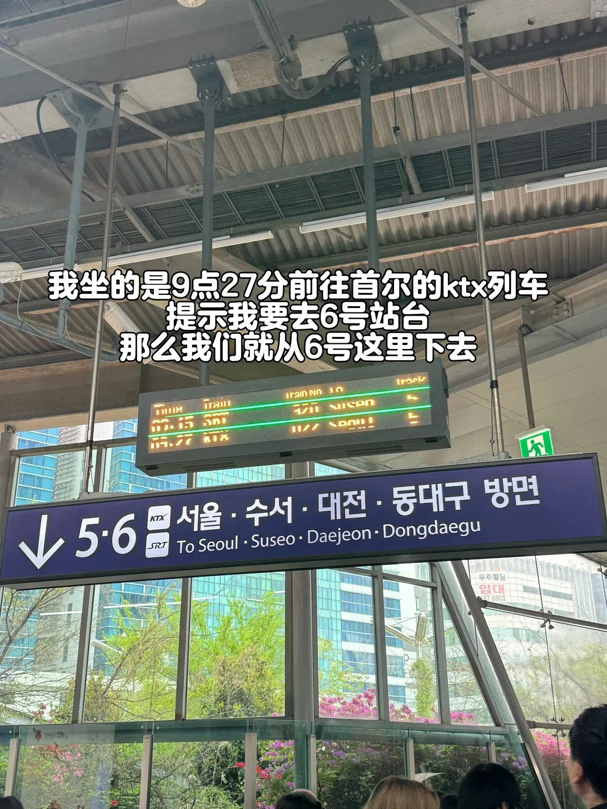

ปูซานถึงโซลเป็นเส้นทางรถไฟที่พลุกพล่านที่สุดในเกาหลี และ KTX ย่อสองเมืองให้เหลือเวลากว่าสองชั่วโมงเล็กน้อย การนั่งรู้สึกคล้ายการบินและไม่เหมือนการบินเลยในเวลาเดียวกัน: ไม่มีจุดตรวจความปลอดภัย ไม่มีประตูตั๋ว ไม่มีประกาศเรียกขึ้นรถซ้ำ ๆ ทางลำโพง — มีเพียงป้ายขาออกที่เก็บหมายเลขชานชาลาไว้จนถึงสิบห้านาทีก่อนรถออก

ต่อไปนี้จะพาผ่านการเดินทางห้าขั้นตอน — ซื้อตั๋ว เข้าสถานี หาชานชาลา เข้าที่นั่ง และถึงสถานีโซล ค่าโดยสารและเวลาในที่นี้เป็นเพียงตัวอย่าง ควรตรวจเว็บไซต์ Korail และหน้าจอที่สถานีก่อนเดินทาง

## การจอง: เว็บไซต์ทางการ แอป หรือบุคคลที่สาม

มีสองช่องทางที่ถูกต้องสำหรับตั๋ว KTX ช่องทางแรกคือเว็บไซต์ Korail และแอป Korail Talk ซึ่งคุณเลือกวันที่ ขบวนออก ตู้โดยสาร และที่นั่งเอง แล้วจ่ายด้วยบัตรต่างประเทศ ช่องทางที่สองคือแพลตฟอร์มบุคคลที่สาม เช่น Trip.com ซึ่งใช้งานเป็นภาษาจีนหรืออังกฤษและส่งอีเมลยืนยันหลังออกตั๋ว ค่าโดยสารมักเท่ากัน และชั้นมาตรฐานอยู่ที่ประมาณ 59,800 วอน ควรตรวจราคาสำหรับวันที่เดินทางกับ Korail

ตั๋วมักเปิดขายล่วงหน้าประมาณหนึ่งเดือน ในฤดูท่องเที่ยวและวันหยุดสุดสัปดาห์ ขบวนบ่ายยอดนิยมมักหมดก่อนสองหรือสามวัน เหลือแต่ขบวนเช้าตรู่และดึก หากวันที่แน่นอนแล้ว ควรจองโดยเร็วที่สุด — ขบวนเช้าหมายถึงต้องตั้งนาฬิกาปลุก แต่ก็ทำให้ถึงโซลก่อนเที่ยง

คุณสามารถเลือกตู้และที่นั่งได้ตอนจอง ที่นั่งริมหน้าต่างหรือติดทางเดินแสดงบนหน้าจอจอง และผู้ที่เดินทางกับเด็กหรือกระเป๋าใบใหญ่ควรเลือกที่นั่งใกล้ประตู

หลังชำระเงิน แพลตฟอร์มจะส่งอีเมลยืนยัน และหน้าคำสั่งซื้อแสดงรายละเอียดเดียวกัน **บันทึก PDF หรือภาพหน้าจอลงโทรศัพท์ และเก็บสำเนาไว้ในโฟลเดอร์ออฟไลน์** — ข้อมูลมือถือในสถานีไม่เสถียร การขึ้นรถไม่มีประตูกั้น แต่เจ้าหน้าที่เดินตรวจบนขบวน จึงควรเตรียมกระดาษหรือหน้าจอไว้

หากไม่ได้จอง สามารถซื้อตั๋วได้ในโถง เครื่องมีอินเทอร์เฟซภาษาอังกฤษและเคาน์เตอร์รับบัตรต่างประเทศ แม้ที่นั่งติดกันอาจหมดแล้วในชั่วโมงที่พลุกพล่าน

## การเข้า: ไม่มีจุดตรวจ ไม่มีประตู

ฝั่งรถไฟของสถานีปูซานใช้อาคารร่วมกับรถไฟใต้ดินสาย 1 เมื่อขึ้นมาจากรถไฟใต้ดิน ให้ตามป้าย KTX เหนือศีรษะ — ผ่านทางเดิน ขึ้นบันไดเลื่อน — แล้วคุณจะถึงโถงรถไฟ โลโก้ KTX สีน้ำเงินชัดตลอดทางและนำไปยังประตูตั๋ว ยกเว้นว่าที่นี่ไม่มีประตูตั๋ว

ไม่มีจุดตรวจความปลอดภัย ไม่มีสิ่งกีดขวาง: เดินเข้าทางประตูและคุณก็อยู่ระดับชานชาลาแล้ว นี่คือความแตกต่างใหญ่จากการบิน ไม่ต้องเผื่อสองชั่วโมง ไม่ต้องส่งกระเป๋าผ่านเครื่องสแกน ไม่ต้องต่อคิวประทับตรา

«ไม่ตรวจ» ไม่ได้หมายถึง «ไม่ต้องใช้» พนักงานรถไฟสุ่มตรวจ โดยเฉพาะขบวนระยะไกล เก็บตั๋วไว้ในโทรศัพท์หรือพิมพ์ใส่กระเป๋า และเตรียมบอกหมายเลขตู้และที่นั่ง

## ชานชาลา: ประกาศก่อน 15 นาที

หน้าจอหลายจอในโถงแสดงหมายเลขขบวน เวลาออก จุดหมาย และชานชาลา คอลัมน์ชานชาลาจะว่างจนถึงสิบห้านาทีก่อนออกเดินทาง ผู้มาครั้งแรกมักตกใจตรงนี้ ไม่จำเป็นเลย ปูซานเป็นปลายทางและรถจอดรอที่ชานชาลาแล้ว การรอหมายเลขจึงไม่เสียเวลา

เมื่อหน้าจออัปเดต ให้จดชานชาลาและตามป้ายเหนือศีรษะ ชานชาลาที่ปูซานแบ่งเป็นสองกลุ่ม — 1 ถึง 6 ด้านหนึ่ง 8 ถึง 11 อีกด้าน — การเลือกผิดฝั่งหมายถึงต้องเดินย้อนกลับ ป้ายสีน้ำเงินเหนือบันไดเขียนว่า «서울·수서·대전·동대구 방면» พร้อม «To Seoul · Suseo · Daejeon · Dongdaegu» ด้านล่าง จึงควรตรวจทิศทางก่อนลง

ไม่ใช่ทุกชานชาลามีบันไดเลื่อน ดังนั้นหากมีกระเป๋าหนักให้ใช้ฝั่งลิฟต์ เมื่อถึงชั้นล่าง ป้ายเสาและหน้าจอเล็กจะยืนยันขบวนและชานชาลาอีกครั้งก่อนขึ้นรถ

## ตู้โดยสารและที่นั่ง: จองแล้ว พร้อมชั้นวางด้านบน

ทุกที่นั่ง KTX เป็นที่นั่งจอง หมายเลขตู้ทาสีไว้ข้างประตู — เช่น «ตู้ 6» — และคุณหาที่นั่งจากหมายเลขบนตั๋ว หมายเลขที่นั่งอยู่บนแผ่นเล็กใต้ชั้นวางสัมภาระเหนือที่นั่ง: C คือติดทางเดิน D คือริมหน้าต่าง ตรงกับที่คุณเลือกตอนจอง

ชั้นวางเหนือที่นั่งรับกระเป๋าเล็กและกระเป๋าขนาดกลาง กระเป๋า 28 นิ้วไม่พอดี จึงควรใช้พื้นที่ปลายตู้หรือเลือกที่นั่งใกล้ประตูที่มีที่วางที่เท้า เก็บของมีค่าไว้กับตัว ทางเดินจะแน่นเมื่อถึงสถานีกลางทาง

ไม่ใช่ทุกตู้มีห้องน้ำ บางตู้มีป้าย «no toilet» ที่ประตู ต้องเดินไปตู้ถัดไป การใช้ห้องน้ำในโถงก่อนขึ้นรถช่วยลดปัญหาภายหลัง

## บนรถ: สี่ภาษา เงียบมาก ไม่มีของขาย

ตู้โดยสารเงียบเกือบสนิท คนเกาหลีไม่ค่อยรับสายบน KTX และพูดคุยเสียงเบา สิ่งที่ดังที่สุดจึงมักเป็นประกาศสถานี หากต้องรับสาย ให้ใช้ห้องโถงระหว่างตู้ซึ่งมีประตูกันเสียง

ประกาศมีภาษาเกาหลี อังกฤษ จีน และญี่ปุ่น และหน้าจอเพดานแสดงสถานีถัดไปและจุดหมายปลายทาง สถานีกลางทางจึงพลาดได้ยาก รถจอดที่แทจอน ทงแดกู และอื่น ๆ การจอดสั้น และการลงไปสูดอากาศเป็นการเสี่ยง

ไม่มีบริการรถเข็น ไม่มีน้ำฟรี ไม่มีขนม และไม่มีพนักงานเข็นรถผ่าน การซื้อน้ำและข้าวปั้นที่ร้านสะดวกซื้อในโถงก่อนขึ้นรถเป็นแผนที่ง่ายที่สุด

## ประมาณ 2 ชั่วโมง 40 นาทีถึงสถานีโซล

ปูซานถึงโซลใช้เวลาราว 2 ชั่วโมง 40 นาทีตลอดเส้นทาง ซึ่งคาดเดาได้มากกว่าการบินบวกรถรับส่งทั้งสองฝั่ง: กิมแฮถึงกิมโปใช้เวลาหนึ่งชั่วโมงบนอากาศ แต่เช็คอิน รักษาความปลอดภัย และการเดินทางเข้าเมืองมักดันเวลาเดินทางตั้งแต่ต้นทางถึงปลายทางเกินสามชั่วโมง

สถานีโซลเป็นศูนย์กลางรถไฟของประเทศและเป็นอาคารขนาดใหญ่มาก ป้ายแยกทางออกตามวัตถุประสงค์: ขบวน KTX ต่อไปยังเมืองอื่น รถไฟใต้ดินสาย 1 และ 4 และรถไฟสนามบิน AREX ไปอินชอน ล้วนเปลี่ยนสายภายในโดยไม่ต้องออกจากสถานี

มยองดงและทงแดมุนอยู่บนสาย 4; ศาลาว่าการเมืองและจงโนอยู่บนสาย 1 สำหรับสนามบินอินชอนมี AREX Express จากสถานีเดียวกัน และหากมีกระเป๋าหนัก คุณสามารถเช็คอินและฝากกระเป๋าที่ City Airport Terminal ก่อน แล้วเข้าเมืองแบบเบา ๆ

เผื่อเวลาเพิ่มยี่สิบนาทีสำหรับการหาทางในครั้งแรก ป้ายดีแต่มีหลายชั้นและหลายทางออก และการลากกระเป๋าขึ้นลงใช้เวลานานกว่าที่คิด การเปลี่ยนไปรถไฟใต้ดินหมายถึงต้องแตะผ่านอีกครั้ง และเครื่องเติมเงินในโถงรับเงินสดและบัตร

## ลิงก์ที่เกี่ยวข้อง

- **ในเว็บไซต์นี้**: [เกาหลีใต้ (KR)](/country/KR)
- **Wikipedia**: [Korea Train Express](https://en.wikipedia.org/wiki/Korea_Train_Express), [สถานีปูซาน](https://en.wikipedia.org/wiki/Busan_station), [สถานีโซล](https://en.wikipedia.org/wiki/Seoul_Station)
- **Baidu Baike**: [รถไฟความเร็วสูงเกาหลี](https://baike.baidu.com/item/%E9%9F%A9%E5%9B%BD%E9%AB%98%E9%93%81)

ค่าโดยสารและเวลาเป็นไปตามข้อมูลที่ Korail เผยแพร่ ผู้ให้บริการและหน้าจอที่สถานีคือข้อมูลที่ชี้ขาด ที่มาของภาพ: คู่มือท่องเที่ยวต้นฉบับ
