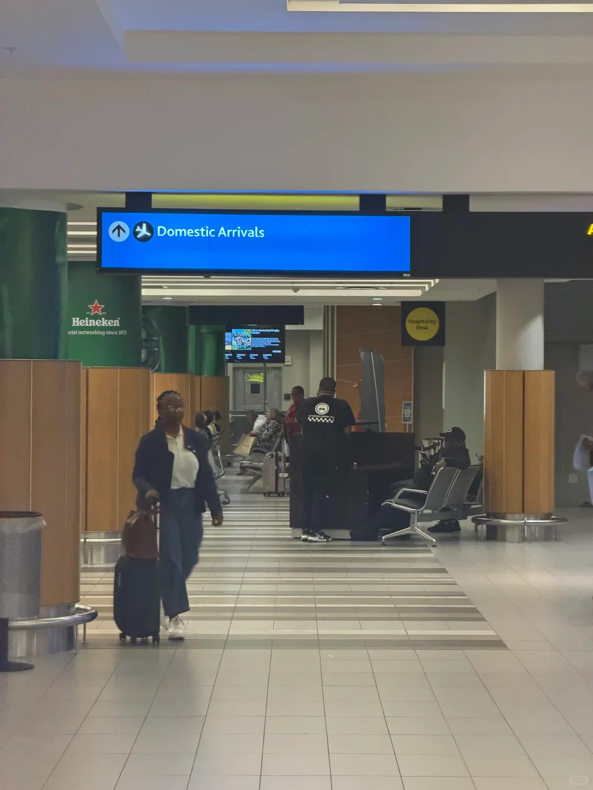
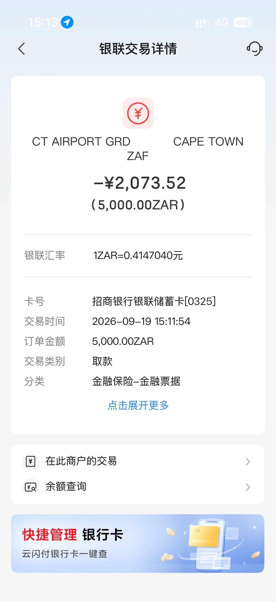

কেপ টাউন বিমানবন্দরে অবতরণের পর দুটি জিনিস সবচেয়ে জরুরি: **নগদ টাকা পাওয়া** এবং **উবারের পিকআপ খুঁজে পাওয়া**। কোনোটিই এমন জায়গায় নয় যা এক নজরে চোখে পড়ে, তাই এই গাইডে রুটগুলো বলে দেওয়া হলো।

## টাকা বিনিময়: স্ট্যান্ডার্ড ব্যাংক দিয়ে শুরু করুন

**স্ট্যান্ডার্ড ব্যাংক ভালো রেট দেয় এবং কার্যত কোনো কমিশন নেই**, যা এটিকে বিমানবন্দরের সবচেয়ে ভালো মূল্যের বিকল্পগুলোর একটি করে তোলে।

### এটিএম আন্তর্জাতিক আগমনের প্রস্থানপথে নেই

এটাই সবচেয়ে সহজ ফাঁদ: **আন্তর্জাতিক আগমনের প্রস্থানের কাছে কোনো এটিএম নেই**।

সঠিক রুট এই:

1. আন্তর্জাতিক আগমন থেকে বেরিয়ে **সোজা বাইরের দিকে হাঁটুন** যতক্ষণ না **P2**-তে পৌঁছান, যেখানে **Domestic Arrivals**-এর সাইন দেখবেন;
2. **এটিএম বাঁ দিকে, P3 Domestic Arrivals-এ।**

### একটি বাস্তব ইউনিয়নপে উইথড্রয়াল

লেখক চায়না মার্চেন্টস ব্যাংকের ইউনিয়নপে ডেবিট কার্ড দিয়ে বিমানবন্দরের এটিএম থেকে নগদ তুলেছেন: **5,000 ZAR তোলা হয়েছে, 2,073.52 CNY ডেবিট হয়েছে**, কার্যকর ইউনিয়নপে রেট প্রায় **1 ZAR = 0.4147 CNY** (মোটামুটি 1 CNY ≈ 2.41 ZAR)।

এটি স্বাভাবিক রেট, এবং **সরাসরি ইউনিয়নপে কার্ড দিয়ে টাকা তোলায় অনেক বিদেশি নগদ বহনের ঝামেলা বাঁচে**। তোলার আগে যাচাই করুন আপনার কার্ডে বিদেশে নগদ তোলার সুবিধা চালু আছে কি না এবং কোনো ফি প্রযোজ্য কি না।

## রাইড-হেইলিং: উবারের পিকআপ P6-7-এ

**উবারের পিকআপ পয়েন্ট P6-7 প্রস্থানে।** সেখানে পৌঁছাতে কেবল **Parkade 1** সাইন অনুসরণ করুন, এবং **অ্যাপে একই জায়গা সেট করুন** — নইলে সহজেই অন্য পার্কিং গ্যারেজে নিয়ে যাওয়া হতে পারে।

## কানেক্টিভিটি: ইসিম কম ঝামেলার

লেখক একটি ই-কমার্স প্ল্যাটফর্মে ইসিম কিনেছেন: **30 দিন, কল সহ, প্রায় 180 CNY**। অবতরণের পর চালু করুন, ব্যস — ফিজিক্যাল সিমের জন্য লাইনে দাঁড়াতে হবে না।

## সারসংক্ষেপ

| কী করতে হবে | কোথায় |
| --- | --- |
| স্ট্যান্ডার্ড ব্যাংকে টাকা বিনিময় | বিমানবন্দরের ভিতরে, ভালো রেট, কমিশন নেই |
| এটিএম থেকে নগদ তোলা | সোজা বাইরে P2 পর্যন্ত, তারপর **বাঁ দিকে P3 Domestic Arrivals** |
| উবার ধরতে | **P6-7 প্রস্থান**, Parkade 1 সাইন অনুসরণ করে |
| ফোন কার্ড | আগে থেকেই ইসিম কিনুন, বা বিমানবন্দর কাউন্টারে ফিজিক্যাল সিম নিন |

> দক্ষিণ আফ্রিকার অনেক জায়গায় এখনও নগদ চলে (টিপস, রাস্তার দোকান, কিছু কার পার্ক), তাই সামান্য খুচরা টাকা সাথে রাখুন; বড় কেনাকাটায় কার্ডে দিন।
