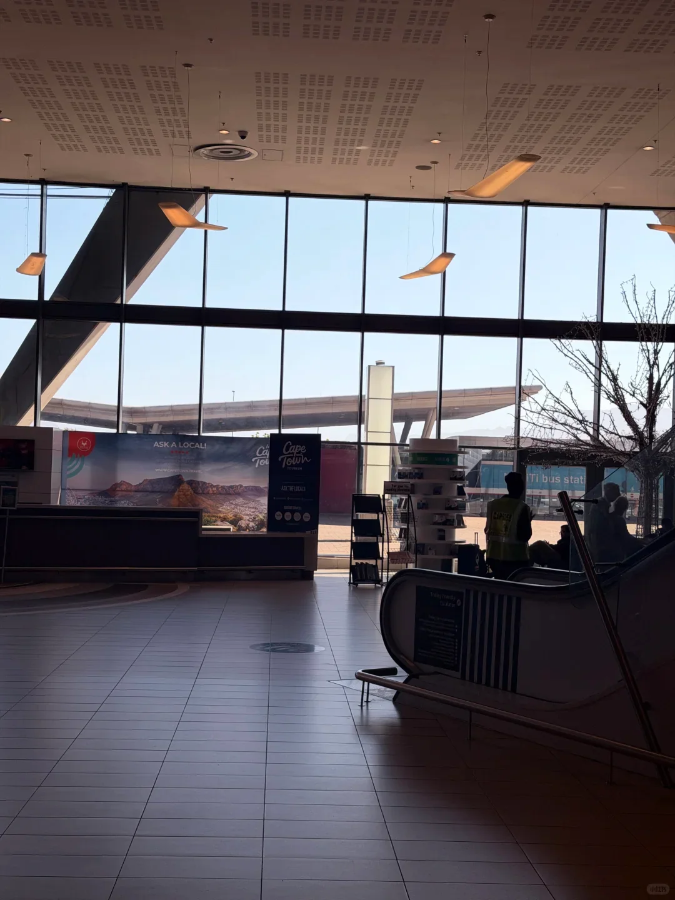

Když přistanete na letišti v Kapském Městě, nejdůležitější jsou dvě věci: **získat hotovost** a **najít místo vyzvednutí Uberu**. Ani jedno není na místě, kterého byste si na první pohled všimli, takže tento průvodce ukazuje trasy.

## Směnárna: začněte u Standard Bank

**Standard Bank nabízí dobrý kurz a v podstatě žádnou provizi**, což z něj dělá jednu z výhodnějších možností na letišti.

### Bankomat není u východu z mezinárodního příletu

To je nejjednodušší past: **u východu z mezinárodního příletu žádný bankomat není**.

Správná trasa je tato:

1. Při odchodu z mezinárodního příletu **jděte rovně ven**, dokud nedorazíte k **P2**, kde uvidíte značky **Domestic Arrivals**;
2. **Bankomat je na levé straně u P3 Domestic Arrivals.**

### Skutečný výběr kartou UnionPay

Autor vybral hotovost z letištního bankomatu debetní kartou UnionPay China Merchants Bank: **vybráno 5 000 ZAR, odepsáno 2 073,52 CNY**, což je efektivní kurz UnionPay asi **1 ZAR = 0,4147 CNY** (zhruba 1 CNY ≈ 2,41 ZAR).

To je normální kurz a **výběr přímo kartou UnionPay vás ušetří starostí s nošením velké částky cizí hotovosti**. Před výběrem si ověřte, že máte kartu povolenou pro výběry v zahraničí a zda se neúčtuje poplatek.

## Přivolání odvozu: Uber vyzvedává u P6-7

**Místo vyzvednutí Uberu je u východu P6-7.** Stačí se držet značek **Parkade 1** a **stejné místo nastavte v aplikaci** — jinak vás snadno odvezou do jiné parkovací garáže.

## Připojení: eSIM je méně starostí

Autor koupil eSIM na e-shopové platformě: **30 dní, včetně volání, kolem 180 CNY**. Aktivujte ji po přistání a je to — žádná fronta na fyzickou SIM.

## Shrnutí

| Co udělat | Kde |
| --- | --- |
| Směnit peníze ve Standard Bank | uvnitř letiště, dobrý kurz, bez provize |
| Vybrat hotovost z bankomatu | rovnou ven k P2, pak **na levé straně u P3 Domestic Arrivals** |
| Chytit Uber | **východ P6-7**, následujte značky Parkade 1 |
| Telefonní karta | kupte si eSIM předem, nebo si vezměte fyzickou SIM u přepážky na letišti |

> V Jižní Africe mnoho míst stále přijímá hotovost (spropitné, pouliční stánky, některá parkoviště), takže u sebe mějte trochu drobných; větší nákupy plaťte kartou.
