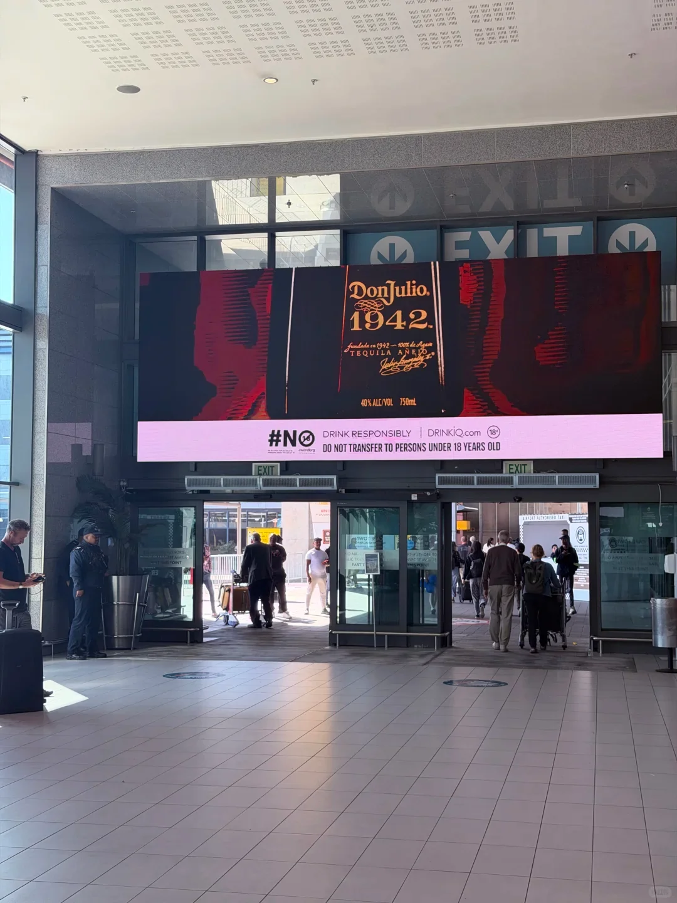

Begitu Anda mendarat di Bandara Cape Town, dua hal paling penting: **mendapatkan uang tunai** dan **menemukan titik penjemputan Uber**. Keduanya tidak berada di tempat yang akan Anda perhatikan sekilas, jadi panduan ini memaparkan rutenya.

## Penukaran uang: mulai dari Standard Bank

**Standard Bank menawarkan kurs yang baik dan praktis tanpa komisi**, yang menjadikannya salah satu pilihan bernilai lebih baik di bandara.

### ATM tidak berada di pintu keluar kedatangan internasional

Ini jebakan yang paling mudah dimasuki: **tidak ada ATM di dekat pintu keluar kedatangan internasional**.

Berikut rute yang benar:

1. Keluar dari kedatangan internasional, **berjalan lurus ke depan menuju luar** sampai Anda mencapai **P2**, tempat Anda akan melihat papan menuju **Kedatangan Domestik**;
2. **ATM berada di sisi kiri di P3 Kedatangan Domestik.**

### Penarikan UnionPay sungguhan

Penulis menarik uang tunai dari ATM bandara dengan kartu debit UnionPay China Merchants Bank: **5.000 ZAR ditarik, 2.073,52 CNY didebit**, kurs efektif UnionPay sekitar **1 ZAR = 0,4147 CNY** (kira-kira 1 CNY ≈ 2,41 ZAR).

Itu kurs normal, dan **menarik langsung dengan kartu UnionPay menghemat kerumitan membawa banyak uang tunai asing**. Sebelum menarik, periksa apakah kartu Anda diaktifkan untuk penarikan tunai luar negeri dan apakah ada biaya.

## Ride-hailing: penjemputan Uber di P6-7

**Titik penjemputan Uber berada di pintu keluar P6-7.** Ikuti saja papan **Parkade 1** untuk sampai ke sana, dan **tetapkan titik yang sama di aplikasi** — jika tidak, Anda mudah dibawa ke garasi parkir lain.

## Konektivitas: eSIM lebih praktis

Penulis membeli eSIM di platform e-commerce: **30 hari, termasuk panggilan, sekitar 180 CNY**. Aktifkan saat mendarat dan Anda siap — tidak perlu antre untuk SIM fisik.

## Ringkasan

| Yang harus dilakukan | Di mana |
| --- | --- |
| Tukar uang di Standard Bank | Di dalam bandara, kurs baik, tanpa komisi |
| Tarik uang tunai dari ATM | Lurus keluar ke P2, lalu **sisi kiri di P3 Kedatangan Domestik** |
| Naik Uber | **Pintu keluar P6-7**, mengikuti papan Parkade 1 |
| Kartu telepon | Beli eSIM terlebih dahulu, atau dapatkan SIM fisik di loket bandara |

> Banyak tempat di Afrika Selatan masih menerima uang tunai (tip, kios jalanan, beberapa tempat parkir), jadi simpan sedikit uang kecil; bayar dengan kartu untuk pembelian yang lebih besar.
