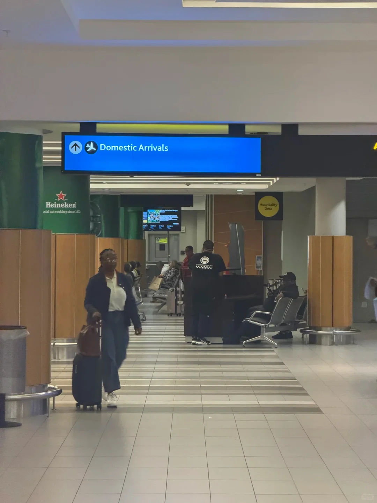
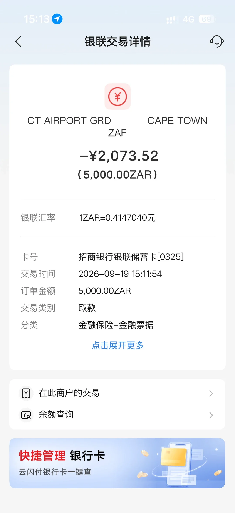
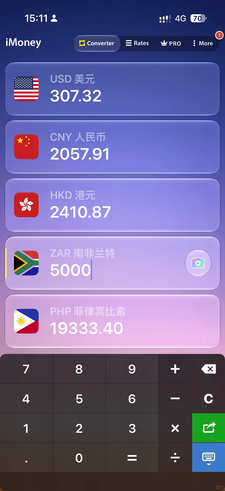
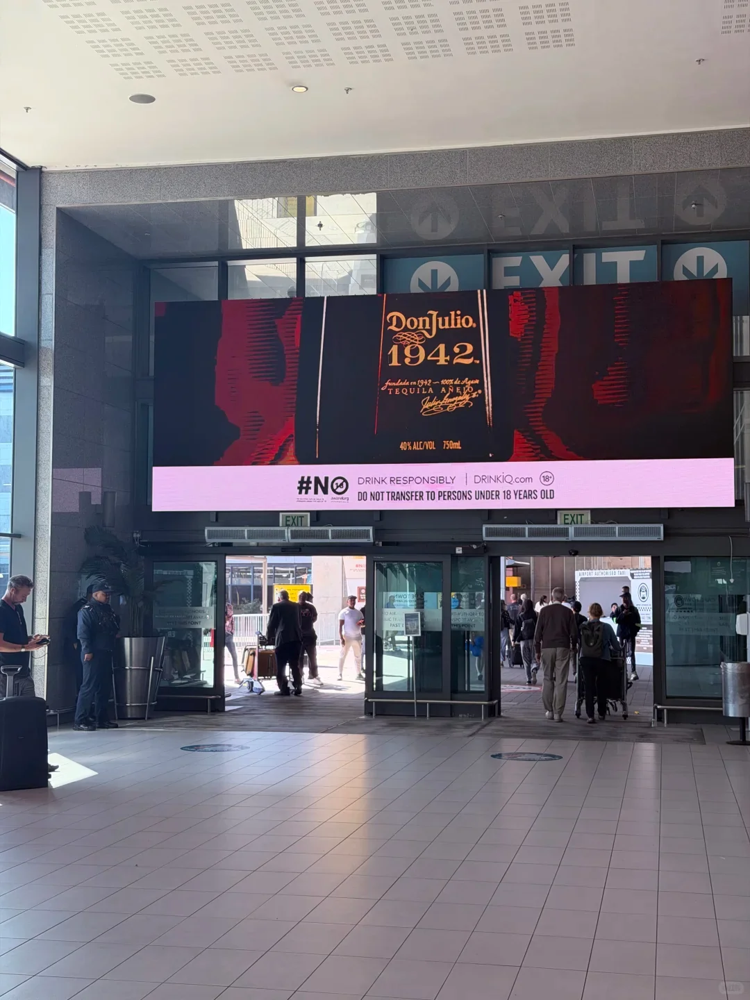
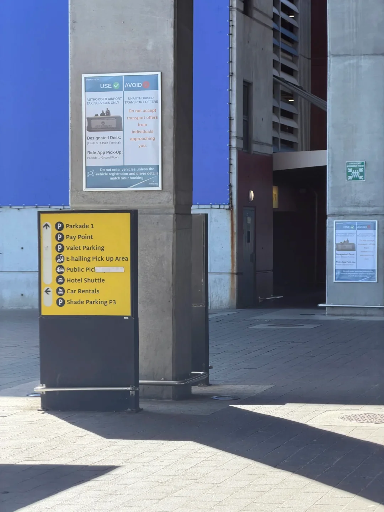

开普敦机场落地后，两件事最要紧：**换到现金**、**找到 Uber 上车点**。这两处都不在「一眼就能看到」的位置，这篇把路线说清。

## 换汇：先找 Standard Bank

**Standard Bank 的汇率不错，基本没有手续费**，是机场里比较划算的选择。

### ATM 不在国际到达出口

这是最容易踩的坑：**国际到达出口附近没有 ATM**。

正确走法是：

1. 出了国际到达，**一直往外直走**，走到 **P2**，看到「**Domestic Arrivals**（国内到达）」的指示；
2. **ATM 在 P3 国内到达的左手边**。

### 银联卡取现实测

作者用招商银行银联储蓄卡在机场 ATM 取现：**取出 5,000 兰特，扣款 2,073.52 元人民币**，银联汇率约 **1 兰特 = 0.4147 元**（即 1 元 ≈ 2.41 兰特）。

这个汇率算正常水平，**直接用银联卡取现省去了带大量外币现金的麻烦**。取现前先确认自己的卡是否开通境外取现、是否收取手续费。

## 打车：Uber 上车点在 P6-7

**Uber 的上车点在 P6-7 出口**。跟着「**Parkade 1**」的指示走就能到，**在 App 里定位也要选这里**——否则容易被带到别的停车楼。

## 网络：eSIM 更省事

作者在电商平台买的 eSIM：**30 天、含通话，约 180 元**。落地激活就能用，不用排队买实体卡。

## 小结

| 要做的事 | 位置 |
| --- | --- |
| Standard Bank 换汇 | 机场内，汇率好、无手续费 |
| ATM 取现 | 出门直走到 P2，**P3 国内到达左手边** |
| Uber 上车 | **P6-7 出口**，跟 Parkade 1 指示 |
| 电话卡 | eSIM 提前买，或机场柜台办实体卡 |

> 南非用现金的地方不少（小费、路边摊、部分停车场），建议随身留一点零钞；大额消费刷卡即可。
