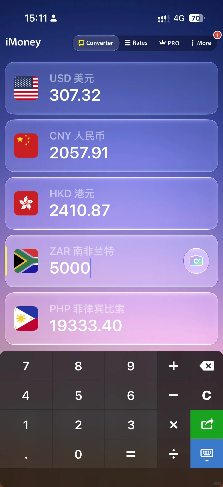
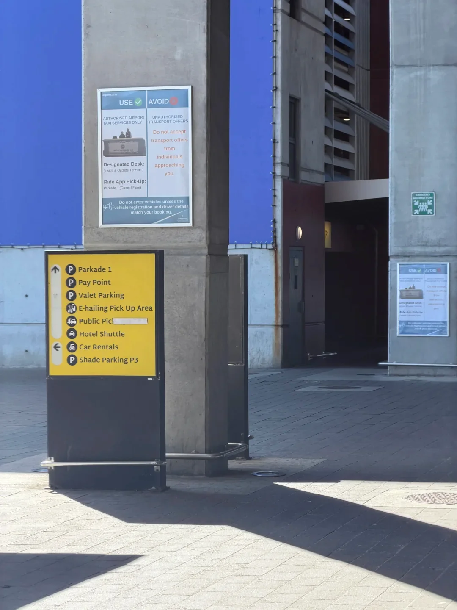

После прилёта в аэропорт Кейптауна важнее всего две вещи: **получить наличные** и **найти место посадки Uber**. Ни то ни другое не бросается в глаза, поэтому гид раскладывает маршруты.

## Обмен валюты: начните со Standard Bank

**Standard Bank предлагает хороший курс и практически без комиссии**, что делает его одним из самых выгодных вариантов в аэропорту.

### Банкомат не у выхода международного прилёта

Это самая лёгкая ловушка: **у выхода международного прилёта банкомата нет**.

Вот правильный маршрут:

1. Выйдя из международного прилёта, **идите прямо на улицу**, пока не дойдёте до **P2**, где увидите указатели **Domestic Arrivals**;
2. **Банкомат находится слева у P3 Domestic Arrivals.**

### Реальное снятие по UnionPay

Автор снял наличные в банкомате аэропорта дебетовой картой UnionPay China Merchants Bank: **снято 5 000 ZAR, списано 2 073,52 CNY**, эффективный курс UnionPay — около **1 ZAR = 0,4147 CNY** (примерно 1 CNY ≈ 2,41 ZAR).

Это нормальный курс, и **прямое снятие картой UnionPay избавляет от хлопот с перевозкой крупной суммы иностранной наличности**. Перед снятием проверьте, включены ли на карте зарубежные снятия и есть ли комиссия.

## Поездки с водителем: посадка Uber у P6-7

**Точка посадки Uber находится у выхода P6-7.** Просто идите по указателям **Parkade 1**, и **отметьте то же место в приложении** — иначе легко уехать в другой паркинг.

## Связь: eSIM меньше хлопот

Автор купил eSIM на торговой площадке: **30 дней, звонки включены, около 180 CNY**. Активируйте по прилёте — и всё готово, без очереди за физической SIM-картой.

## Итог

| Что сделать | Где |
| --- | --- |
| Обменять деньги в Standard Bank | Внутри аэропорта, хороший курс, без комиссии |
| Снять наличные в банкомате | Прямо к P2, затем **слева у P3 Domestic Arrivals** |
| Поймать Uber | **Выход P6-7**, по указателям Parkade 1 |
| Сим-карта | Купить eSIM заранее или физическую SIM на стойке в аэропорту |

> Во многих местах ЮАР до сих пор принимают наличные (чаевые, уличные лотки, некоторые парковки), поэтому держите немного мелочи; крупные покупки оплачивайте картой.
