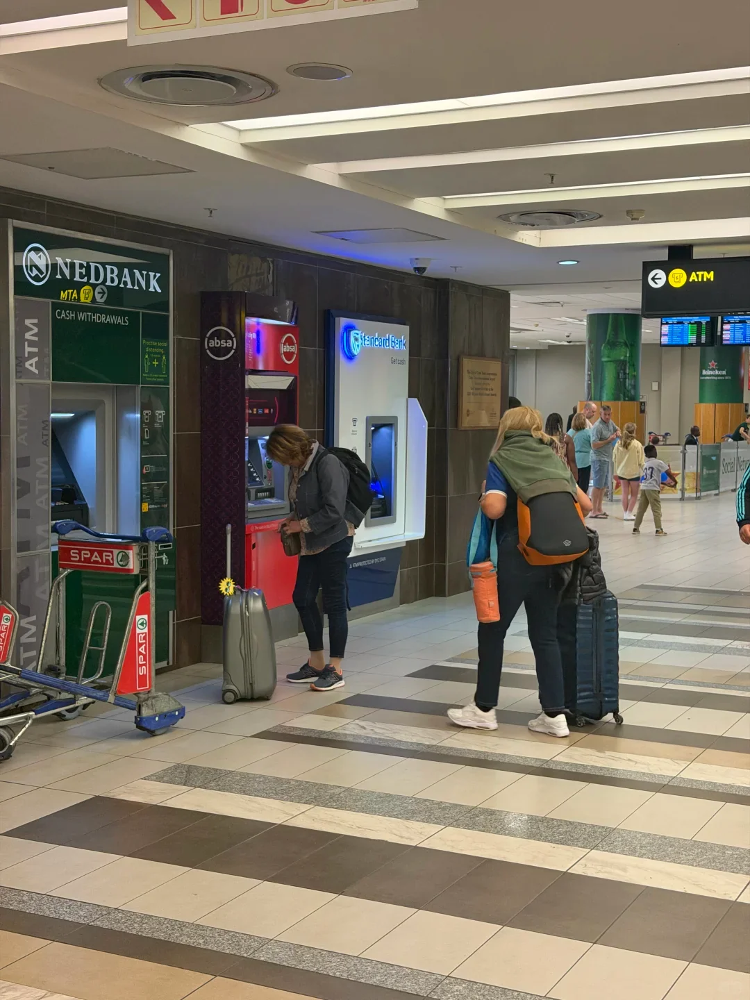

Щойно ви прилітаєте в аеропорт Кейптауна, найважливіші дві речі — **отримати готівку** й **знайти місце посадки в Uber**. Жодне з них не впадає у вічі з першого погляду, тож цей путівник прокладає маршрути.

## Обмін грошей: почніть зі Standard Bank

**Standard Bank дає хороший курс і практично без комісії**, що робить його одним із вигідніших варіантів в аеропорту.

### Банкомат не біля виходу з міжнародних прильотів

Це найпростіша пастка: **біля виходу з міжнародних прильотів банкомату немає**.

Ось правильний маршрут:

1. Вийшовши з міжнародних прильотів, **ідіть прямо надвір**, доки не дійдете до **P2**, де побачите вказівники **Domestic Arrivals**;
2. **Банкомат — ліворуч біля P3 Domestic Arrivals.**

### Реальне зняття готівки UnionPay

Автор зняв готівку в банкоматі аеропорту дебетовою карткою UnionPay China Merchants Bank: **знято 5 000 рандів, списано 2 073,52 юаня**, що дає ефективний курс UnionPay близько **1 ранд = 0,4147 юаня** (приблизно 1 юань ≈ 2,41 ранда).

Це звичайний курс, і **зняття напряму карткою UnionPay позбавляє клопоту везти велику суму іноземної готівки**. Перед зняттям перевірте, чи ваша картка дозволяє зняття готівки за кордоном і чи стягується комісія.

## Виклик авто: посадка в Uber — біля P6-7

**Місце посадки в Uber — біля виходу P6-7.** Просто йдіть за вказівниками **Parkade 1**, щоб туди дістатися, і **позначте те саме місце в застосунку** — інакше вас легко завезуть до іншого паркінгу.

## Зв'язок: eSIM — менше клопоту

Автор купив eSIM на торговельній платформі: **30 днів, із дзвінками, близько 180 юанів**. Активуйте після прильоту — і все готово, без черги за фізичною SIM-карткою.

## Підсумок

| Що зробити | Де |
| --- | --- |
| Обміняти гроші у Standard Bank | Усередині аеропорту, хороший курс, без комісії |
| Зняти готівку в банкоматі | Прямо до P2, далі **ліворуч біля P3 Domestic Arrivals** |
| Викликати Uber | **Вихід P6-7**, за вказівниками Parkade 1 |
| Телефонна картка | Купіть eSIM заздалегідь або візьміть фізичну SIM на стійці в аеропорту |

> У ПАР багато місць досі приймають готівку (чайові, вуличні лотки, деякі паркінги), тож тримайте трохи дрібних; великі покупки платіть карткою.
