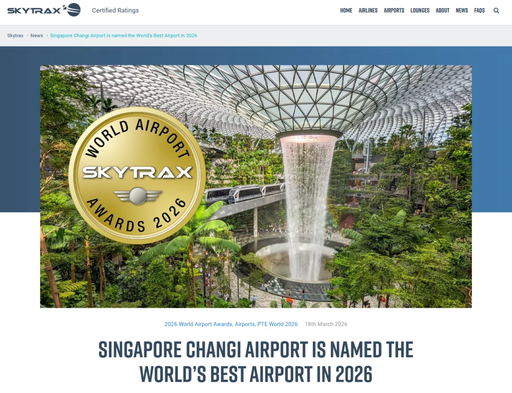
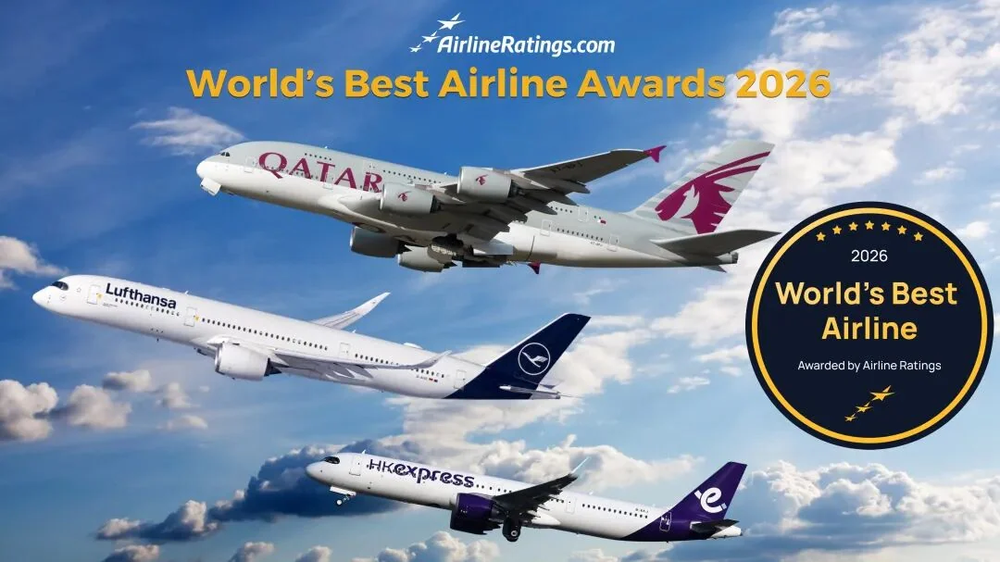

Die World Airport Awards wurden am 18. März in London verkündet, und der Flughafen Singapur Changi (SIN) wurde zum weltbesten Flughafen 2026 gekürt – im zweiten Jahr in Folge und zum 14. Mal, dass er diesen Titel errungen hat.

Für einen Flughafen, der bereits 13 Mal auf Platz eins stand, ist das „schon wieder“ nicht die eigentliche Geschichte. Die Breite ist es. Neben dem Hauptpreis gewann Changi die Auszeichnungen für das weltbeste Flughafen-Dining, den weltbesten Flughafen-Immigrationsservice, den besten Flughafen Asiens und den besten Flughafen mit 60–70 Millionen Passagieren; das an Terminal 3 angeschlossene Crowne Plaza Changi Airport holte sowohl den Titel „Bestes Flughafenhotel der Welt“ als auch „Bestes Flughafenhotel Asiens“. Fünf Flughafen-Trophäen und zwei Hotel-Trophäen aus einem einzigen Award-Programm sind ein seltener Durchmarsch.

## 1. Fünf Auszeichnungen: was tatsächlich gewonnen wurde

Beginnen wir mit der Liste. Die World Airport Awards werden vom britischen Beratungsunternehmen Skytrax durchgeführt und beruhen auf Umfragen zur Passagierzufriedenheit, die 575 Flughäfen abdecken; deshalb gibt es in dem Programm zwei Arten von Preisen: die Gesamtwertung und Kategorien, die nach Etappe der Reise oder nach Flughafengröße aufgeteilt sind.

| Auszeichnung | Gewinner |
| --- | --- |
| Weltbester Flughafen | Flughafen Changi (14. Mal, zweites Jahr in Folge) |
| Bestes Flughafen-Dining der Welt | Flughafen Changi |
| Bester Flughafen-Immigrationsservice der Welt | Flughafen Changi |
| Bester Flughafen Asiens | Flughafen Changi |
| Bester Flughafen mit 60–70 Millionen Passagieren | Flughafen Changi |
| Bestes Flughafenhotel der Welt | Crowne Plaza Changi Airport |
| Bestes Flughafenhotel Asiens | Crowne Plaza Changi Airport |

Nur eine der fünf Flughafenauszeichnungen ist der Gesamttitel; die übrigen betreffen Gastronomie, Einreise, Region und Größe. Den Hauptpreis und vier verschiedene Kategoriesiege im selben Jahr zu holen, deutet darauf hin, dass die Stärke nicht in einem einzelnen herausragenden Merkmal liegt, sondern in einem durchgängig hohen Niveau über die gesamte Reise hinweg.

## 2. Warum Dining und Einreise die aussagekräftigeren Preise sind

Bei Flughafenpreisen allgemein wird „bester Flughafen“ meist von Architektur und Retail-Fläche bestimmt. Dining und Einreise sind schwerer zu messende operative Größen.

Dining misst Auswahl, Preis und Beständigkeit: ob ein Passagier mit zwei Stunden Umsteigezeit ein richtiges Essen findet, ob die Menüs verschiedene Ernährungsweisen berücksichtigen, ob bei einem späten Abflug noch etwas geöffnet ist. Das entsteht nicht durch eine einzelne Renovierung; es braucht Jahre des Mietermanagements und der Mietstrukturen. Changis Ruf in Sachen Essen verdankt sich zu einem großen Teil dem Umstand, dass die Hawker-Kultur Singapurs in die Terminals geholt wurde, statt nur Fast-Food-Ketten anzubieten.

Einreise ist noch direkter: Sie misst den Durchsatz an den Schaltern, die Klarheit der Beschilderung und den Umgang des Personals mit den Menschen. Für einen Flughafen, der um Transfers herum gebaut ist, ist dies die Kategorie, die Transitpassagiere kaum bemerken – aber für alle, die tatsächlich nach Singapur einreisen, ist sie das erste Tor nach der Landung. Hier zu gewinnen deutet darauf hin, dass Changi in die menschliche Seite des Prozesses ebenso viel Aufwand steckt wie in die Technik.

## 3. Das Transitmodell: aus einem Zwischenstopp einen Aufenthalt machen

Um zu verstehen, warum diese Preise immer wieder bei Changi landen, muss man seine Struktur ansehen. Der Flughafen wurde 1981 eröffnet, hat vier Terminals, ist Heimatbasis von Singapore Airlines und einer der wichtigsten Umsteigepunkte auf der Kette Europa–Südostasien–Australien. Ein großer Teil seiner Passagiere geht nie durch die Einreise; sie gehen einfach von einem Gate zum anderen.

Diese stark transitgeprägte Mischung bedeutet, dass der Flughafen die Umsteigezeit als Produkt behandeln muss. Die Terminals sind durch eine automatische Peoplemover-Bahn und Shuttlebusse verbunden, und die meisten Umsteigepassagiere müssen nicht nach Singapur einreisen, obwohl ein Terminalwechsel weiterhin eine Stunde Puffer verdient. Jewel Changi Airport, 2019 eröffnet, setzte den Rain Vortex, eine Waldlandschaft und Einzelhandel zwischen die Terminals – eine Antwort auf die Frage, was ein Passagier mit vier Stunden Wartezeit damit anfangen soll. Der Wasserfall, der im Titelbild von der Kuppel stürzt, ist der klarste Ausdruck dieser Idee.

Die Spannung in diesem Modell liegt darin, dass ein Zielflughafen zwei Zielgruppen gleichzeitig bedienen muss. Transitpassagiere wollen einen kurzen, vorhersehbaren Weg; lokale Besucher und Passagiere mit viel Zeit wollen Geschäfte, Restaurants und Attraktionen. Changi hält Jewel für die meisten Reisenden außerhalb des Transitbereichs, was die Umsteigeströme schützt, den Wasserfall aber zu einem Umweg statt zu einer Abkürzung macht. Deshalb ist der Einreisepreis kommerziell ebenso wichtig wie operativ: Je leichter der Flughafen zu betreten und zu verlassen ist, desto leichter lässt sich ein Zwischenstopp statt eines Anschlusses verkaufen.

Terminal 5, derzeit im Bau, ist die nächste Stufe desselben Modells. Kurzfristig werden Passagiere die Züge zwischen den Terminals und die Beschilderung bemerken; langfristig hängt es davon ab, ob das neue Gebäude die Umsteigeströme bündeln kann, die derzeit über vier Terminals verteilt sind.

## 4. Die andere Liste jener Woche: Singapore Airlines Dritter, Scoot Fünfter

Abseits des Flughafens hatten Singapurs Airlines in einem separaten Ranking eine gute Woche. Bei den World's Best Airline Awards 2026 von AirlineRatings.com belegte Singapore Airlines Platz drei unter den Full-Service-Carriern, hinter Qatar Airways und Cathay Pacific.

Die Jury von AirlineRatings hob Singapore Airlines für eine ausgewogene, starke Leistung über Economy, Premium Economy, Business und First hinweg hervor – dieselbe Logik wie bei Changis Preisen: kein Sieg in einer einzelnen Kabinenklasse, sondern Beständigkeit.

In der Billigflugkategorie belegte Scoot, Teil der Singapore Airlines Group, Platz fünf. Scoot hat seine Flotte von Boeing 787 Dreamliner und sein Netz über Asien-Pazifik hinaus ausgebaut, und die Bewertung spiegelt ein Gleichgewicht aus Preis und Servicequalität. Für Reisende bedeutet das sowohl eine Full-Service- als auch eine Billigflugoption, wenn sie in Singapur starten oder dort umsteigen.

## 5. Was das für Reisende bedeutet

Setzt man die Trophäen zurück in eine Reiseroute, weist jede auf einen anderen Teil der Reise hin. Wenn Sie in Changi nur umsteigen, zählen der Dining-Preis und der Gesamttitel am meisten: Planen Sie zwei bis drei Stunden ein, dann können Sie für eine richtige lokale Mahlzeit die Terminals wechseln und sind trotzdem wieder am Gate. Jewel eignet sich besser für Anschlüsse von vier Stunden oder mehr, aber rechnen Sie Einreise und erneute Sicherheitskontrolle ein, wenn Sie den Transitbereich verlassen wollen.

Wenn Sie nach Singapur einreisen, ist der Einreisepreis der relevante. Die Abfertigung in Changi ist meist schneller als der regionale Durchschnitt, aber die Schlangen wachsen trotzdem, wenn Urlaubsverkehr und frühmorgendliche Ankünfte zusammenkommen, und das Ausfüllen der elektronischen Einreisekarte im Voraus spart Zeit am Schalter.

Was „weltbester“ angeht: Behandeln Sie es als eine Information, nicht als Garantie. Auf derselben Liste lag Seoul Incheon auf Platz zwei, Tokio Haneda auf drei und Hongkong International auf vier, mit London Heathrow auf 16, Melbourne auf 21 und London Gatwick auf 30. Die Abstände zwischen diesen Positionen kommen meist auf eine Handvoll konkreter Prozesse zurück. Was entscheidet, ob Ihre Reise reibungslos läuft, sind weiterhin der Flugplan, die Umsteigezeit und Ihre Dokumente.

## Weiterführende Links

- **Auf dieser Seite**: [Flughafen Singapur Changi (SIN)](/airport/SIN), [Singapur (SG)](/country/SG)
- **Wikipedia**: [Singapore Changi Airport](https://en.wikipedia.org/wiki/Singapore_Changi_Airport), [Singapore Airlines](https://en.wikipedia.org/wiki/Singapore_Airlines)
- **Baidu Baike**: [Singapore Changi Airport](https://baike.baidu.com/item/%E6%96%B0%E5%8A%A0%E5%9D%A1%E6%A8%9F%E5%AE%9C%E6%9C%BA%E5%9C%BA), [Singapore Airlines](https://baike.baidu.com/item/%E6%96%B0%E5%8A%A0%E5%9D%A1%E8%88%AA%E7%A9%BA)

Bildquelle: Skytrax, AirlineRatings.com und SgEye. Award-Namen, Ranglisten und Kriterien entsprechen den Veröffentlichungen der Veranstalter; prüfen Sie beim Flughafen Changi und bei der Immigration & Checkpoints Authority die aktuellen Terminalverbindungen und Einreisebestimmungen.
