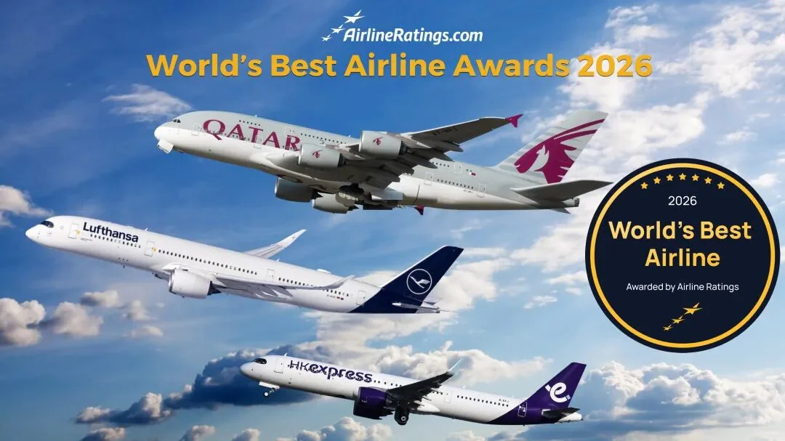

World Airport Awards diumumkan di London pada 18 Maret, dan Bandara Singapura Changi (SIN) dinobatkan sebagai Bandara Terbaik Dunia 2026 — tahun kedua berturut-turut dan ke-14 kalinya bandara ini meraih gelar tersebut.

Bagi bandara yang sudah 13 kali menempati peringkat pertama, “lagi” bukanlah inti ceritanya. Luasnya cakupan itulah yang menarik. Selain hadiah utama, Changi memenangkan Makanan Bandara Terbaik Dunia, Layanan Imigrasi Bandara Terbaik Dunia, Bandara Terbaik di Asia, dan Bandara Terbaik 60–70 juta penumpang; Crowne Plaza Changi Airport, yang terhubung ke Terminal 3, meraih Hotel Bandara Terbaik Dunia dan Hotel Bandara Terbaik di Asia. Lima trofi bandara dan dua trofi hotel dari satu program penghargaan adalah kemenangan menyeluruh yang langka.

## 1. Lima penghargaan: apa yang sebenarnya diraih

Mulailah dari daftarnya. World Airport Awards dijalankan oleh konsultan Inggris Skytrax dan berdasarkan survei kepuasan penumpang yang mencakup 575 bandara, itulah sebabnya program ini memiliki dua jenis hadiah: peringkat keseluruhan, dan kategori yang dibagi menurut bagian perjalanan atau ukuran bandara.

| Penghargaan | Pemenang |
| --- | --- |
| Bandara Terbaik Dunia | Bandara Changi (ke-14 kalinya, tahun kedua berturut-turut) |
| Makanan Bandara Terbaik Dunia | Bandara Changi |
| Layanan Imigrasi Bandara Terbaik Dunia | Bandara Changi |
| Bandara Terbaik di Asia | Bandara Changi |
| Bandara Terbaik 60–70 juta penumpang | Bandara Changi |
| Hotel Bandara Terbaik Dunia | Crowne Plaza Changi Airport |
| Hotel Bandara Terbaik di Asia | Crowne Plaza Changi Airport |

Hanya satu dari lima penghargaan bandara itu yang merupakan gelar keseluruhan; sisanya menunjuk pada makanan, imigrasi, kawasan, dan ukuran. Meraih hadiah utama dan empat kategori berbeda pada tahun yang sama menunjukkan bahwa kekuatannya bukan satu fitur yang menonjol, melainkan standar dasar yang konsisten tinggi di sepanjang perjalanan.

## 2. Mengapa makanan dan imigrasi adalah penghargaan yang layak diperhatikan

Dalam penghargaan bandara pada umumnya, “bandara terbaik” cenderung ditentukan oleh arsitektur dan ruang ritel. Makanan dan imigrasi adalah ukuran operasional yang lebih sulit.

Makanan mengukur pilihan, harga, dan konsistensi: apakah penumpang dengan waktu transit dua jam dapat menemukan makanan yang layak, apakah menunya mengakomodasi berbagai pola makan, apakah masih ada yang buka menjelang keberangkatan larut malam. Itu tidak dihasilkan oleh satu renovasi saja; dibutuhkan bertahun-tahun pengelolaan penyewa dan struktur sewa. Reputasi Changi dalam hal makanan banyak berkat penempatan budaya hawker Singapura di dalam terminal, bukan hanya menawarkan makanan cepat saji berjaringan.

Imigrasi bahkan lebih langsung: ia mengukur laju pemrosesan di loket, kejelasan papan petunjuk, dan cara staf menangani orang. Bagi bandara yang dibangun di sekitar transfer, ini adalah kategori yang hampir tidak diperhatikan penumpang transit — tetapi bagi siapa pun yang benar-benar memasuki Singapura, inilah gerbang pertama setelah mendarat. Menang di sini menunjukkan bahwa Changi menaruh usaha yang sama besarnya pada sisi manusiawi proses tersebut seperti pada perangkat kerasnya.

## 3. Model transit: mengubah persinggahan menjadi masa menginap

Untuk melihat mengapa penghargaan-penghargaan ini terus jatuh ke Changi, lihat strukturnya. Bandara ini dibuka pada 1981, memiliki empat terminal, menjadi basis utama Singapore Airlines, dan merupakan salah satu titik pertukaran terpenting dalam rantai Eropa–Asia Tenggara–Australia. Sebagian besar penumpangnya tidak pernah melewati imigrasi; mereka hanya berjalan dari satu gerbang ke gerbang lain.

Komposisi yang sangat padat transit itu berarti bandara harus memperlakukan waktu koneksi sebagai produk. Terminal-terminal dihubungkan oleh people mover otomatis dan bus antar-jemput, dan sebagian besar penumpang transit tidak perlu memasuki Singapura, meskipun pergantian terminal tetap memerlukan cadangan waktu satu jam. Jewel Changi Airport, yang dibuka pada 2019, menempatkan Rain Vortex, lanskap hutan, dan area ritel di antara terminal-terminal — sebuah jawaban atas pertanyaan apa yang harus dilakukan penumpang yang punya empat jam untuk menunggu. Air terjun yang jatuh dari kubah pada gambar sampul adalah ungkapan paling jelas dari gagasan itu.

Ketegangan dalam model ini adalah bahwa bandara tujuan harus melayani dua audiens sekaligus. Penumpang transit menginginkan jalan kaki yang singkat dan dapat diprediksi; pengunjung lokal dan penumpang yang punya banyak waktu menginginkan toko, restoran, dan atraksi. Changi menempatkan Jewel di luar area transit bagi sebagian besar pelancong, yang melindungi arus transfer tetapi mengubah air terjun itu menjadi jalan memutar, bukan jalan pintas. Itulah juga sebabnya penghargaan imigrasi penting secara komersial sama seperti secara operasional: semakin mudah bandara dimasuki dan ditinggalkan, semakin mudah pula menjual persinggahan, bukan sekadar koneksi.

Terminal 5, yang kini sedang dibangun, adalah tahap berikutnya dari model yang sama. Dalam jangka pendek penumpang akan memperhatikan kereta antarterminal dan papan petunjuknya; dalam jangka panjang, semuanya bergantung pada apakah bangunan baru itu dapat menyatukan arus transfer yang saat ini tersebar di empat terminal.

## 4. Daftar lain minggu itu: Singapore Airlines ketiga, Scoot kelima

Di luar bandara, maskapai-maskapai Singapura mengalami minggu yang baik pada peringkat terpisah. Dalam World's Best Airline Awards 2026 dari AirlineRatings.com, Singapore Airlines menempati peringkat ketiga di antara maskapai full-service, di belakang Qatar Airways dan Cathay Pacific.

Panel juri AirlineRatings menyoroti Singapore Airlines karena kinerjanya yang seimbang dan kuat di kelas ekonomi, ekonomi premium, bisnis, dan kelas pertama — logika yang sama dengan penghargaan Changi: bukan kemenangan pada satu kabin, melainkan konsistensi.

Di kategori berbiaya rendah, Scoot, bagian dari Singapore Airlines Group, menempati peringkat kelima. Scoot telah memperluas armada Boeing 787 Dreamliner dan jaringannya di seluruh Asia-Pasifik dan sekitarnya, dan penilaian itu mencerminkan keseimbangan antara harga dan kualitas layanan. Bagi pelancong, ini berarti tersedia pilihan full-service maupun berbiaya rendah saat berangkat dari atau transit melalui Singapura.

## 5. Artinya bagi pelancong

Kembalikan trofi-trofi itu ke dalam rencana perjalanan dan masing-masing menunjuk ke bagian perjalanan yang berbeda. Jika Anda hanya transit di Changi, penghargaan makanan dan gelar keseluruhan paling penting: sisakan dua hingga tiga jam dan Anda dapat menyeberangi terminal untuk menikmati makanan lokal yang layak lalu kembali ke gerbang. Jewel lebih cocok untuk koneksi empat jam atau lebih, tetapi perhitungkan imigrasi dan pemeriksaan ulang jika Anda berencana meninggalkan area transit.

Jika Anda memasuki Singapura, penghargaan imigrasi adalah yang relevan. Pemrosesan di Changi biasanya lebih cepat daripada rata-rata kawasan, tetapi antrean tetap menumpuk ketika arus liburan dan kedatangan pagi hari bertemu, dan mengisi kartu kedatangan elektronik terlebih dahulu menghemat waktu di loket.

Adapun “terbaik dunia”, anggap itu sebagai masukan, bukan jaminan. Dalam daftar yang sama, Seoul Incheon kedua, Tokyo Haneda ketiga, dan Hong Kong Internasional keempat, dengan London Heathrow ke-16, Melbourne ke-21, dan London Gatwick ke-30. Selisih antarposisi itu biasanya bertumpu pada segelintir proses spesifik. Yang menentukan lancar tidaknya perjalanan Anda tetap jadwal, waktu koneksi, dan dokumen Anda.

## Tautan terkait

- **Di situs ini**: [Bandara Singapura Changi (SIN)](/airport/SIN), [Singapura (SG)](/country/SG)
- **Wikipedia**: [Bandara Singapura Changi](https://en.wikipedia.org/wiki/Singapore_Changi_Airport), [Singapore Airlines](https://en.wikipedia.org/wiki/Singapore_Airlines)
- **Baidu Baike**: [Bandara Singapura Changi](https://baike.baidu.com/item/%E6%96%B0%E5%8A%A0%E5%9D%A1%E6%A8%9F%E5%AE%9C%E6%9C%BA%E5%9C%BA), [Singapore Airlines](https://baike.baidu.com/item/%E6%96%B0%E5%8A%A0%E5%9D%A1%E8%88%AA%E7%A9%BA)

Sumber gambar: Skytrax, AirlineRatings.com, dan SgEye. Nama penghargaan, peringkat, dan kriteria sesuai yang diterbitkan penyelenggara; periksa Bandara Changi dan Immigration & Checkpoints Authority untuk koneksi terminal dan persyaratan masuk yang berlaku saat ini.
