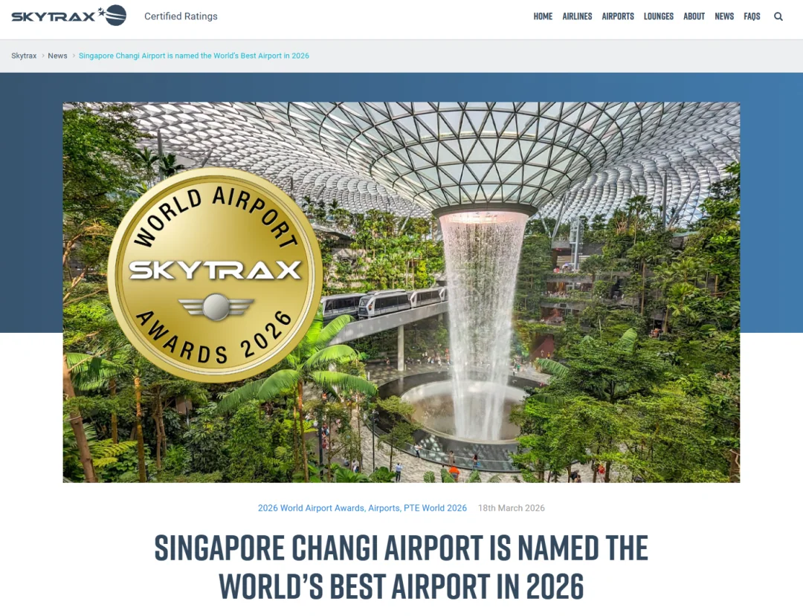

งานประกาศรางวัล World Airport Awards จัดขึ้นที่ลอนดอนเมื่อวันที่ 18 มีนาคม และสนามบินชางงีของสิงคโปร์ (SIN) ได้รับการขนานนามว่าเป็นสนามบินที่ดีที่สุดในโลกประจำปี 2026 — เป็นปีที่สองติดต่อกันและเป็นครั้งที่ 14 ที่คว้ารางวัลนี้

สำหรับสนามบินที่เคยถูกจัดอันดับเป็นที่หนึ่งมาแล้ว 13 ครั้ง คำว่า "อีกครั้ง" ไม่ใช่เรื่องน่าสนใจ สิ่งที่น่าสนใจคือความกว้างของรางวัลต่างหาก นอกเหนือจากรางวัลใหญ่ ชางงียังชนะรางวัล World's Best Airport Dining, World's Best Airport Immigration Service, Best Airport in Asia และ Best Airport 60–70 million passengers ส่วน Crowne Plaza Changi Airport ซึ่งเชื่อมต่อกับอาคารผู้โดยสาร 3 คว้ารางวัล World's Best Airport Hotel และ Best Airport Hotel in Asia ทั้งสองรางวัล การได้ถ้วยรางวัลสนามบิน 5 ใบและโรงแรม 2 ใบจากงานประกาศรางวัลเดียวกันถือเป็นการกวาดรางวัลที่หาได้ยาก

## 1. ห้ารางวัล: สิ่งที่ได้รับจริง ๆ

เริ่มจากรายการก่อน World Airport Awards จัดโดย Skytrax ที่ปรึกษาสัญชาติอังกฤษ และอ้างอิงจากการสำรวจความพึงพอใจของผู้โดยสารครอบคลุม 575 สนามบิน จึงมีรางวัลสองแบบ: อันดับโดยรวม และหมวดหมู่ที่แบ่งตามช่วงของการเดินทางหรือขนาดของสนามบิน

| รางวัล | ผู้ชนะ |
| --- | --- |
| World's Best Airport | สนามบินชางงี (ครั้งที่ 14, ปีที่สองติดต่อกัน) |
| World's Best Airport Dining | สนามบินชางงี |
| World's Best Airport Immigration Service | สนามบินชางงี |
| Best Airport in Asia | สนามบินชางงี |
| Best Airport 60–70 million passengers | สนามบินชางงี |
| World's Best Airport Hotel | Crowne Plaza Changi Airport |
| Best Airport Hotel in Asia | Crowne Plaza Changi Airport |

ในบรรดารางวัลสนามบินทั้งห้า มีเพียงรางวัลเดียวที่เป็นตำแหน่งโดยรวม ส่วนที่เหลือชี้ไปที่การรับประทานอาหาร การตรวจคนเข้าเมือง ภูมิภาค และขนาด การคว้ารางวัลใหญ่และรางวัลหมวดหมู่อีกสี่ประเภทในปีเดียวกันบ่งชี้ว่าความแข็งแกร่งไม่ได้มาจากจุดเด่นเพียงอย่างเดียว แต่มาจากมาตรฐานที่สูงสม่ำเสมอตลอดการเดินทาง

## 2. ทำไมรางวัลด้านอาหารและการตรวจคนเข้าเมืองจึงน่าอ่าน

โดยทั่วไปในรางวัลสนามบิน "สนามบินที่ดีที่สุด" มักถูกกำหนดโดยสถาปัตยกรรมและพื้นที่ค้าปลีก ส่วนอาหารและการตรวจคนเข้าเมืองเป็นตัววัดการดำเนินงานที่ยากกว่า

อาหารวัดทางเลือก ราคา และความสม่ำเสมอ: ผู้โดยสารที่มีเวลาต่อเครื่องสองชั่วโมงจะหาอาหารจริงจังได้หรือไม่ เมนูรองรับอาหารหลากหลายหรือไม่ มีอะไรเปิดอยู่ช่วงเที่ยวบินออกดึกหรือไม่ สิ่งเหล่านี้ไม่ได้เกิดจากการปรับปรุงครั้งเดียว แต่ต้องใช้การบริหารผู้เช่าและโครงสร้างค่าเช่าหลายปี ชื่อเสียงด้านอาหารของชางงีส่วนใหญ่มาจากการนำวัฒนธรรมอาหารข้างถนนของสิงคโปร์เข้ามาในอาคารผู้โดยสาร แทนที่จะมีเพียงฟาสต์ฟู้ดแบบเชน

การตรวจคนเข้าเมืองเป็นตัววัดที่ตรงกว่า: วัดปริมาณผู้โดยสารที่เคาน์เตอร์ ความชัดเจนของป้าย และวิธีที่เจ้าหน้าที่ดูแลผู้คน สำหรับสนามบินที่สร้างขึ้นเพื่อการต่อเครื่อง นี่คือหมวดที่ผู้โดยสารเปลี่ยนเครื่องแทบไม่สังเกตเห็น แต่สำหรับผู้ที่เข้าเมืองสิงคโปร์จริง ๆ มันคือด่านแรกหลังลงเครื่อง การชนะรางวัลที่นี่บ่งชี้ว่าชางงีทุ่มเทให้กับด้านมนุษย์ของกระบวนการพอ ๆ กับด้านฮาร์ดแวร์

## 3. โมเดลการเปลี่ยนเครื่อง: เปลี่ยนการหยุดพักให้เป็นการเข้าพัก

เพื่อดูว่าทำไมรางวัลเหล่านี้จึงตกอยู่ที่ชางงีบ่อยครั้ง ให้มองโครงสร้างของมัน สนามบินเปิดในปี 1981 มีสี่อาคารผู้โดยสาร เป็นฐานหลักของสายการบินสิงคโปร์ และเป็นหนึ่งในจุดเปลี่ยนเครื่องสำคัญบนเส้นทางยุโรป–เอเชียตะวันออกเฉียงใต้–ออสเตรเลีย ผู้โดยสารจำนวนมากไม่ผ่านการตรวจคนเข้าเมือง พวกเขาเพียงเดินจากประตูขึ้นเครื่องหนึ่งไปยังอีกประตูหนึ่ง

สัดส่วนการเปลี่ยนเครื่องที่สูงหมายความว่าสนามบินต้องมองเวลาเปลี่ยนเครื่องเป็นผลิตภัณฑ์ อาคารผู้โดยสารเชื่อมต่อกันด้วยรถไฟอัตโนมัติและรถรับส่ง และผู้โดยสารเปลี่ยนเครื่องส่วนใหญ่ไม่จำเป็นต้องเข้าเมืองสิงคโปร์ แม้ว่าการเปลี่ยนอาคารยังควรเผื่อเวลาหนึ่งชั่วโมง Jewel Changi Airport ซึ่งเปิดในปี 2019 ได้นำ Rain Vortex ภูมิทัศน์ป่า และพื้นที่ค้าปลีกมาไว้ระหว่างอาคารผู้โดยสาร — เป็นคำตอบสำหรับคำถามที่ว่าผู้โดยสารที่มีเวลารอสี่ชั่วโมงควรทำอะไรกับเวลาเหล่านั้น น้ำตกที่ตกลงมาจากโดมในภาพหน้าปกคือการแสดงออกที่ชัดเจนที่สุดของแนวคิดนี้

ความตึงเครียดในโมเดลคือสนามบินปลายทางต้องตอบสนองผู้ชมสองกลุ่มพร้อมกัน ผู้โดยสารเปลี่ยนเครื่องต้องการทางเดินสั้นและคาดเดาได้ ส่วนผู้มาเยือนในพื้นที่และผู้โดยสารที่มีเวลาเหลือต้องการร้านค้า ร้านอาหาร และสถานที่ท่องเที่ยว ชางงีวาง Jewel ไว้นอกพื้นที่เปลี่ยนเครื่องสำหรับผู้เดินทางส่วนใหญ่ ซึ่งช่วยรักษากระแสการเปลี่ยนเครื่องแต่ทำให้น้ำตกกลายเป็นการอ้อมมากกว่าทางลัด นั่นก็เป็นเหตุผลที่รางวัลด้านการตรวจคนเข้าเมืองมีความสำคัญเชิงพาณิชย์พอ ๆ กับเชิงปฏิบัติการ: ยิ่งสนามบินเข้าและออกง่ายเท่าไร ก็ยิ่งขายการหยุดพักระหว่างทางได้ง่ายกว่าการต่อเครื่องเพียงอย่างเดียว

อาคารผู้โดยสาร 5 ซึ่งอยู่ระหว่างการก่อสร้างคือขั้นต่อไปของโมเดลเดียวกัน ในระยะสั้นผู้โดยสารจะสังเกตเห็นรถไฟระหว่างอาคารและป้ายบอกทาง ในระยะยาวขึ้นอยู่กับว่าอาคารใหม่จะรวมกระแสการเปลี่ยนเครื่องที่ปัจจุบันกระจายอยู่สี่อาคารได้หรือไม่

## 4. อีกรายการในสัปดาห์เดียวกัน: สายการบินสิงคโปร์อันดับสาม, Scoot อันดับห้า

นอกเหนือจากสนามบิน สายการบินของสิงคโปร์มีสัปดาห์ที่ดีในอีกรายการหนึ่ง ใน World's Best Airline Awards 2026 ของ AirlineRatings.com สายการบินสิงคโปร์อยู่ในอันดับสามในกลุ่มสายการบินเต็มรูปแบบ รองจาก Qatar Airways และ Cathay Pacific

คณะกรรมการตัดสินของ AirlineRatings ชี้ให้เห็นว่าสายการบินสิงคโปร์มีผลงานที่สมดุลและแข็งแกร่งในชั้นประหยัด พรีเมียมอีโคโนมี ธุรกิจ และชั้นหนึ่ง — ตรรกะเดียวกับรางวัลของชางงี: ไม่ใช่ชัยชนะของห้องโดยสารชั้นเดียว แต่คือความสม่ำเสมอ

ในหมวดสายการบินต้นทุนต่ำ Scoot ซึ่งเป็นส่วนหนึ่งของกลุ่มสายการบินสิงคโปร์ อยู่ในอันดับห้า Scoot กำลังขยายฝูงบิน Boeing 787 Dreamliner และเครือข่ายทั่วเอเชียแปซิฟิกและไกลออกไป และการจัดอันดับสะท้อนความสมดุลระหว่างราคากับคุณภาพบริการ สำหรับผู้เดินทางหมายความว่ามีทั้งตัวเลือกสายการบินเต็มรูปแบบและต้นทุนต่ำเมื่อเริ่มต้นหรือต่อเครื่องที่สิงคโปร์

## 5. สิ่งนี้หมายความอย่างไรสำหรับผู้เดินทาง

นำถ้วยรางวัลกลับมาวางในแผนเดินทาง แล้วแต่ละรางวัลชี้ไปยังส่วนต่าง ๆ ของทริป หากคุณเพียงต่อเครื่องที่ชางงี รางวัลด้านอาหารและตำแหน่งโดยรวมสำคัญที่สุด: เผื่อเวลาไว้สองถึงสามชั่วโมง แล้วคุณสามารถข้ามอาคารไปกินอาหารท้องถิ่นจริงจังและกลับมาที่ประตูขึ้นเครื่องได้ทัน Jewel เหมาะกับการต่อเครื่องสี่ชั่วโมงขึ้นไป แต่ต้องคำนึงถึงการตรวจคนเข้าเมืองและการตรวจรักษาความปลอดภัยซ้ำหากวางแผนจะออกจากพื้นที่เปลี่ยนเครื่อง

หากคุณเข้าเมืองสิงคโปร์ รางวัลด้านการตรวจคนเข้าเมืองคือรางวัลที่เกี่ยวข้อง การผ่านด่านที่ชางงีมักเร็วกว่าค่าเฉลี่ยของภูมิภาค แต่คิวยังคงยาวเมื่อการเดินทางช่วงวันหยุดและเที่ยวบินขาเข้าช่วงเช้ามืดมาบรรจบกัน และการกรอกบัตรขาเข้าอิเล็กทรอนิกส์ล่วงหน้าช่วยประหยัดเวลาที่เคาน์เตอร์

ส่วนคำว่า "ที่ดีที่สุดในโลก" ให้มองเป็นข้อมูลนำเข้าไม่ใช่การรับประกัน ในรายการเดียวกัน โซลอินชอนอยู่อันดับสอง โตเกียวฮาเนดะอันดับสาม และฮ่องกงอินเตอร์เนชันแนลอันดับสี่ โดยลอนดอนฮีทโธรว์อันดับ 16 เมลเบิร์นอันดับ 21 และลอนดอนแกตวิกอันดับ 30 ช่องว่างระหว่างอันดับเหล่านี้มักขึ้นอยู่กับกระบวนการเฉพาะไม่กี่อย่าง สิ่งที่ตัดสินว่าการเดินทางของคุณจะราบรื่นหรือไม่ยังคงเป็นตารางบิน เวลาเปลี่ยนเครื่อง และเอกสารของคุณ

## ลิงก์ที่เกี่ยวข้อง

- **ในเว็บไซต์นี้**: [สนามบินชางงีสิงคโปร์ (SIN)](/airport/SIN), [สิงคโปร์ (SG)](/country/SG)
- **Wikipedia**: [สนามบินชางงีสิงคโปร์](https://en.wikipedia.org/wiki/Singapore_Changi_Airport), [สายการบินสิงคโปร์](https://en.wikipedia.org/wiki/Singapore_Airlines)
- **Baidu Baike**: [สนามบินชางงีสิงคโปร์](https://baike.baidu.com/item/%E6%96%B0%E5%8A%A0%E5%9D%A1%E6%A8%9F%E5%AE%9C%E6%9C%BA%E5%9C%BA), [สายการบินสิงคโปร์](https://baike.baidu.com/item/%E6%96%B0%E5%8A%A0%E5%9D%A1%E8%88%AA%E7%A9%BA)

ที่มาของภาพ: Skytrax, AirlineRatings.com และ SgEye ชื่อรางวัล อันดับ และเกณฑ์เป็นไปตามที่ผู้จัดงานเผยแพร่ ตรวจสอบการเชื่อมต่อระหว่างอาคารผู้โดยสารและข้อกำหนดการเข้าประเทศล่าสุดได้ที่สนามบินชางงีและ Immigration & Checkpoints Authority
